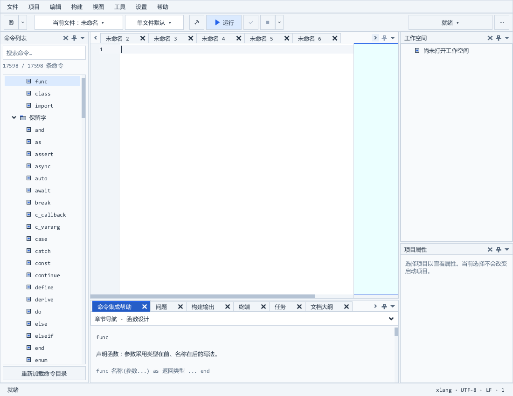

# IDE Dock 标签按钮同步验收

上一版 XGE 固定在 4d402c08，标签导航功能随后才进入 1312f035。本轮同步对应 DLL、导入库、声明头和编译配置；IDE 创建 Dock 时显式启用标签滚动按钮。保留既有 OpenGL 3.3／WGL 启动修正。

左右箭头仅在标签溢出、且对应方向仍可滚动时出现；滚动不切换当前编辑文档。右侧窗格菜单可选择全部标签。42 项原生检查覆盖首端、中间、尾端、双向点击、列表选取、布局重载及开关；实际 release/win_x64 下再次通过。输入、IME、设置、默认自动诊断、原生动作和大字号字体回归合计六组通过。正式 GUI 通过会话副本恢复及 100%／125%／200% DPI 渲染检查。

receipt.json 为入口，acceptance.json 汇总通过的原始测试行。native-r1 留有已修正的测试源码编译警告，完整原始记录保留。测试先隔离保护正在运行的用户 IDE；用户关闭后安装，并在正式目录复测。用户设置、编译器和语言服务器保留。源码、匹配 SDK 和运行库身份均记录；本轮是 Windows IDE 专项验收。

