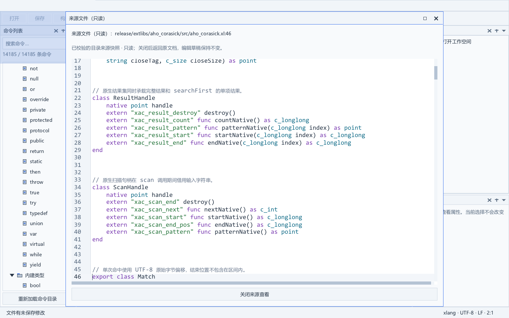

# IDE 扩展库命令覆盖审计

日期：2026-10-31。范围为当前根目录发布树；不修改编译器主线、XRT、TCC 或冻结的六个编译器二进制。

## 覆盖结果

| 项目 | 原目录 | 更新后 |
| --- | ---: | ---: |
| 扩展模块 | 227（含失效包和内部包） | 207 个活动公共包 |
| 扩展条目 | 3,039 | 11,441 |
| 语言/标准库条目 | 2,744 | 2,744，逐项保持不变 |
| 总条目 | 5,783 | 14,185 |
| 共享文档 | 45 | 134（6 份设计资料 + 128 份 README） |
| 实际引用的可校验来源 | 335 | 596，无缺失 |

扩展条目分类：函数 5,525、成员方法/属性/构造 3,157、常量 1,941、字段 329、类型 281、模块 207、变量 1。25 个类型为工厂等公开签名暴露的未直接导出类型，允许查看实例表面，但明确提示不能按模块名直接构造，不进入全局静态补全。

完整活动包集合、输入/工具/前端指纹和公开 AST 种类位于 `ide/data/commands.json` 的 `extensionCatalog`；每条命令包含真实签名、参数、默认值、返回、显式导入和原始来源位置。同名不同签名各自保留，属性读写也各有一条。

清理失效模块：`acme`、`docx`、`duckdb`、`ffmpeg`、`grpc`、`jwt`、`libtorch`、`nats`、`oauth2`、`protobuf`、`quic`、`stablediffusion`、`tensorrt`、`webrtc`、`xlsx`。同时不再公开 `_bzip2`、`_expat`、`_libzip`、`_tomlc17`、`_xge_native`、`_zlib` 六个内部依赖。新增活动模块 `xacme`。这里依据当前发布目录同步，不执行包源码删除或重新分类成熟度。

净增加 8,402 条扩展记录；按稳定 ID 比较新增 9,163、移除 761，包含真实签名纠正所产生的 ID 替换，不能把它们全部当成新增语言能力。

## 原因与实现

旧生成器遗漏了 `export_const`/`export_var` 的独立 AST 形态、字段、let、部分类型和未导出返回对象；类型/泛型/默认值的文本还可能被签名猜测截断。旧快照与已移除包、内部依赖也未同步。

现在复用未修改的共享 lexer/parser/AST，导出声明的编译器 UTF-8 半开范围。大类成员分别输出；普通/原生类、重载、get/let、工厂可达类型均走同一遍提取。保留固定语言/标准库原始资料与版本证据，扩展按当前源单独刷新；不依赖缺失的旧标准库编译缓存，不调用扩展本体，也不修改冻结运行库。

目录和来源沿用原发布器成对事务发布；原始来源及工具按字节保留，避免 Git 自动行尾转换破坏指纹。没有来源不猜测帮助内容，没有发布通过证明不标成“成熟”。

## 本轮验证

- 真实声明工具的 11 项聚焦测试全部通过：中文/UTF-8/BOM/CRLF、嵌套默认值、两种可变参数、静态成员、重载、get/let、枚举载荷、私有边界、工厂可达类型、API/包删项、坏源拒绝、1,800 方法大类及完整资料/新鲜度负例。
- 全部 207 个公共包的声明解析成功；596 个来源可验证，所有条目和文档行号都在对应来源范围内，ID 无重复；2,744 条非扩展记录与原目录逐项一致。
- 同输入重复生成时，目录及来源索引摘要完全相同，新增/删除条目数为零。目录 SHA-256：`38243d6328d5cbff57adc79cb1cd8cd399bd5118fa1352c1c1e5c74cfb6e605d`。
- 原生 `catalog_test` 严格 GCC 构建并通过；确认新字段/变量读取、工厂类型限制、签名、检索、C 隔离及失败后保留旧目录。
- 发布器 14 项检查通过：正常/首次发布、重复发布、四阶段异常回滚、真实进程中断恢复、锁及外部篡改拒绝。修正的是测试工具复制副本前未统一 Windows 长路径的问题，没有放宽产品发布验证。
- 复用已严格编译的 107 个 IDE 对象，真实链接并运行 `catalog_view_test`、`help_document_test`、`catalog_source_view_test`，三项均通过。覆盖原生检索/帮助/补全隔离、72 章节菜单、全部来源读取和 62 项来源窗口断言；保存了 4 张真实截图。
- 8 个冻结文件（六个 Windows/Linux 编译器产物、两份运行库头）逐项 SHA-256 不变；没有修改仓库根 `src/` 或运行库实现。

现场证据：`build/test/ide_catalog_20261031/` 下的 `complete-pair/generation-report.json`、`unit-complete/report.json`、`native-final-run.json`、`ui/report.json`、`publication-long/publication-e8404fa9bc/evidence.json`、`frozen.after.json`。已使用现有事务发布器安装至 `ide/data`，新鲜度检查返回 current。

## 不冒充已完成的部分

207 个公共包表示当前声明覆盖，不表示 207 个包均已完善或成熟；普通扩展长期任务仍按原 100 包验收矩阵维护。

帮助内容仍需在逐包开发中补充：79 个包没有 README；11,234 条非模块扩展记录中 10,784 条没有逐 API 说明，当前扩展声明没有内嵌 `#doc example`，4,485 条可关联包 README。缺失的说明/范例在 IDE 中明确显示缺失状态，不凭函数名编造。新提取器已测试 `#doc`，以后补文档可随声明自动进入列表。

尝试完整 IDE 重建时，语言服务器构建的既有前端摘要锁拒绝当前 `xl6_sem_index.c`，报 `shared index changed; audit typed arena/JSON budget separation and unchanged collector rules`。107 个 IDE 模块已严格编译，但没有产出/重发完整 IDE 便携包；上述三个聚焦原生界面测试不代替完整语言服务器验收。后续须由对应上下文审计前端适配和版本锁，不能仅改摘要跳过验证。

总扩展发布脚本本轮仍报 7 项既有问题：shellwords 四处 Windows 路径示例被绝对路径检查命中、xacme 两处 README 路径命中、`concurrent` 导入被判为缺包。新目录检查独立通过；此记录不宣称总发布门已绿，也不在 IDE 工作中擅改其他包或标准模块规则。

词法调试 JSON 的 EOF 裸 NUL 另记于 `dev/extlib_blockers/ide_lex_json_eof_control.md`，未修改主线或引入宽松读取回退。完整标准库重生成也未执行，因为本工作树没有其固定构建缓存。

后续新增/删除功能必须同阶段同步，执行[长期同步规则](扩展库IDE命令目录同步规则.md)。
