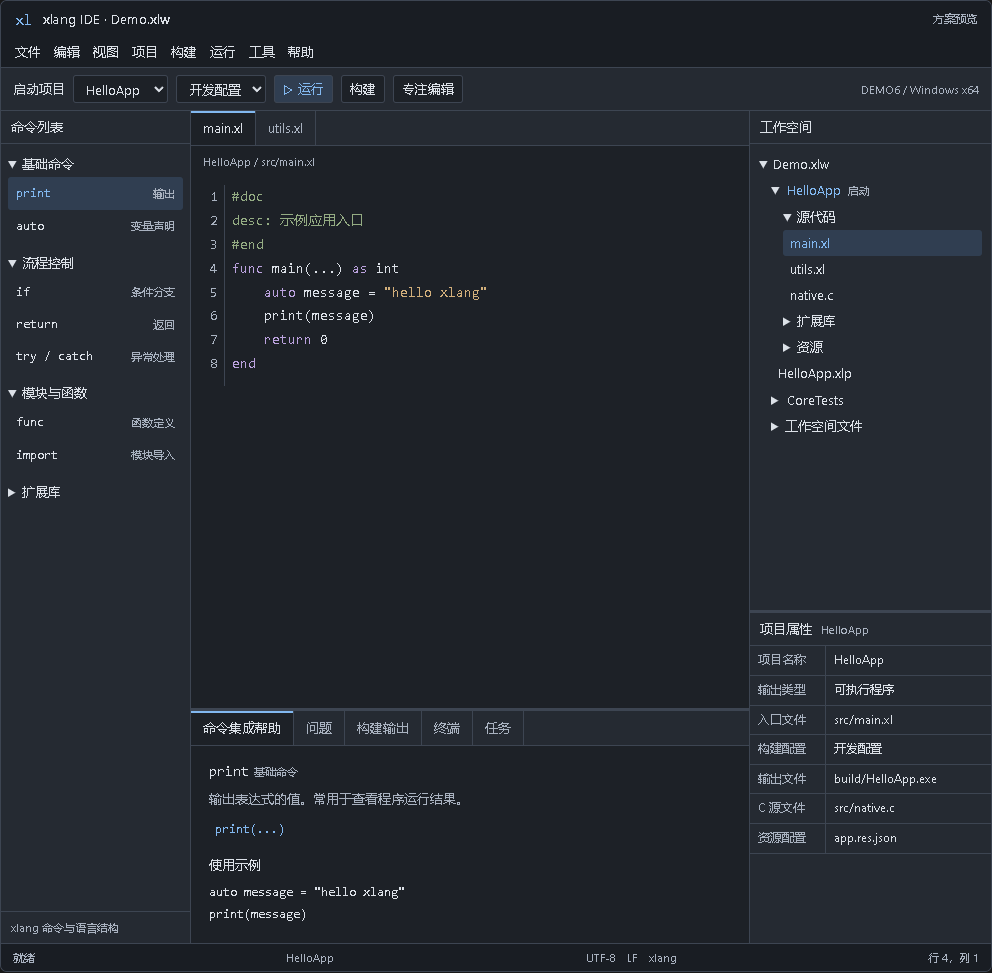

# xlang IDE

2026-10-22 已支持 C／xlang 单文件、独立 `.xlp` 和 `.xlw` 工作空间构建运行。无项目时 F7／F5 使用当前源文件；项目上下文保持所选／启动目标规则，新增“项目 → 构建当前文件／构建并运行当前文件”。显式源文件启动优先于历史工作空间恢复。严格构建 `cb-bd75b462` 为 88 个编译对象／109 项产物，构建期间源码变化为空。20 个相关原生 fixture、40 项单文件断言、7 次真实主程序入口与便携验收通过；发布目录已更新。SDK、默认编译器和 C 服务器沿用上一候选。本轮为相关范围回归，未重复全量标准／ABI 专项。见 [四种构建形态](docs/standalone-builds.md) 和 [当前候选](CURRENT-CANDIDATE.md)。

2026-10-21 当前版本已升级为 **XGE 3.0.0**，完成文本／DPI、资源、编译器时间协议及原生窗口消息链适配。`release/xlang_ide.exe` 可直接启动，`dist` 保留新的已核验便携包。更新说明见 [XGE 3 更新](docs/xge3-upgrade.md)，精确版本与验收范围见 [当前候选](CURRENT-CANDIDATE.md)。

2026-10-21 已整理工作区：`release` 是当前已验证便携候选的完整运行副本，`dist` 只保留该候选及其 ZIP、收据。旧候选、测试程序、探针、旧构建和受保护状态已移到工作区外的可恢复归档。日常开发使用 `build_current.bat`，避免把测试产物写回发布目录；目录分工与归档位置见[工作区与发布目录](docs/workspace-hygiene.md)。

当前文件 / 目录选择入口也已迁移为 XUI FileDialog，包含添加已有项目、打开 / 另存为、字体、导入、引用、资源和工具选择；应用不再调用 Windows 公共文件对话框或 `MessageBoxA/W`，已移除 `comdlg32` 链接。清单与当前精确验证见[文件与目录选择](docs/file-dialogs.md)，启动入口见[当前候选](CURRENT-CANDIDATE.md)。

当前源码已将 12 组业务对话框迁移为真实 XUI Window，提示和确认使用 XUI MsgBox；窗口支持拖动、缩放、最大化、滚动与取消。C／xlang 双语法、定版工作台、三层管理和构建运行保持可用。修改范围见[窗口与消息框清单](docs/window-dialogs.md)，可直接启动的版本和最终验证记录见[当前便携候选](CURRENT-CANDIDATE.md)。默认编译器及 C 服务器沿用上一候选，已有扩展库能力见[扩展库分析与导航](docs/c-native-extensions.md)；正式首版验收继续。

以下为先前阶段的实现记录；其中候选路径、SDK 未安装和本轮验收表述对应各自历史阶段，当前版本以 `CURRENT-CANDIDATE.md` 为准。

本目录是新 xlang IDE 的开发工作区。设计于 2026-10-05 定版，首版面向 Windows，使用 C 与 XGE/XUI，提供传统 IDE 的工程管理、代码编辑、命令文档、构建和运行能力。

历史候选（2026-10-10，已移入[工作区外归档](docs/workspace-hygiene.md#历史归档)）：支持 C/xlang 双语法、定版 Dock 布局、工作空间—项目—文件三层管理、单栏命令帮助、语义补全与导航及实际混合构建运行。该轮优化状态栏：文本和光标未变化时复用行列结果，中文、组合字符、emoji、切换语言、撤销和文档复用保持正确。严格 83 模块构建、12 项邻近检查、标准全量回归和五个便携门通过。固定 SDK 与编译器沿用，实验 SDK 未安装；大文件渲染、干净 Windows、实体 IME／混合 DPI 和正式发布继续。见[编辑器状态栏](docs/editor-status.md)、[本轮核验](build/editor-status-final-v1-verification.json)和[实施进度](docs/progress.md)。

前一视口缓存增量的 83 模块严格 Release、90 类完整运行回归、12 项邻近验收及生产对象 50 项实际窗口检查通过。新便携候选通过默认工具链、载荷／搬迁／深路径／C 标量及四个实际 C/xlang GUI 验收；上一 DPI 候选保留。固定 DPI 的五次真实尺寸变化中，私有观测峰值约 849→822 MiB；+464 MiB 进程余量旧顺序失败而新顺序完成，+448 MiB 两者仍失败。数字只代表本机场景，历史 DPI GPU／4K 最大化故障根因仍未据此证明。编译器与固定 SDK 本次未变，兼容性沿用已核验证据。长期任务继续，干净 Windows、实体 IME/混合 DPI、完整 C 输入图/ABI 及正式发布边界见[实施计划](docs/implementation-plan.md)与[实施进度](docs/progress.md)。

迁移正文维护的开发预览、此前两次完整回归失败及原始产物继续保留。系统提交内存回升后，本次全新完整回归通过；DPI GPU 资源和 4K 最大化内存失败的根因仍待定位。见 [实施进度](docs/progress.md)。

长期实现任务已开启。当前已有可运行的原生工作台、真实三层工程管理、项目基本属性和可编辑多文档；编辑器支持 C / xlang / 纯文本高亮折叠、手动语法覆盖、撤销和 UTF-8 保存。已接入后台构建运行、问题定位、输出、运行会话输入和任务状态；构建失败不会运行旧产物。模型、编辑、进程和原生任务视图均有验收，构建配置编辑和便携编译器路径保存已接入，已接入公开命令目录、分类搜索、单栏参数帮助、显式范例插入和 C/xlang 静态补全；长文档章节、多代码块及目录损坏恢复已接入，工作空间会话、脏正文、选区、滚动折叠、主题与 Dock 恢复已接入；有序原生输入、IME 组合提交及焦点兼容适配已接入；代码字体设置与帮助、输出、终端度量更新已接入；主窗口正常尺寸、位置和最大化状态恢复已接入；全工作台的逻辑坐标与高 DPI 字体、表面和输入映射已接入；界面字体独立配置、控件行高和大字号弹窗滚动已接入；工程/命令树的展开、选择与行锚点、帮助章节与正文锚点以及属性滚动恢复已接入；恢复存储已加入作用域检查点锁、上一份会话保护和七天孤立快照维护；原生恢复窗口提供只读正文预览、C/xlang 未命名文档取回和先备份再重建当前会话；后台外部文件监视、干净文档自动更新、已保存清单与模型协调，以及只读双语法磁盘比较/保留/确认重载已接入；现有公共动作的注册、菜单/工具栏/属性按钮状态及编辑快捷键和核心右键命令统一路由已接入；工程文件种类、编译资源配置与普通资源、包/库引用的原生事务草稿管理已接入。四种项目模板及原生新建向导已接入，包含真实 C/xlang 混编和 DLL 导出示例。实际能力与边界见 [实施进度](docs/progress.md)。

文件另存为和物理重命名已接入当前工作空间的共享引用同步；文件菜单或代码编辑器 F2 可重命名当前文档；项目菜单或工程树 F2 可重命名所选普通文件，包含未打开的二进制资源。未保存正文、选区、折叠和撤销保留，工程树操作保持其他活动标签。详见 [文件重命名](docs/file-rename.md)。

图标和应用清单素材改名会同步更新当前可用项目的资源配置路径，保留现代 XLON 扩展正文，并形成可撤销的未保存编辑。共享配置、硬链接、Unicode 和大小写改名受到检查；配置仍需显式保存，部分失败保留待完成补丁。详见 [资源素材引用联动](docs/file-rename.md#资源素材引用联动)。

编辑菜单、代码编辑器右键菜单与 Ctrl+G 支持跳转到行或“行:列”。列与编辑器状态栏一致，支持中文、emoji 和组合字符；目标所在折叠区间自动展开，其他折叠保留，正文、脏标记及撤销记录不变。详见 [行列定位](docs/goto-line.md)。

项目菜单现提供“迁移项目清单…”和“迁移项目目录…”，同步已打开 C/xlang 文档、工程引用、文件监视及工作空间/独立项目会话，保留未保存正文和撤销。受影响清单仍需保存。详见 [项目迁移](docs/project-migration.md)。

项目菜单的“导入旧工作空间或项目…”已接入：选择旧 `.xlw/.xlp` 和新目录，分析并确认入口、类型、启动项目及单栏报告，再生成新清单。可只生成，也可打开并恢复旧 C/xlang 标签与展开状态；原资产和未知字段保留，已有原生会话受到保护。详见 [旧格式导入](docs/legacy-import.md)。

项目菜单和右侧项目属性已加入“Windows 资源属性…”，编辑版本、ICO 图标和应用清单，并原样保留扩展数据。现代 XLON 的 char/time/float/intmap/set/bytes 可以位于根、版本和素材对象中；应用形成一次可撤销的正文编辑，再按 Ctrl+S 保存。JSON 和现代 XLON 均有真实 C/xlang 混编与 PE 资源验收。详见 [Windows 资源属性](docs/windows-resources.md)。

项目引用窗口提供包清单、版本/ABI 和声明文件检查；包文档在中央底栏打开，返回按钮保留引用草稿，磁盘与目录版本差异会标记。真实依赖与链接能力继续由构建确认。详见 [工程引用与包文档](docs/project-references.md)。

文件菜单新增“工具链信息…”，后台查询真实 PE 文件版本、CLI 声明与文件指纹，支持刷新、取消和失败结果保留。每次构建继续独立核对能力，并在发布前检查工具链是否变化。详见 [工具链信息](docs/toolchain-profile.md)。

文件菜单现提供“检查当前 xlang 文档（含未保存依赖）”、旧保存后检查和取消操作。独立 C stdio 服务使用真实编译器与所有已打开命名 `.xl` 的全文快照，错误标注在对应编辑器，中央问题页可跳转到打开或未打开的依赖文件。当前检查入口在文档修改后延迟复查，取消可关闭该自动行为；诊断不会保存正文。C 已接入真实持续语义分析，完整项目输入图继续实施。详见 [语言服务](docs/language-service.md)。

当前开发构建的 0.27 服务与 IDE 已默认接通命名 `.xl` 的打开／未保存编辑自动诊断，复用原生前端及 XRT，无需工作空间或执行编译器。结果按相关依赖撤回并保留无关文件，旧服务及 `--no-auto-diagnostics` 仍走手动兼容路径；独立补全连接不重复检查。发布目录暂保留旧版，本阶段验证产物使用隔离构建目录。见 [IDE 自动诊断](docs/lsp-ide-automatic-diagnostics.md) 与 [长期进度](docs/lsp-development.md)。

实际加载输入、候选和包环境在发布前复核；成功结果保留期间，由后台按每轮复核耗时加一秒的间隔持续观察磁盘依赖、包描述、导入候选和工具链。变化会撤销整批旧诊断并延迟复查；暂时不可读取的输入按 1–10 秒退避恢复，取消可停止。GUI 的包路径环境或编译器配置改变时重新启动服务并同步全文。跨文件跳转仍复核正文摘要与磁盘身份。编译器合同见 [来源与覆盖接口](../demo6/docs/IDE源码覆盖接口.md)。

成功的当前检查还提供原生 F12 定义跳转、文档大纲与符号信息。大纲位于中央底栏，通过视图菜单打开；鼠标停留或 Ctrl+I 显示真实声明及类型，文档变化会撤销旧结果。C 原生语义已接入，完整项目输入继续实施。见 [大纲与悬停](docs/outline-hover.md)。

命名的 xlang 文档现支持原生语义补全：Ctrl+Space 和点号查询当前未保存正文及依赖，显示真实作用域、class 成员、类型和重载；Enter/Tab 替换整个标识符并支持一次撤销。候选组合保留静态目录后备，取消、焦点、版本和来源失效后不应用旧结果。详见 [原生补全](docs/native-completion.md) 与 [服务协议](docs/semantic-completion-service.md)。

C 语义后端已接入真实 clangd，可查询未保存 C/头文件的诊断、补全、定义、悬停和大纲；工程参数及不可变版本合同、固定依赖核验与真实服务门禁见 [C 语义会话](docs/c-language-service.md)。原生 C 诊断、F12、大纲与鼠标/Ctrl+I 悬停已接入，含未保存头文件；当前守卫覆盖显式编译文件、所属清单和服务器，当前拥有项目的未保存 xlang ABI 声明、真实 TCC 配置与准确内嵌头已自动接入 C 分析/补全，输入变化撤下旧结果；C → xlang 导出函数和全局变量 F12 已接入，完整预处理图、公共类型与更多导航继续实施。见 [自动桥接](docs/c-xlang-bridge.md)。

所选项目的当前配置现可填写显式测试程序、参数、工作目录及环境；Ctrl+F7 接入真实任务和管道会话，测试独立于启动项目。见 [项目测试](docs/project-tests.md)。

资源构建同时核对图标与应用清单文件；排队编辑、外部变化及目录外未保存素材会阻止发布旧结果。见 [资源构建输入保护](docs/resource-build-inputs.md)。

## 定版决策

- 左侧 Dock 为命令列表。
- 中央上方为代码编辑器，中央下方为底栏。底栏夹在左右 Dock 之间，只占中央区域宽度。
- 右侧 Dock 上下分区，上方为工作空间，下方为项目属性，两者同时可见。
- 底栏默认打开命令集成帮助，采用 AutoTestIDE 风格的单栏纵向文档流，同时保留问题、构建输出、终端和任务标签页。
- 工程采用工作空间、项目、文件三层管理，项目格式兼容 DEMO6 的 `xlang-project-1`。
- 编辑器支持 C 与 xlang 双语法，按 `.c` / `.h` / `.xl` 文件类型识别，允许逐文档显式切换；未知类型使用纯文本。
- 首版只做传统 IDE。AI 助手、代码代理和自动化脚本辅助工具不进入首版。
- 实现主要参考 `D:\GIT\auto_test_ide`；`D:\GIT\xlang_ide` 与 `D:\GIT\x-lang\ide_old` 用于借鉴工程语义及迁移经验。

已打开文档范围查找和当前文档替换现已进入上方新便携候选。53 项新原生断言和四张已查看截图覆盖实际结果选择、版本失效、另存为、关闭与槽位复用；原始访问异常及修复证据保留。

## 设计入口

| 文档 | 内容 |
| --- | --- |
| [架构与交互设计](docs/architecture.md) | 定版布局、面板联动、进程边界、模块职责 |
| [工作空间与项目格式](docs/workspace-project-format.md) | 三层模型、文件格式、会话状态、路径与旧格式迁移 |
| [实施计划与验收](docs/implementation-plan.md) | 开发顺序、阶段产物、验收条件与工具链前置能力 |
| [参考项目复用清单](docs/reference-map.md) | AutoTestIDE 源码映射、复用方式及需要去除的依赖 |
| [构建与 SDK 说明](docs/sdk-and-build.md) | 独立构建、测试、成套 SDK 来源及兼容适配 |
| [窗口与消息框清单](docs/window-dialogs.md) | XUI Window、MsgBox、异步确认、取消与诊断窗口 |
| [语言服务与保存后诊断](docs/language-service.md) | 独立 C stdio 服务、UTF-16、真实标注、取消及当前分析范围 |
| [编译器源码范围](docs/compiler-source-ranges.md) | 真实入口 AST 范围、坐标、兼容及后续语义查询边界 |
| [工具链信息](docs/toolchain-profile.md) | 真实文件版本、命令能力、后台查询、缓存边界与失败保护 |
| [构建运行与任务](docs/tasks-and-toolchain.md) | 工具链、配置、构建运行、日志及当前限制 |
| [构建输入记录](docs/build-input-receipt.md) | 同次真实构建依赖、编译器基础与待接入范围 |
| [命令目录与帮助](docs/commands-and-help.md) | 权威元数据、分类检索、帮助、补全及当前限制 |
| [会话与布局恢复](docs/session-and-layout.md) | 存储位置、恢复正文、原子检查点、错误保护及当前限制 |
| [恢复存储维护](docs/recovery-maintenance.md) | 检查点锁、双会话引用、七天保留、原生恢复窗口与备份协议 |
| [工程文件、资源与库引用](docs/project-references.md) | 文件种类、资源与包引用草稿、事务保护及真实资源编译验收 |
| [Windows 资源属性](docs/windows-resources.md) | 版本、ICO、应用清单、无损数据编辑与文档保存保护 |
| [项目模板与新建向导](docs/project-templates.md) | 四种模板、入口与清单生成、只读双语法预览及目录创建事务 |
| [动作注册与统一路由](docs/actions.md) | 内建动作、状态保护、菜单/工具栏/按钮与编辑器输入路由 |
| [原生输入与 IME](docs/input-and-ime.md) | 有序事件、快捷键、组合提交、SDK 兼容及当前边界 |
| [DPI 与界面字体](docs/dpi-and-ui-fonts.md) | 逻辑单位、独立界面字体、高分辨率渲染、输入映射与验收范围 |
| [主窗口状态](docs/window-state.md) | 全局窗口几何、最大化、越界修复与实际 DPI 验收边界 |
| [代码字体设置](docs/editor-fonts.md) | 原生设置、双语法共用、失败回滚及 DPI 边界 |
| [查找与替换](docs/find-and-replace.md) | 已打开文档范围、Unicode 替换、撤销与失效结果保护 |
| [外部文件与清单协调](docs/file-coordination.md) | 后台监视、保存后模型同步、只读磁盘比较、保留与确认重载 |
| [文件另存为与引用协调](docs/file-save-as.md) | 共享入口/C/资源/文件路径同步、失败不变、会话与构建保护 |
| [旧工作空间与项目导入](docs/legacy-import.md) | 显式入口、旧资源/库审阅、新清单发布和原文件保护 |
| [项目清单与目录迁移](docs/project-migration.md) | 原生目录/清单迁移、文档事务、监视与会话协调 |
| [文件物理重命名](docs/file-rename.md) | 原生菜单与 F2、未保存正文保持、共享引用与磁盘事务保护 |
| [原生语义补全](docs/native-completion.md) | Ctrl+Space/点号、候选组合、整段替换、撤销及过期保护 |
| [光标语义补全服务](docs/semantic-completion-service.md) | 标准 completion、当前输入、textEdit、取消与持续来源守护 |
| [C/xlang 自动桥接](docs/c-xlang-bridge.md) | 未保存 ABI 声明、真实配置/内嵌头、后台撤销恢复与当前边界 |
| [Windows 便携发行](docs/portable-distribution.md) | 独立载荷、相对工具路径、摘要清单、迁移验收及发布材料范围 |
| [实施进度](docs/progress.md) | 当前已验证能力、未完成部分及下一阶段 |

阅读顺序为架构、格式、实施计划、参考清单。界面空间关系以架构文档中的 Dock 树为准。

## 定版布局

```text
菜单栏与工具栏
┌──────────────┬────────────────────────────┬──────────────────┐
│ 命令列表     │ 代码编辑器                 │ 工作空间         │
│              │                            │ 工作空间 → 项目  │
│              │                            │ → 文件           │
│              │                            ├──────────────────┤
│              │                            │ 项目属性         │
│              ├────────────────────────────┤                  │
│              │ 命令集成帮助及其他底栏页   │                  │
└──────────────┴────────────────────────────┴──────────────────┘
状态栏
```



[交互布局预览](docs/assets/workbench-preview.html) 和 [可编辑布局源](docs/assets/workbench-fragment.html) 随设计保存。截图与预览说明空间关系和交互样例，不代表原生 IDE 已实现。正式命令文档必须由当前语言和库的权威资料维护。

## 开发约定

业务模型与 XUI 控件分离。可复用的 C 文件改为独立编译模块，避免复制 AutoTestIDE 的大型应用结构和跨文件全局状态。

使用同一次构建的 XGE IDE 配置 SDK，保持 DLL、导入库、头文件与来源记录一致。不能只复制 `xge.dll`，也不能混用另一工作区的头文件。

语言语义以 `demo6/docs` 为准。`ide_old` 保留为历史参考，新实现进入本目录。后续设计变更先更新文档，再修改代码，并同步验收项。

## 构建与运行

在本目录执行，需要 PATH 中有 GCC、objdump 和 Windows PowerShell：

```powershell
.\build_current.bat -Configuration Release -Tests
$build = Get-Content .\build\current-build.json -Raw | ConvertFrom-Json
& (Join-Path $build.root 'release\xlang_ide.exe')
```

当前整理好的运行副本可直接执行 `.\release\xlang_ide.exe`。源码构建输出位于新的 `build/cb-xxxxxxxx/release`，不会覆盖这个副本。`-Tests` 只编译测试；运行回归时使用对应快照的 `tools/test.ps1 -SkipBuild`，按验收范围传入编译器与 C 服务器参数。生成新候选使用 `package_current.bat`。直接入口 `build.bat`、`test.bat` 会重新写入工作区 `release`，不适用于保持发布目录整洁的日常流程。

诊断版本为 `release/xlang_ide_console.exe`，支持 `--help`。可用 `--workspace PATH.xlw`、`--project PATH.xlp` 和 `--open-file PATH` 启动时打开工程或文件。工作空间与项目文件路径使用 UTF-8；命令行从 Windows Unicode 参数转换。测试使用隐藏的本程序窗口，截图写入 `build/tests/render/`。构建仅使用本目录固定 SDK；不依赖另外三个参考项目的业务源码或二进制。
F7 构建当前所选项目；F5 先构建再运行启动项目；Shift+F5 停止活动与排队任务。编译器可从“文件 → 选择 xlang 编译器”指定，也支持 `--compiler` 或 `XLANG_COMPILER`。开发目录会查找同仓库 `demo6/release/xl.exe`。构建与运行分别使用目标项目当前配置，也可用 `--configuration ID` 覆盖。运行会话提供 stdin/stdout 管道交互，完整系统 shell / ConPTY 仍需独立验收。参见 [构建运行说明](docs/tasks-and-toolchain.md)。
构建配置可从项目菜单或右侧项目属性编辑，支持路径、库、运行参数和环境变量列表；每个项目独立保存当前配置。编译器选择保存到 `release/option/settings.json`，下次启动恢复。配置页使用独立草稿，取消不会修改项目。
帮助窗格顶部提供章节选择；超过 64 章时可切换章节分组，正文在同一个中央滚动区内阅读。目录缺失或损坏会显示真实错误，修复文件后可在左侧重新加载。诊断程序支持 --help-chapter N 和 --size WIDTH HEIGHT，用于长文档与窄窗口验收。

默认恢复上次工作空间及编辑状态；会话按清单隔离，未保存正文使用独立恢复文件。“视图 → 会话与恢复…”可查看当前作用域、预览当前与备份正文，按 C/xlang/纯文本取回为未命名文件；“备份并重建会话”经窗口内明确确认后备份原资料，再保存当前已打开状态。取回不绑定原路径，源文件不被覆盖。此入口修复当前作用域，独立全局索引、窗口和偏好文件不在修复范围。诊断支持 --recovery-manager、--session-root PATH 和 --no-session，详见 [会话与布局恢复](docs/session-and-layout.md) 与 [恢复存储维护](docs/recovery-maintenance.md)。

代码编辑器和配置输入框支持原生 IME 组合。组合串在控件中显示，候选使用系统界面；Ctrl+Space 主动打开当前文档的补全；命名 xlang 使用真实语义候选和目录后备；命名 C/header 在配置 clangd 后也支持真实语义补全，未配置时使用目录候选。验收与待完成的 DPI/字体边界见 [输入说明](docs/input-and-ime.md)。

“视图 → 代码字体…”选择 TTF/TTC 文件和 8–40 字号，C/xlang 共用并恢复保存的偏好；取消不修改字体，保存失败回到原字体。参见 [字体说明](docs/editor-fonts.md)。“视图 → 界面字体…”独立配置菜单、命令树、工程树、项目属性、帮助正文和设置窗格的字体；代码、帮助代码块、输出和终端继续使用代码字体偏好。两套字号均使用 DIP，物理字体随窗口 DPI 更新；实体混合 DPI 显示器验收继续实施。

主窗口正常位置、尺寸和最大化状态保存到全局 window.json。切换工作空间不移动窗口；`--size` 覆盖启动恢复，`--no-session` 关闭持久化，隐藏渲染不读写主窗口状态。详见 [主窗口状态](docs/window-state.md)。

主程序开启高 DPI，按窗口实际比例统一绘制工作台；诊断 `--dpi-scale` 可验证指定渲染比例。参见 [DPI 与界面字体](docs/dpi-and-ui-fonts.md)。

“视图 → 磁盘变化…”查看外部修改的路径和原因，以 C/xlang/纯文本只读比较当前内容与实际磁盘快照。干净且有效的普通文件自动更新，并保留撤销、选区、阅读位置和未变折叠；脏内容及坏清单受到保护。“保留当前内容”仅确认当前观察版本，不取消保存冲突保护；再次修改重新通知。“重载”经窗口内确认才放弃当前修改。有效的已绑定清单文本保存后立即刷新工程模型，未保存的属性/JSON 草稿继续相互保护。详见 [外部文件与清单协调](docs/file-coordination.md)。

公共菜单与工具栏按当前文档和项目状态启用；未命名文档不能重载，DLL 启动项目不能运行，撤销和重做依据真实编辑历史。配置窗格打开时仍可用 Shift+F5 停止任务。注册协议与已验收边界见 [动作注册与统一路由](docs/actions.md)。

“项目 → 项目文件、资源与库引用…”或右侧项目属性入口可编辑文件路径、种类和引用顺序。字段编辑后按添加或更新，再应用和保存；未加入列表的输入受到保护。普通资源保留为引用，.json/.xlon 编译资源配置进入构建，包引用与源码 import/配置链接库独立。详见 [工程引用说明](docs/project-references.md)。

“项目 → 从模板新建项目…”可从空工作台创建应用或向现有工作空间添加项目。选择空白、控制台、C/xlang 混合或 DLL 模板，预览文件和清单后创建；新项目目录与 project.xlp 自动保存，工作空间引用仍需另行保存。原启动项目默认保留，已有目录不会覆盖。详见 [模板说明](docs/project-templates.md)。

“文件 → 文件另存为…”成功后同步当前工作空间中共享文件的入口、C 源、编译资源及 FileEntry，保留稳定身份和原磁盘文件；受影响的清单仍需保存。写盘失败不改路径或模型，旧构建失效，新文件继续参与监视与会话。物理重命名已支持当前文档与工程树所选文件；项目清单与整目录迁移使用项目菜单专用入口，源码 import/include 重构继续单独处理。详见 [另存为说明](docs/file-save-as.md)。

编译器同次检查语义索引已完成基础验收，包含独立声明/实际引用/重载目标、类型与原名称范围；已接入 GUI 定义、大纲和悬停，补全使用独立光标查询。见 [语义索引与已知来源观察边界](docs/compiler-semantic-index.md) 和 [最新进度](docs/progress.md)。


成功的当前 xlang 检查现支持 F12 或文件菜单“转到定义”，可定位局部/参数、重载及未保存模块依赖中的真实声明。选择带 `--semantic-index` 能力的编译器后启用；旧工具链继续诊断检查。详见 [定义跳转](docs/definition-navigation.md)。


编译器已补齐独立光标补全查询，覆盖未完成输入、真实作用域和 class 成员，156 项查询/兼容性验证通过。后续已接标准 LSP 和原生候选，使用版本/来源守护、整段 textEdit 与一次撤销；C 原生语义补全已接入 clangd，支持未保存头文件、整段标识符替换和撤销。详见 [语义补全基础](docs/compiler-completion.md) 与 [C 服务及原生补全](docs/c-language-service.md)。长期任务继续。

C 补全服务器从“文件 → 选择 C 语言服务器…”选择并保存，或用 `--c-server PATH.exe` 临时指定。C 分析与 xlang 构建工具链分别配置；C 诊断、定义、大纲、悬停和补全已接入原生界面。支持环境查询的编译器可自动生成同批未保存 xlang 的真实 ABI 声明；支持 declarationMap 时，C 中 F12 可跳到导出函数或全局变量的 xlang 源位置。完整 C 预处理输入图与 clang/TCC ABI 等价性仍待验收。

C 活动配置现支持系统头目录、强制包含头文件和宏定义/取消定义，可使用实际生成的 xlang ABI 头进行分析；见 [C 语义服务与分析输入](docs/c-language-service.md)。自动声明桥接与受保护的 C → xlang 定义跳转见 [桥接合同和验收命令](docs/c-xlang-bridge.md)。完整预处理依赖图、安装包工具链配置和首版交付继续实施。

便携候选使用 `tools/package.ps1`，需显式指定已经验证的编译器与 clangd 目录及其冻结输入清单。包内含默认相对工具链路径、完整离线命令帮助和程序运行依赖；选择包内工具会保留相对路径，便于迁移。开发目录的测试程序、工具脚本和用户会话不会进入 ZIP。装配与验收入口及正式发行的剩余核对项见 [便携发行说明](docs/portable-distribution.md)。


2026-10-11 默认 C 输入观察交付：默认便携 C 后端已加入实际输入观察，未打开的间接头文件变化会撤回旧语义结果并重新分析；目录守卫支持超过 MAX_PATH 的 Unicode 深目录。SDK67 沿用已严格构建的匹配材料，应用重新严格构建为 84 模块／104 产物，含渲染的完整回归及六项实际便携门通过。真实输入观察 113 项接口、21 项界面及 52 项导航上下文检查，69 项短／长目录观察检查和 13 项材料拒绝检查通过；普通 clangd 的五项兼容门和修正后草稿启动门也通过。 提供者为此前成功源码构建的精确复用，本轮没有重新编译 LLVM。材料范围为适配差异和既有构建记录，完整上游源码按固定提交获取；正式发行核对仍继续。详见[默认 C 输入观察](docs/c-input-trace-delivery.md)和[当前候选](CURRENT-CANDIDATE.md)。
