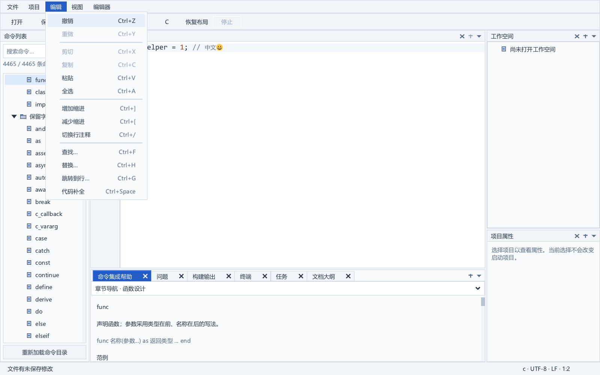
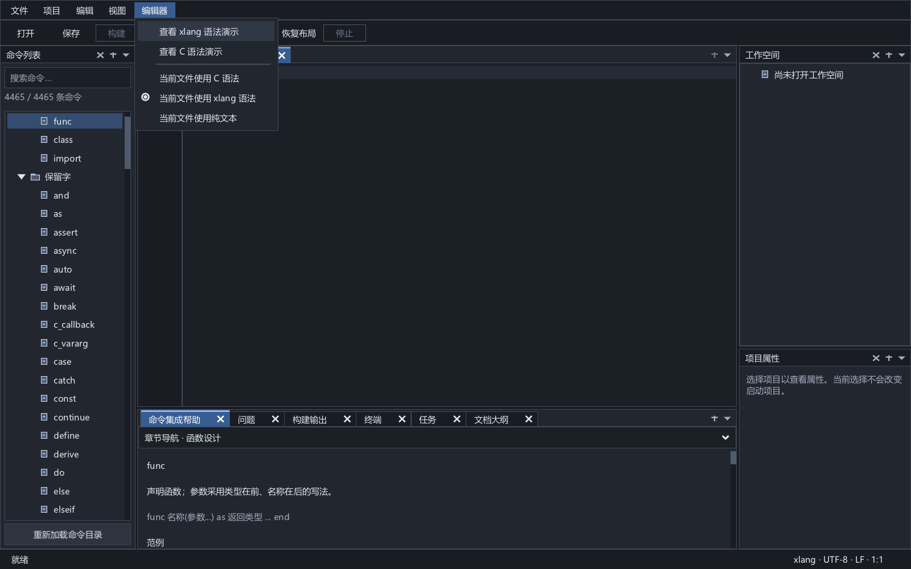

# 动作注册与统一路由

截至 2026-10-10，`app/actions.c` 注册现有 69 个内建动作，统一稳定 ID、ASCII 名称、中文标题、工具栏短标题、快捷键、作用域、状态查询和执行入口。菜单顺序、快捷键与定版 Dock 布局保留。历史语言服务完整 Release/CompilerPath 回归包含 55 个独立应用模块、43 类测试和 90 张新鲜原生图，最新验收记录见 [实施进度](progress.md)。

## 状态与执行

菜单、工具栏和公共属性按钮按动作 ID 绑定，刷新读取条目实际值，不依赖固定条目下标。主题、C/xlang/纯文本和启动项目的标记反映当前实际状态，撤销与重做根据目标文档的真实历史决定是否可用。按钮同时更新公开 enabled 属性和绘制缓存状态，防止点击后仍显示上一种状态。

每次执行重新核对文档、模型、任务及模态状态。无文档、未命名文档重载、不可用项目、未配置编译器、非 exe 启动项目和已关闭运行输入分别受到保护，即使条目被错误启用也不能绕过执行检查。F7 构建所选项目，F5 构建并运行启动项目，两者保持分离。设置窗格打开时阻止其他公共动作；有活动或排队任务时，Shift+F5 仍可停止任务。

参数化属性和配置事务继续由所属视图验证独立草稿。“应用项目属性”与“构建、运行与测试配置”公共按钮进入同一注册入口。执行返回区分未知、不可用和已交给处理器；已派发并不表示保存成功，取消和业务失败由已有处理器处理。后台线程继续只使用服务，状态同步发生在 UI 线程。

## 编辑器、快捷键和右键菜单

普通 Edit/TextEdit 及模态草稿保留自己的编辑快捷键。注册的编辑快捷键只对已打开的代码文档生效，并按实际事件目标选择文档，避免 Ctrl+Z/F/H 操作另一个输入框。

固定 SDK 的焦点目标会先处理 KEY_DOWN，再进入根快捷键处理。应用保存 CodeEdit 原处理器，在目标阶段先处理已注册编辑快捷键；只读文档的不可用动作也消费该按键，防止底层撤销绕过保护。其余按键、补全、原生文本和 IME 仍转交原处理器。底层撤销、重做、查找和替换直接派发到目标控件的 COMMAND，不重新注入键盘事件；显式补全继续调用已经验证的公开接口。详细输入边界见 [原生输入与 IME](input-and-ime.md)。

已注册的原生编辑命令通过公开 provider 接口接入查询和执行。CodeEdit 的右键菜单按应用设置的标题识别对应动作，使用公开菜单接口同步状态和点击/键盘执行，不依赖 SDK 私有菜单值。其余原生菜单条目继续调用原处理器。应用动作对象拥有绑定记录和原回调，记录保留至 XUI 销毁之后释放；部分绑定失败恢复原回调。

右键菜单在打开时绑定当前界面字体，字体遍历也包含 CodeEdit 所属菜单。更换界面字体或设置写入失败后的回滚覆盖该菜单，避免它引用已释放的字体。菜单尺寸依实际逻辑字号调整，代码正文继续使用代码字体。

## 已验证行为

新增 `actions_test` 在未切换到前台的独立 Windows 桌面内运行真实 XGE/XUI，使用 125% 比例、真实控件输入与任务子进程。验证内建 ID、稳定名称和快捷键的唯一性；重排菜单仍按 ID 更新；菜单、工具栏、公共按钮、目标 COMMAND、编辑快捷键和原生右键菜单走相同入口。

测试覆盖无文档/未命名状态、真实撤销历史、只读键盘及右键保护、C/xlang 与主题标记、普通属性输入框焦点、DLL 启动项目禁用运行、属性按钮点击与缓存灰显、选中项目和启动项目分离、实际运行输入关闭以及设置草稿打开时停止子进程。界面字体更换和原子写失败回滚均核对原生菜单字体；移除文件引用保留源文件、已打开文档和原入口引用。

该测试中的编译器是进程夹具；完整验收另执行真实 DEMO6 C/xlang 混编、include/library/link、构建运行及失败构建不运行旧产物。三张实际菜单图已经查看，未出现 XUI 错误回调。

## 后续边界

当前注册表覆盖已有应用公共动作及上述编辑命令，尚不支持动态插件注册、用户自定义快捷键或动作面板。剪贴板、缩进和行注释已按下表接入；其他未注册的 SDK 命令仍沿用原处理器。后续迁移与更多编辑动作按同一协议扩展；完整 IDE 的语言服务、性能和发布验收仍在长期任务内。

工程引用增量新增 project.references 动作；项目菜单和右侧属性按钮共享入口，未应用的项目属性会阻止打开，引用窗口参与模态检查。注册表现有 45 个动作，停止任务沿用原条件；参数化草稿由引用视图一次验证并提交。详情见 [工程文件、资源与库引用](project-references.md)。

现有 newProject 动作现打开“从模板新建项目…”原生向导，无工作空间也可用；未应用属性草稿阻止打开。向导期间仍遵守统一模态保护，45 个动作总数未增加。四种模板、只读 C/xlang 预览和创建事务见 [项目模板与新建向导](project-templates.md)。

动作查询与文件路径事务共用 xideActionsHasModal。现有 file.saveAs 仍通过原生保存对话框与文档服务执行，成功后同步工程引用，失败释放准备计划。内建动作仍为 45 个；完整路径与草稿保护见 [文件另存为与工程引用协调](file-save-as.md)。

前一增量新增 file.rename（稳定 ID 55），当时共 46 个动作。文件菜单可打开原生窗口，F2 只路由到真实代码文档；未命名文档、已绑定清单及未应用项目属性阻止打开。窗口参与公共模态、文件监视暂停和字体/滚动协议；输入保留、过期基线、磁盘失败与成功引用同步由所属视图和文档服务验证。先前增量的 45 个计数为历史验收，当前使用方法见 [文件物理重命名](file-rename.md)。

## 工程树重命名作用域

上一增量新增 project.renameFile（稳定 ID 34），当时共 47 个动作。项目菜单和工程树 F2 作用于所选普通文件；file.rename 的 F2 保留代码文档作用域。全局注册按键组合只绑定一次，回调再按焦点作用域分派；编辑器/工程树目标阶段消费相应按键，不可用时也不落入另一作用域，普通输入框不触发改名。

工程树按稳定文件 ID 读取当前模型路径，缺失、目录、重解析点、只读及不可用项目禁用动作；窗口参与公共模态和草稿保护。已打开文档通过物理身份复用，未打开文件不新增文档。快捷键冲突检查允许不同非全局作用域共用 F2，同作用域或全局冲突仍拒绝。真实键盘、菜单和事务验收见 [文件物理重命名](file-rename.md)。

## 项目迁移动作

新增 project.moveManifest（稳定 ID 35）与 project.moveDirectory（稳定 ID 36），共 49 个公共动作。项目菜单要求选中可用项目且没有属性草稿；参数化目标路径由原生迁移窗口验证，F2 原作用域保持。两项复用已有重命名模态、字体与滚动协议，全部打开文档与源身份的冻结基线在确认时再次校验。完整模型/文档/监视/会话事务及原生验收见 [项目清单与目录迁移](project-migration.md)。

新增 project.importLegacy（稳定 ID 37），项目菜单进入原生旧工程导入窗口，无工作空间也可用，未应用属性草稿阻止打开。窗口参与统一模态动作、文件监视暂停和字体/滚动；生成清单、切换工程和旧状态应用沿用独立的后端与会话服务。当前共 50 动作，见 [旧格式导入](legacy-import.md)。

## 资源属性动作

新增 project.resources（稳定 ID 38），现有注册表共 51 个公共动作。项目菜单和右侧属性按钮共用入口；要求选中含编译资源配置的可用项目并先处理属性草稿。原生资源窗口参与统一模态、字体与文件监视暂停；应用写入当前资源文档的撤销历史，随后按既有保存流程落盘。见 [Windows 资源属性](windows-resources.md)。

## 语言检查动作

注册 `language.checkSaved`（ID 66）和 `language.cancelCheck`（ID 67），通过文件菜单执行。检查需要干净且没有外部冲突的命名 `.xl`、xlang 模式、已选编译器和不超过 8 MiB 的正文；等待上次请求结束期间禁止重复提交。取消只在有请求时可用，模态草稿继续阻止检查。结果使用原生 CodeEdit 标注及已有问题页，任务与问题节点已明确启用选择，语言错误的 Enter 跳转消费本次事件并将焦点交给编辑器。详见 [语言服务](language-service.md)。

全文快照增量新增 `language.check`（稳定 ID 68），文件菜单可检查未保存入口及打开的 `.xl` 依赖，旧保存/取消 ID 66/67 保持。新模式取消动作在进行中、等待复查或已开启自动复查时均可执行，取消后不会随下一次编辑重新启动。使用、限制及验收见 [语言服务](language-service.md)。

定义动作 `language.definition` 的稳定 ID 为 69，F12 只在当前受保护的 xlang 索引可用时执行；文件菜单与快捷键共享状态，C 标签、取消、失败或过期批次禁用。详见 [定义跳转](definition-navigation.md)。

大纲动作 `language.outline` 为稳定 ID 74，在视图菜单打开中央底栏页面；符号信息 `language.hover` 为稳定 ID 75，文件菜单与编辑器 Ctrl+I 共享可用状态。鼠标悬停同样要求当前受保护的 xlang 索引，C 标签、失败或过期批次不显示旧结果。详见 [大纲与悬停](outline-hover.md)。

C 原生补全新增稳定 ID 76、ASCII 名称 `language.cServer`，由文件菜单打开 C 语言服务器选择器，沿用统一模态状态与设置写入保护。选择保存在 `toolchain.cServer`，与 xlang 编译器独立。

C 语义 GUI 继续使用稳定 ID 68/69/74/75。当前检查标题改为“检查当前文档（含未保存依赖）”；在命名 C 模式中路由独立 clangd 会话，xlang 模式沿用编译器索引。F12、Ctrl+I 和鼠标只发布当前版本与项目配置的真实结果；大纲在同一中央 dock 切换客户端。取消 ID 67 停止两种语义会话的自动复查，保存后 xlang 检查 ID 66 保持原范围。公共动作仍为 59 个，见 [C 语义服务](c-language-service.md)。

新增 `editor.gotoLine`（稳定 ID 77），当前共 60 个动作。编辑菜单、原生 CodeEdit 右键命令与编辑器 Ctrl+G 共用窗口和状态，普通输入框不抢占快捷键；只读、未命名及纯文本也可定位。窗口参与公共模态、文件监视暂停、界面字体与滚动协议，确认前复核文档身份和版本。详见 [跳转到行与列](goto-line.md)。

## 资源创建动作

`project.newResource` 的稳定 ID 为 39，当前共 61 个公共动作。项目菜单和右侧项目属性共用入口；选中可用项目、无属性草稿且无其他模态窗口即可进入，零资源项目也可使用。JSON/兼容 XLON 的单栏预览、创建与引用提交沿用资源窗口的模态、字体与滚动生命周期；现有属性动作 ID 38 保持。保存清单和冲突规则见 [资源创建流程](resource-creation.md)。

## 项目测试

稳定动作 `task.test`（ID 78，Ctrl+F7）运行所选项目当前配置的显式测试程序，允许 DLL 测试宿主，不要求 xlang 编译器。程序留空、不可用项目或模态草稿打开时不可执行；停止、关闭会话输入及历史输出沿用任务路由。配置和边界见 [项目测试](project-tests.md)。

## 已打开文档查找

`editor.find` / `Ctrl+F` 与 `editor.replace` / `Ctrl+H` 继续使用已有动作，不新增公共动作 ID。共享范围涵盖已打开 C/xlang/纯文本标签，结果选择激活 Dock；只读替换禁用。全部替换仍限制当前文档。文档修改、关闭和另存为由共享查找生命周期处理，详见[查找与替换](find-and-replace.md)。

## 常用编辑命令

| 动作 | 稳定 ID | 快捷键 | 可用条件 |
| --- | --- | --- | --- |
| 剪切 | 80 | Ctrl+X | 可写正文且有选区 |
| 复制 | 81 | Ctrl+C | 有选区，允许只读 |
| 粘贴 | 82 | Ctrl+V | 可写正文 |
| 全选 | 83 | Ctrl+A | 正文非空，允许只读／已有局部选区 |
| 增加缩进 | 84 | Ctrl+] | 可写正文 |
| 减少缩进 | 85 | Ctrl+[ | 可写正文 |
| 切换行注释 | 86 | Ctrl+/ | 可写且当前语言注册了行注释 |

菜单、键盘及原生 provider 使用同一注册入口，已有 ID 和非编辑器输入快捷键保留。行注释依照当前逐文档语法：C 与 xlang 都支持 `//`；纯文本禁用，不根据文件后缀偷偷退回注释。当前选择整行的缩进、反缩进和注释可以一次撤销／重做；全选从局部或反向选区扩展为全文。SDK 没有缩进菜单标题槽，绑定通过公开标题查询跳过该槽，缩进仍可从编辑菜单与快捷键执行。Tab／Shift+Tab 继续进入原生处理器，补全确认保留。

新增 51 项真实原生检查通过；剪贴板使用创建上下文时绑定的私有 UTF-8 提供者，避免修改用户系统剪贴板。检查涵盖中文／emoji、反向选区、单步撤销／重做、只读／纯文本禁用、普通属性字段和焦点文档隔离。严格构建、12 项邻近检查、标准全量回归和便携专项验收通过。测试证据及历史失败见[本轮核验](../build/editor-commands-final-v1-verification.json)与[实施进度](progress.md)。
