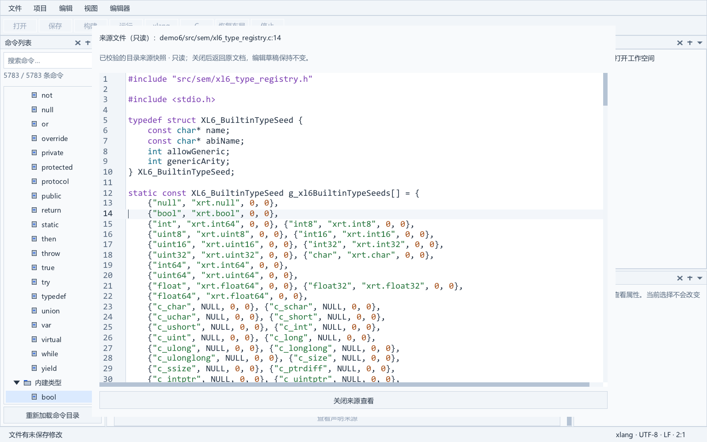
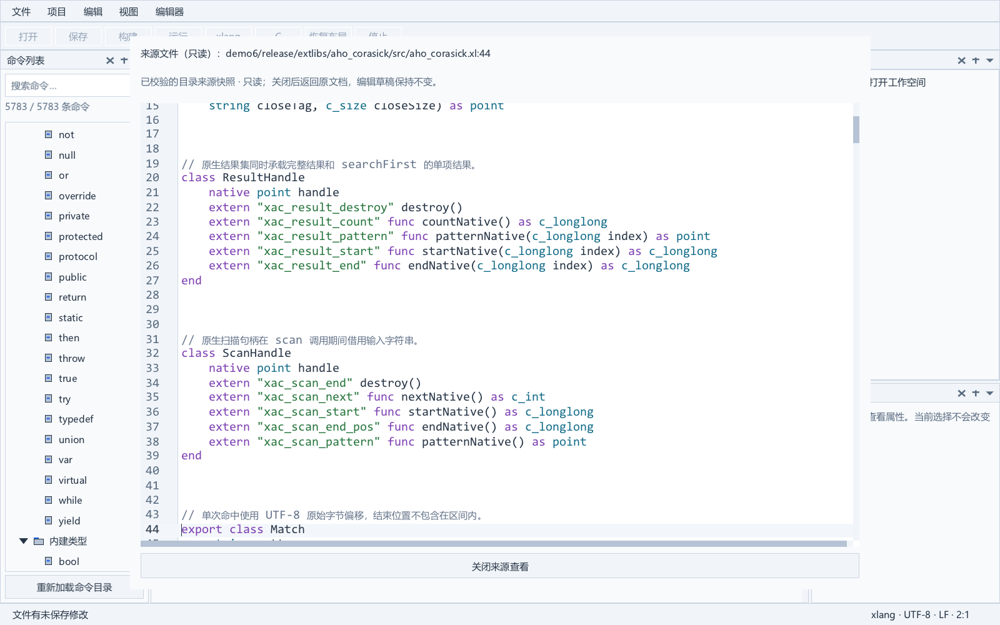
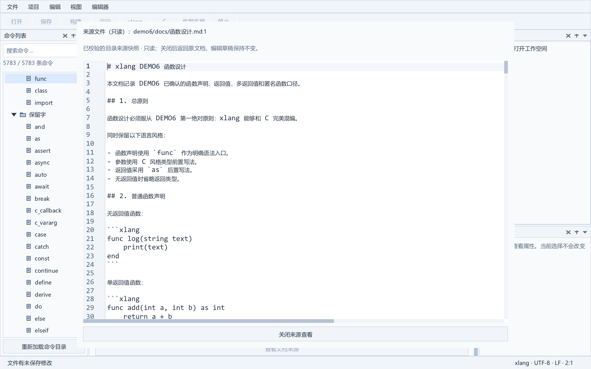
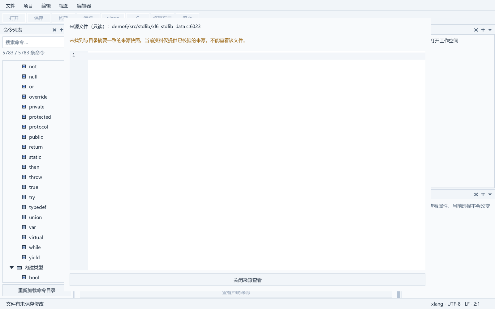

# 命令与文档来源查看

当前候选在命令帮助末尾提供“查看声明来源”和“查看文档来源”。声明直接定位到目录记录的来源行；文档依据当前选中章节所属的文档，未选择章节时打开第一份文档。原生只读窗口支持 C／xlang 语法，Markdown 原文保持单栏。关闭按钮或 Escape 返回原焦点，编辑草稿、选区及撤销记录不被修改。

[启动 IDE](../dist/portable-20261011-catalog-update-v2/xlang-ide/xlang_ide.exe) · [便携 ZIP](../dist/portable-20261011-catalog-update-v2/xlang-ide-windows-x64.zip) · [完整说明](commands-and-help.md#命令与文档来源查看)

来源资料与随附静态目录绑定，读取时校验原始字节摘要。2026-10-31 源目录已更新为 596 个实际引用来源；本页旧候选链接、截图和下述 335 份原生界面验收为历史记录，不表示旧便携包已重发。成对更新与中断恢复见[命令资料更新](catalog-update.md)，本轮证据见[覆盖审计](../../docs/IDE扩展库命令覆盖审计_2026-10-31.md)。实际可用 API 仍由项目所选编译器决定。

严格构建得到 84 个模块和 99 个产物。来源窗口通过全部 335 份读取和 62 项原生断言；邻近目录、长帮助和全局动作验收、标准完整回归（含实际编译器与渲染）、6 项资料拒绝检查和便携门均通过。缺失或被改动的来源会清空预览，保留清楚的失败状态。

证据：[阶段核验](../build/catalog-update-stage-v1.json)、[完整回归](../build/catalog-update-full-v1-599053d2/evidence.json)、[来源原生验收](../build/sf-e0148cb5/evidence.json)、[便携验收](../build/catalog-update-package-native-v2.json)。先前候选及源码快照保留；实体设备、极长行性能与正式发布继续验收。
