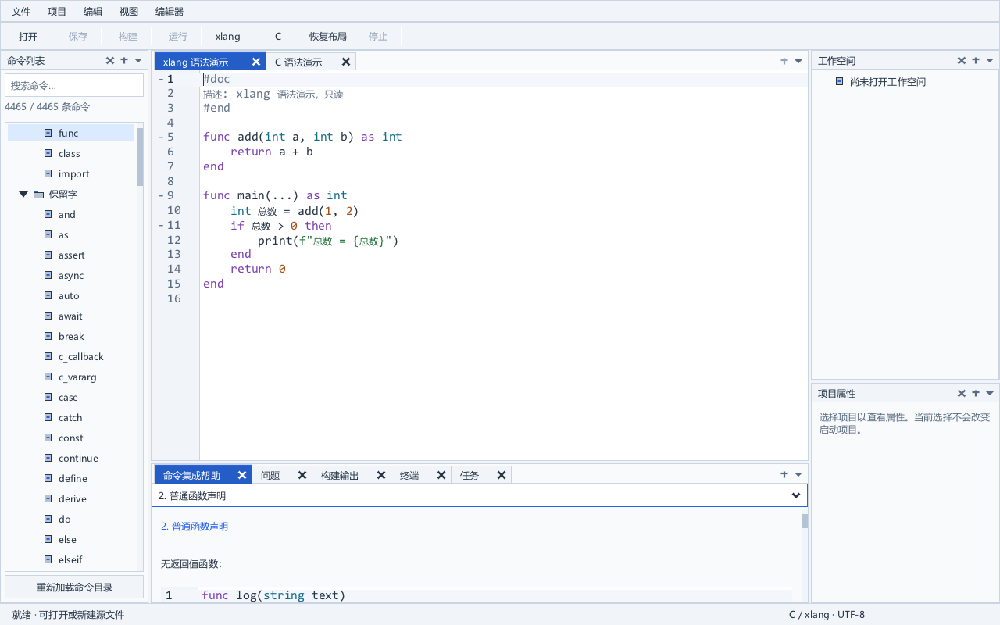

# 命令目录、集成帮助与静态补全

当前实现遵循定版布局：命令列表位于左侧，帮助位于编辑器下方的中央底栏；帮助为单栏纵向文档。代码位于 `services/command_catalog.c`、`ui/catalog_view.c` 与 `ui/help_document.c`，业务数据不依赖参考应用的自动化功能。

## 数据与来源

随程序提供 `release/data/commands.json`，工作区源快照为 `data/commands.json`。当前目录使用 0.6.0 编译器：**9,591** 个条目，其中语言／基础类型 168、标准库 5,988、扩展库 3,435，覆盖当前 213 个扩展包。C 目录保留 44 个 C11 保留字。

生成器从同源登记表读取 1,070 个函数注册和 202 个常量注册，排除 154 个内部函数注册。真实标准库展开器负责拼装条件声明，再由当前发布编译器解析全部公开接口；目前校验覆盖 823 个不计重载的函数名、406 个公开类型和 3,830 个不计重载的成员名。命令条目保留不同签名的重载。公开字段和枚举值纳入资料，private／protected 与 native 存储字段排除。

扩展声明从 `release/extlibs/*/xlang.package.json` 的 `artifact.xlSources` 读取，使用真实编译器解析公开声明，记录包名、实际版本和显式导入要求。目录中保留编译器 SHA-256 与源文件指纹。条目 ID 由类别、限定名称、类型和真实签名产生，同名不同签名分别查阅。

来源字段定位语言文档、函数注册或声明文件。标准库类成员的位置指向真实展开的标准库 xlang 声明，并非工作区语义定义跳转位置。开发者文档的说明和示例按实际内容摘取；没有说明、没有范例时明确显示状态，不按名称编造接口。

## 浏览与帮助

列表按类别、模块组织，检索支持名称、模块、签名及说明中的多个词，ASCII 忽略大小写、中文按完整 UTF-8 内容匹配。显示匹配条目数，检索零结果不修改编辑文档。

单击条目更新帮助并激活中央帮助页，保持列表焦点和当前文档版本。帮助依次显示标题、说明、签名、参数、返回值、范例与版本、导入、来源信息。没有参数或返回值时省略对应内容。说明按宽度换行，章节共用纵向阅读滚动区。

目录另存 145 份共享 Markdown 文档，包括语言/标准库设计、模块文档和实际扩展包 README；条目的 sections 通过稳定 ID 引用，避免为每个 API 重复保存整份文档。没有包文档时继续显示真实条目信息，不合成 README。加载时验证文档 ID 唯一、UTF-8、大小和引用存在，任一失败保留原目录。

帮助使用固定 SDK 的窗口无关 Markdown 解析器，再将标题、段落、列表、引用及代码块接入原生控件。C/xlang 围栏使用对应的只读 CodeEdit，其他代码围栏使用纯文本；没有执行文档代码的操作。文档表格按表头重排为逐行纵向字段，长单元格和窄窗口不会依靠横向截断阅读。参数表仍使用可调整列宽的原生表。

章节选择固定在帮助窗格顶部，正文滚动后仍可使用；所有级别标题都可定位。SDK 单个下拉框最多 64 项，因此超出时按 64 章分组，后续章节仍完整保留。相邻命令引用同一文档时复用已解析控件。章节跳转在布局完成后只更新阅读偏移，不移动命令列表焦点或编辑光标。

宽窗格使用可调整列宽的原生参数表；窄窗格重排为逐参数的纵向说明。可选参数显示真实默认值，可变参数单独标记。范例使用只读 CodeEdit 并按条目的 C 或 xlang 模式显示。切换条目重置阅读位置，同一条目刷新不主动重置。

仅点击“插入范例到当前文件”会插入内容，要求当前存在可编辑文档且语言一致；替换当前选区，完整插入为一次撤销。浏览、检索、主题切换不插入示例。

## 静态补全

帮助和补全读取同一目录。C 文档只获得 C 目录条目，xlang 文档获得 xlang 条目，纯文本不提供目录候选。命名空间补全只替换最后一段标识符，例如 `math.sq` 确认后成为 `math.sqrt`。原生弹窗负责前缀过滤、键盘确认及一次撤销，提供者保留当前命名空间的完整候选以供后续过滤。

按输入延迟自动显示，点号输入结束后显式请求，编辑菜单与 Ctrl+Space 可主动调用补全。固定 SDK 的映射键处理会再次关闭弹窗，因此绑定编辑器时解除该原生键映射，由 XUI HotKey 调用显式补全动作。点号请求在输入结束后执行，并验证文档身份、版本、光标、焦点和语言，过期或关闭文档的请求不显示。

注释、字符串、字符字面量及未闭合字面量的错误 token 中不提供目录候选。实例成员和模块声明只用于浏览；没有真实类型信息时不将它们作为全局函数插入。扩展候选明确提示 `需 import`，静态目录不证明其已在当前作用域内。

命名 xlang 文档现由独立 [语义补全](native-completion.md) 查询当前作用域与 class 实例成员，静态目录作为后备。两者共用 SDK 候选窗格；同名目录项由语义项替代，实际重载保持不同签名和身份。语义 textEdit 可替换光标右侧后缀，目录插入继续使用上述最后一段前缀合同。

## 重新生成与验收

IDE 运行只读取随附静态资料，不依赖 Python，也不加载目录生成工具的编译器 DLL。开发构建与便携打包使用 Python 校验并复制快照；维护者更新目录时，在已配置 Python 与 GCC 的 PowerShell 中执行（详细步骤见 [命令资料更新](catalog-update.md)）：

```powershell
.\tools\generate_catalog.ps1 -PrepareOnly -GccPath E:\software\w64devkit\bin\gcc.exe
# 核对生成报告后，成对发布已验证目录与来源资料：
python tools\catalog_publish.py --pair build\cg-生成目录编号 --data data
# 直接重新生成并发布，也可省略 -PrepareOnly。
.\build_current.bat -Configuration Release -Tests -ToolchainDirectory E:\software\w64devkit\bin
```

生成工具依据当前发布验收报告校验编译器与 Git 源码版本，先冻结源码、扩展声明、实际文档和生成工具。原生辅助程序运行真实展开器，再由当前发布的编译器解析声明，同时捕获原始来源字节。所有声明解析成功且目录与来源资料成对校验通过后才发布。生成失败不改变已安装资料；发布持有写入锁，异常回退，中断后依据日志恢复完整资料对。具体命令与边界见 [命令资料更新](catalog-update.md)。

`catalog_test` 在不创建 UI 的情况下验证真实签名、默认值、版本、C 关键字、内部名称排除、实例成员限制、重复 ID、非法 UTF-8 与事务失败保留。`catalog_view_test` 验证原生检索、焦点及文档隔离、范例和命名空间补全撤销、点号及主动补全、过期请求、窄窗格重排、注释字符串、中文与关闭槽复用。浅、深色目录截图进入完整原生 smoke。新增 help_document_test 使用真实原生按钮和章节菜单验证损坏启动、修复后加载、失败后保留旧目录、72 章分组跳转、列表/表格和 C/xlang 只读代码块。原生截图另检查长帮助、900×600 窄窗口与损坏恢复界面。

## 当前限制

目前是与 0.6.0 发布产品绑定的快照，不会自动适配任意所选编译器版本；实际可用接口仍由工具链决定。扩展导入作用域、别名和对象类型由当前光标查询实际支持的范围决定，静态目录仍不证明其可用。C 头文件声明和项目符号由已接入的 [C 语言服务](c-language-service.md) 按实际项目配置查询。

当前帮助覆盖条目说明、参数、范例和完整长章节正文。Markdown 行内文字展示为普通文字，尚未提供行内加粗/链接交互及图片加载；许多公开声明尚无功能说明或示例，显示缺失状态。渲染限制为每次至多 4,096 个原生块、每份文档 4 MiB、递归深度 128；超限或解析失败明确显示错误，不留下部分正文。代码字体与帮助块行高已联动；DPI 与独立界面字体设置已接入，实体设备和大文档控件虚拟化仍需后续验收。章节及正文内容锚点现已进入本机会话；字体或宽度重排、重启和目录顺序变化后恢复合理阅读内容，详见 [会话与布局恢复](session-and-layout.md)。

长文档的普通正文标签直接绘制并复用字体字形，不再为每段建立独立位图缓存，以减少高分辨率和低可用内存时的渲染分配。dock 标题栏、页签和代码块保留原缓存与绘制方式，正文测量、章节定位和阅读锚点不变；控件虚拟化仍按上述后续范围验收。

目录缺失或损坏时 IDE 正常启动，左侧与帮助显示具体错误和目录路径。修复后点击“重新加载命令目录”即可恢复；已有有效目录时重载失败继续保留旧目录。成功重载取消旧补全弹窗并重绑提供者，保持搜索词与稳定命令 ID，编辑文档不被修改。





## 命令与文档来源查看

命令帮助末尾提供“查看声明来源”和“查看文档来源”。声明来源打开对应文件并定位到目录记录的行号；文档来源读取当前选中章节所属的文档，尚未选择章节时读取第一份文档。章节分组只用于导航，不作为文档序号。窗口为独立的原生只读编辑器，C／头文件／声明片段使用 C 语法，`.xl` 使用 xlang 语法，Markdown 文档以单栏原文显示。关闭按钮或 Escape 返回原焦点，工作区中的文档、未保存内容、光标及撤销记录保持不变；查看内容不加入文档会话。

来源文件是与随附命令目录一致的静态快照。读取前核对目录摘要和原文件字节摘要，文件缺失、被修改、目录不匹配或行号越界时显示明确提示。不会自动打开机器上的另一份编译器源码。字体、主题、窗口尺寸和 DPI 调整同样应用于来源窗口。

本次重新生成并随附全部 **432 个**实际引用的可校验来源，包括标准库设计、`xl6_stdlib.c` 和 `xl6_stdlib_data.c`。这些字节与新目录同时捕获；先前候选的 3 个来源缺口仍作为历史记录保留。资料缺失或损坏时，来源窗口继续显示明确状态并清空旧内容。

开发构建与便携打包均验证 `data/catalog-sources/index.json` 和来源资料，缺失、摘要不符或混入额外文件会停止交付。独立校验命令为 `python tools/catalog_sources.py --source data/catalog-sources --catalog data/commands.json`。命令目录重新生成后，来源索引及对应快照必须同步更新；旧资料不会被当作新目录的来源。

`catalog_source_view_test` 验证实际原生按钮、Escape、C/xlang 语法标记和定位、长文档及多文档章节分组、只读输入、摘要与索引拒绝、缺失来源、越界行号、目录重载、字体和 125%／200% DPI、草稿与撤销保留，以及打开窗口时退出。原有动作数量断言同步增加 2 个来源动作，其他动作 ID 保持不变。
