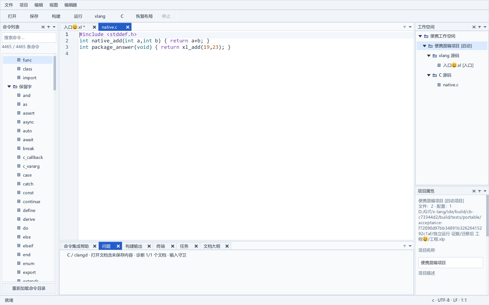
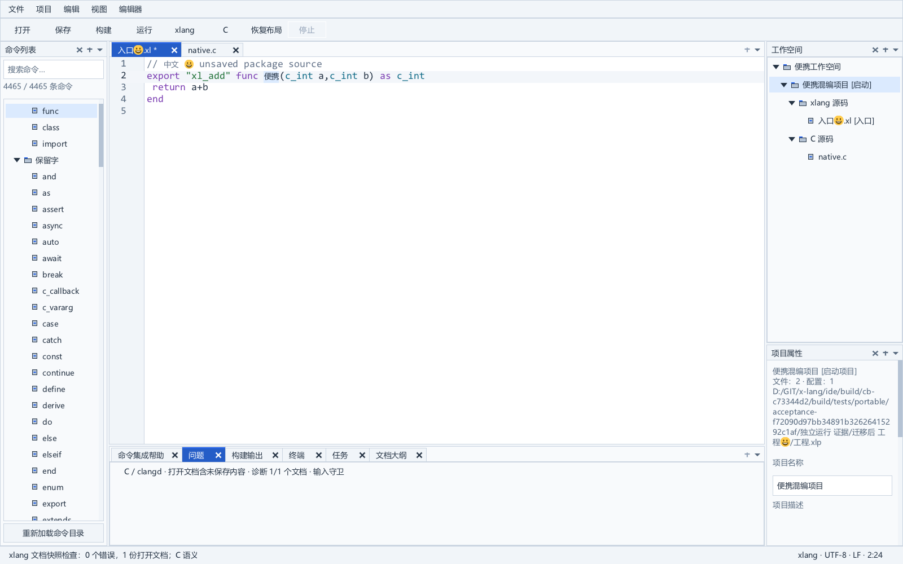

# 当前源码构建与便携交付

开发工作区现在可以从当前源码生成独立构建，再直接生成可运行便携包。`package_current.bat` 读取当前构建的实际目录，核对源码、SDK 和应用产物，避免使用保留在 `ide/release` 的历史程序。先前便携包继续保留。

```powershell
.\build_current.bat -Configuration Release -Tests -ToolchainDirectory E:\software\w64devkit\bin
.\package_current.bat
```

新输出目录与实际 IDE 路径在终端打印。完整参数、固定工具链材料及依赖见 [源码构建说明](current-source-build.md)。本轮可直接体验 [原生程序](../dist/portable-20261011-current-build-v1/xlang-ide/xlang_ide.exe) 或 [Windows x64 ZIP](../dist/portable-20261011-current-build-v1/xlang-ide-windows-x64.zip)。

## 本轮验收

| 检查 | 实际结果 |
| --- | --- |
| 当前源码严格 Release 构建 | 83 个应用对象、98 个程序/DLL，退出码 0 |
| 当前构建保护 | 五项拒绝检查通过：源码变化、新构建准备失败、最新构建失败、最新构建未完成、构建产物变化 |
| 便携载荷与搬迁 | 15 项原有拒绝门、2 次真实默认工具链运行、4 次实际程序运行、12 张原生截图 |
| C/xlang 混编与语义桥接 | 包内编译器与 clangd 实际运行，通过基础类型和目标差异检查 |
| GUI 启动与清理 | 开发构建和便携包各验证 C/xlang，4 个真实启动父进程中断场景通过 |

便携包包含 4358 个载荷文件，约 401 MB，包括原生程序、工具链、字体、对应 SDK/编译器源码材料与来源记录。新增 `provenance/ide-source-build-report.json` 绑定当前构建的源码与应用产物摘要。ZIP 的 SHA-256 为 `c0ab594ca1673e210afb1dbeb872d10a464950f18e6630e3c434cc4bbc2d9a60`。

本轮应用 C 源码、测试 C 源码和 SDK 与前一完整回归版本相同；本轮改动集中在构建记录与打包入口。此次未重复标准全量应用回归，已对新构建执行便携专项真实流程。详细证据见 [本轮核验](../build/current-package-stage-v1.json)、[构建拒绝检查](../build/current-package-rejections-v3.json) 和 [便携门](../build/current-package-native-v2.json)。

首次便携控制脚本使用了另一个 IDE 根下的包路径，被现有测试工具的目录约束拒绝，尚未进入原生验收。失败记录保留在 `current-package-native-v1.json`；随后在构建目录内制作逐文件摘要一致的包副本，未改变断言，三项门均通过。

## 搬迁后的真实工程

下图来自本次包内默认工具链的真实混编工程，包含未保存 xlang 正文、C 对导出符号的调用、中文和 emoji 路径。中央底栏只占编辑器宽度，右侧工作空间与项目属性上下同时可见。





本轮证明本机的源码构建和便携闭环，不能替代所有干净 Windows 设备、实体 IME／混合显示器、复杂 ABI／宏矩阵、性能基准或完整发行条款核对。长期任务保持 active，正式首版验收继续按实施计划推进。

2026-10-11 后续候选已增加命令与文档来源查看；本页上述候选对应前一源码打包阶段，当前入口见[当前候选](../CURRENT-CANDIDATE.md)，新功能与验收见[来源查看](catalog-source-navigation.md)。

2026-10-11 命令资料完整候选已更新：335 份来源全部随附，5,783 项目录与来源支持成对更新和进程中断恢复；此前候选继续保留，当前入口见[当前候选](../CURRENT-CANDIDATE.md)。
