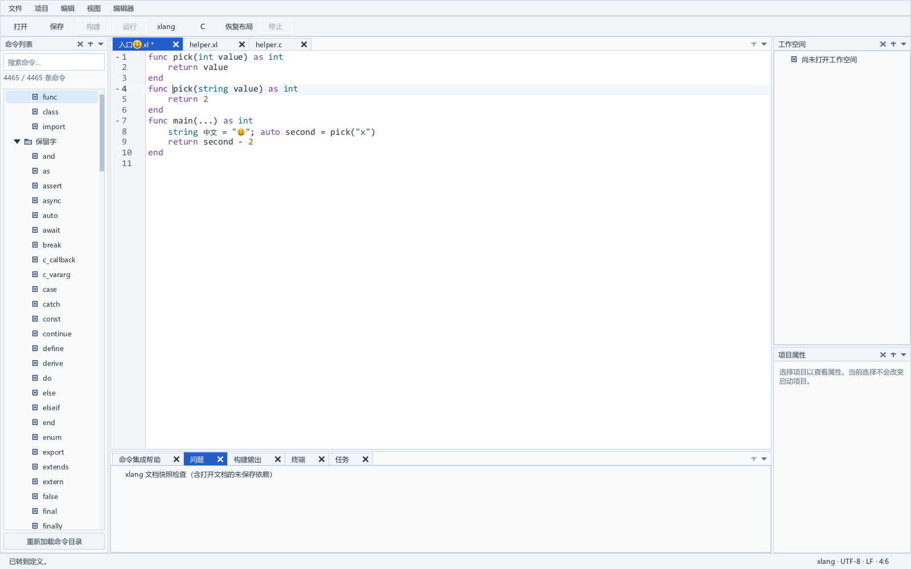
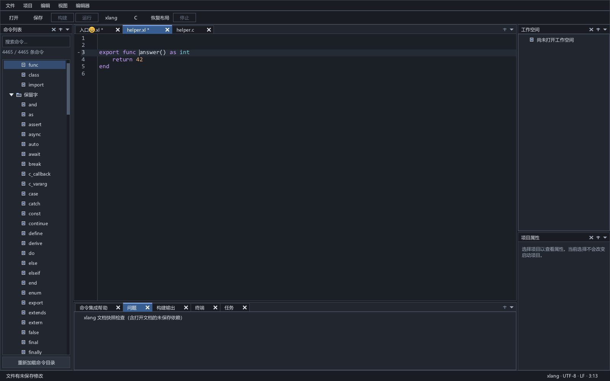

# xlang 定义跳转

开发版配合原生服务 0.24，打开命名 `.xl` 即可按 F12 或选择“转到定义”，无需先执行检查，也无需保存入口和已打开依赖。动作的稳定 ID 为 69，名称为 `language.definition`。IDE 先确认所有命名输入的同步状态，再发送标准定义请求；返回位置包含协商后的目标文件证明，核验后才跳转。旧服务和显式检查仍使用原有严格批次路径：选择支持 `check --json --semantic-index` 的编译器，执行“检查当前 xlang 文档（含未保存依赖）”，然后查询定义。

局部变量、参数、同名遮蔽、函数重载与模块导入使用编译器实际符号 ID；函数调用优先采用 CALL 节点已解析的重载 ID，参数和成员接收对象保留自己的身份。显式类型标记可按同批次 TypeId 跳转到 class、union、enum、typedef 和 extern type 声明。支持新增类型事实的编译器还可定位 protocol、`extends` 基类、已检查的泛型约束与泛型参数。目标选区来自真实声明 token，导入内部改名不改变原始位置。缺少可导出的声明或语义事实时返回空结果。引用查找、隐式成员补全与所有生成实体定位仍待实施。

## 类型身份导航

类型表与符号表分别建立索引，不混用 TypeId 和 SymbolId。新增编译器字段 `declaredTypeId` 与 `referencedTypeId` 明确区分类型声明和引用；两者最多一个非零，并与节点的 `typeId` 一致。整个索引必须统一提供两个字段或统一省略。引用仅接受 TYPE、类的真实基类 NAME，以及泛型约束中已核验的类型；泛型参数声明仅接受 TYPE_PARAMS 的直接 NAME 子节点。没有声明符号的 protocol 和泛型参数也可提供独立类型声明身份。

引用匹配同批次类型声明及其 ABI ID。具体类型要求非零 ABI；泛型参数使用真实的作用域 TypeId，ABI 保持零，不伪造运行时类型。同名 `T` 在不同声明中有独立 TypeId。单态化复制产生相同 TypeId 时，仅将 ABI、类型参数角色及完整/名称源码范围完全一致的目标合并；范围不同或缺失时保持不可导航。两个底层同为 `int` 的别名按各自 TypeId 定位，类型别名链定位源码中实际写出的别名；不按 canonical 字符串、展示名或 C ABI 名猜测。

支持函数参数/返回值、显式类型声明、泛型类型和实参、数组与可空类型内部的类型标记，以及磁盘或未保存模块导入的公开类型。class 句柄规范化保留的原始 token 仍可定位类声明。变量名的推断类型不触发类型跳转，变量引用继续定位变量自身。歧义类型身份、未知/零身份、ABI 不一致或无位置声明保持空结果，不使已有符号导航失效。旧 schema-1 索引省略新增字段时，保持原 TYPE 标记与具有声明符号的公开类型导航。

新增编译器只在 opt-in 索引检查中为已验证基类及 CLASS/PROTOCOL 约束记录类型身份；已有类型注册表提供 protocol 与泛型参数的身份，索引保留其真实名称选区，不分配额外运行时 SymbolId。内建能力约束没有对应类型声明时保持不可导航。大纲使用 protocol/interface 类别和真实类型参数子项。此功能不扩展 C 生成头文件的类型源映射，后者目前仍是函数/全局变量范围，见 [C/xlang 桥接](c-xlang-bridge.md)。

## 同批次服务

支持索引的工具链在原全文快照检查中执行一次 `--semantic-index`，不用第二次解析。旧工具链保持 `--source-report` 检查，结果中 `semanticDefinitions:false`，定义动作不可用。编译失败只发布可验证诊断，完整索引必须与同次成功状态一致。

服务逐项核验 schema、来源位、连续节点 ID、先前父 ID、深度、声明身份及所有实际范围；同一来源中的所有端点排序后单次扫描核对 UTF-8 偏移、Unicode 标量行列、CRLF 与半开边界，转换为 UTF-16。磁盘文件去 BOM；带 BOM 的协议正文保留打开文档第一行的 BOM 坐标，同时严格核对 CLI 实际去 BOM 的输入摘要。转换完成即释放源码图，保留独占的路径、身份关系和位置表。

`textDocument/definition` 参数示例：

```json
{
  "textDocument": { "uri": "file:///D:/Example/main.xl" },
  "position": { "line": 8, "character": 18 },
  "version": 7,
  "checkId": 12
}
```

`version/checkId` 是可选的批次保护扩展。显式检查后的 GUI 请求提交两者；按需 GUI 请求只提交当前同步版本，省略 `checkId`，由服务捕获并分析当前输入。标准客户端可以省略两者。结果采用单个 LSP Location 或 null；未协商目标证明时不增加字段。没有可验证语义事实的源码错误返回 null；不完整代码的容错导航仍待实施。旧批次请求在版本、检查 ID 或输入守护不匹配时继续拒绝，不以新分析替换指定的旧批次。

初始化声明 `definitionProvider:true` 和 `experimental.snapshotDefinition:true`，表示已实现查询协议。具体工具链是否可查由该次结果的 `semanticDefinitions` 决定；悬停／大纲见 [大纲与悬停](outline-hover.md)，已接入的补全见 [补全服务](semantic-completion-service.md)，C 语义仍由独立提供者负责。CLI 兼容索引限制仍为 65,536 节点、256 深度、8 MiB JSON 索引，原生 typed 索引有独立的 32 MiB 数据预算，见 [分析核心](lsp-analysis-core.md)。兼容编译器响应在索引模式为 12 MiB，旧快照为 4 MiB，旧保存检查为 1 MiB。stdout 队列按协议限额配置，默认任务和 stderr 保持 1 MiB；stdio 单帧保持 8 MiB，传结果而不传整棵编译器索引；客户端队列为帧头额外预留 16 KiB。

## 按需目标文件证明

客户端在初始化的 `capabilities.experimental.definitionInputProof` 显式提交 `true`，服务 0.24 声明同名能力。此时非空 Location 额外包含 `xlang: {schema: 1, document: {...}}`；未声明或提交 false 时仍仅返回 `uri/range`。证明格式及边界见 [定义输入证明](lsp-definition-proofs.md)。null 不携带虚构证明。

证明由产生目标位置的同一检查锁、输入守护和实际来源组投影，只复制目标文件的固定元数据；不复制完整检查结果、诊断、源码或索引，不在协议线程访问磁盘。服务接口 `xideLanguageCheckDefinitionWithProof` 返回独立拥有的值，原接口保持兼容。目标证明不代替完整依赖图，也不承诺磁盘变化即时发现。

IDE 在等待初始化和在线输入确认期间保留一次 F12 意图。源文档身份、版本、全部参与模型、活动标签或光标变化后取消；旧服务缺少能力时提示先检查。已打开目标必须匹配同一模型、同步版本和规范化正文摘要；未打开的磁盘目标在打开前核对原字节大小和身份，打开后再次核对身份、原字节摘要和规范化正文。UTF-16 范围严格验证；同字节替换文件也不能接受旧身份。打开新依赖后安排按需刷新。手动检查模式继续使用检查 ID、原有守护及 500 ms 复查，不被按需流程接管。

## 原生导航保护

请求发出后，正文版本、文档稳定身份、当前标签、光标以及所用模式的输入状态必须保持一致；显式模式还要求检查 ID 一致。光标移动、切换标签、编辑、取消或新检查会使晚到响应失效。目标必须属于已验证的来源组，UTF-16 起止位置必须可映射且顺序有效。

跨文件导航沿用诊断导航的正文摘要和磁盘身份保护：已打开的未保存依赖直接导航；未打开的磁盘来源先验证身份，再打开并核对原字节摘要、正文与身份。打开新依赖改变参与集合后会重新检查。持续输入守护按每轮复核耗时加一秒观察来源、包描述、解析候选和工具链；不承诺磁盘变化即时发现。

显式 `import "helper.xl"` 的未保存覆盖与失败包探测来源冲突仍安全拒绝，普通 `import helper` 覆盖可用。此编译器观察边界、C 语义、完整项目输入图、语义补全、性能与发布继续属于长期任务；大纲和悬停已由后续增量接入。

## 验证入口

- [真实协议门禁](../tools/check_language_definitions.py)：遮蔽、重载、非 BMP/CRLF/BOM、插值、磁盘和未保存模块、输入身份替换、版本/批次与来源拒绝、索引畸形/限额及旧工具链。
- [类型导航门禁](../tools/check_type_navigation.py)：真实类型身份、相同底层别名、class/union/enum/extern type、泛型/数组/可空内部类型、BOM/CRLF/非 BMP、磁盘与未保存导入、过期批次，以及真实索引上的重复/缺失/未知身份与 ABI 变异拒绝。
- [类型事实门禁](../tools/check_type_facts.py)：真实 protocol、基类、泛型参数和约束身份，同名参数隔离、符号 ID 与生成头文件兼容、准确 UTF-16 目标、大纲及非法元数据拒绝。
- [目标证明协议门禁](../tools/check_lsp_definition_proofs.py)：真实冷查询、能力协商、目标版本、BOM／CRLF 双摘要、实际来源过滤、同字节身份替换与有界元数据。
- [原生交互测试](../tests/definition_view_test.c)：无需检查的实际 F12、初始化关闭／重用、证明／摘要／身份拒绝、源码错误恢复及旧服务回退；原有菜单、类型身份、未保存依赖、过期响应和主题截图继续验证。
- [实施进度及本次结果](progress.md)。




