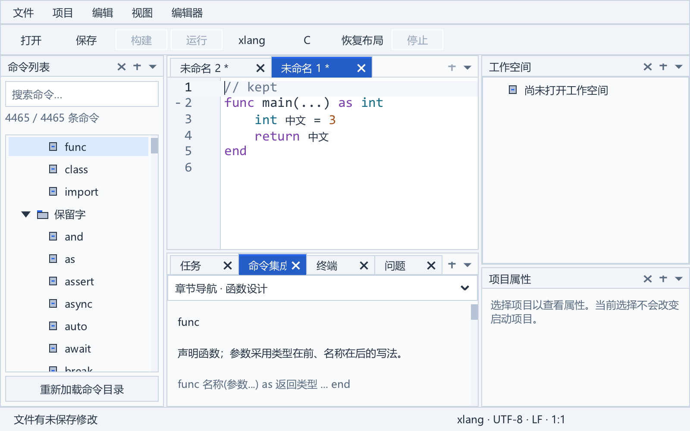
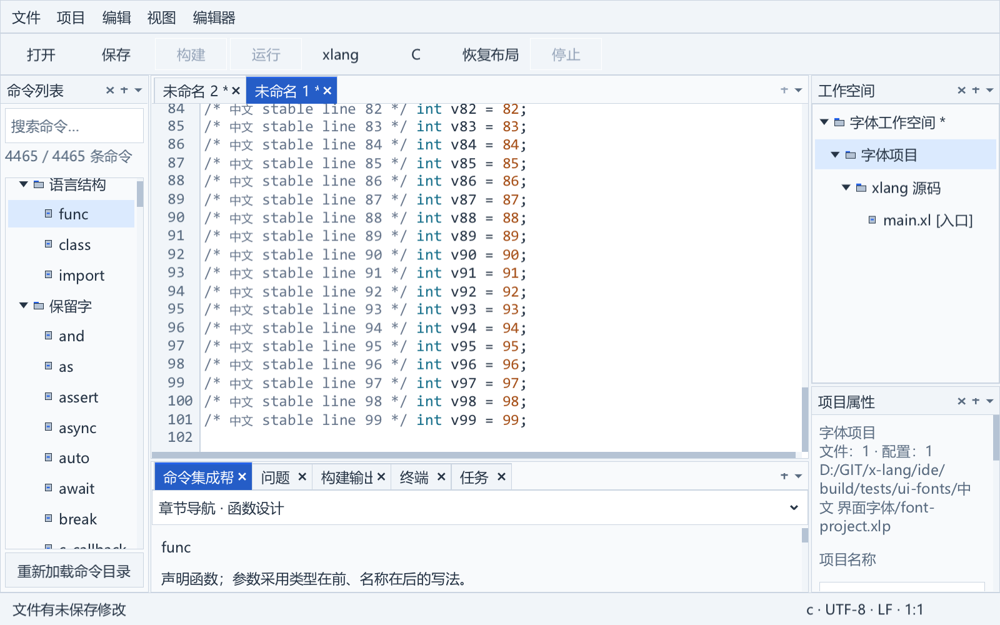
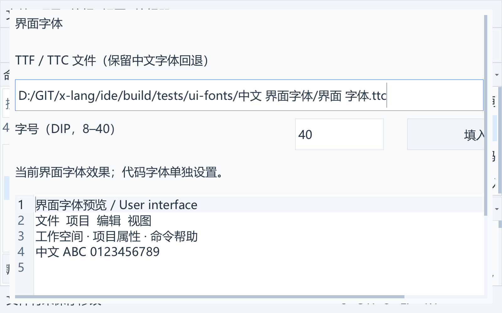

# DPI 与界面字体

原生 DPI 渲染与独立界面字体设置已接入主程序。界面和代码默认使用随包 `Consolas-with-Yahei_Nerd_Font.ttf` 16 DIP；两套偏好仍可独立选择 TTF/TTC/OTF 和 8–40 的整数字号。以下区分已自动验收的渲染比例与尚未完成的实体显示器验收。

## 坐标与资源

应用布局、Dock 快照、滚动与输入采用 96 DIP 逻辑坐标。默认左侧 190、右侧 242、中央底栏约 180 的数值保持为逻辑单位；渲染代理将整个控件树的绘制、剪裁、表面缓存和字体实例映射到物理像素。固定 SDK 的 xuiSetVirtualDpi 明确保持像素几何不变，只失效依赖缓存，因此应用不把它当作自动尺寸缩放。

主程序开启 XGE_INIT_HIGHDPI，优先按 GetDpiForWindow 获取窗口的整数有效 DPI；旧 Windows 回退至窗口 DC。固定 SDK 的 resize 比例来自两个已取整的尺寸，拖动分数 DPI 窗口可能有微小变化，不能据此反复重建字体。没有启用高 DPI 的测试宿主仍采用 XGE runtime 比例。启动及每帧绘制前核对比例，变化时先准备新字体和目标表面，再更新 XUI DPI 与逻辑视口；窗口恢复后的实际比例也在此处理。显示比例不写入字体偏好，也不累计放大已存 Dock 树。

字体保留逻辑字号的实例用于度量，另通过原后端 fontCreateSized 创建目标物理字号的实例用于绘制，包含原字体的中文回退。代理字体句柄保持稳定，文档、控件、补全和派生字体继续引用同一个逻辑对象；文本、撤销和选区不因 DPI 重建。现有字号 8–40 解释为 DIP，界面和代码的物理字号均随比例变化。

渲染目标和缓存表面使用物理分辨率。矩形按边界四舍五入，剪裁、线宽、路径、三角形和网格使用同一映射；四顶点绘制使用栈数组。加载的位图保留其天然像素尺寸；SVG 缓存尺寸由 SDK 的 DPI 图标缓存指定，不重复乘比例。原 SDK 缺失的回调仍为空，不宣告新的后端能力。

## 输入与像素接口

有序输入桥将 XGE 帧缓冲坐标映射到当前逻辑视口，键盘、鼠标、触摸和事件顺序继续使用同一桥。IME 候选的反向映射也由原桥负责；DPI 代理不再给候选矩形乘一次比例，避免双倍偏移。

普通 surfaceReadRGBA 遵守逻辑宽高和 stride，缩放目标的读回按像素中心采样，行填充不被写入。surfaceUpdateRGBA 映射逻辑区域并保留行填充。固定 Windows OpenGL 后端对渲染目标的上传行方向与读回相反，适配层规范化为 UI 的左上角坐标；创建带像素的目标也处理此差异和原透明度标志。位图载荷接口保留天然尺寸。

主程序截图使用独立的实际像素读取接口，保存高分辨率目标，不将逻辑尺寸截图再放大。最终呈现覆盖当前物理帧缓冲；分数比例按整数像素边界对齐。

## 更新与失败保护

缩放更新先准备所有字体及目标资源，任一步失败则释放临时资源并保留旧实例、比例和采样器。成功后一起替换，目标需要重新绘制，应用通过 XUI DPI、布局和缓存失效通知完成重绘。绘制批次进行中拒绝缩放。目标尺寸超过当前适配限制则失败，不截断或发布半套资源；实际大窗口与缓存峰值仍需性能测量。

## 验收范围

dpi_test 在未切换到前台的独立 Windows 桌面内运行真实高 DPI XGE/XUI。100/125/150/175/200% 比例验证中央底栏、右侧上下分区、真实物理字体字号与渲染表面、稳定逻辑度量、C/xlang 文档版本和选区、撤销、模态字段、物理鼠标命中与 IME 候选位置；保存五张实际像素原生图，并取消诊断覆盖回到窗口有效 DPI，调整真实窗口尺寸后检查字体句柄与比例稳定。独立像素检查覆盖 150% 剪裁边界、RGBA 行填充、位图和目标的上传读回、采样器保留、绘制中缩放拒绝与资源准备失败回滚。

诊断 `--dpi-scale N` 可覆盖渲染比例，范围 0.5–8，用于自动验收，不保存为用户显示偏好。完整回归另从发布程序执行 125% C 和 200% xlang 的 CLI 原生截图，检查真实退出码和 SDK 错误回调。

这些比例来自程序注入，未改变用户 Windows 显示设置。实际运行会自动读取窗口有效比例，但多实体混合 DPI 显示器切换、不同输入法的系统候选行为、不同机器上的字体与系统文件选择，以及 DPI 下的大文件/缓存峰值继续验收，不能用这些自动图代替设备证据。

## 界面字体设置

“视图 → 界面字体…”复用原生字体设置窗格，预览、填入默认值、取消和应用可用。默认路径相对 IDE 程序目录解析；设置使用现有 xlang-ide-settings-1 格式的 ui.font.path 和 ui.font.size，代码字体继续使用 editor.font。两者与编译器配置连续保存时保留根及各层未知字段；相对字体路径按设置文件目录解析，随包字体保存相对路径。

加载与代码字体共用严格 TTF/TTC/OTF 检查和内存加载，最多读取 64 MiB，不能把 SDK 对坏文件的静默备用字体当成有效选择。字号以 96 DIP 保存，物理绘制字体通过 DPI 代理更新；保存的字号不受显示比例影响。启动时坏路径或坏字体明确记录错误并回到随包默认/备用字体，不覆盖原偏好。

界面字体更新菜单、工具栏、状态栏、Dock 标题、树、表、列表、输入、按钮、帮助正文及项目属性。代码编辑器、帮助代码块、构建输出和终端仍使用代码字体。树和列表行高、菜单高度、工作台上下栏、属性表单与模态控件依实际逻辑字体度量调整。Dock 左右宽度仍保持保存的逻辑尺寸，可由用户调整；大字号模态内容保持完整，通过原生横向和纵向滚动访问字段与按钮。

绑定遍历普通控件、菜单、下拉列表、保留的短暂 Popup 及 ScrollView 的私有内容，业务 Window 的标题栏和正文也参与重绑。类型查询使用 xuiWidgetFindType；固定 SDK 的部分 GetType 会重新注册样式，不能在每个控件的遍历中重复调用而触发整树样式重算。工作台创建使用成对样式批量更新，遍历去重，同一个控件不重复重绑。当前窗口规范见[迁移清单](window-dialogs.md)。

应用先准备并绑定新字体，再比较设置基线并原子保存。失败时恢复旧字体、字号、布局和原阅读滚动位置；成功后才释放旧字体。C/xlang 文本、文档版本、Unicode 选区、语言和撤销不重建，配置草稿也不丢失。界面字体变化和失败回滚同时保留树顶部行及帮助内容锚点，避免不同字号只恢复旧像素偏移而读到另一段内容。帮助正文失效宽度缓存并重新度量，代码块继续依代码字体计算。

ui_font_test 在独立后台 Windows 桌面使用真实中文路径 TTC，验证原生应用/默认值草稿/取消、125% 的物理字号、独立 UI/代码偏好、菜单与树、项目属性、打开的配置草稿、40 字号下通过滚动点击按钮、无效字体/范围拒绝、外部设置冲突、锁定原子写失败及阅读位置回滚。还验证 C/xlang 版本、选区、撤销和两套偏好的独立重启恢复。发布程序以 --ui-font-settings 在隔离设置文件下执行浅/深色 900×600 原生截图；自动比例不能代替实体显示器和输入法验收。

动作增量将 CodeEdit 所属原生右键菜单加入界面字体遍历；打开时也绑定当前字体和行高度量。actions_test 在实际 125% 原生界面核对菜单 UIFont 24 → 16 的成功更换，并锁定设置文件验证尝试 20 后回到原字体与指针；菜单不会保留已经释放的字体。应用仍只使用固定 SDK 公开接口，实体混合 DPI 验收边界保留。

缺少系统字体的离线启动、中文字形、OpenType 和目录迁移验收见 [随包中文字体](font-fallback.md)。
