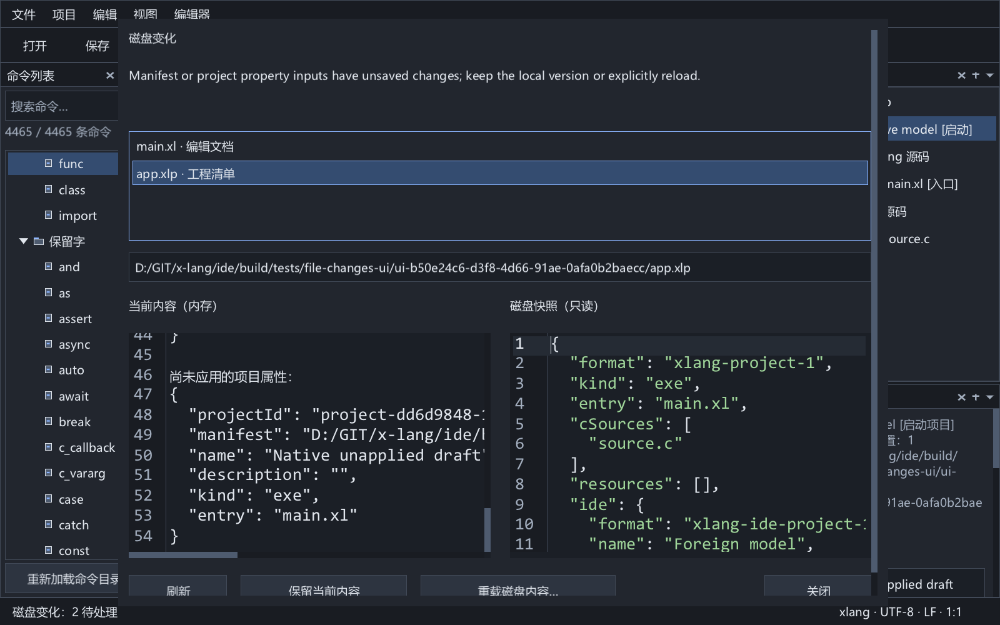
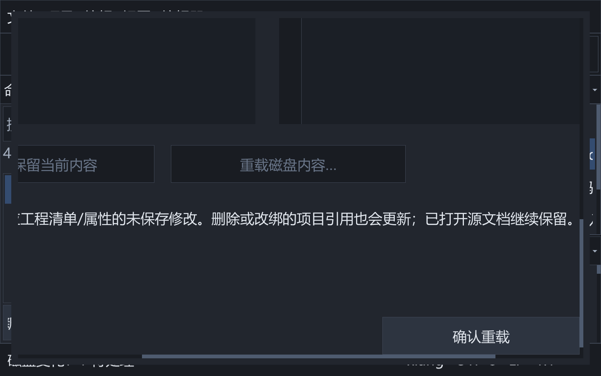

# 外部文件变化与清单双向协调

2026-10-06 已实现并通过最终严格 Release 完整回归：36 个独立应用模块、28 类测试、55 张原生图，真实 DEMO6 C/xlang 混编运行与 SDK 负面检查通过。

本增量按定版架构实现传统 IDE 的文件监视与文档/模型协调，默认 Dock 和单栏命令帮助不变。参考 AutoTestIDE 的外部变化提示、保留当前版本和后续变化重新通知语义；新实现使用独立 C 模块和后台目录监视，不复用固定编辑器数组或主线程逐文件内容读取。

## 目标与交互

监视已命名文档、当前工作空间/项目清单及工程引用文件。普通干净文档可自动接受磁盘内容；有本地修改、删除/移动、无效编码、不可读、超限或清单冲突时保留内存编辑并显示变化状态。自身保存的相同字节不会重复提示。保留当前内容只确认已观察版本，保存仍比较原始基线；再次磁盘修改重新提示。

“视图 → 磁盘变化…”提供待处理列表、路径与原因、只读的当前内容/磁盘内容比较、保留当前内容、刷新，以及明确确认后的重载。比较使用真实快照，不写源文件。文档按稳定 ID、路径和当前编辑版本关联，已关闭/复用/另存为的结果不能作用到其他文档。磁盘快照再次变化会使旧确认失效。预览与编辑器使用当前 C/xlang/纯文本语法；模态窗口适配独立界面字体、代码字体、主题与两向滚动。

## 后台监视

`platform/file_watch` 使用 Win32 ReadDirectoryChangesW、重叠 I/O 与完成端口，目录句柄动态管理，不受 WaitForMultipleObjects 的 64 句柄限制。订阅的是规范化目标路径和稳定令牌，线程不持有 UI/模型指针。通知合并后在后台读取普通文件并核对同一读取句柄的身份/长度/时间，生成有界原字节快照；目录通知溢出或不可用时重新核对全部订阅，缺失父目录定期重新订阅。

事件携带订阅代次、令牌、路径、文件状态和字节快照。队列按同一订阅合并最新状态，限制数量与总字节；溢出显式要求全量重新核对。正文/清单读取上限沿用 16 MiB，引用文件只读元数据。UI 分批消费，内容读取不占用主线程；停止先取消目录 I/O 与同步读取，再回收线程与结果。

## 清单双向规则

有效清单文本保存后立即从已保存的实际正文事务解析并刷新当前模型，不关闭未保存源文档，不切换工作空间作用域，也不隐式改变启动项目或稳定项目身份。项目属性/配置保存继续更新已打开且干净的清单文档。当前未保存清单文本与未保存属性互相拦截；不以属性序列化静默替换用户的 JSON 草稿。已绑定清单的文本保存先验证结构，错误草稿留在编辑器，不提交磁盘或模型；未知字段保留。

外部干净项目清单可以事务替换模型，保留项目引用身份和仍有效的当前配置。外部工作空间清单按引用身份协调现有项目，保留未改变引用的项目和独立未保存源文档；删除/改绑有未保存属性的项目必须先明确处理冲突。新引用由后续后台观察加载。坏清单保留当前有效模型并报告实际原因，保存基线检查继续保护磁盘。

模型刷新保留工程树选择/展开/行锚点与属性所属者。清单、源文件的实际变化会使相关构建请求失效；重载不误运行旧产物。源文件另存为引用同步已通过后续增量验收，见 [路径同步协议](file-save-as.md)；当前文档及工程树所选文件的物理重命名已接入路径同步，已打开文档通过新路径实际订阅验收，见 [重命名协议](file-rename.md)；长期大量订阅性能和实体网络文件系统仍需单独验收。

## 验收要求

必须实际创建/替换/删除/恢复 Unicode 路径文件，验证原生目录通知、跨进程外部编辑、同长度变化、硬链接、缺失父目录、超过 64 个目录、有界队列、取消与订阅代次。原生 UI 验证 C/xlang 干净更新与撤销、脏编辑保留、比较/确认/取消、坏编码/损坏清单保护、稳定工程身份/阅读位置、自身保存无重复提示及字体/DPI。最终重新严格构建并运行全部现有回归与真实 DEMO6 混编运行。

实际测试细节、工具链指纹、历史记录与当前剩余范围见 [实施进度](progress.md)。本文描述已实现协议；性能和实体设备边界不以接口存在代替通过证据。

## 数量、生命周期与当前限制

最多 20,000 个订阅目标，单正文最多 16 MiB；平台事件队列和服务待处理队列各自最多 4,096 条/128 MiB，合计原始快照最多 256 MiB，另有一个读取缓冲区及解码/编辑/预览副本。溢出不静默丢失已知版本，后续核对重试并给出状态。每两秒重建目录订阅并核对目标，目录句柄先完成取消和完成端口排空再释放。目标批次/令牌与观察序号隔离旧结果；目标切换取消旧读取，不等待所有旧大文件读完。

UI 每帧最多消费 16 条或约 4 MiB；单个最大快照仍完整消费，不拆坏正文。后台负责磁盘 I/O，UTF-8 解码、JSON 解析/模型验证及词法更新仍在 UI 线程。路径/目录和令牌去重目前含平方复杂度，周期重订阅也未针对超大型工程优化；20,000 是防护上限，不能当作性能承诺。长期大量目标、网络文件系统和大型文件编辑/解码延迟仍需实测。

保留记录按实际文档身份或同一路径的绑定模型关联；增加其他文档、重新订阅或打开对应清单不重新通知同一观察版本。关闭后复用为另一普通文档不会继承旧确认。显式刷新撤销保留确认并重新观察。重载核对当前 UI 审阅的文档版本、模型和未应用属性内容；后台再次变化使旧确认失效。这是观察快照协议，不是与任意外部写入者共同参与的原子文件系统事务。

停止服务先将借用动态缓冲区的状态栏项恢复为静态文本，随后取消 I/O、等待工作线程并释放记录。私有列表标签和比较正文具有各自明确所有权，停止/关闭弹窗不留下借用已释放服务数据的绘制指针。

外部原子替换可能短暂出现共享冲突，随后可读状态是新的观察版本；测试审阅实际 READY 正文后才确认。未保存 JSON 的每次击键不直接更新模型，清单协调发生在有效文本提交或外部快照接受时。另存为、当前文档及工程树所选文件重命名已同步工程引用；目录/清单迁移和全局配置损坏修复仍在后续范围。

后续另存为增量已实现当前工作空间的共享物理文件引用更新。文档保存成功提交预分配模型补丁后，路径指纹促使服务重新订阅；新的有效外部正文按既有版本/脏状态保护接受，旧观察版本不能作用于新的绑定。旧构建按受影响项目清单失效，会话保持文档 ID 并保存新路径。该增量不改写源码 import/include，详细验收见 [文件另存为与工程引用协调](file-save-as.md)。
