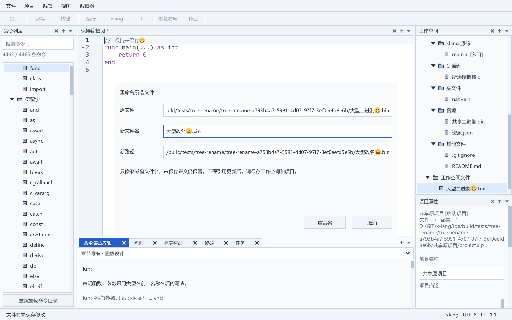
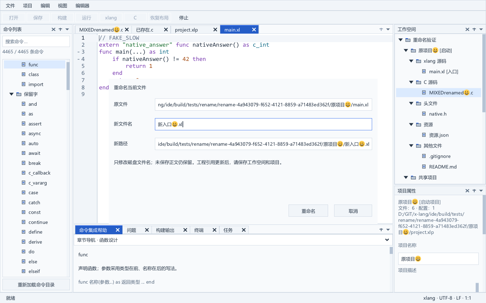

# 文件物理重命名

文件菜单中的“重命名当前文件…”作用于当前编辑文档；在代码编辑器中按 F2 可执行同一操作。工程树选中文件后，项目菜单中的“重命名所选文件…”或工程树 F2 作用于所选文件。窗口显示原文件和目标完整路径，只允许填写同一目录内的新文件名。失败保留输入，取消不改磁盘或模型。

工程树入口支持未打开的普通文件，包括二进制资源。改名不会把二进制素材打开为文本；素材被项目资源配置引用时，受影响配置会增加编辑标签，当前活动 C/xlang 文档保持。其他普通文件改名保持原标签数量。已有文档沿用其编辑器、会话和未保存正文；重命名移动磁盘文件，未保存正文仍需另行保存。

## 文件与工程状态

重命名保持文件物理身份及原始字节，包含 UTF-8 BOM 和 CRLF。Document、FileEntry、编辑器标签和会话 ID 保持；未保存正文、脏状态、版本、选区、折叠及撤销保留。同语法改名保留现有词法与折叠缓存，独立文档变扩展名时自动识别 C 或 xlang，显式语法覆盖继续有效。

当前工作空间中指向原文件的入口、FileEntry、C 源、编译资源和工作空间文件引用一起更新。多个项目及硬链接别名按物理身份匹配，模型引用统一使用新路径，稳定 ID、未知 JSON 字段、启动项目和树阅读位置保持；受影响清单标记已修改，仍须保存工作空间和项目。

工程树操作移动实际选中的路径。若文档通过另一硬链接打开，则只移动所选链接，另一链接留在磁盘；文档和已加载工程引用绑定到新路径。后续正文保存沿用原子保存协议，可能解除与其他硬链接的物理关联。

源码 import/include 不自动改写。目录和已绑定 .xlw/.xlp 的迁移、旧格式导入独立实施。只读、目录、重解析点、缺失或不可用项目中的文件不开放工程树改名动作。

## 资源素材引用联动

项目资源配置中的图标或应用清单指向待改名素材时，工程树和当前文件的重命名入口会更新这些路径。检查范围是当前已加载可用项目的编译资源配置；同一路径的共享配置只更新一次。配置自身通过不同硬链接路径加载时拒绝改名，要求先统一配置路径，避免相对目录基准歧义或未冻结的别名身份变化。根字符串和素材对象中生效的字符串 `path` 都支持，按实际文件身份匹配素材硬链接别名。相对路径继续相对配置目录，绝对路径保持绝对形式，保留 `./`、反斜杠习惯及目标文件名的大小写和 Unicode 拼写。未选中的素材硬链接仍留在磁盘，匹配的配置统一引用新选中路径。

只更换生效路径，保留未启用的 `base64/text` 和现代 XLON 扩展的原始拼写；纯 Base64、内联清单和非字符串 path 不改写。相同文件名确认不更新别名路径，也不新开资源标签。资源配置自身改名继续由工程引用同步处理；另存为、项目目录迁移和源码 include/import 改写不使用此素材改名流程。

窗口打开时冻结配置磁盘身份、摘要和当前正文；已打开配置使用其未保存正文。确认前核对配置磁盘与文档版本，并预打开所需配置标签，预分配补丁和选区/滚动状态。配置缺失、无法解析或检查超过限额时拒绝改名，避免漏掉引用；受影响配置只读时也拒绝。预打开或素材物理改名失败会关闭本次新开的干净标签，原有正文保持。每份配置最多 16 MiB，整批冻结正文最多 128 MiB；检查仍同步执行，慢存储与大规模项目的响应性尚待验收。

素材物理改名成功后，每份配置形成一次可撤销的未保存正文更新；原有脏内容、选区、滚动和活动源代码标签保留。撤销只撤销正文路径更新，不把磁盘素材改回。配置磁盘不会自动保存；保存配置及工程后再构建，沿用外部冲突保护和任务输入失效机制。

固定 SDK 没有可预备或回滚的 CodeDocument 文本事务。若素材已改名而后续文档编辑失败，窗口明确显示“文件已改名”，保留剩余补丁，并提供“完成资源更新”重试；已完成配置不会重复加入撤销历史。此时取消和普通退出受到阻止，其他普通动作保持模态屏障，Escape 后窗口重新打开。此补丁队列只存在于当前进程，强制终止或系统崩溃后的跨文件事务恢复仍未实现。

resource_rebind_test 使用真实改名窗口、磁盘和文档，覆盖共享配置、未保存与未打开配置、同字节配置替换、版本变化、只读及源锁、硬链接别名、Unicode/大小写、同名 no-op、原字段保留、C 编辑状态和单步撤销；测试程序注入一次公开正文编辑失败，核对已改名状态、重试和模态屏障。真实 C/xlang 构建运行及 PE 图标/清单字节也纳入验收，生产程序没有故障注入入口。

## 提交与失败保护

正常会话启用时，确认改名先预打开资源文档、恢复原活动标签，并发布包含全部脏/未命名正文的会话检查点。检查点冲突、损坏、锁定或不可写会阻止物理改名；已预打开的干净标签回退，当前正文、输入、文件与模型保留。检查点后继续核对资源基线，源文件身份与正文仍由最终句柄操作核对。显式 `--no-session` 沿用禁用持久化的行为，同名操作不会为未发生的移动强制写入会话。

物理改名后立即发布当前文档路径与资源正文检查点，保留原活动编辑器；资源部分失败及后续“完成资源更新”重试也发布当前已完成正文。提交后写入失败不会伪装成未改名或再次执行移动：状态栏明确提示“文件已改名；会话检查点写入失败”，原检查点保留。正常退出与防抖保存继续沿用原会话协议。

真实进程中断已验证 C/xlang、资源配置和未命名正文恢复。现已加入 [文件改名事务记录](rename-journal.md)：在磁盘移动后、清单保存前中断，也可恢复内存工程引用和待应用资源补丁，原磁盘清单由开发者显式保存。连续改名、后续编辑与资源撤销通过同一记录检查点保留。项目目录迁移、存储配额和电源故障持久性仍继续实施，不能把文件改名验收视为全部工程事务完成。

窗口保存独立工作空间/项目基线，打开文档另保存路径、版本、语言、脏状态和原始字节。工程树操作还保存所选路径的物理身份、长度、最后写入时间、属性及 SHA-256。确认时核对当前模型、文档和树选择；过期状态保留输入并要求重新打开。已打开且未保存的相关清单正文、项目属性草稿和其他模态窗口受到统一保护。普通字段的 F2 不操作其他文件。

未打开文件以 64 KiB 分块计算 SHA-256，不解码 UTF-8，不分配整份正文，也不受文本编辑器 16 MiB 打开限制影响。最终提交重新锁定源句柄，禁止并发写入与删除，再复核身份、元数据和摘要；文档模式还比较磁盘原始字节。内容变动后恢复时间戳、同字节原子替换导致身份变化都拒绝提交。

新路径、文档元数据、工程补丁和树阅读快照预先准备；磁盘成功后模型补丁无需分配内存。后端明确拒绝只读文件，再执行禁止覆盖的 Windows 句柄重命名。已有目标、准备后出现的目标、共享锁、权限或跨卷失败都保留原文件、文档与引用。只有同一文件的大小写拼写变化可通过已有目标检查，最终仍禁止替换。

失败释放临时计划；成功同步引用并使旧输入相关的未完成构建失效。已打开文档的监视和会话继续使用新路径。字体/DPI 沿用工作台协议，大字号小窗口可双向滚动访问按钮，字体偏好写入失败恢复字体与草稿。

SHA-256 核对目前同步执行；大文件改名功能通过 20 MiB 二进制验收，但超大文件、慢速网络存储与界面响应仍需性能验收。构建输入及文本监视的既有读取限制不因改名而放宽，见 [构建运行说明](tasks-and-toolchain.md) 和 [文件协调](file-coordination.md)。

## 已执行验收

rename_test 使用独立后台 Windows 桌面验证当前文档的脏/干净 C/xlang、字节/身份/BOM/CRLF、版本/选区/折叠/撤销、共享引用、目标竞争和锁定/只读/过期状态、菜单/F2/普通字段、大小写与语法切换、40 DIP 小窗口、字体回滚、新路径监视/会话和旧构建失效。

tree_rename_test 同样使用真实 XGE/XUI、文件系统、模型、文档和任务，补充验证：

- 未打开的 20 MiB 二进制文件按独立已知 SHA-256 核对；不新增标签、不改变另一活动脏文档；取消和同名操作保持状态。
- 同长度内容变动并恢复时间戳、同字节原子替换、目标已存在、源共享锁/只读、过期模型/树选择/文档及未保存清单保护；失败输入保留、计划清理。
- 共享二进制和实际选中的 C 硬链接移动，未选链接仍存在；共享引用、稳定 ID、未知字段、选区、撤销、文档会话和活动标签保留。
- 实际工程树 F2 与项目菜单，项目节点、不可用项目及普通属性字段不误触发；稳定文件 ID 对当前模型路径解析。
- 未打开入口、头文件、资源配置改名，旧构建失效，真实 DEMO6 根据新入口/C/头文件引用/资源配置构建并运行成功。

2026-10-06 最终严格 Release 重建与完整 CompilerPath 回归退出码 0：43 个应用模块、35 类测试、47 个公共动作、71 张新鲜原生图和 SDK 负面检查。完整记录见 [实施进度](progress.md)。以下原图来自本次完整回归。

