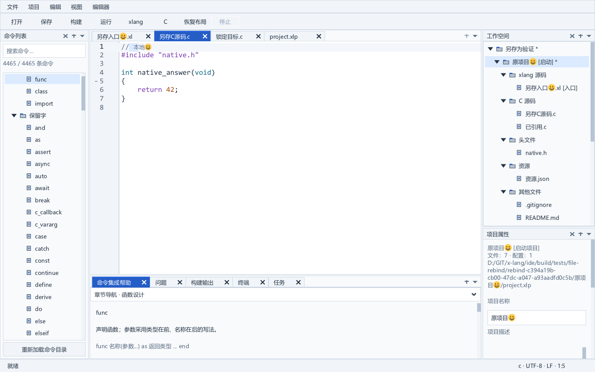

# 文件另存为与工程引用协调

“文件 → 文件另存为…”沿用原生 Unicode 保存对话框。已命名工程文件另存为成功后，当前工作空间中指向原物理文件的 FileEntry、项目入口、C 源、编译资源和工作空间文件引用统一改为新路径。稳定文件 ID、项目 ID、未知字段及启动项目保持；编辑标签、文档身份、会话 ID、正文版本、选区和撤销继续保留。原文件保留在磁盘。

## 使用与保存状态

| 情况 | 行为 |
| --- | --- |
| 共享入口或源文件 | 当前加载的所有相关项目一起更新引用，包含原文件的硬链接别名 |
| C 源 | 更新 FileEntry 与 cSources，保持 .c |
| 头文件 | 更新 FileEntry，保持 .h，不加入 cSources |
| 编译资源配置 | 更新 FileEntry 与 resources，保持 .json 或 .xlon |
| 工作空间文件 | 更新引用并标记工作空间已修改 |
| 独立或未命名文档 | 继续使用普通另存为；扩展名可以改变，未显式覆盖语言时按新路径识别 C/xlang/纯文本 |
| 已绑定 .xlw/.xlp 清单 | 源文件另存为拒绝改绑或覆盖；工作空间使用专门的“工作空间另存为”，项目清单迁移仍待后续独立操作 |

受影响项目标记为已修改，后续保存项目/工作空间时通过已有磁盘基线与原子清单写入持久化。正文已经保存不代表工程清单已保存；构建前沿用现有保存流程。其他未加载工作空间不被改写。新路径与同一项目/工作空间的另一文件引用冲突时拒绝，不合并或丢弃另一文件身份。

这一操作同步工程管理路径，源码中的 import、C include 或其他字符串引用仍由开发者修改；跨文件语义重构依赖后续真实语言服务。文件物理重命名、目录迁移和项目清单另存为也仍需独立实施。

## 事务与失败保护

services/file_rebind.c 使用独立路径补丁计划。准备阶段在 UI 线程枚举所有相关入口、FileEntry 和构建字段，按实际物理身份匹配共享文件；验证扩展名、重复引用和清单保护，并分配所有替换路径与项目列表，不写入任何文件。模型在准备和应用之间保持不变，调用期间不派发用户事件；后台服务不直接修改模型。

editor/documents.c 仍负责文档编码、保存目标冲突和原子写入。新增完整保存结果回调 saveFinished，覆盖准备拒绝、另一打开文档占用目标、覆盖未确认、编码或写盘失败、无变化保存及成功。失败立即释放计划和阅读快照，文档路径、脏状态与模型保持；成功后无内存分配地替换模型路径，再刷新原生树和阅读状态。

右侧未应用属性、设置模态窗格，以及受影响工程清单的未保存正文阻止路径事务，防止刷新覆盖草稿。正常文档去重与覆盖保护继续生效。另存为不同硬链接拼写即使正文干净也真正保存和重新绑定；只对完全相同的规范化路径执行无变化快速返回，避免返回成功却仍保留旧文档路径。

提交使受影响项目的未完成构建快照失效，旧任务不能依据旧引用运行。文件监视器通过模型/文档路径指纹重新订阅，新文件的后续有效正文变化进入原有自动更新或磁盘变化确认流程；会话从当前文档路径序列化，无需更换文档 ID。

## 验收

file_rebind_test 在独立后台 Windows 桌面使用真实 XGE/XUI、模型、文档、监视、会话和任务服务。验证共享入口、C 源硬链接别名、头文件、工作空间文件和资源配置，准备阶段无写盘、稳定身份/未知字段/启动项目/树选择，实际锁定目标的原子失败、种类/重复/打开文档/清单/模态保护及所有保存结果的计划清理，独立文档语法切换、原文件字节、干净硬链接另存为、选区/撤销/会话、新路径的实际外部修改与旧构建失效。指定 CompilerPath 后使用更新清单中的新入口、C 源和资源配置实际构建运行 DEMO6 项目。

最新完整回归结果与原生图见 [实施进度](progress.md)。当前不把路径管理同步宣告为源码语义重构，也不把该增量视为完整 IDE 发布验收。

## 完整回归记录

2026-10-06 严格 Release 重建和真实 CompilerPath 完整回归退出码 0：41 个应用模块、33 类测试、66 张原生图与 SDK 负面检查。两张实际图已经查看，来自这次完整回归。真实 DEMO6 使用更新清单中的新入口、C 源及资源配置构建运行通过。

