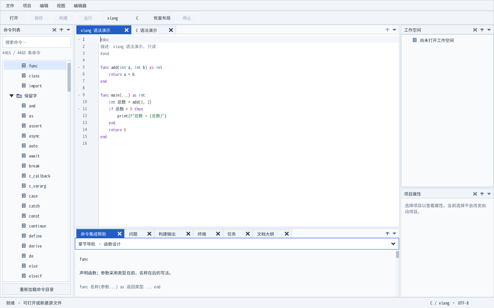
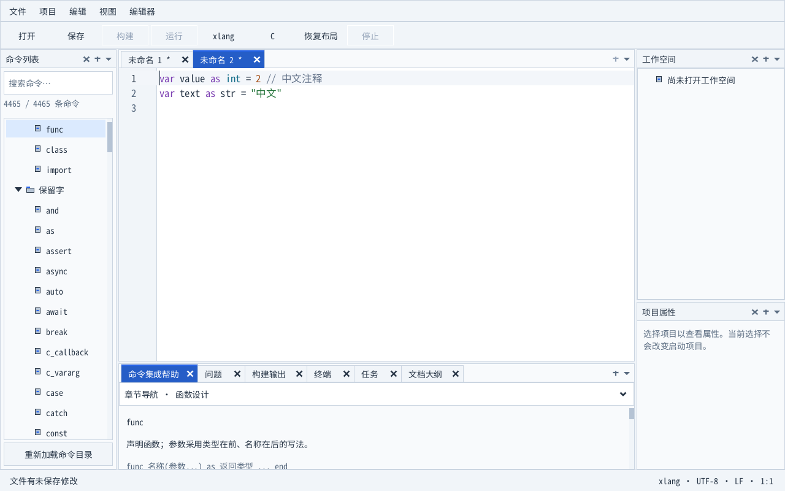

# 随包中文字体与离线启动

Windows 未安装微软雅黑或 Consolas 时，IDE 使用程序目录下的 `data/fonts/NotoSansMonoCJKsc-Regular.otf`。正常设备仍优先使用原有系统字体；保存的外部字体不可用或系统字体损坏时，继续尝试随包字体。两套字体资源都不可用时，启动返回失败，并沿用已有的原生错误提示与诊断机制。

随包字体是未修改的 Noto Sans Mono CJK SC Regular 2.004，覆盖中文及等宽 ASCII。来源固定到 [官方仓库提交](https://github.com/notofonts/noto-cjk/tree/f8d157532fbfaeda587e826d4cd5b21a49186f7c/Sans/Mono)，字体 SHA-256 为 `ec04cc376b34887cedbdf84074e2e226ed2761eeabdcb9173fc1dd7bfd153ef7`。按上游 [SIL Open Font License 1.1](https://github.com/notofonts/noto-cjk/blob/f8d157532fbfaeda587e826d4cd5b21a49186f7c/Sans/LICENSE) 随程序分发；完整许可证、版权说明和来源记录均保存在同一目录，并纳入便携载荷清单。

字体设置页支持 TTF、TTC、OTF，字号仍为 8–40。加载保持 64 MiB 上限和字体表范围检查，采用内存接口验证实际字体；中文备用字体也从内存建立，支持中文及深路径的外部字体文件。C、xlang 编辑器、帮助代码、输出和终端共享代码字体偏好。

默认 `option/settings.json` 中的随包字体保存为 `../data/fonts/...`，重新复制或搬移目录后仍能恢复各自字号。显式指定的外部设置文件和外部字体保留绝对绑定。自动回退仅影响本次显示，保留磁盘上的失效偏好；“填入默认值”仍只修改草稿。

`font_fallback_test` 使用真实生产字体服务、XGE/XUI 和隔离的系统字体目录，在从未切换的 Windows 桌面验证缺失、损坏、失效偏好、仅有拉丁字体、资源缺失、超过 260 字符的中文字体文件路径，以及另一进程在迁移目录后恢复偏好。中文字符通过真实标签渲染与缺字方框比较；C/xlang 文档通过实际编辑事件验证词法高亮和版本保持。构建与打包同时核对字体、许可证、来源、版权说明，拒绝缺失或过期的发行资源。

深程序路径另有本机驱动边界：独立 Win32/WGL 复现、实际 minidump 调用栈及匹配模块反汇编将失败定位到 AMD OpenGL 模块 `atio6axx.dll` 的固定容量目录复制。IDE 已增加可用短别名的自动启动处理，并修复命令目录的扩展路径读取，详见 [深程序路径启动](startup-paths.md)。没有可用短名称的卷、其他驱动及干净 Windows 尚未验收；外部深路径字体文件与程序启动分别验证。实体设备与正式分发条件继续开放。
