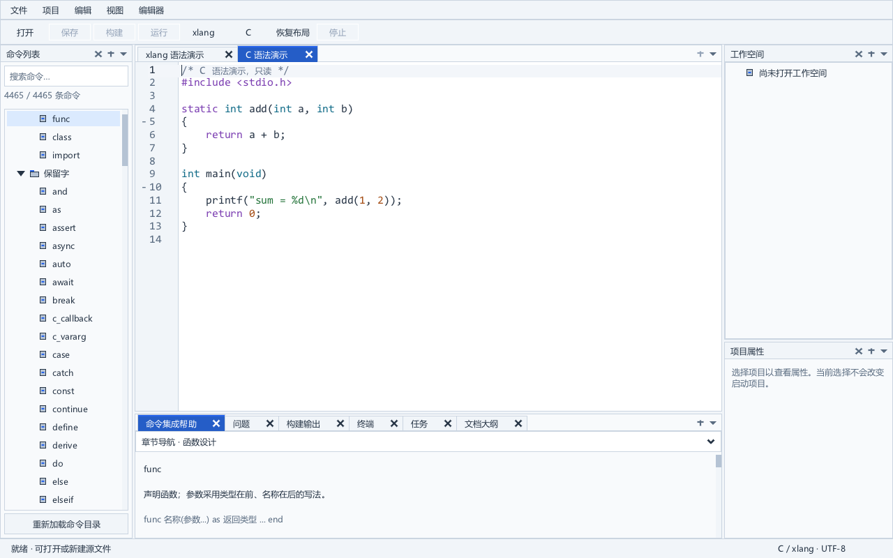
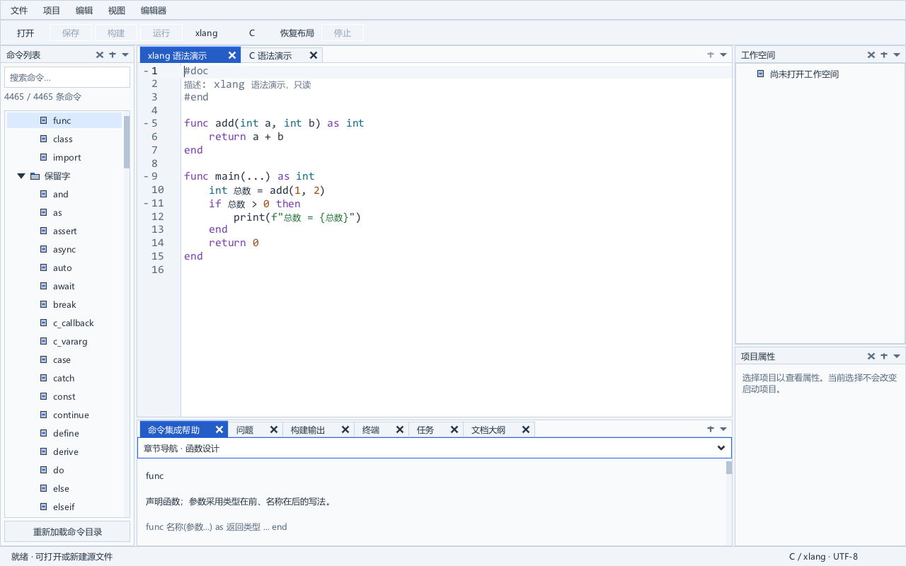

# 完整 IDE 与 SDK48 集成候选

完整应用已使用成套 SDK48 和十份已验证的编辑器工厂／文本追踪改动重新构建，并通过标准原生回归及本阶段便携专项检查。候选供本地开发验收，不宣告正式发行、整体 SDK ABI 或性能验收。固定 SDK、正式工作区源码、现有运行产物和原便携包保持原样。

## 可运行候选

- 目录：`dist/portable-20261011-integrated-editor-v1/xlang-ide/`
- 启动：目录中的 `xlang_ide.exe`；诊断入口为 `xlang_ide_console.exe`。
- 压缩包：`dist/portable-20261011-integrated-editor-v1/xlang-ide-windows-x64.zip`。

布局沿用定版方案：左侧命令列表；中央编辑器及其下方单栏帮助／输出／终端；右侧上方工作空间，下方项目属性。编辑器支持 C、xlang 和纯文本，工作空间—项目—文件、保存和恢复、命令帮助、构建运行及已有真实语言服务继续验证。包内 xlang 和 clangd 使用相对默认路径。

## 构建与实际接口

复制冻结的应用／工具／测试／数据输入，在独立树中应用十份编辑器改动，使用消费者 SDK48。显式启用 `XIDE_STREAM_LAYOUT_ENABLED=1` 与 `XIDE_CURSOR_LAYOUT_ENABLED=1`。实际完整严格构建退出 0，用时 171.313 秒。

83 个对象按正式对象清单逐项确认，其中包含 `tools_clangd_input_trace_NativeInput.c.o`，不能仅用 `src_*.c.o` 统计。当前标准构建实际生成 98 个程序／DLL：4 个核心产物、4 个辅助程序，以及测试程序。受保护的旧 105 个运行产物中，另有 7 个历史诊断探针不属于标准构建；本候选明确排除它们，没有复制旧文件冒充新编译结果。主程序实际按名称导入全部五个新增访问接口。

最初统计控制器漏计工具模块而退出 1；原生构建本身退出 0。更正的是清单发现方式，未重编译已通过的应用。原脚本、实际构建记录和纠正说明保留。

## 标准原生回归

使用原 `test.ps1` 的完整标准参数集、真实冻结编译器、两套 clangd、真实 C/xlang 桥接和类型查询；没有 `SkipRender`，没有删减功能断言。V4 原生及外层控制器均退出 0，用时 993.375 秒。

覆盖工作空间与项目、C/xlang 文档和编辑命令、帮助、字体／布局、资源、迁移与重命名、恢复、外部文件变化、进程与任务、真实语义及原生错误恢复。会话在多进程与宽度变化下恢复；实际 C/xlang 工程构建运行、失败构建不运行旧产物和明确配置的测试任务继续检查。标准截图与原生事件记录保留在独立证据根目录。

测试根目录必须同时满足 Windows 原有路径边界和各检查器自己的 `ide/build` 归属保护。V2 过深的测试根目录在 244 字符的原子写入路径失败；补充的两个原生 SDK 实验表明，原 SDK 与候选 SDK 在该路径均返回失败，在较短路径均成功。V3 的输出位于复制项目外，被重命名证据目录保护拒绝。V4 改用候选项目内部的短 `build` 子目录，两项保护保持不变。失败及补充实验原样保留；没有把原有原子写入边界标记为修复。

## 实际源码与便携材料

`tools/prepare_experimental_sdk_materials.py` 从实际严格构建命令读取 IDE 配置，以同一 GCC 对 119 个翻译单元观察依赖。确认 211 份预处理依赖均在 241 份实际源码清单内。全部源码、构建／资源入口以及 13 份命名或内嵌说明来源被保留。原通用材料收集器接受新的准确描述，登记 249 份材料；缺少来源时状态明确，错误 DLL、错误源清单及损坏新增 helper 均拒绝。

SDK 组装与公开兼容范围详见 [公开接口检查](sdk-public-compatibility.md)。XRT 消费者声明来自相同的完整实现／配置／生成快照，DLL、导入库与公开头来自同次 SDK48 构建。包中另存本次源构建报告、源清单和父 SDK 清单，不将旧 236 份描述作为新 DLL 的完整来源。

便携输入使用独立副本，只替换实际 SDK 材料描述并补充三份成套来源记录及正确的快速入门说明。应用二进制逐字节沿用本次通过的严格构建。原包工具在独立目录组装，随后逐文件校验并复制到上述工作区评审目录，校验 ZIP 和全部载荷。共 4356 份载荷，归档 SHA-256：`8bf07c760d70bfceacfe279fbfb81652a1efd09e776b9f11454050f6b4242af0`。

本阶段再运行便携／迁移默认提供者检查、随包真实 TCC 标量与 C/xlang 桥接检查，以及实际 GUI 父进程／启动缓存检查。每项使用独立且从未切换的 Windows 桌面和所属 Job，实际退出均为 0。便携首次检查因测试程序不在检查器自己的 release 目录而被归属保护拒绝，实际退出 1。随后将已通过的应用输入、98 个原生产物和候选逐字节复制到独立短目录，以同一检查器和本地 helper 重试；候选 dist 与 helper release 归属保护保持原样。原评审副本未被这些检查修改。沿用的编译器来源材料与此前专项证据仍明确绑定；这不宣告所有复杂扩展库或全部 ABI 等价。

## 验收边界与定位

首版长期任务继续进行。SDK 全部发行条款／完整 ABI、所有干净 Windows 设备、实体 IME 与混合 DPI、复杂扩展库／完整 C 预处理图，以及 16 MiB 极长行响应仍保留原验收缺口。本阶段没有替换固定 SDK、覆盖现有应用或标记这些缺口通过。

原生 C／xlang 预览：

实际报告：`build/editor-integrated-strict-v2-artifacts.json`、`build/editor-integrated-full-v4-run.json`、`build/sdk48-materials-closure-v2/result.json`、`build/sdk48-materials-collection-v1.json`、`build/editor-integrated-package-v2-run.json` 和 `build/editor-integrated-portable-v2-run.json`。阶段封存再核对 1,622 份冻结材料、原 83 个对象、105 个运行产物及 3 个编译器产物，并保存本阶段新工具、文档和预览快照。
