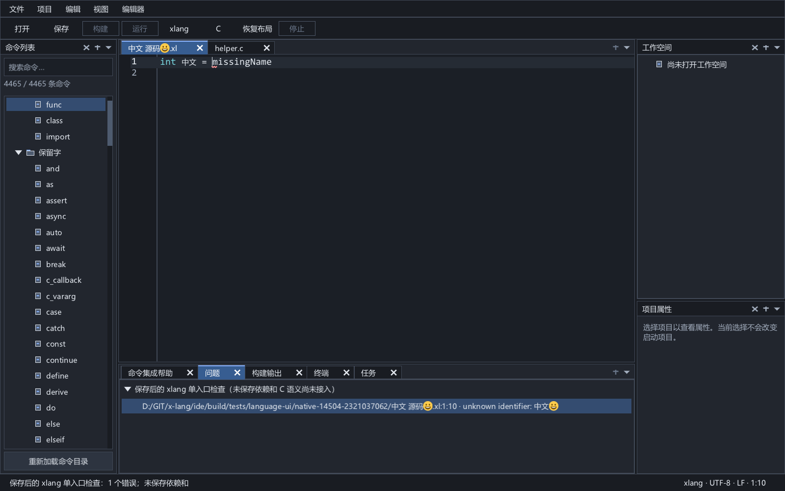

# xlang 语言服务与文档快照诊断

2026-10-22 开发服务 0.9：宿主与共享前端使用独立编译器 XRT。默认未保存文档检查在常驻 XRT 执行器中保留完整语义／typed IR／类型化索引，相同输入与正文可跨新版本复用，命中前重新验证磁盘、导入候选和包环境。协议线程以引用捕获正文，物理别名检查在工作线程执行；光标位置使用正文行索引。补全保持独立前台执行路径，折叠使用独立分析执行器。源码编辑目前仍整份重建，函数／依赖级增量继续开发。保存后兼容模式及 C 桥接仍走 CLI。已发布目录保持旧候选，长期计划、阶段证据及边界见 [LSP 实施计划](lsp-development.md) 和 [分析核心](lsp-analysis-core.md)。

UTF-16 `didChange` 范围变化及同一通知内的顺序多次编辑继续兼容全文同步。IDE 的补全、诊断／导航客户端均保留文档镜像，协商增量或全文变化；重复查询不重开、重传未变正文，连接重启发送当前全文。文本快照复用 XRT，失败时不提交正文或版本；这属于文本同步能力，尚不是语义增量分析。以下部分包含此前阶段的全文同步与能力记录。

`initialize.initializationOptions.diagnosticsBackend` 可选 `native`（默认）或 `cli`，其他值返回无效参数。`capabilities.experimental.nativeSnapshotDiagnostics`、`diagnosticsBackend` 报告当前快照后端；`savedDiagnosticsBackend=cli` 明确保留的保存后模式。原生分析使用服务构建绑定的前端，不依赖执行编译器文件存在；IDE 启动配置仍保留编译器路径供执行和兼容模式使用。受控编译器响应测试显式选择 CLI，不能将这些测试算作原生静态分析本身的证明。

`experimental.retainedSemanticChecks` 表示默认原生检查使用常驻检查会话，`retainedNativeInputs` 表示原生请求以不可变正文引用捕获输入。原生快照响应的 `analysis` 字段提供实际完整检查调用次数 `builds`、验证后复用次数 `cacheHits`、输入守卫拒绝次数 `invalidations`、当前输入文档数／字节数及捕获／适配／分析线程身份。计数来自核心会话，不是按请求推测的命中率；语法折叠的既有 `xlang/analysisStats` 计数仍单独报告。

本轮接通独立 C 程序 `xlang-ls.exe`、后台 stdio 客户端、真实编译器检查、CodeEdit 错误标注及中央问题窗格。首版仍是传统 IDE，C/xlang 的词法高亮、折叠和目录补全保持可用。

GUI 提供当前 `.xl` 文档快照检查，使用所有已打开命名 `.xl` 的正文及版本覆盖入口、递归源码和源码包；逐文件 CodeEdit 标注和中央问题定位已接入，修改后可自动复查。独立 C 后台及 stdio 使用 `xlang/check`；旧 `xlang/checkSaved` 和保存后菜单保持兼容。成功检查后已接入真实符号定义与 F12；已实现当前文档大纲和原生悬停；项目多输入和 C 语义继续实施，原生候选已接入独立客户端；标准 LSP 光标补全已接入独立当前快照，详见 [补全服务](semantic-completion-service.md)。详见 [定义跳转](definition-navigation.md) 与 [大纲及悬停](outline-hover.md)。

## 原生使用

1. 配置 xlang 工具链路径，打开命名的 `.xl` 入口并保持该入口的 xlang 语法。原生分析使用服务构建绑定的前端；CLI 兼容检查需要所选编译器具有源码覆盖和来源报告能力。
2. 执行“检查当前 xlang 文档（含未保存依赖）”。入口和已打开 `.xl` 依赖无需保存，编辑器保留正文、选区、脏状态和撤销历史。命名的恢复文档可以提供尚未落盘的依赖；未命名文档须先确定路径。
3. 错误标注显示在对应文件，中央底栏“问题”页列出路径与位置。双击或选中后按 Enter 定位；未打开的磁盘依赖会先核对检查时的正文摘要与文件身份，再打开并跳转。BOM/CRLF 文件按规范化的 UTF-8 编辑正文定位。
4. 显式检查开启本次入口的自动复查。任何已打开 `.xl` 的全文/版本、路径、语法、外部冲突或打开集合变化都会撤销旧结果；等待最后一次修改 500 ms 后，以原入口而非当前活动标签复查。切换到 C 标签不会改换检查入口，C 修改不会使 xlang 批次失效。
5. “取消源码检查”可取消进行中的请求、等待复查或已开启的自动复查，并撤销标注。取消后修改不会重新启动编译器，下一次显式检查重新开启。关闭入口或复用其文档槽位终止该自动状态；此状态不跨会话持久化。
6. 服务异常退出会撤销结果；再次显式检查重新初始化并同步全部命名 `.xl` 全文，不沿用旧进程版本。一次结果全部验证后才提交，晚到的通知不能逐个文件写入过期标注。

入口必须命名、扩展名为 `.xl` 且处于 xlang 模式；其依赖覆盖按命名 `.xl` 文件收集，包括显式覆盖为其他显示语法的 `.xl`，编译器仍按 xlang 分析这些文件。任一参与文档有需要处理的外部冲突、超过容量、没有编译器或上个请求仍在结束时不能启动新批次。磁盘缺失的命名文档可以用本地正文检查，缺失提示仍由文件协调保留；其他外部冲突会暂停检查。最多 64 份、8 MiB/份、32 MiB 合计；单通知另受 8 MiB JSON 帧限制，转义、URI 等开销也计入。

“检查已保存的 xlang 源码”继续提供旧编译器兼容入口，只接受已保存、无外部冲突的命名 `.xl`。该旧模式仅显示入口结果，在该文档成功保存、另存为或物理改名后复查；不覆盖未保存依赖。两种检查共用当前的一批结果，显式启动另一模式撤销此前标注。C 文件继续支持编辑、构建和运行，构建 C 错误从任务问题定位，目前定位到行首。

选择任务会使问题窗格显示该任务的诊断；两种来源共用现有标签。命令列表仍在左侧，工作空间和项目属性仍在右侧，底栏只占中央宽度。成功快照结果保留期间，后台持续复核本次实际输入、已观察候选、工具链及服务进程环境；发现变化后整批撤销，并由 GUI 延迟复查。该观察仅覆盖本次单入口报告中的输入，尚不是完整工程的实时分析。

## 模块与进程边界

| 模块 | 职责 |
| --- | --- |
| `protocol/lsp_wire` | 有界帧解析、Windows 文件 URI、UTF-8/UTF-16 严格位置与批量转换 |
| `platform/process` | 默认合并日志，协议模式独立 stdout/stderr，后台读写、取消与进程树清理 |
| `services/language_client` | 后台发送及接收队列，子进程协议读取，异常退出和坏帧检测 |
| `services/language_check` | 保存检查与不可变快照任务、生命周期及取消 |
| `services/language_snapshot` | 原生引用捕获／类型化分析适配、CLI 临时全文覆盖、输入守卫、UTF-16 诊断与独立光标查询 |
| `analysis/check_session`、`analysis/worker` | 常驻 XRT 检查会话、完整语义／IR 复用、后台队列及结果所有权 |
| `services/semantic_completion` | 有界候选解码、原字节/标量范围核对与 UTF-16 整段 textEdit |
| `server/xlang_ls` | 独立 stdio 服务、请求关联、文档版本和检查任务生命周期 |
| `ui/language_view` | 公共检查/取消动作、初始化和重连、编辑器范围映射与结果有效性 |
| `ui/task_view` | 已有中央问题窗格的来源切换、节点选择及跳转 |

GUI 不载入 `xlc.dll` 或 `xl.dll`。默认服务直接链接共享前端与编译器 XRT；保存后／显式 CLI 兼容检查和 C 桥接执行独立编译器进程，不把编译器 DLL 导入服务地址空间。所有 GUI 模块使用固定 `xge.dll` 提供的 XRT 实例；服务不初始化图形窗口，也不混用 GUI 的分配器或容器。

CLI 兼容后端每次执行真实 `--help`；旧模式运行 `check <absolute-file.xl> --json`，快照模式另加 `--source-report` 与逐文档 `--source-overlay`。即使存在工具链观察缓存，CLI 检查仍核对本次能力声明和前后文件指纹。原生检查无需这些进程和临时文件。输入只读，不保存或重写源码；兼容编译器 stdout 必须是完整、有界的 UTF-8 JSON，stderr 独立消费。检查发生错误时保留用户的编辑状态。

## 协议与能力

开发版 0.23 默认原生后端支持打开／编辑后的标准自动诊断，按入口贡献保留、依赖失效和后台观察，详见 [自动诊断](lsp-automatic-diagnostics.md)。另外提供可协商的 [文件输入证明](lsp-diagnostic-proofs.md)，复用已验证正文摘要与磁盘身份，以及共享的 [在线文档同步确认](lsp-input-state.md)。当前 IDE 两个客户端显式关闭新默认自动行为，诊断／导航仍使用上述批次控制，待后续同步与界面策略接入；补全客户端关闭它以避免重复检查。标准定义、悬停与文档符号的按需分析继续支持，无需事先手工检查；范围、错误与调度契约见 [按需语义分析](lsp-on-demand.md)。开发构建与发布候选分别记录。

规范参考 [Microsoft LSP 3.17](https://microsoft.github.io/language-server-protocol/specifications/lsp/3.17/specification/)；帧采用 ASCII `Content-Length`、CRLF 头和 UTF-8 JSON-RPC 2.0 正文。长度按字节，支持分片和连续帧，拒绝缺失/重复/非法长度、非 UTF-8 编码、坏 JSON 和截断 EOF。

实现了 `initialize`、`initialized`、`shutdown`、`exit`、`$/cancelRequest`、`didOpen/didChange/didSave/didClose` 和 `publishDiagnostics`，变化通知支持有序增量及全文内容。请求 ID 按整数或字符串关联；未初始化请求、重复初始化、未知方法、坏参数、取消及变化后的请求返回明确错误。通知没有请求响应。关闭文档或正文版本变化时清空该版本的诊断。

初始化响应声明 UTF-16、增量同步及全文变化兼容、打开/关闭与保存通知。`experimental.savedEntryDiagnostics`、`snapshotDiagnostics` 和 `unsavedDependencies` 为 true，表示自定义保存检查及文档快照检查；CLI 快照后端要求编译器在 check 帮助行声明 `--json/--source-overlay/--source-report` 并返回可验证报告，默认原生后端无需该进程。`snapshotDocumentFingerprint` 为 true，表示快照文件组携带规范化正文摘要及磁盘输入身份。`snapshotInputGuard` 为 `background-poll`：成功快照在保留期间由后台持续复核，每轮复核完成后等待一秒。结果的 `guardScope` 使用相同值；旧保存模式仍没有此持续守护。`cSemantics` 为 false；声明 definitionProvider 与实验性 snapshotDefinition，具体可用性取决于该次成功索引；声明 hover/documentSymbol 与相应 snapshot 实验能力，已声明 completionProvider，补全使用独立当前快照查询；GUI 使用独立客户端查询原生语义候选，并组合现有目录提供者；详细交互与边界见 [原生补全](native-completion.md)。详见 [补全服务](semantic-completion-service.md)。

显式自定义请求 `xlang/checkSaved` 参数为：

```json
{
  "textDocument": { "uri": "file:///D:/Example/main.xl" },
  "version": 7
}
```

文件必须以同 URI 和版本在服务中打开，正文采用 IDE 内部去 BOM、规范化为 LF 的 UTF-8；其他客户端当前也需要遵守此约定。服务会核对磁盘解码正文与全文同步内容一致。成功分析返回真实 `ok/phase/version/durationMs/count/diagnostics`，语义错误允许 `ok:false` 并带编译器实际诊断；这不同于协议或编译器执行失败。界面初始化 `checkOnSave:false`，由自己的成功保存回调提交复查，避免一次保存触发两次编译器检查。其他客户端默认可使用保存通知触发检查。

URI 保留路径大小写，支持驱动器和 UNC 共享路径；空格、中文、非 BMP、`#` 与 `%` 使用 UTF-8 百分号编码。解码拒绝非 file URI、查询/片段、坏转义、NUL、转义的路径分隔符和非绝对 Windows 路径。

## 位置和过期结果

编译器当前使用一基行列，xlang 列按 Unicode 标量计数。服务验证实际行列后转换成零基 UTF-16；GUI 再将范围映射为 CodeEdit 的 UTF-8 字节偏移。非 BMP 字符占两个 UTF-16 单元，组合字符逐标量计数；不能定位到 UTF-8 标量内部、代理项中间或 CRLF 中间。编译器只提供起点，所以错误标注当前覆盖一个 Unicode 标量，并未伪造完整语法节点范围。

GUI 对一组诊断采用排序后一次文本扫描，批量映射最多 8,192 个位置；全部合法才提交。正文、文档版本、路径或外部观察状态变化时撤销标注。关闭后复用文档控件也清理旧标注和借用字符串。请求 ID、服务文档 generation/version 和 GUI CodeDocument 版本共同防止晚到结果应用到另一个标签。

服务在分析前后核对入口的原字节、SHA-256 和文件身份，以及 `xl.exe/xlc.dll/xl.dll` 状态。源文件被同字节替换或工具链变化也不能发布本次结果。旧保存模式只保护入口与工具链；快照模式按报告复核本次实际加载的源码/包描述和已观察候选/环境，仍不能据此声称所有项目输入一致。

## 资源上限与清理

| 项目 | 当前上限 |
| --- | --- |
| 协议头 / 正文 | 8 KiB / 8 MiB |
| GUI 每方向消息队列 / 服务输入队列 | 2,048 条、64 MiB / 256 条、64 MiB |
| 服务文档 | 64 份、每份 8 MiB、合计 32 MiB |
| 编译器帮助 / 保存检查 JSON / 普通快照 JSON / 索引及补全查询 JSON | 65,535 字节 / 1 MiB / 4 MiB / 12 MiB |
| 补全候选 / 保留文本 / 序列化列表 | 4096 / 4 MiB / 7 MiB，超限整批拒绝 |
| 快照加载图 / 导入候选 | 512 路径、64 MiB 正文 / 2,048 路径、1 MiB 路径字节 |
| 诊断 | 4,096 条 |
| 编译器子进程 | 每次帮助或检查最多 30 秒 |
| stdout / stderr 内存环 | 各 1 MiB，独立丢弃计数 |

stdout 丢失任何协议字节都会使客户端失败；stderr 可以有界保留尾部，完整日志模式分别写到日志和 `.stderr` 文件。二进制或切分的 UTF-8 stderr 不直接进入界面字符串。取消、EOF、坏帧、服务崩溃与应用退出都清理写线程、读线程和关联子进程。服务异常退出后再次显式检查会重新初始化，并发送当前文档完整正文，不沿用旧请求结果。

## 编译器审计与下一步

本轮核对了 `demo6/release/include/xlc.h`、`demo6/src/api/xl_api.c`、`demo6/src/compile/xl6_imports.c` 和诊断生成代码。`xlcAddSourceFile/xlcAddSourceString` 会替换现有单入口；导入路径调用 `xl6ParseFile` 从磁盘读取。上一轮公开 API 没有完整符号、类型或定义查询，也没有依赖源码覆盖回调；本轮已补充上下文持有的源码覆盖接口，符号/类型/定义查询仍待继续。

后续在 DEMO6 源码与其权威文档补充覆盖层、完整来源范围和查询接口，再接递归依赖版本、诊断、大纲、悬停、语义补全和定义跳转。C 语义与跨语言映射需要独立实现和验收。当前不引入 Python 服务、AI 面板或 AutoTestIDE 的自动化业务模块。

## 验证入口

`build.ps1 -Tests` 构建独立服务与受控进程夹具，`test.ps1` 注册 `snapshot_view_test`、`snapshot_check_test`、`lsp_test` 和 `language_view_test`；前两者需要现代 CompilerPath。指定真实 CompilerPath 时，两者另执行实际 DEMO6 检查和原生标注，现有混编构建运行回归继续执行。

`lsp_test` 覆盖分片/连续帧、错误编码和长度、URI、非 BMP/组合/CRLF、批量位置提交、真实检查适配、无能力/坏字段/超量/异常退出、stderr 洪流、源与工具链变化、未初始化、全文版本、进行中修改、取消及坏服务清理。`language_view_test` 在未切换的独立桌面验证实际菜单、可选择节点和 Enter 定位、C/xlang token、中央底栏边界、检查期间编辑、保存复查、取消、语言覆盖、改名、关闭/控件复用及多主题/字号绘制；还实际结束本测试拥有的服务进程，验证清除结果、重新初始化和全文重同步。

最终完整回归和工具链指纹记录见 [实施进度](progress.md)。





## 编译器覆盖层前置增量

DEMO6 现已新增 `xlcSetSourceOverlay/xlcRemoveSourceOverlay/xlcClearSourceOverlays` 和 CLI `--source-overlay`，支持入口、普通递归源码导入、源码包和包依赖的未保存文本；覆盖也可提供尚未落盘的 `.xl` 路径。注册复制严格 UTF-8 文本，最多 64 份、每份 8 MiB、总计 32 MiB；成功更新与工作目录变化使编译缓存失效，失败更新保留旧状态。检查不改写原源码。

parser/import/semantic 的诊断现保留真实文件标签，AST 导入移动和类型克隆保留共享来源。文件标签不等于完整来源范围或语义查询。合同及原生质量门见 [DEMO6 IDE 源码覆盖接口](../../demo6/docs/IDE源码覆盖接口.md)。

该历史前置增量中 GUI 与 stdio 服务仍使用保存后入口检查。后续须把每个打开文档的版本和全文同步为编译快照，验证递归依赖/工具链身份，分文件发布与定位诊断，处理过期结果、取消和服务重启。该历史前置增量时服务尚未声明覆盖能力；当前服务能力以本页“协议与能力”和后续全文快照增量为准。C 语义及查询能力仍未宣告支持。

## 加载来源报告前置增量

DEMO6 新增 `xlcCheckWithSources` 和 `check --json --source-report`，可记录实际加载的入口、递归源码和包描述文件，区分磁盘/覆盖/字符串入口，提供实际原字节与解析正文 SHA-256、文件身份、修改时间及完整状态。重复读取使用首次不可变快照，输出前复核磁盘输入，改写、删除和同字节替换都会使报告失效。普通 JSON 检查保持兼容；字段、上限、原生验收见 [编译器接口合同](../../demo6/docs/IDE源码覆盖接口.md)。

这是读取来源观察，scope 明确为 loaded-sources-and-manifests；缺失候选/目录优先级、环境、C/头文件/库等输入尚未包含。该历史前置增量时 GUI/stdio 仍为保存后入口诊断；当前 GUI/stdio 已接入下述全文快照、分文件坐标及发布前输入复核、修改/关闭失效和崩溃后的全文重同步。


## 全文快照后端与 stdio 增量（2026-10-07）

`xlang/check` 与 `xlang/checkSaved` 使用相同参数格式，入口 URI 和 version 必须对应服务当前打开的文档。新请求把所有已打开命名 `.xl`（最多 64 份、8 MiB/份、合计 32 MiB）复制为不可变批次。路径按编译器的词法绝对 Unicode 大小写规则匹配；重复词法/物理别名拒绝。覆盖可以提供尚未落盘的命名文件和递归包源码，不要求入口已保存。正文仍须严格 UTF-8、不含 NUL；协议 8 MiB 正文限制还包括 JSON/转义/URI 开销，因此实际单通知文本须留出帧开销。

产品使用独占 GUID 命名的临时文件生成 UTF-8 快照，通过重复 `--source-overlay` 传入 CLI，不改原源码。每次先观察实际帮助和编译器/运行库指纹，再执行 `check --json --source-report`。只接受完整 `sourceReport` 和 schema-1 `resolutionReport`；覆盖输入摘要必须匹配本次提交，磁盘输入以同句柄复核原字节、BOM 后正文、大小、身份、属性与时间。发布前再次复核磁盘内容、缺失/存在的普通文件候选、`XLANG_PACKAGE_PATH` 及工具链；改变、删除、同字节替换、优先候选新建或旧工具链不发布结果。

编译器实际文件标签匹配其已加载输入图，每条一基标量位置只与该文件正文校验和转换。该后端增量当时响应新增 `scope: entry-with-open-overlays`、`guardScope: before-publication`（后续发布后增量已改为 `background-poll`）、`documents`（path、origin、normalizedSize/normalizedSha256、打开文件 version 或磁盘 input 来源记录，以及 diagnostics）；顶层 diagnostics 为带 file 的平坦列表，count 是错误总数。每组同时经 `publishDiagnostics` 发布，打开文件带其版本，未打开磁盘导入不伪造版本。未使用但打开的覆盖也有空组，便于清除旧标注。

任一有效 didOpen/didChange/didClose 改变批次 generation，取消进行中快照检查并清空此前整组结果；同版本或旧版本改变拒绝，关闭/重开与槽位复用不能沿用旧结果。取消返回 -32800，正文/批次变化返回 -32801；旧保存检查仍只跟踪入口。服务重启后需要客户端初始化并重新同步全部全文；测试已验证协议层恢复，GUI 多文档重同步已接入，并在真实结束拥有的服务子进程后验收。

该后端增量当时只在发布前保护本次单入口分析的实际 xlang 源码、实际读取包描述、查询过的普通文件候选与包搜索环境；发布后的持续守护已由下述增量接入。范围仍不包含所有项目输入、C/头文件/原生库内容观察。GUI 已接所有命名文档同步、逐文件标注与问题定位，保留版本/路径/语法/关闭和崩溃保护，支持当前检查入口的延迟复查。后续发布后磁盘依赖、候选和环境的持续失效已接通；来源范围、符号/类型查询及 C 语义继续独立实现。

验证入口：`snapshot_check_test <fixture-root> <modern-xl.exe>` 与 `python tools/check_language_snapshots.py --compiler <modern-xl.exe> --gcc <MinGW GCC>`。前者验证拥有副本、递归虚拟文件、别名、容量、取消和原字节保护；后者使用真实服务/编译器及由真实报告派生的受控响应，覆盖 44 项协议、跨文件/Unicode、64 文档、能力缺失、包清单、同字节替换、候选变化、取消与重新同步。测试 Python 仅为开发驱动，不进入 GUI/服务。


快照文件以 CREATE_NEW 创建，持有不可继承、禁止其他写入的 FILE_FLAG_DELETE_ON_CLOSE 句柄；正常完成、失败、取消和服务被强制结束均由系统删除本次实际拥有的文件。使用唯一文件命名空间而不新建目录，避免服务先退出而编译器仍持有读句柄时留下空目录。清理只关闭拥有句柄，不按路径删除创建失败时已存在的文件。

## GUI 全文快照增量（2026-10-07）

公共动作 `language.check` 为稳定 ID 68，旧保存/取消仍为 66/67。GUI 捕获稳定文档 ID、CodeDocument 版本、路径、显示语法和全文；请求拥有副本，完整结果到达前再逐项比较。任何参与文档或打开集合变化使整批失效，原入口关闭/复用不会继承自动复查。

GUI 从同一检查响应验证全部文件组，确认打开文档版本和规范化 SHA-256，批量转换 UTF-16 范围，再统一设置对应编辑器标注和问题树。忽略该模式先到的逐文件发布通知，以免半组或过期通知先写入 UI；独立服务仍按协议发布给其他客户端。诊断消息由持有的结果对象拥有，撤销全部标注后才释放。

未打开文件定位会比较报告的磁盘身份/属性/时间，打开后比较原字节 SHA-256 和规范化正文 SHA-256，再将该文件范围转换为字节位置。同字节原子替换也拒绝旧跳转。打开新的命名依赖改变覆盖集合，会撤销旧批次并重新检查；不会把原磁盘观察直接当成新编辑文档版本。

`snapshot_view_test <fixture-root> <modern-xl.exe>` 在独立 Windows 桌面按真实主循环运行文件协调、语言轮询、菜单和问题节点 Enter，覆盖未保存入口/依赖、Unicode 跨文件位置、虚拟恢复依赖、取消及自动复查、最后编辑延迟、原入口与活动 C 标签隔离、改名/关闭/复用、真实服务崩溃及全量恢复、BOM/CRLF 磁盘定位与同字节替换。原文件内容和身份在检查前后复核，四张原生图查看浅/深主题、大字号和磁盘依赖场景。64 文档完整重同步及 65 文档拒绝纳入验收；完整回归结果见 [实施进度](progress.md)。


原生接收边界另以真实成功批次回放四类异常响应：总数小于分组数量、总数大于实际数量、重复文件组和错误规范化摘要，均在写 UI 前拒绝。该 GUI 增量当时完整 45 类/44 项协议和 94 张新鲜图门通过，四张本轮 GUI 图见 [实施记录](progress.md#gui-未保存全文快照跨文件定位与自动复查增量)。


## 发布后输入守护与失效恢复（2026-10-07）

成功 `xlang/check` 响应新增 `checkId`，与请求 ID 保持同一 JSON 类型和值。服务持有本次检查对象及已验证来源/候选报告的独立副本；源码图正文和临时覆盖文件在检查结束时释放。每轮后台扫描复核所有实际磁盘源码和包描述的原字节/正文 SHA-256、身份、大小、属性及时间，并重新验证已查询候选是否为普通文件、工具链 `xl.exe/xlc.dll/xl.dll` 的有无与指纹，以及服务进程的 `XLANG_PACKAGE_PATH`。扫描不重新执行编译器，保留的覆盖正文仍以提交快照为准。

扫描完成后等待一秒，实际发现延迟为等待、磁盘复核与传输时间之和，不承诺一秒内发现。复制报告沿用 512 文件/64 MiB 图正文、2,048 候选/1 MiB 路径和 4 MiB 编译器响应上限；守护不保留 64 MiB 源码图正文。对不可读取输入采取失效处理，同字节原子替换和只改变 BOM 的改写也会撤销旧结果。当前是有界轮询，网络/大文件扫描耗时与性能预算仍待单独验收。

首次发现变化发送 `xlang/diagnosticsInvalidated`，参数为 `checkId`、原入口 `uri`、原入口 `version`、`reason`，随后对该结果全部文件发布空诊断。失效是永久的，不能从旧对象取得新诊断副本。GUI 只接受与当前已接收结果、入口 URI 和全文版本匹配的通知，先清除所有借用诊断字符串的标注和问题树，再释放结果。逐文件通知仍不单独改写 GUI 快照批次。

GUI 延迟 500 ms 后复查原入口，完整关闭/重同步全部命名 `.xl`；一次验证成功后重新建立守护。若失效后的检查因输入暂时不可读取而失败，按 1、2、4、8、10 秒上限退避继续尝试；取消或入口关闭会停止该行为。GUI 自身进程的包路径环境、用户选择的编译器路径改变时撤销旧结果，并在后续复查中重新启动服务，以便新子进程继承当前环境。未设置和空环境值分别保存。其他进程或系统注册表环境的变动不会自动改变当前 GUI/服务进程环境。

文档修改/关闭、新检查、取消、关机与异常退出都终止旧守护。服务最多同时保留一个旧守护和一个新检查；取消先发线程事件，owner 只在后台线程退出后回收，不在消息派发时等待磁盘扫描。新结果在旧守护退役后才发布，因此旧代扫描不能清除新代结果。后台客户端在消息入队和进程结束后调用只负责唤醒的回调，使按需绘制的原生主循环及时处理失效/退出，而不从后台操作控件。

`check_language_snapshots.py` 当前增加 13 项发布后场景，总计 57 项；包括实际内容/BOM 改写、同字节替换、删除、文件变目录、缺失候选目录与普通文件区别、候选创建、包描述替换、工具链新兄弟 DLL/执行文件替换、无关文件与覆盖正文独立性，以及旧守护退役。原生 `snapshot_check_test` 另验证进程环境、永久失效、取消后禁止结果读取和线程退出；`snapshot_view_test` 验证无需跳转/保存的自动复查、独占锁失败后的自动恢复、旧请求/版本通知过滤、环境重启和取消。`lsp_test` 验证正常消息与坏服务结束均唤醒 owner。最终完整回归记录见 [实施进度](progress.md)。

C/xlang 双语法和定版 Dock 保持；完整符号/类型/范围、C 语义、项目全输入图、性能及发布仍属于后续长期任务。


## 编译器源码范围基础

DEMO6 新增 xlcEmitAstWithRanges 与 parse --json --source-ranges，为真实入口语法树提供完整语法/构造 token 范围和来源路径，遵循去 BOM 的 UTF-8 半开字节区间及从 1 开始的 Unicode 标量坐标。旧 parse/check 格式保持。详见 [源码范围](compiler-source-ranges.md) 与 [编译器合同](../../demo6/docs/IDE源码范围接口.md)。

该入口语法范围接口本身只覆盖解析结果。语言服务现使用同次成功检查的独立语义索引，将定义、大纲和悬停关联到已验证的批次、正文版本及持续输入守护；原生语义补全现使用独立光标查询；C 语义及完整项目输入仍须继续实现。

## 同次检查的编译器语义索引基础

DEMO6 新增 `xlcCheckWithIndex` / `check --json --semantic-index`，同一已检查 AST 提供独立声明 ID、实际引用/重载目标、类型事实与原名称范围，并附带来源/解析观察报告及生成后复核。真实 26 命令、706 节点、673 范围与既有协议/混编回归通过；合同与未解决的显式文件覆盖边界见 [语义索引](compiler-semantic-index.md)。

2026-10-07 已启用同次检查的真实定义查询与 GUI F12，保留批次/正文版本和持续守护。索引模式整体响应上限为 12 MiB，旧快照检查仍为 4 MiB；定义查询不再启动编译器。后续增量已接入大纲/悬停；失败包探测来源、C 语义及完整项目输入继续实施；原生补全已接入独立查询。详见 [定义跳转](definition-navigation.md) 和 [大纲与悬停](outline-hover.md)。


## 按光标补全的编译器查询基础

新增 `xlcComplete` / `check --json --completion-at`，使用当前原始输入和覆盖层捕获真实词法作用域与 class 接收对象事实，可查询半输入的标识符与点号。查询有独立范围、完整性和来源报告，明确不表示整份编译检查成功。本次 42 项查询和 114 项旧合同回归通过；语言服务后续已宣告 completionProvider，当前全文/依赖覆盖、独立查询取消/排队、持续来源守护和标准 UTF-16 textEdit 已实现。原生候选组合、焦点/光标校验及 Enter/Tab 整段插入与一次撤销已接入；详情见 [原生补全](native-completion.md)。见 [补全服务](semantic-completion-service.md) 与 [编译器基础](compiler-completion.md)。
