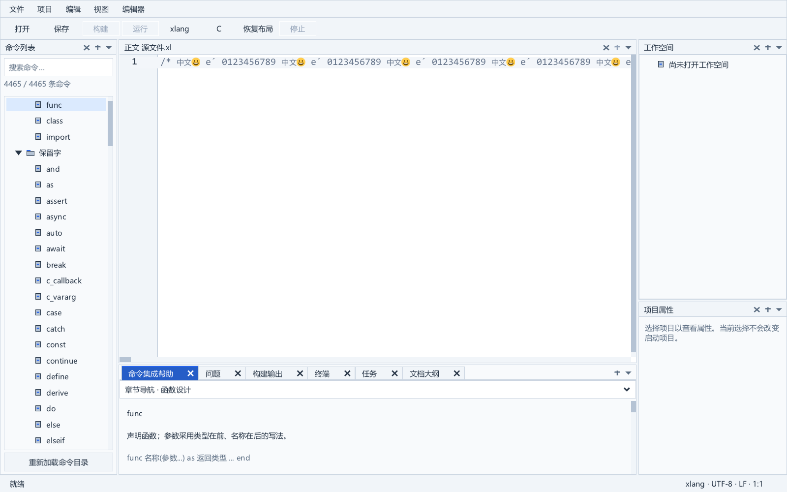

# 绘制期间裁剪换算复用

2026-10-10，SDK31 在普通字形绘制中复用本次调用的像素裁剪矩形。严格构建、1,812,609 项裁剪断言、605 组既有 GPU 像素用例、新增 24 组动态裁剪像素用例、3 项 SDK 检查、6 项相关 IDE 检查和 16 组 C/xlang 原生窗口用例通过。绘制时间有小幅下降，16 MiB 单行输入仍停顿约 1.7 秒，性能未验收，候选未安装。

父阶段是[连续字符串字素遍历](large-source-pointer-grapheme.md)。SDK31 基于 SDK29，237 项源材料仅修改 `src/xge_text_run.c`；公开头逐字节相同，DLL 的 5,949 个导出名称和序号相同。这些检查不能替代完整 ABI 验收。

## 修改依据

上一阶段的自有进程采样出现 `__xgePixelRound → xgeRectToPixelsNearest → __xgeGlyphRunDrawPosition`。源码确认，普通字形在判断屏幕外裁剪前都会调用 `xgeClipGetPixels()`，每次重复四个端点取整。采样只用于定位，不能证明该路径的总时间占比。

新增私有结构在一次完整 glyph-run 绘制或可见记录重放期间存活。每次查询先比较实际的 `g_xge.bClipEnabled` 与四个 float 裁剪字段的原始字节；状态不变时返回已算出的像素矩形，变化时调用原 `xgeClipGetPixels()` 重算。首次查询也使用原函数。

该检查仍发生在字形绘制判断前，尤其是在 Emoji/SVG 绘制返回后。没有假定 SVG 或错误路径一定恢复裁剪。Atlas 查询、页上传、字形度量、span 颜色、float 画笔累加、两像素的保守裁剪边界和绘制顺序保持原规则。新增结构仅在栈上，没有正文副本、持久缓存、额外堆分配或公开接口；它沿用引擎现有的串行全局绘制状态，不增加线程安全承诺。

## 正确性验证

小型标量夹具从实际源码提取九个几何/裁剪函数及新增 helper，仅 GPU 与 flush 使用无绘制替身。随后独立 GPU 夹具使用完整实际引擎，再次运行相同状态比较：1,538,912 次查询、1,812,609 项断言、270,993 次必要换算。100 万次同一状态查询只有一次换算。

状态覆盖启用/禁用和实际 setter/clear API，正负零、分数取整边界、整数饱和范围、float 极值、无穷、不同 NaN 字节、subnormal，以及确定种子的随机 float 位模式。每次与原 `xgeClipGetPixels()` 比较全部返回字段；重复查询核对重算次数。

GPU 夹具严格编译整个引擎，只有一份可执行程序 XRT，不导入 SDK DLL。参考绘制函数从 SDK29 实际 `DrawPosition`/`DrawSpans` 函数体提取并私有改名。新旧路径使用相同的诊断绘制/SVG 钩子，在真实 draw 后轮流改变、清除或恢复裁剪；还覆盖 SVG 成功后改变状态，以及强制失败后进入字体回退。屏幕坐标与原坐标、中文、组合字符、Emoji 和多行共 24 组实际 GPU 输出逐像素相同。

既有绘制夹具同时通过 36,434 项断言：605 组像素比较、96 组相同错误返回、216 次长正文复用、314 次 cache 路径 shape 调用，常规语料最多保留 96 条可见记录。原 4096 条上限和分配失败回退仍受既有合成用例检查。三处分配钩子与三处裁剪/绘制钩子仅位于独立测试副本，SDK DLL 没有这些钩子；其余 236 项引擎材料逐项不变。

首次完整冷构建实际退出 1，日志为 `cc1` 内存分配失败，当时系统提交余量约 0.4 GiB。失败树、日志和源材料核验保留。余量恢复后在全新目录重跑，使用相同 `-O2 -Wall -Wextra -Werror` 和既有三项警告排除，另为 GCC 指定 `ggc-min-expand=5`、`ggc-min-heapsize=8192` 来缩减编译器回收间隔；不修改系统设置或应用运行选项。整套构建实际退出 0、162.312 秒，源材料与失败尝试逐项相同，DLL、导入库和资源对象成套保存。

原始 Unicode/Emoji/文档三项 SDK 检查通过。现有 `document`、`editor_view`、`goto_view`、`find_view`、`input`、`reading` 六个应用程序在私有 SDK DLL 下实际退出 0。应用核心没有重编译；本轮不视为完整标准回归或正式便携验收。

## 窗口响应与截图

同一组现有 83 个核心对象，旧 SDK29 与新 SDK31，C/xlang × 2/16 MiB × 多行/单行，共 16 次实际运行，每例 43 项检查，总计 688 项。采用从未切换的私有桌面、自有 Job、1600 × 1000 窗口、1.25 DPI 覆盖、2 GiB 进程私有提交限制，未配置语言服务。每个组合只有一次观察，宿主机背景负载没有隔离。

| 16 MiB 单行 | SDK29 C | SDK31 C | SDK29 xlang | SDK31 xlang |
| --- | ---: | ---: | ---: | ---: |
| 插入一个字符 ms | 1722.705 | 1736.000 | 1685.555 | 1660.988 |
| 撤销 ms | 1741.024 | 1751.710 | 1754.545 | 1685.612 |
| 最大编辑阶段帧 ms | 2497.732 | 2342.429 | 2522.305 | 2323.209 |
| 全流程秒 | 17.579 | 16.578 | 18.079 | 16.313 |
| 最大采样私有 MiB | 977.172 | 977.043 | 993.148 | 993.387 |
| 峰值工作集 MiB | 1403.145 | 1403.738 | 1415.652 | 1415.219 |

2 MiB 单行最大编辑帧：C 327.482 → 293.215 ms，xlang 321.451 → 295.366 ms。插入：C 219.863 → 216.529 ms，xlang 217.789 → 207.694 ms；撤销并非全部改善。16 MiB 多行插入：C 86.448 → 84.545 ms，xlang 54.571 → 54.449 ms。插入/撤销计时不含随后的绘制，最大编辑帧不含启动；最大采样私有量不是峰值提交，也不能解释为新增 helper 占用。

原始 8 对截图中 7 对完全一致；C 16 MiB 多行有 20 像素差异，保留未掩盖的原图和差异矩形 `(326,116)-(327,136)`。差异为背景与光标颜色的一条竖线。使用仅在私有探针中设置的 `fCaretBlinkSeconds=0`，对该组合重跑旧/新各一次、各 45 项检查，完整窗口逐像素相同。这两次用于排除光标闪烁，不纳入性能表。初次分析脚本沿用了父阶段状态字符串而退出 1；修正后的分析退出 0，原脚本及退出记录保留，原生矩阵本身均退出 0。

已查看下面两张真实窗口图。左侧命令、中央编辑器及其下方单列帮助、右侧上下工作空间/属性维持定版布局。




## 复现与后续

[第十一版补丁包](../third_party/sdk_patches/large-source-experiment-v11/README.md)保存累计 8 个源材料、8 份 diff、23 份测试材料和 3 个元数据文件。[源准备入口](../tools/prepare_clip_query_sdk.py)核验固定输入后只输出新目录；本次 237 项输出匹配实际 SDK31，已有目标拒绝覆盖且不变，受控改动输入 `xge_text_run.c` 后在创建目标前拒绝。

[GPU 对照入口](../tools/test_clip_query_sdk.py)核验已完成 SDK 构建、源材料及五份测试材料，复制引擎，严格编译并在自有私有桌面进程中运行。上述 GPU、状态和分配失败结果均来自这一落盘入口，构建及原生进程实际退出 0。

```powershell
& 'C:\Program Files\Python312\python.exe' -X utf8 tools/prepare_clip_query_sdk.py --source-root 'D:\GIT\auto_test_ide\build\sdk-candidates\theme-20260916\xge-source' --output build/my-private-clip-source
& 'C:\Program Files\Python312\python.exe' -X utf8 tools/test_clip_query_sdk.py --build build/editor-sdk-clip-v31-v2-build.json --output build/my-private-clip-replay
```

窗口数据在 `build/editor-clip-comparison-v1.json`；固定光标比较在 `build/editor-clip-caret-comparison-v1.json`；落盘测试在 `build/editor-clip-durable-v1/result.json`；阶段封存和见证为 `build/editor-clip-evidence-cohort-v1.json`、`build/editor-clip-final-v1-witness.json`。保护既有 888 对材料、83 个核心对象、105 个运行输出、3 个暂存现代编译器输出与便携候选。父阶段仅以清单哈希和成功见证衔接，不递归核验全部历史 build。

长任务保持 active。本轮继续证明了绘制路径的小范围改动正确，但未解决超长行输入、布局和全部正式发布验收。后续应直接定位输入处理与全行布局的线性成本，避免仅凭局部绘制节省时间将整体性能标为通过。
