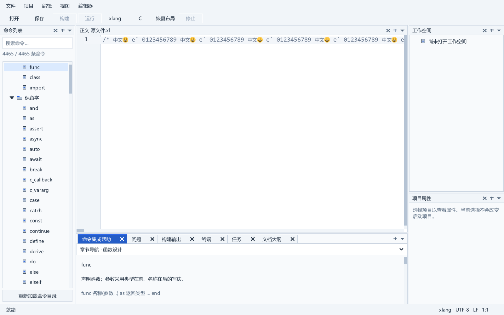

# 长行字形间距查询复用

2026-10-11，SDK37v2 私有实验。源方案基于 SDK35v4；尚未替换固定 SDK 或选入便携候选。传统 IDE 的既定布局及 C/xlang 双语法继续保持。长期目标 active，完整发行验收继续。

## 改动及边界

仅 SDK `src/xge_text_run.c` 相对 SDK35 改变。长度至少 256 字节且启用 kerning 时，单次整形调用用 64 槽缓存 face/左右 glyph 的原始整数间距，实际 1536 字节。碰撞走原查询；短文本和关闭 kerning 的调用继续原查询。字体倍率仍在原位置读取并相乘，浮点相加顺序保持。无堆分配或跨调用缓存。

公开头逐文件一致；实际 5951 个导出名称和序号一致。两版探针使用相同 83 个应用对象，均启用 SDK35 的流式布局及 DPI factory。V14 的累计材料仍包含 SDK35 相对固定 SDK 的两项导出增加和 2946 项旧序号变化；本阶段没有完成整体 ABI 或发行许可验收。

## 功能验证

- SDK 首次完整构建因 `cc1` 分配失败退出 1，原日志及源保留。相同 238 份材料在新目录中只调整 GCC GC 参数为 `ggc-min-expand=1` / `ggc-min-heapsize=1024`，严格 O2/Werror 完整构建退出 0，耗时 332.218 秒。
- 三项原 SDK Unicode/Emoji/document 检查、六项现有应用 document/editor/goto/find/input/reading 检查通过。
- 完整引擎夹具实际冷编译退出 0，318.203 秒；首次原生运行因所选字体没有提供非零间距而退出 1。字体扫描确认 Trebuchet 在当前引擎下有 110 对非零 ASCII 间距，使用新输出及字体重新执行相同编译产物后通过。没有修改字体或失败目录。
- 131072 对原始间距、16 次回调中修改字体倍率、29024 个位置、480385 项新增断言通过，包含共享 face 的不同字体尺寸、重复与碰撞、缓存关闭路径以及 255/256/257/8192 字节文本。观察到 440 个非零间距样本。
- 原 2822 次完整/流式整形、585 次布局、696 次代理、612 次回调失败、8 个真实控件生命周期以及 108 对 GPU 像素比较通过。整形比较控制脚本初次因变量名遮蔽而在创建输出前失败，该脚本和日志保留，后续使用独立版本。
- 实际 C/xlang / 2、16 MiB / 多行、单行 / 旧、新 SDK 的 16 组窗口各通过 45 条检查；8 对 1600×1000 完整截图逐像素一致，无遮罩或裁剪。实际 DPI 125%，探针关闭 caret blink，以保证像素可比较。

## 实际测量

下表为 SDK35v4 流式布局 → SDK37v2。每格为一次观测；后台负载未隔离，不能据此声称稳定百分比收益。采样 Private Bytes 也不等于峰值提交内存。

| 输入 | 插入字符 ms | 撤销 ms | 最大采样私有 MiB |
|---|---:|---:|---:|
| c / 2 MiB 单行 | 190.089 → 177.108 | 192.271 → 179.061 | 441.176 → 442.273 |
| c / 16 MiB 单行 | 1536.980 → 1416.608 | 1549.596 → 1505.090 | 666.309 → 666.082 |
| xlang / 2 MiB 单行 | 180.398 → 169.332 | 180.390 → 171.977 | 444.266 → 443.836 |
| xlang / 16 MiB 单行 | 1477.878 → 1447.809 | 1486.679 → 1426.264 | 682.324 → 682.246 |

16 MiB 单行新候选 C/xlang 的最大编辑帧仍为 1952.468/1993.476 ms，最大消息脉冲延迟 2734/2750 ms。间距查询复用只能带来有限改善，仍不满足极端长行的流畅编辑目标；性能未验收。后续重点验证局部编辑能否复用分块几何，避免再次生成整行的光标停止点，同时保持字素、tab、kerning、换行、字体/DPI 和提供器失效行为。




## 复现材料

[V14 材料包](../third_party/sdk_patches/large-source-experiment-v14/README.md)含 77 个文件：11 个累计 SDK 替换、11 份 diff、10 个应用替换、10 份 diff、31 份测试与 4 个说明/描述。只保存源码/测试，Windows 字体为本机运行时输入。

[SDK 源准备](../tools/prepare_kern_sdk.py)及[应用 overlay 准备](../tools/prepare_kern_app.py)分别在新目录生成 238 个 SDK 材料及 10 个应用材料，已与实际使用源逐文件核对。已有输出、修改源和编译参数不匹配均拒绝；8 次准备/拒绝调用的实际退出值为 0/1/1/0/1/1/1/1，已有材料不变。

[比较工具](../tools/test_kern_sdk.py)默认严格冷编译完整 XGE/XUI；可显式提供 `--reuse-compile-report`，只在全部 SDK、八份夹具、DPI 源、编译参数与可执行文件完全匹配后复用。此阶段的落盘工具验证用了该复用入口并重新执行原生检查，未另做一次冷编译。原完整引擎编译在 retained report 中明确记录；默认冷编译代码分支未在落盘工具版本中另行运行。单一可执行文件拥有 XRT，不链接 SDK DLL；原生进程仅在自身 Job 及从未切换的私有桌面中运行。

```powershell
Set-Location D:\GIT\x-lang\ide
& 'C:\Program Files\Python312\python.exe' tools\prepare_kern_sdk.py --source-root D:\GIT\auto_test_ide\build\sdk-candidates\theme-20260916\xge-source --output build\my-kern-sdk
& 'C:\Program Files\Python312\python.exe' tools\prepare_kern_app.py --output build\my-kern-app
# 比较需要已完成的严格 SDK 构建报告；输出目录必须不存在。
& 'C:\Program Files\Python312\python.exe' tools\test_kern_sdk.py --build-report build\editor-sdk-kern-v37-v2-build.json --output build\my-kern-test
```

可用 `--kern-font` 指定具有非零间距的字体；默认 Trebuchet。当前机器 Times/Arial 等字体经本引擎查询返回零的观察已记录，不据此推广到其他版本或完整字体排版能力。

## 本阶段记录

[完整构建](../build/editor-sdk-kern-v37-v2-build.json)、[等价检查](../build/editor-kern-durable-v1/result.json)、[16 组窗口](../build/editor-kern-matrix-v1-run.json)、[像素与测量](../build/editor-kern-comparison-v1.json)、[拒绝路径](../build/editor-kern-reproduction-v1.json)、[功能与旧材料核验](../build/editor-kern-final-v1-verification.json)。此前 1065 对源/保存材料、83 个生产对象、105 个运行输出和 3 个冻结编译器输出保持原摘要。正式发行、干净 Windows、实体 IME/混合 DPI、完整 C 输入图/ABI、SDK 许可/选用及历史 GPU 边界仍继续。
