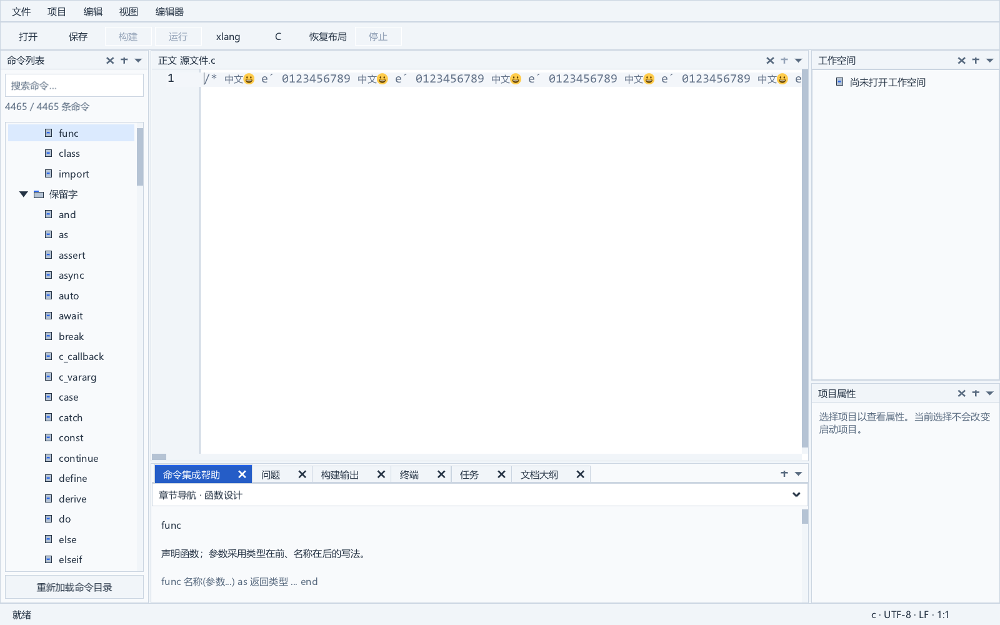

# 长行布局的流式整形与 DPI 接入

本阶段实现 SDK35 私有候选：布局阶段逐个接收已经完成 kerning 的 glyph，聚合为 cluster，再直接生成 caret stops，省去完整 glyph 与 cluster 数组。实际 IDE 使用 DPI 代理，因而同时提供显式适配入口，并将其注册到八个编辑器构造处。

候选基于 SDK31；SDK33 的 gap 读取实验没有继承。当前便携候选和正式 SDK 没有替换，长期任务保持 active。16 MiB 单行编辑仍超过一秒，性能尚未验收。

## 实现范围

`xge_text_run.c` 的原整形流程增加私有同步 visitor。原公开 `xgeTextShape` 继续返回完整 glyph 数组，原 UTF-8 验证、fallback 字体顺序、Emoji backend 引用、默认 flags 和指标累加顺序保留。为避免提前输出仍会被下一 glyph 调整的 kerning，visitor 延迟一个位置；回调只能在当前位置最终确定后发生。

XUI 将位置按原规则聚合为借用的 cluster，回调返回后该对象不可持有。流式结果的 `pClusters` 为 NULL，`iClusterCount` 与宽高指标仍有效，`xuiTextShapeFree` 可以清理。此结果用于几何计算，不能当作完整绘制数组使用。绘制和原公开 `textShape` 仍走完整整形入口。

`LineLayoutEnsure` 直接按原 float 顺序更新 caret stops。代理不支持 visitor 时，保留原整形路径；只有 `UNSUPPORTED` 允许回退，该返回必须发生在 visitor 调用和结果发布之前。回调失败会清理未提交 segment，完整整形 backend 的字体和 Emoji 引用也会释放。

布局仍持有整行副本、全部 caret stops、segment 元数据及换行偏移；文档版本改变仍会清空行布局。这次改动降低了大数组的保留量，尚未实现增量布局或有界长行几何。

## IDE 接入与接口约定

新增公开入口：

- `xuiCodeEditSetTextShapeVisitor`：为控件注册同步提供器及其 user 指针；提供器改变时清空行布局和换行索引。同一 callback/user 不重复清理，传入 NULL 可恢复默认路径。
- `xuiProxyXgeVisitTextShape`：对内建 XGE 代理进行流式整形。其他代理返回 `UNSUPPORTED`。

`xideDpiVisitTextShape` 验证自己的 DPI 代理身份，再用当前字体包装中的逻辑字体 `base` 调用 XGE；和原 DPI `textShape` 使用相同字体。比例变化仍由已有字体管理机制处理。提供器和 user 的有效期须覆盖控件使用期，借用的 cluster 只在回调期间有效。

`xideDpiCodeEditCreate` 在创建控件后注册提供器，避免初始 `desc.pFont` 绕过字体设置服务。正文、命令列表、文件变更、字体预览、帮助、恢复、模板、工作台共八个构造源均已接入。字体切换保留提供器；已有 `SetFont` 会更新 scroll model，并可能立即重新生成换行索引。测试比较更新后的字体和几何，而非要求公共调用后所有缓存仍为空。

公开 XUI 结构定义保留；移除新增声明后，原头文件声明一致，XGE 头文件逐字节一致。实际编译对照了 8 个公开类型的 size/alignment 与 6 个 field offset。私有 code-edit 数据新增两个指针。

导出名称从 5,949 增到 5,951，原名称全保留，新增仅上述两个入口。自动分配的 2,946 个原有序号发生变化；本阶段没有完成完整 ABI 验收，不能据此宣称可替换任意旧 SDK 二进制。

## 验证

最终 SDK35v4 完整严格构建通过：GCC 16.2.0、`-O2 -Wall -Wextra -Werror`，沿用三项原有警告排除与编译器 GC 参数。SDK35v3 到 v4 仅在提供器 setter 补充换行索引清理；公开头文件与 IDE 输入没有变化。

原生整形/布局比较使用一个完整 XGE/XUI 可执行文件作为唯一 XRT owner。旧整形与旧 `LineLayoutEnsure` 摘自 SDK31；引擎源副本不改写，使用实际 `xui_sources.bat` 的 116 个额外模块及实际 DPI 适配器。字体来自只读复制的 Windows Consolas 与仓库 CJK 字体。

SDK35v3 已通过 2,882,719 项位置断言、2,822 个位置案例、612 个回调错误案例，以及 238,683 项布局断言、585 个布局和 696 个代理案例；完整整形另有 4,801,138 项断言、3,365,718 个 lookup 检查、108 对 GPU 像素一致。覆盖 kerning、fallback、中文、Emoji、组合字符、ZWJ、旗帜、Indic/Hangul、换行、NUL、无效 UTF-8、tab、换行宽度、命中测试、1 MiB 混合正文及 1/1.25/1.5/2 DPI。

最终 SDK35v4 的三项原 SDK 检查和六项既有应用检查通过。落盘复现夹具再次通过上述整形、布局及 GPU 对照，并通过 280 项生命周期断言、8 个控件案例，验证创建、同提供器重复注册、切换/撤销提供器、换行索引清理、字体更换和销毁。

SDK35v3 和最终 SDK35v4 各有 16 组真实 IDE 窗口通过每组 45 项检查；每轮 8 对 1600×1000 完整截图逐像素一致，未裁剪或遮罩。C/xlang、2/16 MiB、多行/单行均覆盖；两种模式使用同一 SDK、82 个相同核心对象，仅 DPI factory 注册开关不同。窗口位于从未切换到前台的私有 desktop，拥有独立 Job，单进程内存上限 2 GiB，caret 闪烁在比较时关闭。

## 性能观察

下面是最终 SDK35v4 同 SDK 两种注册模式的单次观察，非独立基准；后台宿主负载没有隔离。私有内存为事件采样最大值，不是 peak commit，working set 也不能直接等同于私有内存。

| 16 MiB 单行 | 完整数组布局 | 流式布局 |
| --- | ---: | ---: |
| C 输入一个字符 | 2219.622 ms | 1641.076 ms |
| C 撤销 | 2296.591 ms | 1664.701 ms |
| C 最大采样私有内存 | 964.848 MiB | 666.145 MiB |
| xlang 输入一个字符 | 1885.294 ms | 1524.087 ms |
| xlang 撤销 | 1871.678 ms | 1548.432 ms |
| xlang 最大采样私有内存 | 993.383 MiB | 682.348 MiB |

最终轮次 2 MiB 单行输入约 200–218 ms；16 MiB 多行输入约 68–84 ms。早一轮 SDK35v3 的 16 MiB 单行输入为 C 1505.658 ms、xlang 1436.367 ms，采样私有内存 665.773/682.355 MiB；最终轮次 C 基线存在更高耗时，不能用单次差值推断稳定百分比。两轮均观察到流式路径降低长行数组保留量，输入和帧延迟仍未满足大文件目标。

长行仍有完整 UTF-8 预验证、逐字素计算、全部 caret stops 和绘制整形成本。下一步应处理增量布局或有界几何，同时保持 kerning、字素边界、tab、换行、选择及命中测试的原语义。




## 复现

[补丁包](../third_party/sdk_patches/large-source-experiment-v13/README.md)保留 11 个累计 SDK 材料及 diff、10 个 IDE 材料及 diff、原源描述与测试夹具。SDK 源准备不执行构建或安装；应用准备输出十个文件的 overlay，编译时将 overlay 的 `src` 放在原 IDE `src` 前。输出必须是新目录，不能位于源 `src` 或补丁树内。

```powershell
& 'C:\Program Files\Python312\python.exe' -X utf8 tools/prepare_layout_stream_sdk.py --source-root 'D:\GIT\auto_test_ide\build\sdk-candidates\theme-20260916\xge-source' --output build/my-private-stream-source
& 'C:\Program Files\Python312\python.exe' -X utf8 tools/prepare_layout_stream_app.py --output build/my-private-stream-app
& 'C:\Program Files\Python312\python.exe' -X utf8 tools/test_layout_stream_sdk.py --build-report build/editor-sdk-layout-stream-v35-v4-build.json --output build/my-private-stream-replay
```

准备工具验证固定源材料、payload 哈希和八个构造源的完整清单；已有输出、改变输入和新增遗漏构造处均在复制前拒绝。测试工具验证 SDK 构建输出及 238 项源输入，复制引擎后进行完整严格编译和私有桌面运行。

阶段材料：`build/editor-layout-stream-durable-v3/result.json`、`build/editor-layout-stream-comparison-v4.json`、`build/editor-layout-stream-reproduction-v3.json`；密封清单与成功见证为 `build/editor-layout-stream-evidence-cohort-v1.json`、`build/editor-layout-stream-final-v1-witness.json`。当前阶段保护此前 984 对冻结材料、83 个核心对象、105 个运行输出及 3 个暂存编译器输出，新增 81 份持久材料。父阶段按清单哈希和成功退出衔接，不递归验证历史构建。

阶段报告采用独立文件保留失败尝试。最初 SDK35v1 仅识别原 XGE 代理，在实际 DPI wrapper 上回退，因而未带来布局流式收益；v2 的 typedef 声明位置编译失败，v3 修正顺序；factory 的首次 include 插入又触发 `_WIN32_WINNT` 重定义，后续保留首个原 include 后再插入。两次矩阵标签碰撞在创建日志时拒绝，没有覆盖旧结果。新增生命周期夹具的第一次编译误判 void destructor，第二次运行错误地要求字体更新后缓存为空；均保存日志、实际退出和使用材料，修正测试后重新验证。应用 overlay 初次输出门禁过宽，已缩小为保护 `src`，允许新的 `build` 目录。

正式发布、干净 Windows 验证、物理 IME、多显示器 DPI、完整 SDK 授权和 ABI 审查、完整 C 输入图等仍未完成。新 SDK 与 IDE overlay 均未安装到当前便携候选。
