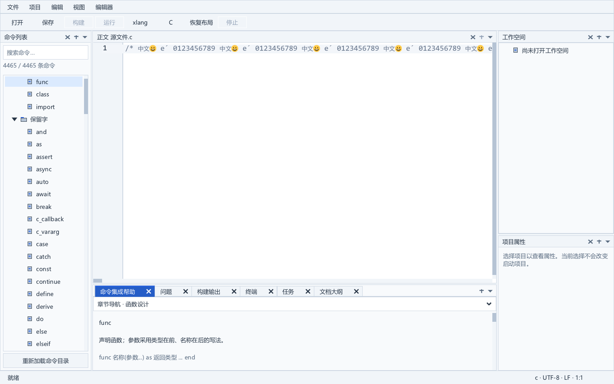

# 可见范围的两份结果复用

2026-10-10，SDK21 在同一有效读取缓冲区内保留最近两份视口端点结果，避免滚动模型和绘制使用不同宽度时覆盖唯一缓存槽。新旧范围对照、整套 SDK 严格冷构建、相关回归和 16 组原生文件测试通过。16 MiB 单行仍有数秒停顿，性能未验收，当前应用和便携候选不变。

上一轮见[字形度量实验](large-source-shape-measure.md)。本版基于 SDK17，相对其 237 个源材料仅修改 `src/xui_code_edit.c`，不包含未采用的 SDK19 度量补丁。公开头保持一致。

## 缓存调整

滚动模型用控件总宽度观察可见行长度，绘制用扣除边栏后的文字区宽度查询范围。原来唯一的结果条目会被两种端点查询覆盖。SDK21 保留两份端点，仍共用原有的文档身份、版本、读取起止与 Tab 设置条件；只接受当前自有读取缓冲区，不缓存外部字符串。

读取范围改变、复制或容量申请失败仍清除原来的有效标记；失效上下文的第一次写入同时禁用第二份结果。第三种范围按原规则重新遍历并替换条目。新增五个私有整数，没有新增正文、逐字符、字形数组或堆分配；本次 GCC Win64 编译的私有结构体 `sizeof` 增量实际为 16 字节，不能仅把字段大小之和当成结构体增量。

字素遍历、Tab 展开、严格的“下一列大于目标列”端点规则和所有原来的边界修正保持一致。缓存只减少重复查询，不改变字体宽度估算或复杂文字整形能力。

## 实际比较及测试修正

比较材料从 SDK17／SDK21 的实际私有结构体和七个辅助函数提取，分别命名，不共用两版缓存字段。字符步进只增加诊断计数，调用实际 Unicode 实现；文档、内存和版本 API 使用匹配的 SDK21 DLL，XRT 由 DLL 持有，测试程序导入，不在 SDK 中加入计数钩子。

第一版夹具严格编译退出 0，原生运行退出 1：夹具将 CRLF 规范化前的长度用于文档读取，旧版模型首先返回读取错误。文档已有 CRLF／CR 转 LF 的规则。本版保留失败程序及日志，第二版对自有文档使用实际长度；外部字符串的原始 CRLF 与非法 UTF-8 对照仍保留。

第二版原生运行已退出 0，但控制器随后因错误假定结构体增加 24 字节而退出 1。实际编译结果为 16 字节。第三版验证器核对已结束运行的日志、程序材料、退出码和精确计数，实际退出 0，没有重启原生测试或覆盖失败记录。独立落盘入口随后在新目录实际再次严格编译、运行并通过。

两次成功的原生比较各完成 521,973 项断言，覆盖中文、组合字符、Emoji／ZWJ、区域旗帜、Hangul、Tab、CRLF、非 BMP、长组合序列、嵌入 NUL、非法 UTF-8、所有测试字符串的部分字节范围、不同视口与滚动位置、自有／外部缓冲区、不同存活文档的相同版本和内容、读取范围与版本变化、复用缓冲区及受控复制／申请失败。

在 65,537 字节的真实文档上预热两种宽度后，32 次交替查询的 SDK17 模型再次调用字素步进 3,849,696 次，SDK21 为 0，返回端点相同。这个计数证明特定交替查询的复用，不代表实际窗口总耗时或任意 Unicode 输入都不再遍历。

SDK21 整套严格冷构建使用 `-O2 -Wall -Wextra -Werror` 和既有三项警告排除，退出 0，耗时 130.250 秒。237 个输入前后相同，DLL／导入库／资源对象成套保存；5,949 个导出名称和序号与 SDK17 一致，尚未构成完整 ABI 验收。

三个原始 SDK 测试和六个现有 IDE 程序 `document`、`editor_view`、`goto_view`、`find_view`、`input`、`reading` 均退出 0。应用程序没有重新编译，在独立目录加载 SDK21 DLL；本轮没有执行新 SDK 的应用严格重建、完整标准回归或便携验收。输入事件回归不等于实体 IME 验收。

## 实际窗口测量

相同的 83 个当前应用核心对象分别链接 SDK17／SDK21；新旧版 × C／xlang × 2／16 MiB × 多行／单行共 16 次运行，各完成 43 项检查，总计 688 项。使用从未切换到前台的私有桌面、1600 × 1000 窗口、1.25 DPI 覆盖和 2 GiB 私有提交限制，未配置语言服务。

| 语言 | 文件 | SDK17 最大编辑帧 ms | SDK21 最大编辑帧 ms | SDK21 插入 ms | SDK21 撤销 ms |
| --- | --- | ---: | ---: | ---: | ---: |
| C | 2 MiB 多行 | 5.869 | 6.164 | 11.314 | 10.255 |
| C | 16 MiB 多行 | 6.956 | 6.026 | 83.522 | 84.400 |
| xlang | 2 MiB 多行 | 6.241 | 6.341 | 7.423 | 6.751 |
| xlang | 16 MiB 多行 | 9.824 | 9.477 | 54.349 | 52.382 |
| C | 2 MiB 单行 | 364.691 | 364.043 | 257.774 | 256.910 |
| C | 16 MiB 单行 | 2936.357 | 2942.886 | 2098.434 | 2082.105 |
| xlang | 2 MiB 单行 | 366.068 | 367.686 | 251.662 | 251.164 |
| xlang | 16 MiB 单行 | 2932.509 | 2935.513 | 1991.519 | 2008.421 |

最大编辑帧不含启动，输入处理不含后续绘制。SDK21 的 C／xlang 16 MiB 单行整例为 28.109／27.860 秒，SDK17 为 29.875／31.109 秒；最大消息脉冲延迟仍为 3969／3829 ms。每例只有一次观察，后台负载未完全隔离，不能以整例差异宣称稳定提速。最大编辑帧及输入处理未明显改善，长行性能仍未通过。

SDK21 的这两例最大采样私有内存约 948.6／964.7 MiB，Windows 峰值工作集约 1387.6／1398.6 MiB，与 SDK17 接近。操作后采样不是真正峰值提交。

八组最终截图中五组逐像素一致，其余三组各只差首行光标列的 20 像素，边界均为 `(326,116)-(327,136)`，该列外一致。与实际闪烁条件相符，截图时钟未同步。人工查看了两张新长行截图；布局、中文、Emoji 和组合字符符合当前表现，有限截图不是完整字体或混合 DPI 验收。本轮未重跑以前的引擎整形像素夹具。

## 剩余耗时与复现

SDK21 另有一次独立 C 16 MiB 单行调用栈观察。调试器只附加自行创建且仍有效的进程句柄，核对 PID、创建时间与程序路径；两次采集与分离均退出 0，应用最终退出 0 并完成 43 项检查。该运行明确排除在上述性能矩阵之外。

第一栈处于 `__xgeGlyphRunDrawSpans` → `__xuiProxyXgeDrawTextSpans` → 编辑器缓存绘制；第二栈处于 Emoji 匹配 → `xgeTextShape` → 同一个文字跨度绘制路径。源码确认 `__xuiProxyXgeDrawTextSpans` 每次调用都会整形、绘制并释放整段字形结果，即使编辑器布局已保存度量整形对象。下一步处理该路径的重复整形与整段绘制遍历，核对现有整形对象、代理、字体和裁剪的生命周期与语义，不把两次采样当成总耗时占比证明。

- [第七版补丁](../third_party/sdk_patches/large-source-experiment-v7/README.md)与[清单](../third_party/sdk_patches/large-source-experiment-v7/patch-manifest.json)：七份完整源码、七份 diff、八份以前的比较材料与五份本轮范围材料。
- [源码准备入口](../tools/prepare_viewport_pair_sdk.py)：实际复现全部 237 项，已有目标不改写，变更来源在创建输出前拒绝。
- [独立范围比较入口](../tools/test_viewport_pair_sdk.py)：本轮实际在新目录重新编译、运行，核对精确计数与源码／DLL 材料。
- [原生测量](../build/editor-range-comparison-v1.json)、[截图差异](../build/editor-range-capture-v1.json)、[新版调用栈](../build/editor-performance-range-profile-sdk21-c16-v1-run.json)和[本轮材料清单](../build/editor-range-evidence-cohort-v1.json)。

本轮核对 725 对冻结材料及副本，包括上轮新增 32 个持久文件、83 个实际核心对象、105 个运行输出和三个编译器产物。上轮 2,901 项材料清单和闭合验证按哈希引用，不递归扫描全部历史。便携候选仍为 `portable-20261010-editor-status-v1`；实验 SDK 未安装。

首版仍需完成长行性能、成套 SDK 审查与许可核对、新 SDK 的应用严格构建、完整标准回归和便携验收。干净 Windows、实体 IME、混合 DPI、深目录无 8.3 别名工作目录、完整 C 输入图／ABI、TCC 扩展库和原始 GPU 故障根因继续待办。
