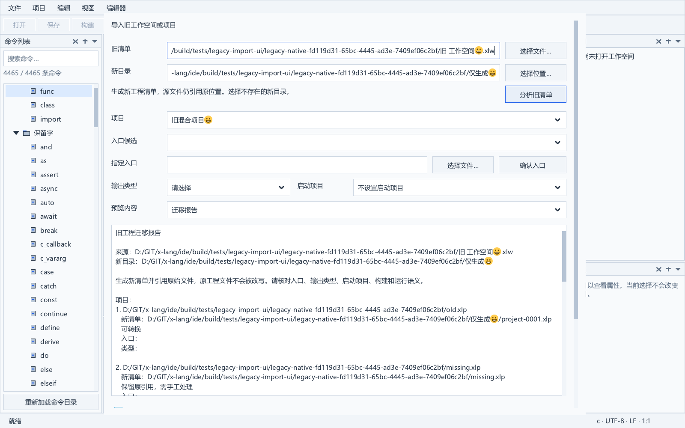
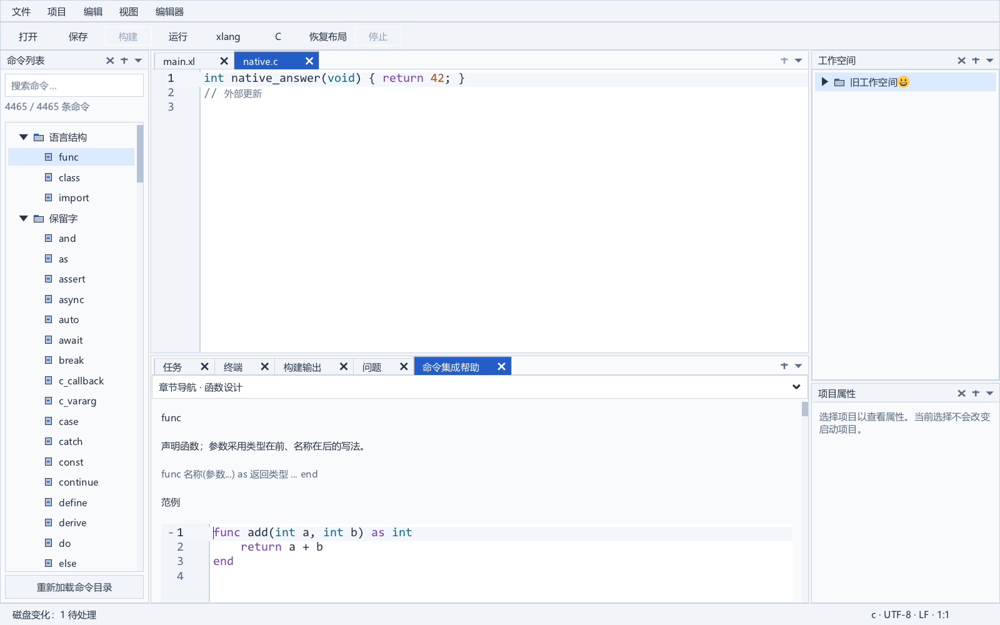
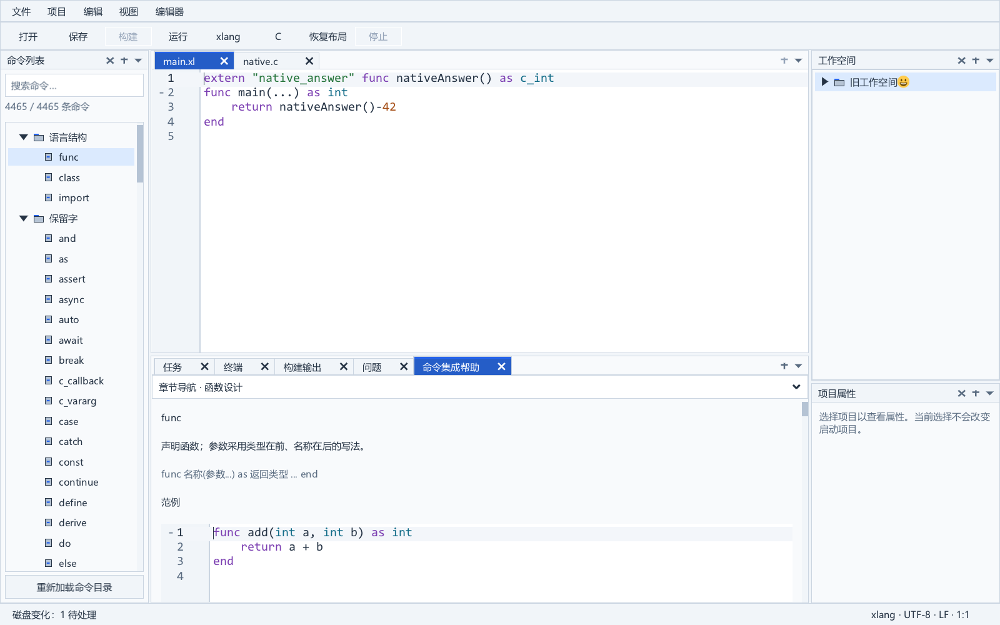

# 旧工作空间与项目导入

2026-10-06 独立 `services/legacy_import` 后端、原生项目菜单导入窗口和实际会话应用已通过严格完整 Release 验收。新入口 `project.importLegacy`（37）明确分析和复核旧清单，再生成新目录；现有打开菜单仍按新格式读取。当前应用 46 模块、39 类测试、50 个公共动作及 76 张新鲜原生图。

## 格式依据

旧工作空间以 `Version: 1`、`Name`、`Projects`、`Files` 和 `Status` 表示空间；项目引用的 `Path` 相对旧工作空间目录。旧项目以 `Project`、`Build`、`Library`、`File`、可选 `Resource`、`BootCode` 和 `Status` 表示工程，文件路径相对旧项目目录。

已核对 `D:\GIT\xlang_ide\TeemoBot IDE\Module\GlobalDefine.cs` 的加载和保存实现，以及 `Window/MainWindow.cs` 的 `PrepareXlangSource`、`GetXlangBuildFile`、`MakeCode`、`StartConsoleProcess`。该版本按活动源码构建和运行，没有固定项目入口；`Open` 只是打开状态，不能当作入口或启动项目。运行时使用活动源文件所在目录，并调用 `xl run`。新 IDE 的运行流程是构建成功后运行产物，报告明确记录此差异。

验收使用 [历史清单夹具](../tests/fixtures/legacy/README.md)。原 `ide_old` 路径当前不存在，未重新创建该目录；样本从仓库历史保存到新的测试目录。参考项目只读，导入测试不会写它们。

## 转换与审阅

| 旧内容 | 新清单与报告 |
| --- | --- |
| 工作空间 `Name`、项目/文件引用 | 新 `xlang-workspace-1`，生成稳定项目和文件 ID |
| 项目 `Project.Description` | 新项目名称和描述；原始字段完整保留 |
| 旧 `.xl` 文件 | xlang 文件；只有一个候选时自动设为入口，多候选或零候选需明确选择 |
| 旧 `.c`、`.h` | C 源与头文件；C 源同步到 `cSources` |
| 显式清单外 `.xl` 入口 | 增加新引用和报告项，原清单不变；已分类为其他种类的旧文件需先修复 |
| `Project.AppPath`、`Build.File` | 输出相对旧项目目录解析；文件名为空时使用所选入口名称生成输出 |
| `.exe` / `.dll` 输出 | 映射项目类型；未知后缀必须选择类型，DLL ABI 仍须核对 |
| 运行配置 | 工作目录为所选入口目录；参数和环境为空，不猜测旧启动命令 |
| `Library` | 包或 `legacy-dll` 引用元数据，逐项报告，不自动 import 或链接 |
| `Resource` | 普通资源；JSON/XSON 数据不会被误当作 Windows 编译资源配置 |
| 图标、版本、字符集、进程名等 `Build` 内容 | 完整保留并列入构建审阅，不宣称自动等价迁移 |
| `BootCode`、未知字段 | 原始 JSON 和报告保留，不注入源码 |
| `Open`、`Status`、`NewFileIndex` | 单独会话提示文件，尚不修改当前本机会话 |
| 缺失、损坏或不支持的引用项目 | 保留原清单路径和可读原始 JSON，生成报告，未转换引用不产生假清单 |

顶层输入必须是匹配扩展名的旧 `Version=1` 清单，没有新格式的 `format` 字段。旧模板中的 `$Project_Description`、`$Project_AppPath`、`$Build_File` 未实例化时拒绝。顶层坏数据直接失败；工作空间内字段损坏的项目保留为未转换引用。不可读取的清单需先处理访问问题，不能跳过后假装完整导入。

同一项目内物理重复文件合并，旧引用均存入 `legacyEntries`，文件打开提示合并；冲突分类沿用首次种类并报告。工作空间重复物理项目引用合并并保留完整旧工作空间数据。跨项目共享文件保持各自的 FileEntry，后续由现有 DocumentService 复用同一文档。

启动项目默认为空，独立于文件打开状态；调用方必须显式选择可转换项目。项目入口或类型尚未选择时，项目预览缺少对应字段且不能加载，`Ready` 为 false，提交必定失败。选择更新失败保留已有预览与计划。

## 生成目录与事务

目标须为既有父目录下的新目录，不合并或覆盖现有内容。仅生成以下文件，全部源代码、库和数据资产仍引用原位置；这个目录是新的清单集合，移动原资产仍需使用项目迁移功能。

```text
新导入目录/
├─ workspace.xlw
├─ project-0001.xlp
├─ project-0002.xlp           # 仅为成功转换的引用生成
├─ report.json
└─ session-hints.json
```

新工作空间保存原始根数据和来源；新项目在 `ide.legacy` 保存来源与原始 JSON，引用保留旧条目。保存和重载沿用现有模型的未知字段保护。报告格式为 `xlang-ide-legacy-import-report-1`，包含来源、目标、就绪状态、项目选择、原始数据、问题代码和中文说明。会话提示格式为 `xlang-ide-legacy-session-hints-1`，通过新项目/文件 ID 关联状态；未转换项目也保留打开与展开提示。

准备过程不写磁盘。每份读取到的旧清单独立捕获原字节、物理身份、长度、时间和属性；允许只读和 UTF-8 BOM。单清单上限 16 MiB，累计源快照上限 128 MiB、最多 10000 份，文件与项目使用动态集合。

提交必须明确确认迁移报告，复核所有原清单并保持只读句柄，防止发布期间改写或替换。原缺失项目在提交复核时出现、原清单同字节被原子替换、同长度内容变化后恢复时间戳，均使确认失效。既有父目录也按物理身份复核，锁定期间禁止改名。

生成文件以新建方式写入同一父目录的 GUID 暂存目录并刷新，关闭子文件后用一次禁止覆盖的目录句柄重命名发布。目标竞争不覆盖；回滚仅删除本次生成且身份仍匹配的文件，不递归删除陌生内容，清理异常明确保留路径。成功计划只可提交一次。

原清单之外的资产只是引用，导入不冻结它们或复制其正文；原缺失引用的状态检查是提交时快照。文件随后出现、删除或变化仍由现有模型、文件协调和构建基线处理。后端发布不写原清单、源文件、现有 Workspace 对象、已打开文档或当前会话。原生窗口选择生成后打开时，另行确认当前文档与工程，并按下面的会话协议切换到已生成的新工作空间。

## 已执行验收

`legacy_import_test` 已通过严格 C11 编译和真实 DEMO6 构建运行：历史真实清单、中文/非 BMP 路径、多入口与启动项目独立、零候选显式外部入口、未知后缀选择、未实例化模板拒绝、硬链接去重、未知字段往返、普通资源、旧 DLL/BootCode/构建差异报告、缺失与损坏引用、BOM/只读源、字节/身份/父目录变化保护、外部写入锁、发布期间目标竞争及暂存清理、40 个项目和 301 个文件均通过。

后端阶段的最终严格完整 Release 回归退出码为 0：45 个应用模块、38 类测试、49 个公共动作、73 张新鲜原生图及 SDK 负面检查。真实 DEMO6 混编/运行与全部既有编辑、迁移、恢复、输入和字体测试通过。记录见 [实施进度](progress.md)，日志为 `build/legacy-import-full-regression.log`，时间与前后指纹为 `build/legacy-import-full-evidence.json`。此后端增量没有新增 UI 动作或导入窗口截图。

## 原生使用步骤

1. 项目菜单选择“导入旧工作空间或项目…”，填写旧清单与不存在的新目录，点击“分析旧清单”。分析失败保留输入，不生成文件。
2. 逐项目核对入口候选或选择外部 .xl 并“确认入口”，确定 exe/dll。启动项目单独选择，默认不设置；未转换项目不能作为启动项目。
3. 阅读单栏迁移报告。预览选择器可查看工作空间、当前项目、完整报告和会话提示 JSON。预览只读换行；超过 8 MiB 的 JSON 明确提示限制，完整数据随导入保存。
4. 勾选“已阅读迁移报告”。任何入口、类型或启动选择变化都会清除确认，来源或目录改变需要重新分析。当前工程或文档基线变化会拒绝提交。
5. 默认导入后打开并应用旧状态；可只生成，保持当前工程、未保存文档和会话。打开模式先执行原生未保存确认、当前会话检查点，再发布并切换。被锁定/外部修改的会话会在生成前拒绝操作。

生成后打开失败时保留新目录，窗口的导入按钮变为“重试打开”，不会重复生成。新工程先完成加载验证，再切换模型和文档；若切换后的界面初始化失败，模型可能已经进入新工程，不能承诺回退已确认的切换。打开成功但旧状态或保存失败时，状态栏显示具体原因，工程和当前应用状态保留；已有原生会话/布局受到保护，不覆盖它们。实际源代码的语言版本、库和 Windows 资源仍按报告手工核对。

## 原生接入协议

导入入口放在项目菜单，打开独立模态窗格，不更改 Dock 树。源清单与新目录变化后清空分析结果和审阅确认；显式“分析旧清单”才读取项目，避免逐字符扫描文件系统。项目、入口候选、显式外部入口、类型和启动项目选择均针对独立计划，长报告单栏换行只读，另可查看新清单及原始报告 JSON。

默认生成后打开并恢复旧打开/展开提示；可选择只生成，保留当前工程和编辑状态。分析时捕获独立当前工程及全部文档基线，提交前验证。打开模式复用既有未保存确认，并在发布前保存当前作用域恢复检查点；发布前失败或确认取消不关闭当前文档。发布成功后才切换工程。打开失败时保留生成目录，按钮改为重试打开，不能再次生成。

旧状态应用只接受当前新工作空间的匹配项目/文件身份与路径。打开文件按物理路径去重，C/xlang 自动识别；缺失打开引用进入既有会话不可用文档集合。展开提示映射到稳定树键：ProjExpand 控制项目，FileExpand 控制源码/头文件/其他文件分组，LibsExpand 控制库，ResourceExpand 控制资源，IsExpand 控制工作空间。旧编号和原提示保存在本机会话扩展元数据，不改运行时文档 ID。

已有新作用域会话不被旧提示覆盖；首次应用后由正常会话检查点保存。写入失败保留当前打开状态、原提示和新目录，明确说明需要重试。重启必须实际恢复 C/xlang 标签、缺失打开引用和树展开。原生 import_view_test 已验证只读预览、入口/类型/启动独立、未转换引用、文档版本过期、未保存取消、会话锁、生成模式隔离、模态动作保护、界面字体重新绑定、125% 比例、窄窗口和 40 DIP 两轴滚动；后端继续覆盖源变化与目标竞争。

## 原生验收与预览

原生接入最终完整 Release 回归通过 46 模块、39 类测试、50 动作、76 张新鲜图及 SDK 负面检查。验收使用逐文件校验的独立 Windows DEMO6 快照，真实导入混合项目构建运行通过，工具链和 SDK 的前后指纹一致；首次共享 DLL 变化记录另行保留。完整时间、快照和日志见 [实施进度](progress.md)。



下面两张图是在原生测试会话副本中启动真实隐藏 IDE 进程，以正常字号恢复同一导入工作空间所得。C 和 xlang 标签来自导入源文件；源码、原测试会话和共享工具链不写入。




