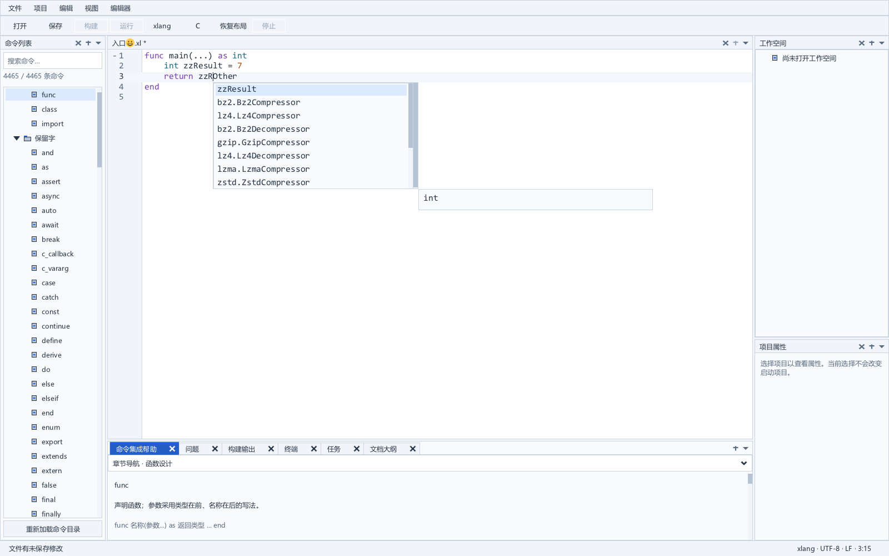
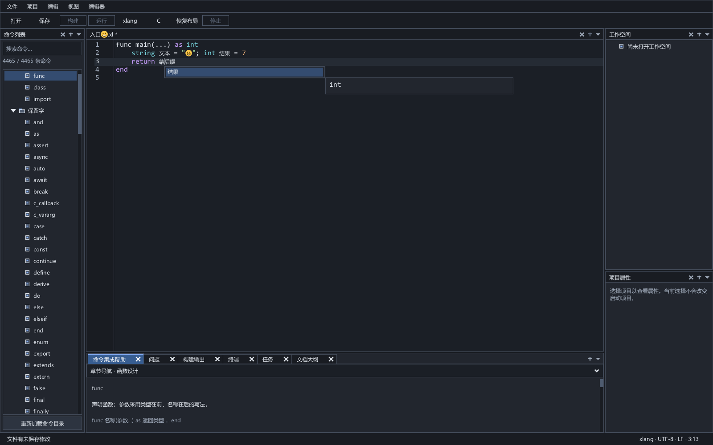

# 原生 xlang 语义补全

2026-10-22 开发更新：服务 0.7 默认在进程内组合共享 xlang 前端完成语义补全，移除每次查询的能力探测进程、临时覆盖文件和分析进程。保留局部作用域、成员类型、未保存依赖、来源／导入候选守卫以及 IDE 的过期结果校验。协议 owner 同时等待输入和旧查询线程的真实完成信号，避免回收轮询延迟下一次补全。已发布候选保持原版本，开发版本的验收记录见 [长期实施计划](lsp-development.md)。

补全及诊断客户端保留文档镜像，按 `textDocumentSync` 协商增量或全文变化。重复查询复用未变正文，不关闭并重新打开全部文档；单字修改按 UTF-16 范围发送最小连续差异。原生语义查询当前仍新建私有 AST，尚未实现函数级语义增量。服务 0.8 的默认快照诊断和导航也已接入原生检查／索引，保存后兼容模式和 C 桥接仍有 CLI 路径。独立编译器 XRT 与 IDE 的 XGE/XRT 按进程隔离，详见 [分析核心](lsp-analysis-core.md)。

2026-10-07，原生 CodeEdit 已接入真实光标补全查询。命名的 `.xl` 文档在 xlang 模式下，以当前正文和全部已打开命名 `.xl` 的未保存内容查询候选。无需先成功检查，也不把候选当作整份编译成功。

## 使用

开发服务 0.7 的原生补全使用自身构建绑定的共享前端，不再要求所选执行编译器支持 `--completion-at`。服务启动仍保留 `--compiler` 配置，供诊断／导航及显式 CLI 兼容后端使用。已发布旧服务和显式 CLI 后端仍要求编译器支持 `check --json --source-overlay --source-report --completion-at`。编辑器保留 C/xlang 双语法；未命名文档继续提供目录补全。命名 C/header 可单独配置 clangd，见 [C 原生补全](c-language-service.md)。

`initialize.initializationOptions.completionBackend` 可选 `native`（默认）或 `cli`；其他值返回无效参数。`capabilities.experimental.nativeCursorCompletion` 和 `completionBackend` 明确返回实际后端。CLI 是兼容／对照路径，原生分析失败时不会静默改用 CLI。CLI 恶意响应测试显式选择此路径，不能将它们当作原生语义路径的验证。

本轮验证使用[固定补全工具链](../build/toolchains/demo6-completion-a96b23d8-16c9-4eae-9da7-6d082d45f5a7/xl.exe)。在 `ide` 目录启动本地验证版本：

```powershell
.\release\xlang_ide.exe --compiler .\build\toolchains\demo6-completion-a96b23d8-16c9-4eae-9da7-6d082d45f5a7\xl.exe
```

- Ctrl+Space 主动查询；点号输入触发成员查询，已有候选期间继续输入会查询当前版本。
- 使用上下键选择，Enter 或 Tab 提交，Esc 关闭。取消后晚到回复不会重新打开窗格。
- 显示编译器返回的名称与规范类型；真实重载保留不同签名和身份。语义候选与静态目录组合，相同名称优先使用语义候选。
- 当前输入未保存时照常查询。字符串、注释、只读文档、多选区、外部冲突和模态窗口不发起语义请求。

例如：

```xlang
func main(...) as int
    int result = 7
    return reOther
end
```

光标在 `re` 后选择 `result`，替换整段 `reOther`，包含光标右侧后缀。点号后的成员使用零宽度插入。一次撤销恢复提交前的编辑器正文；SDK 原生撤销后的光标位置由现有编辑器行为管理。UTF-16 范围按当前 UTF-8 正文映射，中文、非 BMP 字符及 BOM 坐标受验证；编辑器内部换行规范化与磁盘 EOL/BOM 元数据仍由文档层保存。

## 独立同步与提交

[原生适配](../src/ui/completion_view.c) 使用独立后台客户端，查询不关闭诊断连接中的文档或替换诊断批次。补全进行时后台诊断更新问题数据，不切换底栏页夺取输入焦点；取消检查不撤销独立候选。每次捕获稳定文档 ID、路径、显示语言、外部状态和 CodeDocument 版本，最多 64 份、每份 8 MiB、总计 32 MiB。compiler、入口目录及包搜索环境改变后重建连接；崩溃或停止后的新主动查询重新同步当前全文。

GUI owner 按当前标签、单一插入光标和焦点核对回复，拒绝错请求、错版本、坏 UTF-16 位置、不完整 token 范围、不同 textEdit、非普通文本、非法身份和错误来源合同。所有列表字符串由保留的独占 JSON 结果拥有。提供者组合期间只验证批次一次，静态名称用排序索引查重，避免两个大列表逐项交叉扫描。全部候选共用已验证的替换范围，逐项只核对四个 LSP 数值，避免反复扫描长正文。

SDK 负责候选过滤、导航和弹窗。异步语义列表刷新后通过公开 ListView API 重置旧滚动偏移并确保选中行可见；单行窗格高度包含边框。词中替换时清除与右侧后缀重叠的内联提示。在完成输入的预览回调中，再检查当前文档/依赖/环境并处理已到达的守护通知；通过公共编辑动作替换整个 token、设置选区并消费默认插入，形成一次编辑事务。输入回调发生在 SDK 事务内，下一次查询在 owner 帧中取事务结束后的真实版本。取消候选后才释放借用文本，提交文本独立保留至本次事务结束。

Esc、失焦、光标移动、标签切换、改名/关闭/槽复用、正文/依赖/显示模式/外部状态变化会取消旧请求并关闭结果。新的 Ctrl+Space 或输入请求使用当前状态；候选不会用于另一个文档。

服务的 `background-poll` 持续守护按一秒加扫描耗时复核磁盘来源、候选、包描述和工具链身份。GUI 收到通知即撤销候选，提交前先排空已到达的通知；这不是即时文件变化检测。打开文档的本地版本/身份变化直接在提交前校验。服务协议、容量及编译器语法支持范围见 [补全服务](semantic-completion-service.md) 和 [编译器查询](compiler-completion.md)。

## 验收与边界

[真实原生测试](../tests/completion_view_test.c) 验证 Ctrl+Space、点号、Enter/Tab、整段后缀替换、一次撤销/重做、中文/BOM/换行规范化、未保存依赖与类型、遮蔽/重载、目录去重、连续输入、恶意响应、取消/焦点/标签/文档复用、模态/环境变化、来源守护、重启与旧工具链后备。完整回归使用固定 SDK 和不可变编译器副本，保留严格构建、输入指纹及新鲜原生截图。

```powershell
.\tools\test.ps1 -Configuration Release -CompilerPath <索引兼容的 xl.exe> -CompletionCompilerPath <支持光标查询的 xl.exe>
```

定版左侧命令、右侧上工作空间/下项目属性、中央编辑器下方底栏及单栏帮助保持。补全直接在原生编辑器候选窗格显示，不新增 Dock。

固定 SDK 前缀缓冲区为 255 字节；更长的当前前缀不发起 GUI 语义查询，服务的 512 字节名称合同保持。无支持能力、查询不可用或来源验证失败时继续显示目录候选。C 原生补全已另接 clangd；C 诊断/定义/大纲/悬停 GUI、完整工程输入、显式文件覆盖/失败包探测、资源创建/新 XLON、全局修复、性能、实体输入/DPI 与发布继续实施。

最终构建、完整回归、当前输入和改动证据见 [本轮核验](../build/native-completion-final-verification.json) 与 [进度](progress.md)。




