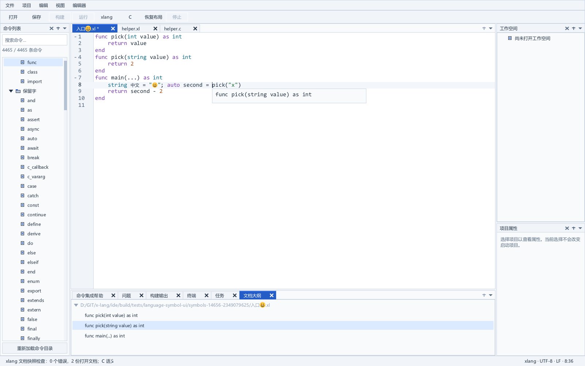
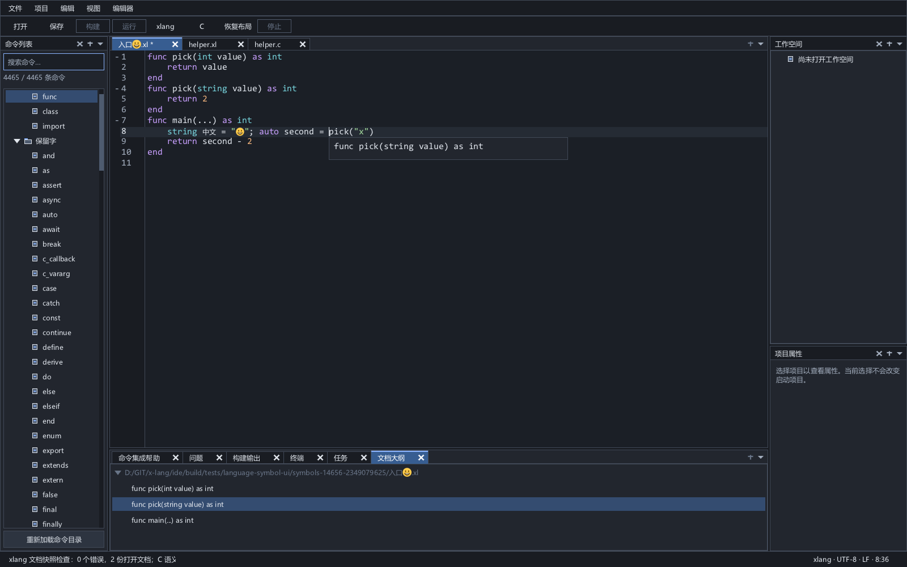

# xlang 文档大纲与符号信息

开发版 IDE 配合原生服务 0.23，可直接打开命名 `.xl` 文档，使用鼠标悬停、`Ctrl+I` 或“视图 → 文档大纲”，无需先执行检查。大纲中的声明可双击或选中后按 Enter 定位。未保存的命名依赖参与分析，执行编译器文件不存在时仍可使用服务构建绑定的原生前端。

旧服务和显式检查模式继续使用同一成功检查批次：先执行“检查当前 xlang 文档（含未保存依赖）”，再查询悬停和大纲。开发构建与已发布候选分别记录，不能把源码中的新能力视为发布目录已经更新。

大纲是中央编辑器下方底栏的一页，和命令集成帮助、问题、输出、终端、任务共用区域。默认仍显示命令集成帮助，左右 Dock 位置保持定版。新增稳定布局 ID 为 `outline`，旧十面板存档仍可恢复，通过视图菜单打开新页。

鼠标在实际文字上停留约 350 ms，显示符号信息；也可在光标处按 `Ctrl+I` 或选择文件菜单“符号信息”。函数调用显示实际解析到的重载声明，变量显示原声明正文和编译器提供的类型。`auto` 不靠正文猜测，类型标明“声明”“推导”或“语法”来源。缺少事实时不填造签名或类型。

大纲按原源码顺序显示具有可靠选区的顶层声明，类方法嵌套在所属类中，重载分别列出。局部变量、参数及函数名称的内部作用域节点不另列条目。当前编译器没有提供完整名称选区的构造器、字段或生成实体会省略；此页尚不是所有语言实体的完整结构浏览器。类型显示仍采用编译器的规范格式，部分内部类型名称后续需要完善用户展示。

C 与 xlang 的语法高亮、折叠和补全继续可用；本文的按需悬停和大纲使用 xlang 真实语义索引，C 使用已有独立语言服务。xlang 语义补全见 [补全服务](semantic-completion-service.md)，引用查找和完整工程输入继续实施。

## 按需查询与同步

新路径复用主诊断／导航连接，没有新增并行服务进程。客户端捕获全部参与文档的本地身份、版本、路径、显示语法和外部状态，使用既有全文／增量同步器发送变化，再通过 [在线文档同步确认](lsp-input-state.md) 核对服务已接受的 URI／版本集合。等待初始化或确认时的悬停意图仍检查光标、标签、文档身份与版本。

服务声明 `automaticSemanticQueries/inputState` 后，GUI 的按需请求发送当前线上 `version` 并省略 `checkId`，使用标准 `textDocument/hover/documentSymbol`。原生服务按需执行真实语义／IR 分析，同入口等待者共享检查，已有有效索引直接查询。源码错误返回空大纲或空悬停；基础设施失败与正常空结果分开处理。具体服务契约见 [按需语义分析](lsp-on-demand.md)。

编辑当前文档或未保存依赖会撤销旧语义结果；已有按需大纲在最后一次变化 75 ms 后刷新。切换到 C 等不适用标签时保留待刷新状态，不为该定时器持续要求绘制；返回 xlang 后恢复。关闭、控件槽位复用、无效同步确认或服务结束撤销旧意图与结果。磁盘依赖守卫失效也撤回旧结果并刷新，未将单文件摘要当作完整依赖证明。

显式手动检查保留原有批次与 500 ms 复查，悬停不会抢占它的复查状态。用户从按需分析切到手动检查时，客户端先取消旧查询；若服务暂时报告旧任务正在停止，只在输入仍当前的情况下每 25 ms 异步重试，最多三秒。取消、编辑或关闭终止该等待。取消源码检查会撤销当前结果，但支持新路径的服务仍允许下一次新的悬停／大纲操作。

该路径尚未替换 GUI 的自动诊断控制器；主客户端仍显式关闭服务默认自动诊断。跨文件 F12 继续使用已有快照输入证明，未移除其磁盘目标核验。

## 同一检查批次

`textDocument/documentSymbol` 返回标准分层 DocumentSymbol 数组，包含真实 `name/kind/range/selectionRange/detail/children`。`textDocument/hover` 返回 plaintext MarkupContent 和真实 token 范围，缺少位置事实时返回 null。请求使用当前打开 URI，位置为 UTF-16；显式检查模式的 GUI 继续提交 `version/checkId`。标准客户端省略检查 ID 时，开发版服务支持按需分析；旧服务仍需先检查。

初始化声明 `documentSymbolProvider/hoverProvider`，以及实验性 `snapshotDocumentSymbols/snapshotHover`。实际可用性取决于当前结果的 `semanticDefinitions`，未成功检查、旧工具链、编译失败、批次过期或参与文档关闭时拒绝查询。两项查询复用同次检查的索引，不重新执行编译器。

表中只保留经来源图验证的路径、范围、身份关系以及从原源码复制的名称、声明首行和实际类型对象。名称不会采用导入后的内部改名。节点类型字段与独立 `type` 对象分别校验；不假定它们的 ID 相等。独立类型对象验证来源枚举、ID 范围、16 位十六进制 ABI 和 canonical 长度，不补写缺失事实。

语义表沿用 65,536 节点和 256 深度上限，名称最多 512 字节，声明首行最多 2 KiB，类型最多 8 KiB。GUI 预留最多 4,096 项、层级最多 64，但四位置批量映射仍受 8,192 个位置上限约束，当前扁平化后实际最多处理 2,048 项；更大大纲整体拒绝，后续需要完善界面容量与呈现。stdio 帧体上限保持 8 MiB，客户端 stdout 队列额外预留 16 KiB 帧头余量。原生类型化与旧 JSON 索引预算分别见 [分析核心](lsp-analysis-core.md)。

## 原生交互与失效

大纲回复核对文档身份、正文版本、当前标签与检查批次；范围批量映射到实际 UTF-8 字节，再核对声明和子声明的包含关系。跳转复用已有来源摘要及磁盘身份核验。

悬停使用编辑器原生文字几何，避开空白插入位置和行号区；提示气泡借用的文字由当前结果独占保留，关闭气泡后才释放。原生事件链继续执行编辑器及快捷键逻辑。移动到其他文字、离开、按键、滚动、失焦、切换标签或编辑时撤销旧提示，晚到回复也须满足同一版本、光标或鼠标位置及批次约束。

显式检查模式下，文档或输入守护失效会同时清除该批次的诊断、大纲和悬停，编辑后沿用 500 ms 延迟复查，取消检查停止该批次自动恢复。按需模式采用上述独立生命周期。持续磁盘观察仍采用每轮核验耗时加一秒的间隔。

## 验证

- [真实协议门禁](../tools/check_language_symbols.py)：真实遮蔽与 auto、函数重载及完整声明首行、类方法层次、类型别名、原始导入名称、BOM/CRLF/中文/非 BMP、未保存依赖、磁盘身份替换、畸形类型合同、旧工具链及不重跑编译器。
- [原生交互门禁](../tests/symbol_view_test.c)：冷启动标准请求、同步确认、未保存及关闭的磁盘依赖类型改变、错误源码空结果与恢复、控件复用、确认错误／重连、取消与手动切换、真实鼠标与 Ctrl+I、大纲 Enter 跳转及原有批次／范围／标签／C 状态和原文件保护。忙回复的重试与期限分支使用明确的受控错误，重试后的恢复执行真实原生检查。
- [完整验收记录](../build/outline-hover-final-verification.json)、[完整构建](../build/outline-hover-build-final.log)、[完整回归](../build/outline-hover-full-regression.log)。

