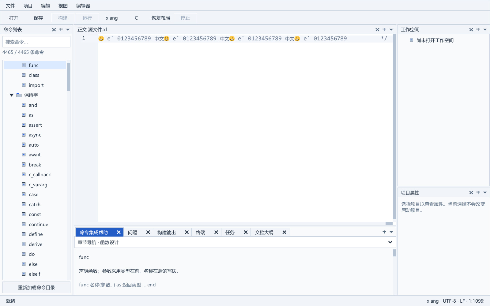

# 极长单行的坐标精度修正

SDK62 私有修订恢复了测试中 C／xlang 16 MiB 单行的行末文字，并通过末尾字符点击定位、输入撤销及自动换行、窗口缩放回归。当前可运行包仍为 [SDK52 完整 IDE](row-index-integrated-editor.md)；下一步将本修订连同 [SDK59 可视区修正](caret-and-wrap-viewport.md)进行完整 IDE 构建、回归和打包集成。

## 原因与修正

此前布局从零累计浮点位置，绘制则从负的滚动偏移累计；每次加法都重新舍入。16 MiB 输入包含 11,615,000 个访问位置，误差积累到可视区之外。基于 SDK59 的只读诊断显示：逻辑布局累计比同一组 advance 的双精度和少 4,048,374.63 像素；行末物理绘制累计少 16,123,158.44 像素，收集到零个可绘字形。物理双精度和与 125% 逻辑双精度和只相差约 0.154 像素。

诊断没有改动原坐标计算；已逐项撤回记录代码并恢复 241 份父版材料，四个 C／xlang 大小用例的行首与行末八张截图与 SDK59 完全一致。首个诊断构建缺少 Windows 头文件而失败，失败记录保留；修正后的诊断严格构建和原生运行通过。

SDK62 在内部采用双精度累计布局、绘制和字形宽度，光标停靠点及恢复检查点保留相应精度。命中测试、选择区、换行段和字符矩形沿用同一坐标，再扣除可视区原点后换算到屏幕。公开结构体、头文件、字形 advance、GPU 坐标及滚动 API 类型保持。相对 SDK59 修改 src/xge_text_run.c、src/xge_text_cursor_internal.inc、src/xui_code_edit.c 三份实现；所有记录修改可精确逆向恢复父版。

## 实际验证

完整 O2／Werror SDK 构建退出 0，用时 261.016 秒。匹配消费者的七份公开头及 XRT 声明与 SDK52 相同，5,954 个导出名称和序号保持。应用夹具连接当前完整 IDE 的相同 83 个应用对象，使用匹配 DLL 与导入库，运行时只有 DLL 一份 XRT。

| 用例组 | 输入和操作 | 原生结果 |
| --- | --- | --- |
| 精度与末尾定位 | C／xlang，8 KiB／16 MiB 单行，125% DPI；用 long double 独立累加原子 advance，检查公开宽度舍入和光标位置，逐个命中末尾两个 ASCII 字符；保留输入、撤销、行首和行末检查 | 4 例，332 项检查 |
| 可视区策略 | C／xlang，8 KiB 单行，100／125／150／200% DPI，默认边栏、全部边栏、小地图、自动换行 | 8 例，520 项检查 |
| 换行和窗口缩放 | C／xlang，8 KiB 长行、64 KiB 长尾行及多行；三次真实窗口尺寸变化，定位行首／行末，显式滚动取消跟随，保持选择字节位置 | 6 例，708 项检查 |

合计 18 例、1,560 项检查，全部实际退出 0。新增精度检查在 SDK59 的 C／xlang 16 MiB 输入上均因宽度误差而按预期退出 1，确认能够检出旧问题。所有 GUI 均在自有、未切换的 Windows 桌面中启动真实原生进程。

完整引擎的 16 份夹具另行严格编译并运行通过。五份旧数值参照使用 long double 累加或精确坐标返回，停靠点仍逐字段精确比较，避免比较 C 结构体的未定义填充字节；没有删除覆盖用例或放宽其相等检查。保留字体、字素、可变字体状态、缓存恢复、绘制回放、Emoji、失败回退和行索引覆盖。行索引仍完成 6,842 项断言，最大 32 KiB。

## 实际行末画面

同一行裁剪区，SDK59 的 16 MiB 行末只有 19 个暗墨像素；SDK62 恢复为 2,524 个，行首保持 2,774 个。下面两张图片是原始原生截图的字节相同副本，未修图；可见末尾文字、闭合符号和光标。独立精度及点击检查另行确认尾部字节位置。

这些结果限定于已测试的输入、字体和可视区；没有将可见文字计数当作全部极端文本的独立逐像素一致性检查，也没有宣称极长行性能验收完成。完整 IDE 回归和当前运行包更新仍待后续集成，长期目标保持 active。

## 复现材料

修订保存在 [私有补丁 v22](../third_party/sdk_patches/large-source-experiment-v22/README.md)。tools/prepare_precise_coordinates_sdk.py、tools/prepare_precise_coordinates_app.py 向新目录准备引擎及应用材料；tools/test_precise_coordinates_sdk.py 严格编译并运行完整引擎夹具。应用原生 v10／v13／v14 C 夹具也保存在补丁包内。材料复现后再次启动原生夹具；只有全部源码、夹具、编译参数和产物一致时，才显式复用已通过的严格编译，不将复用报为重新编译。

实证：[数值诊断及八张对照图](../build/editor-numeric-trace-analysis-v2.json)、[修正与完整原生矩阵分析](../build/editor-precise-coordinates-analysis-v1.json)、[严格 SDK 构建](../build/editor-sdk-precise-coordinates-v62-build.json)、[完整引擎回归](../build/editor-precise-coordinates-engine-fixture-v1/result.json)、[持久材料清单](../build/editor-precise-coordinates-durable-bundle-v22.json)、[材料及原生复现](../build/editor-precise-coordinates-bundle-replay-v22.json)。
