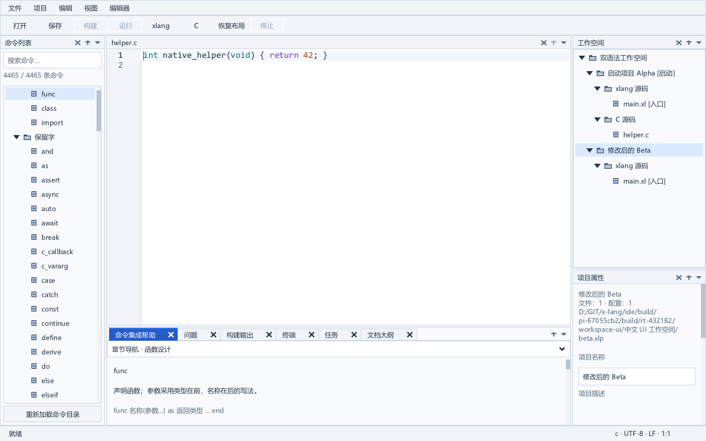
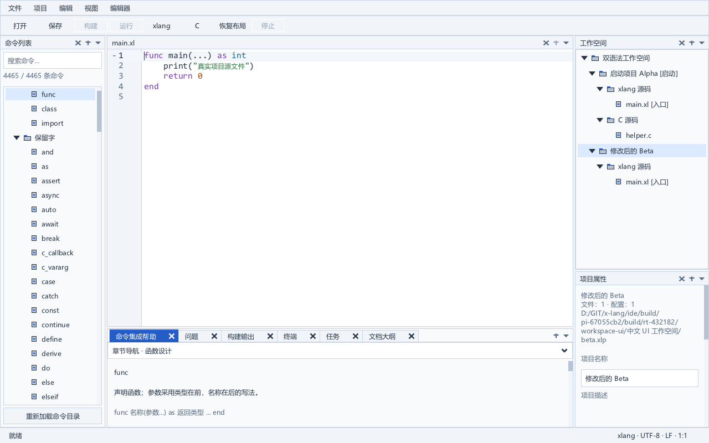

# 精确坐标修订与完整 IDE 集成

SDK62 的极长行坐标修正及 SDK59 的光标／换行视口修正已编入完整 xlang IDE。严格构建、标准全量回归、独立行末精度检查和便携专项均通过。以下是本轮可运行的开发验收候选。

- [启动主程序](../dist/portable-20261011-precise-editor-v1/xlang-ide/xlang_ide.exe)
- [Windows x64 便携 ZIP](../dist/portable-20261011-precise-editor-v1/xlang-ide-windows-x64.zip)
- [包内快速入门](../dist/portable-20261011-precise-editor-v1/xlang-ide/QUICKSTART.md)

左侧命令列表、中央代码编辑器及其下方单栏帮助／问题／输出／终端、右侧上方工作空间和下方项目属性保持定版关系。底栏只占中央宽度。编辑器按 .c／.h／.xl 选择 C 或 xlang 语法，未知类型使用纯文本，并允许逐文档手动覆盖。工作空间—项目—文件管理、撤销、会话恢复、真实构建运行及语义服务沿用完整应用。

## 集成内容与构建

本轮从上一完整 SDK52 应用的 393 份准备输入建立新源码树；376 份应用／测试／数据／构建输入保持逐字节一致，17 份匹配消费者 SDK 材料整体替换。两个文本布局访问接口开关继续启用，完整应用按原规则重新编译 83 个对象和 98 个程序／DLL。

SDK62 使用同次严格构建的 DLL、导入库和资源对象。七份公开头和 XRT 消费者声明与 SDK52 一致；5,954 个导出名称与序号保持。内部坐标累计与恢复点采用双精度，扣除滚动原点后再转换为屏幕坐标；公开结构、字形 advance 与 GPU 坐标沿用原类型。原因、三份源文件改动、完整引擎夹具和专项原生矩阵见 [精度修正](precise-editor-coordinates.md)，光标跟随与窗口尺寸变化见 [视口修正](caret-and-wrap-viewport.md)。GUI 的唯一 XRT 实现继续位于 DLL 中。

完整应用及测试的 O2／Werror 构建实际退出 0，用时 184.453 秒；主程序导入全部五个文本访问接口。完整标准回归的原生进程与外层控制器实际退出 0，用时 934.297 秒。没有 SkipRender，使用已冻结的实际编译器和 C 语言服务器，保留全部既有功能检查，包括中文路径、未保存依赖、真实混编、定义／补全、任务停止、失败构建不运行旧产物、模型／文档保护、字体／DPI 和恢复。标准烟雾检查产生 38 张新原生图。

独立精度夹具重新链接本轮新编译的 83 个应用对象，另行运行 C／xlang 的 8 KiB 与 16 MiB 单行，共 4 例、332 项检查，均退出 0。long double 累加原子 advance，检查公开宽度舍入、行末光标及两个尾字符的准确点击位置；仍保留实际输入、撤销、行首与行末检查。首次准备脚本在成功链接后因文件名替换顺序错误退出 1；后续只纠正控制脚本命名，保留失败日志和已成功的链接，不将其重报为第二次链接。

首次完整标准回归在资源属性真实混编用例中退出 1，编译器帮助日志包含 cannot decode command line；同一时段读取日志的 PowerShell 出现 System.OutOfMemoryException。系统内存压力是待核对因素，未据此确定根因。原字节的资源夹具在独立目录随后通过；本轮另行重新执行完整标准回归，保留第一次完整失败及独立复查，不以局部通过替代全量结果。

第二次完整回归在帮助初始化返回 XUI_ERROR_OUT_OF_MEMORY。SDK52／SDK62 的帮助夹具在随后交错运行的四次原生观察中全部通过，当时最小提交内存余量约 7.1 GB；这说明故障没有在该次独立交错观察中稳定随 SDK62 出现，并未确定所有失败的根因。第三次完整回归保留原全部检查，额外只读记录系统内存余量，不能把局部交错观察当作完整回归。

## 便携包与来源

完整标准回归成功后装配独立候选，逐文件核对复制内容、载荷清单、PE 导入依赖及 ZIP。便携专项使用浅层独立副本，检查默认 xlang／clangd、中文空格路径搬迁、原生主程序和控制台、C/xlang 标量桥接及实际 GUI 父进程。检查过程中只启动测试所属的 Job 和从未切换到前台的私有 Windows 桌面。

| 便携门 | 实际退出码 | 秒 |
| --- | --- | --- |
| portable | 0 | 58.172 |
| scalars | 0 | 11.047 |
| gui-parent | 0 | 87.812 |

同一 GCC 与实际 SDK62 编译配置重新观察 119 个编译单元，确认 211 份预处理依赖全部属于 241 份实际源码。13 份说明来源及 249 份收集输入保留；缺少源码、错误 DLL／源码清单和修改 helper 的拒绝检查均执行。包内保留源码及本次源构建报告、源清单和父 SDK 清单。原有编译器与 clangd 成套资产沿用已验证版本。

载荷清单包含 4356 份文件，另有清单自身。ZIP SHA-256：7258c028617aa74a2f261e43c8c1a8ce9dfc670dd3509c1f48164ac629c81d9e。清单 SHA-256：5e28d556776af10bb4a6dc1554ec62ec2db0a3fc45107fc8dcc48350d981eaed。

复现修订保存在 [补丁 v22](../third_party/sdk_patches/large-source-experiment-v22/README.md)。通用准备入口为 [SDK 源码](../tools/prepare_precise_coordinates_sdk.py)、[应用覆盖](../tools/prepare_precise_coordinates_app.py)、[匹配消费者](../tools/prepare_experimental_sdk.py) 和 [完整应用](../tools/prepare_integrated_editor.py)；完整引擎测试使用 [test_precise_coordinates_sdk.py](../tools/test_precise_coordinates_sdk.py)。本轮完整应用、链接与包控制脚本由下列报告记录实际参数和摘要。

- [完整构建](../build/editor-precise-integrated-strict-v1-run.json)
- [标准全量回归](../build/editor-precise-integrated-full-v3-run.json)
- [完整应用精度检查](../build/editor-precise-integrated-oracle-v1-run.json)
- [实际 SDK 源码与依赖](../build/sdk62-materials-closure-v1/result.json)
- [便携组包](../build/editor-precise-integrated-package-v1-run.json)
- [便携专项](../build/editor-precise-integrated-portable-v1-run.json)

## 新鲜原生预览与范围

本候选推进当前可运行应用；上一 SDK52 候选、原生产产物及历史验证材料保持原字节。完整应用标准回归通过不等于极长行总体性能或所有极端文本逐像素一致性验收通过。干净 Windows 设备、实体 IME／混合 DPI、复杂扩展库、完整 SDK 许可证和总体 ABI 等正式发布检查继续，formalRelease=false，长期目标保持 active。调试仍按独立后续阶段安排。
