# xlang IDE 实施进度

2026-10-22 LSP 开发阶段 M6b4e6 已通过有界、保序的可调用声明候选加速名称补全，原可见性、类型、过滤及错误规则保留。正式原生构建 `m6b4e6-native-v1` 的 24 组测试、新专项 3999 项检查、392 项协议及四组实际 IDE 回归通过。每档每版 60 个编辑样本配对中，9004 行补全中位数 392.0 → 150.1 ms、P95 440.4 → 172.0 ms，3004 行编辑后 P95 为 42.8 ms；小文件、部分重复／同正文新版本和定义回归指标仍有回退，完整交互目标未完成。GUI 沿用完整构建 `cb-d8f14271` 的隔离副本，发布候选未更新。见 [分析核心](lsp-analysis-core.md) 与 [长期实施记录](lsp-development.md)。

2026-10-22 LSP 开发阶段 M6b4e5 已用有界、保序的同名候选优化重载冲突扫描，原签名规则与诊断顺序保留。正式原生构建 `m6b4e5-native-v1` 的 23 组测试、新专项 360 项断言、392 项协议场景及四组实际 IDE 接入回归通过。正式定义查询各 60 次首次配对中，9004 行中位数 216.5 → 147.7 ms，P95 239.8 → 163.1 ms；补全 ABBA 补测编辑后中位数 474.9 → 378.6 ms，仍过慢，部分小文件／重复尾指标也回退。下一阶段直接定位编辑态补全；整体性能及完整 LSP 目标尚未完成。GUI 使用未修改完整构建 `cb-d8f14271` 的隔离副本，发布候选未更新。见 [分析核心](lsp-analysis-core.md) 与 [长期实施记录](lsp-development.md)。

2026-10-22 LSP 开发阶段 M6b4e4 已用有界 XRT 名称候选加速标准库私有词法作用域，原匹配／父链／增添语义保持，并验证预算、长名称、错误和并发释放。正式原生构建 `m6b4e4-native-v1` 的 22 组测试、4743 项标准库专项、392 项协议场景及四组真实 IDE 接入回归通过。正式服务各 60 次首次查询配对中，9004 行中位数由 247.0 降至 195.8 ms，P95 由 265.0 降至 207.5 ms；小文件和部分重复指标仍回退，整体性能目标未完成。GUI 使用未修改的完整构建 `cb-d8f14271` 隔离副本，发布目录未更新。见 [分析核心](lsp-analysis-core.md) 与 [长期实施记录](lsp-development.md)。

2026-10-22 LSP 开发阶段 M6b4e3 已在类型化索引采集复用只读别名范围，保留原采集和容量限制，并验证中途失败的范围清理。正式原生构建 `m6b4e3-native-v1` 的 22 组测试、140440 项索引专项断言、392 项协议场景及四组真实 IDE 接入回归通过。两份正式服务各 60 次首次查询的配对中，9004 行中位数由 347.2 降至 258.8 ms，P95 由 371.6 降至 286.2 ms；4 行中位数增加约 0.17 ms，部分重复指标仍回退，整体性能目标未完成。GUI 使用未修改的完整构建 `cb-d8f14271` 隔离副本，发布目录未更新。见 [分析核心](lsp-analysis-core.md) 与 [长期实施记录](lsp-development.md)。

2026-10-22 LSP 开发阶段 M6b4e2 已在只读 IR 范围优化别名候选，原别名规则保持，名义／别名向量共享 8 MiB 临时预算。正式原生构建 `m6b4e2-native-v1` 的 22 组测试、3322 项 IR 专项断言、392 项协议场景及四组真实 IDE 接入回归通过；GUI 使用未修改的完整构建 `cb-d8f14271` 隔离副本。9004 行独立配对首次查询中位数为 426.3 → 337.6 ms、P95 为 465.5 → 402.2 ms；初轮小文件 P95 回退及扩展 60 次首次测量均保留，部分重复指标仍略高，整体性能尚未达标。发布目录未更新。见 [分析核心](lsp-analysis-core.md) 与 [长期实施记录](lsp-development.md)。

2026-10-22 LSP 开发阶段 M6b4e1 已优化一次 IR 构建内的类型声明候选扫描。正式原生构建 `m6b4e1-native-v1` 的 22 组测试、3145 项 IR 对照断言、392 项协议场景及四组真实 IDE 接入回归通过；GUI 使用未修改的完整构建 `cb-d8f14271` 隔离副本。9004 行配对首次查询中位数由 592.0 降至 494.7 ms，P95 由 635.0 降至 515.1 ms；仍需继续优化，重复查询也并非所有指标改善。发布目录未更新。见 [分析核心](lsp-analysis-core.md) 与 [长期实施记录](lsp-development.md)。

2026-10-22 LSP 开发阶段 M6b4d 已完成无需手动检查的 F12 接入，服务 0.24 通过可协商的目标文件证明核验未保存依赖及未打开磁盘文件。完整开发构建 `cb-d8f14271` 的 110 个程序、22 组原生核心测试、392 项真实协议场景和九组 C／IDE 交互检查通过，构建期间源码未变化；旧服务回退、初始化关闭／重用、源码错误恢复、同字节身份替换及主题截图均已核验。发布目录保持原候选。独立 stdio 测量中，9004 行的重复查询 P95 为 0.2732 ms，但首次查询仍约 610–622 ms；未开启证明时亦约 612–616 ms，首次分析瓶颈需要优先优化，不能视为整体性能达标。详见 [定义跳转](definition-navigation.md) 和 [长期实施记录](lsp-development.md)。

2026-10-22 已支持 C／xlang 单文件、独立 `.xlp` 和 `.xlw` 工作空间构建运行。无项目时 F7／F5 使用当前源文件；项目上下文保持所选／启动目标规则，新增“项目 → 构建当前文件／构建并运行当前文件”。显式源文件启动优先于历史工作空间恢复。严格构建 `cb-bd75b462` 为 88 个编译对象／109 项产物，构建期间源码变化为空。20 个相关原生 fixture、40 项单文件断言、7 次真实主程序入口与便携验收通过；发布目录已更新。SDK、默认编译器和 C 服务器沿用上一候选。本轮为相关范围回归，未重复全量标准／ABI 专项。见 [四种构建形态](standalone-builds.md) 和 [当前候选](../CURRENT-CANDIDATE.md)。

2026-10-21 已更新为 XGE 3.0.0（`f248fd17`，XUI 代理 16），保留有来源记录的 Unicode 查找兼容补丁。严格构建 `cb-4a6a6215` 为 88 个编译对象（87 个 IDE 模块与 1 个 C 输入观察辅助对象）／108 项产物，构建期间源码变化为空；当前提供者对应的标准检查分段完成（含 29 张基础渲染，原脚本资源夹具分支失败保留），14 项实际编译器／语言服务检查及便携搬迁验收通过。`release` 为完整干净载荷，`dist` 仅保留本候选。适配、证据与范围见 [XGE 3 更新](xge3-upgrade.md) 和 [当前候选](../CURRENT-CANDIDATE.md)。下文保留历史阶段记录。

2026-10-12 文件选择增量完成：9 处界面模块统一使用 XUI FileDialog，应用的 Windows 文件 / 目录选择和 `MessageBoxA/W` 调用为零，构建移除 `comdlg32`。严格构建 `cb-fc6c1fdd` 为 88 模块／108 产物；新文件选择 57 项、原消息框 65 项及 26 个相关 fixture、真实异常报告和便携搬迁验收通过。整体跨平台构建与正式首版外部验收仍未完成。见[文件选择清单](file-dialogs.md)、[当前候选](../CURRENT-CANDIDATE.md)及[本轮核验](../build/xui-file-dialogs-20261012/result.json)。下文保留先前增量记录。

2026-10-12 窗口迁移阶段完成：12 组业务对话框使用 XUI Window，应用提示与确认使用 XUI MsgBox，`MessageBoxW` 调用为零。SDK67 严格构建 `cb-4291f399` 为 87 模块／107 产物，业务窗口、启动、字体、DPI、异常报告及当前提供者对应的标准检查通过；证据目录与旧编译器预期导致的两段中断保留，按原脚本分支续跑完成。新便携包通过载荷拒绝、实际默认工具链、搬迁与包内运行检查。工作台创建改用样式批量更新，测试超时保持原有限额。启动与证据见[当前候选](../CURRENT-CANDIDATE.md)、[窗口清单](window-dialogs.md)和[本轮核验](../build/window-msgbox-20261012/result.json)。整体 IDE 的干净系统、实体 IME／混合 DPI 及正式发行验收仍未完成。下文保留此前阶段记录。

2026-10-11 当前扩展库交付：SDK67，84 模块／106 产物重新严格构建，含渲染的完整回归和十项实际便携门通过。默认编译器修正 stdio 外部／内联声明冲突，并为真实扩展函数 C 原型提供可验证的 xlang 来源映射。CRC32、MD5 的实际混编、stdio 格式化、诊断、悬停、补全、F12 和间接头变化撤回已通过开发与包内检查；最终构建的 17 项原生界面断言和三张截图、九项编译器兼容、41 项源码材料及原有 74 项聚合／37 项标量对照通过。 详见[扩展库分析与导航](c-native-extensions.md)与[当前候选](../CURRENT-CANDIDATE.md)。下文保留此前阶段的数量和验收记录。

2026-10-11 当前 C 聚合与位域交付：SDK67，84 模块／105 产物重新严格构建，含渲染完整回归及八项实际便携门通过。默认 C/xlang 桥接新增实际 TCC 位域布局查询；开发与随包提供者各通过 23 类聚合、74 项尺寸／对齐／偏移对照，22 项元数据和用户参数优先级检查、三个实际 TCC 状态执行、九项编译器兼容检查及 41 项源码材料检查通过。原有双语法、定版布局、三层管理、编辑与构建运行保持可用，C 输入观察继续启用。 来源、适用范围和失败记录见[C 聚合与位域布局](c-record-layout.md)，启动入口及本轮精确构建见[当前候选](../CURRENT-CANDIDATE.md)。下文的既有数量和候选链接保留为相应历史阶段记录。

更新时间：2026-10-11。长期目标保持进行中；当前已形成原生工程管理、多文档编辑与后台构建运行闭环，完整 IDE 尚未验收完成。

当前已验收候选使用 SDK67，查找选项与正则 UTF-8 边界修复已通过完整应用回归及便携验收。264 项原生窗口、102 项公开 API、36 个保护页进程和 84 模块／103 产物严格构建通过，四个查找 fixture 已加入标准清单。便携门与完整回归使用同一精确构建；实际搬迁、包内提供者与 GUI 父进程中断检查全部通过。SDK66 曾因记录共享锁中断的回归保持失败记录，不计为通过。见[当前候选](../CURRENT-CANDIDATE.md)、[查找选项](find-options.md)、[正则边界](find-boundaries.md)、[本轮核验](../build/find-options-stage-v1.json)。

此前 SDK65 候选继续保留。该阶段的长行物理字号缓存、84 模块／99 产物严格构建、标准完整回归、1,736 项底层绘制检查、28 对完整 IDE 像素比较和三项实际便携门按其原始记录验收。SDK67 继承其绘制实现，本轮未重复计作底层性能实验。首次长行建索引、干净 Windows、实体 IME／混合 DPI、复杂扩展库及正式发行核对继续。见[DPI 绘制缓存](dpi-paint-cache.md)和[SDK65 阶段核验](../build/dpi-paint-stage-v1.json)。

2026-10-10 状态栏阶段的候选为[状态栏优化候选](../dist/portable-20261010-editor-status-v1/)。该阶段缓存活动文档的行列计算，避免空闲帧重复 Unicode 扫描；元数据即时刷新，正文／光标／文档身份变化与失败重试保持正确。严格 83 模块、12 项邻近、标准全量及五个便携门实际通过；当时固定 SDK、编译器与其材料沿用，实验 SDK 未安装。见[状态栏](editor-status.md)及[阶段核验](../build/editor-status-final-v1-verification.json)。

2026-10-08 资源素材改名阶段的完整 Release 回归通过：75 个独立应用模块、69 类测试、181 项 xlang 协议检查、149 张新鲜原生图和 SDK 负面检查。资源素材改名联动新增 51 项原生检查，共享配置、硬链接素材、Unicode/大小写、未保存正文及部分失败重试均通过真实混编验收。现代 XLON 资源属性新增 72 项文本检查，实际表单保留 char/time/float/intmap/set/bytes，单次撤销及 PE 资源混编验收通过。资源输入保护新增 97 项专项检查，资源素材、目录外脏文档及重复请求完整快照守护均已验证。新增显式项目测试入口支持 Ctrl+F7、程序/工作目录/原样参数/环境配置、终端输入、退出码、取消与历史日志；DLL 可配置宿主，独立于启动项目，打开或应用配置不会执行。新增 Windows 资源创建入口已经接入项目菜单与右侧项目属性，支持零资源项目、精确预览以及 JSON/兼容 XLON 文件和引用的安全发布；窗口首次打开绑定当前字体。独立全局最近工程索引、主窗口位置和程序偏好的原始备份与修复已接入“会话与恢复”，保留当前 C/xlang 编辑及真实撤销记录。新增实验性编译输入观察已验证间接头、失败探测、搜索顺序、响应文件与原生撤下/重建，扩展提供者尚未装入便携包。原生行列定位已通过 93 项断言，支持 Ctrl+G、菜单/右键、Unicode 字素簇、折叠展开与实际视口余量。C 与 xlang 的真实诊断、补全、定义、大纲及悬停均已接入原生编辑器；C 中 F12 现能通过准确声明映射定位同批未保存或磁盘 xlang 导出函数和全局变量，包含重载、导入与命名恢复草稿。未保存头文件在首次预编译解析前已进入完整草稿快照，父头文件悬停及补全不再依赖 didOpen 先后。新 Windows 便携候选继续通过中文空格目录启动、迁移与真实混编验收。最终证据、当前限制及历史失败见末尾记录。

## 当前可运行能力

- 成套 XGE/XUI/XRT SDK 固定在工作区，独立 C 模块构建 GUI、诊断程序和测试；不依赖参考项目的业务目录。
- 62 个内建公共动作统一元数据、状态查询与执行，菜单/工具栏/公共属性按钮和编辑快捷键及核心右键命令按实际目标路由；不可用状态在执行前再次核对，普通字段编辑不被抢占。
- 恢复存储使用作用域级检查点锁、当前/上一份会话引用保护和最近引用后的七天宽限；按小时维护孤立正文，损坏引用、连接点、硬链接、只读、锁定或陌生文件受到保护。原生“会话与恢复”窗口支持只读预览、C/xlang 未命名文档取回和完整备份后的当前作用域重建；也可单独备份并重建全局最近工程索引、窗口位置与程序偏好。原始备份支持超限及无效 UTF-8 字节，发布失败尝试回退，普通偏好保存与修复共用文件写锁。
- 本机会话恢复工程/命令树的稳定身份、分支展开、选择和顶部行，帮助章节与正文块锚点，以及属性滚动；字号、窄窗口和节点顺序变化后保持合理内容。工作空间隔离，损坏元数据保护原文件，旧会话兼容。
- 定版原生 Dock：左侧命令列表，中央编辑器及其下底栏，右侧上工作空间、下项目属性。底栏只占中央宽度，默认打开单栏命令帮助；移动、浮动、隐藏、尺寸调整和恢复默认可用。
- 菜单提供独立界面/代码字体设置，TTF/TTC 与 8–40 DIP 可选；界面行高、属性和模态内容同步调整，大字号按钮可滚动访问。原子保存失败恢复字体和阅读位置，C/xlang 文本、选区和撤销保留。
- 四套主题及 C / xlang / 纯文本高亮与折叠。语言切换保留文本、选区、文档版本和撤销记录；每次编辑刷新实际 token 缓存，结构未变的折叠区间保留收起状态。
- 动态 Workspace / Project / FileEntry 模型，独立于 XUI。新 `.xlw` 与 DEMO6 `.xlp` 可创建、打开、保存、另存为；保留未知 JSON 字段、缺失项目和文件引用，重新计算相对路径。
- 真实工程树按文件种类分组，支持添加和移除引用、入口标记、缺失标记及启动项目。选择、查看或编辑另一个项目不会更改启动项目。Enter 或双击文件可打开编辑标签。
- [新建 Windows 资源配置](resource-creation.md) 可从项目菜单或属性按钮打开：格式、目标路径、版本、图标与清单一窗填写，单栏预览不写入，创建不覆盖目标并加入项目引用。原有 C/xlang 脏文档、选区、版本、撤销及独立启动项目保留；项目清单随后正常保存。
- 原生 Windows 资源属性支持版本、ICO 路径/Base64 及清单路径/Base64/文本、JSON/现代 XLON 原文保留预览；应用进入文档撤销历史，保存保留 BOM/换行。已验证未知字段、坏配置错误提示、项目/文档/磁盘与身份替换保护，以及实际 PE 资源。
- 项目属性支持名称、描述、输出类型及 `.xl` 入口；独立原生窗格管理文件路径/种类/顺序、C 源、编译资源配置、普通资源和包/库引用。草稿应用前验证，入口和未更新字段受保护，修改显示脏标记，保存后更新已打开清单；移除引用保留源文件及编辑文档。
- 库引用支持只读候选清单、版本/ABI 与声明文件检查，标记磁盘和命令目录版本差异；包命令与长文档在中央底栏打开，返回保留独立引用草稿，目录重新加载和过期项目保护已验收。检查不代替真实依赖与链接验证。
- 文件菜单的工具链信息窗口在后台读取真实 PE 文件版本、CLI 声明和文件指纹，提供有界观察缓存、刷新、取消和失败保留。构建仍执行实时能力核对，并在发布产物前检查编译器与兄弟 DLL 是否变化。
- 独立 C stdio 语言服务与后台客户端支持当前 xlang 文档和全部打开命名 `.xl` 的未保存快照；逐文件 CodeEdit 标注、中央问题 Enter 跨文件定位、磁盘正文/身份跳转复核、最后编辑后的延迟复查、64 文档全文重同步、取消及服务崩溃恢复已验证。本次报告范围内的发布后输入失效、整批撤销及自动恢复已接入；xlang 来源、定义、大纲、类型悬停和补全已另经真实编译器/原生界面验证；C 已通过独立真实 clangd 接入。C 原生会话已自动接入未保存 xlang 声明及对应配置/准确内嵌头，旧版本结果与候选撤下后异步重建；导出函数/全局的 C → xlang 定义已接入，公共类型与更多导航、完整 C 预处理/项目输入图及 TCC/clang ABI 等价性仍待完成。
- 原生多文档编辑：新建、打开、保存、另存为、全部保存、关闭、撤销重做、SDK 查找替换及 Ctrl+G 行列定位。`.xl` 默认 xlang，`.c/.h` 默认 C，其他类型为纯文本；编辑器菜单允许逐文档覆盖。
- 同一物理文件从不同路径或项目打开复用唯一文档和编辑标签，包括已存在文件的硬链接。关闭后复用控件和 Dock 标签，不继承旧文本、选区或撤销历史。
- 原生有序键盘/鼠标/触摸桥、事件修饰键、重复按键及 IME 组合/提交已接入。C/xlang、配置字段、停靠和浮动编辑器均有自动验收；SDK 补全及 Dock 失焦捕获适配已修复。
- UTF-8 中文及非 BMP 文本可编辑。内部文本使用 LF，保存保留 UTF-8 BOM 及原换行风格；混合换行在修改后按检测到的主要风格统一。非 UTF-8、二进制和超出当前读取限制的文件明确失败。
- 文件菜单/代码编辑器 F2 支持当前文档重命名，项目菜单/工程树 F2 支持所选普通文件及未打开二进制文件重命名，保留磁盘字节、未保存正文、版本、选区、折叠与撤销。共享入口/C/头文件/资源/工作空间引用同步，大小写改名可用；锁定、只读、已存在目标和过期基线保护已经验收。
- 旧 `.xlw/.xlp` 导入后端支持明确的入口/类型/启动选择，生成新清单、完整迁移报告和会话提示；保留原资产，清单字节/身份与父目录复核、目标竞争和暂存清理已验收。原生项目菜单已接入口/类型/启动选择与单栏报告确认，可只生成或切换并应用旧打开/展开状态；会话检查点、未保存取消、双语法标签、缺失恢复及实际重启已验收。
- 原生项目菜单支持清单和整目录迁移：预分配工程/文档绑定，保留 C/xlang 未保存正文、选区、折叠、版本、语法覆盖和撤销；稳定工程树、旧任务、监视 epoch 及默认/外置会话协调和重启恢复已验收。目标、锁定和过期状态失败保留输入，受影响清单随后保存。
- 原子保存、保存点脏状态、关闭/退出确认、磁盘变化冲突及显式重载。保存失败保留原文件和内存修改；保存不会清空撤销，撤销回保存内容后解除脏状态。
- 后台目录监视已命名文档、当前清单和工程引用文件；干净普通文档自动接受有效正文，脏编辑、删除、不可读、超限及坏编码保留当前内容。原生“磁盘变化”窗口只读比较真实 C/xlang 快照，支持保留当前观察版本和明确确认重载；再次磁盘变化使旧确认失效，保存基线保护继续有效。
- 清单文本与项目属性有双向未保存冲突拦截。已绑定清单的有效文本保存后立即事务刷新模型，属性/配置保存继续更新干净清单文档；外部有效清单按稳定身份协调模型，不关闭源文档或切换作用域。坏清单和未保存属性草稿受到保护，未知字段保留。

新建项目提供空白应用、控制台、C/xlang 混合与 DLL 四种模板，通过原生向导预览并事务生成新目录、入口与项目清单。构建、运行、停止、问题、输出、运行会话和任务页已接真实服务；原生配置编辑、项目独立当前配置与编译器路径持久化已完成。公开命令目录已有 4,465 个条目与 45 份共享文档，支持分类搜索、单栏帮助与 C/xlang 静态补全；帮助范例与语法演示页保持只读，显式范例插入进入当前编辑文档。

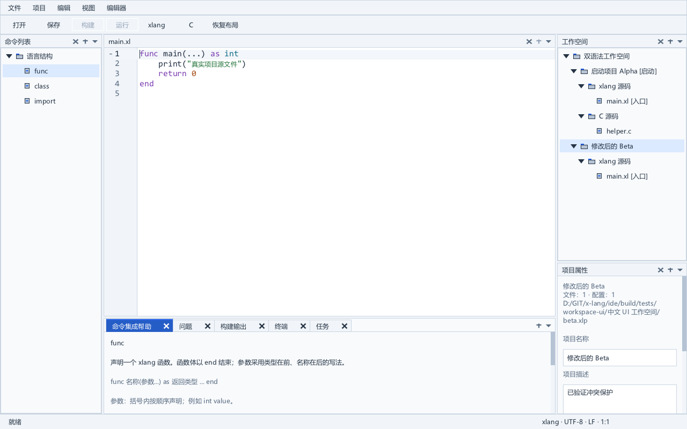

## 后台任务与构建运行增量

- `platform/process.c` 使用固定 SDK 的进程参数与独立进程组，后台 spawn/read、独立 stdin 写线程、有界队列和完整原始日志；停止结束关联子进程，销毁时先取消并等待线程。
- `services/tasks.c` 复制稳定项目与配置快照，任务串行执行，重复未完成请求合并。清单和直接输入比较保存基线，后台检查文件身份，内存编辑及硬链接别名通知会使待运行构建失效。
- 每个任务使用 GUID 阶段目录。必须正常构建且确实产生本次产物，再核对输入并原子发布；失败、取消、过期输入、缺少产物或锁定发布目标都不能运行旧输出。DLL 没有宿主时不直接运行。
- F7 构建所选项目，F5 构建并运行启动项目，Shift+F5 停止任务。构建前保存相关已命名文档及脏项目，沿用已有外部修改与清单冲突保护。
- 原生底栏展示构建输出、可跳转问题、运行管道会话和历史任务。终端键盘输入、粘贴、关闭 stdin 和停止可用。xlang 诊断列按 Unicode 字符转换，C 诊断当前定位到行首。
- include 路径、library 路径、链接库、运行参数、工作目录及环境覆盖已实测；支持工具链选择、环境变量和命令行配置。GUI 支持项目独立当前配置与完整列表编辑；编译器路径可恢复，能力仍由后台即时核对。
- 大量 UTF-8 和二进制输出经过批量转换和有界显示，截断明确标记，原始日志保留原字节。修复 Windows PowerShell 中文脚本 BOM、空项目描述缓存，以及任务首次输出和滚动的原生绘制边界。

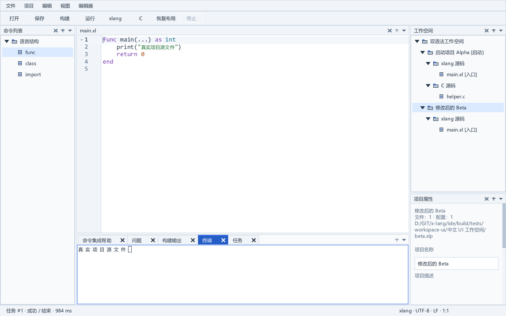

## 阶段状态

| 阶段 | 状态 | 后续工作 |
| --- | --- | --- |
| 0 依赖与模块 | 基础验收通过 | SDK 更新时重新执行兼容验收 |
| 1 原生工作台 | 布局、主题、两套字体、窗口/DPI 与现有公共动作注册可用 | 实体混合 DPI/输入法与硬件验收、更多原生编辑动作及快捷键定制 |
| 2 三层工程管理 | 核心模型、模板、引用编辑、重命名、迁移、旧格式导入/会话、Windows 资源属性/创建及库静态文档/清单检查已验证 | 真实依赖解析/版本约束及完整新 XLON 兼容 |
| 3 文档编辑 | 双语法多文档、行列定位、外部变化、清单协调、引用同步及独立全局状态修复已验证 | 备份长期管理、累积规模与大文件性能 |
| 4 命令帮助 | 公开目录、分类检索、参数表、帮助及静态补全已验证 | 来源打开、行内样式与图片、虚拟化与工具链版本协调 |
| 5 构建运行 | 后台进程、任务、产物、工具链观察与原生交互闭环已验证 | 递归依赖与版本覆盖、并行调度、日志保留策略及系统 shell / ConPTY |
| 6 首版验收 | 已接 C/xlang 语义、有限守卫及全局修复；独立便携候选和中文目录迁移已验证；尚未完成 | 完整 C/项目输入图、公共类型与更多跨语言导航、TCC/clang 兼容边界、备份规模/性能、实体输入和安装发布验收 |

## 已执行验证

早期 Debug 构建与定向测试通过。最新完整验收使用本轮最终严格 Release 构建，随后以 `-SkipBuild` 完整回归，退出码为 0；本次全部原生截图没有 SDK 错误回调。历史增量及失败记录继续保留。

```powershell
.\test.bat -Configuration Release -SkipBuild `
  -CompilerPath D:\GIT\x-lang\ide\build\toolchains\demo6-semantic-862cd3b4-9827-4983-ae59-0f5562ab97bd\xl.exe `
  -CompletionCompilerPath D:\GIT\x-lang\ide\build\portable-compiler-60c184ee-409c-4b75-a215-e6744c121225\release\xl.exe `
  -CServerPath D:\GIT\x-lang\ide\build\providers\clangd-23.1.0\clangd_23.1.0\bin\clangd.exe `
  -CInputTraceServerPath D:\GIT\x-lang\ide\build\providers\clangd-input-trace-8da14892-3cc5-47ec-901e-6d98ca11a07e\runtime-v2\bin\clangd.exe `
  -BridgeCompilerPath D:\GIT\x-lang\ide\build\portable-compiler-60c184ee-409c-4b75-a215-e6744c121225\release\xl.exe `
  -MappingCompilerPath D:\GIT\x-lang\ide\build\portable-compiler-60c184ee-409c-4b75-a215-e6744c121225\release\xl.exe `
  -PortablePackagePath D:\GIT\x-lang\ide\dist\portable-20261008-resource-create-final
```

1. `language_test`：C / xlang / 纯文本、UTF-8 与 CRLF、嵌套注释和插值字符串、部分行重词法、容量受限输出、300 层折叠及实际缓存切换。
2. `workbench_test`：三个窗口尺寸、底栏中央边界、右侧分区、20 次隐藏/浮动/恢复、四主题及单栏帮助。
3. `model_test`：40 个项目、601 个文件、中文空格路径、硬链接、未知字段、另存为路径重算、缺失引用、损坏清单的事务加载、磁盘外部修改和被锁文件的原子保存失败。测试不创建 XUI 上下文。
4. `workspace_view_test`：真实工程树、选中项目与启动项目独立、属性验证、保存重载、清单/属性冲突拦截及更新、Enter/双击打开 C 和 xlang、缺失文件维护、仅移除引用。
5. `document_test`：唯一文件身份、语法覆盖保留撤销与选区、保存点、BOM/CRLF、未变折叠、锁定保存失败、外部冲突及明确覆盖、重载、另存为、无效编码、96 个以上文档槽及 80 次关闭复用。
6. `editor_view_test`：真实 Unicode 键盘输入、实时 token 版本、C/xlang 独立标签、撤销重做、保存、查找界面显示与关闭、实际 Dock 关闭取消及正常关闭、槽复用、恢复布局不丢文档、语言状态栏文本生命周期。
7. 原生渲染：四主题 × 两种语法演示的八张图，以及真实中文路径工程的浅/深色 × C/xlang 四张图，共十二张；每次实际绘制三帧并验证错误、退出码和图片新鲜度。浅色 xlang 和深色 C 工程图已查看。
8. DEMO6 编译器：带 601 条 IDE 文件元数据的项目及真实 xlang/C 混编项目均构建并运行成功，项目清单位于中文空格路径。额外 IDE 文件清单不被误当成独立编译入口。
9. SDK 完整性：生产快照校验通过；独立副本混入改动头文件被拒绝。

## 当前边界与下一工作项

目前一个唯一文档使用一个可移动的原生 CodeEdit 标签。固定 SDK 的公开 CodeEdit 接口持有内部文本/撤销文档，没有将外部文档绑定到另一视图的入口；多视图共享同一文本尚未提供，不创建独立副本假装共享。控件池按最大同时打开数量增长。

文本读取目前限制 16 MiB，实际大型文件编辑性能仍需测量。词法、保存点比较和折叠仍以全文为主；修改导致折叠边界移动时，该块展开。工程文件另存为成功后同步当前工作空间的共享入口、C 源、资源及 FileEntry；原文件保留，受影响清单继续保存。物理文件重命名已支持当前文档和工程树所选文件，保持未保存编辑状态和其他活动标签；未打开二进制改名已验证 20 MiB，慢速存储响应仍待性能验收。项目清单和整目录迁移现通过原生项目菜单协调文档、监视和会话；源码 import/include 重构尚未自动处理。旧格式通过原有打开入口提示明确导入；项目菜单已接独立原生窗口、新清单与报告事务和显式旧会话应用。旧资源、库 ABI 和源码语义转换仍需手工核对。

下一步继续资源创建与完整新 XLON、备份长期管理和规模性能、完整 C/项目输入观察及宏/ABI 边界；真实依赖与版本约束、实体输入/混合 DPI、许可证与干净 Windows 首版发布仍须验收。当前任务与工具链能力见 [构建运行说明](tasks-and-toolchain.md)。
## 本轮追加验收

`process_test` 实际验证 Unicode / 引号 / 反斜杠参数、环境、工作目录、合并标准流、交互输入、3 MiB 原始日志与 1 MiB 队列、启动失败、输入阻塞时取消及子进程树清理。

`task_test` 验证模型释放后请求仍有效、重复合并与排队、取消、缺失本次产物、编译失败保留旧输出但不运行、结构化诊断、内存输入与硬链接别名失效、磁盘输入改变、程序非零退出、运行停止、外部清单和锁定产物失败；还使用真实 DEMO6 混编、include/library/link 选项和真实失败诊断。

`task_view_test` 验证真实 XUI 控件的构建目标与启动目标分离、构建前保存、底栏仅在中央、隐藏后恢复、输出与任务历史、终端回传 stdin、中文和 emoji 列定位，以及超过显示上限的 Unicode / 非法字节输出。

完整 Release 回归包含九类测试、十二张基础原生截图、四张浅/深色真实构建运行截图和一张真实失败构建截图，以及 SDK 负面检查。失败构建图仍要求实际绘制和 `built=0 ran=0`，不能以退出码 1 单独视为成功；任何 XUI 错误仍使 smoke 失败。空描述项目另有直接原生三帧复现与修复核对。

当前运行会话为管道，GUI 不加载编译器 DLL。任务输入基线限制单文件 16 MiB、合计 128 MiB；完整间接依赖图、系统 shell / ConPTY、长期历史保留及阶段目录清理仍未完成。
最终完整 Release 命令（含重建）退出码为 0。已查看最终深色运行图、浅色构建图和失败构建图；有界截图等待 UI 消费完成状态及日志，保证实际显示本次结果。

## 配置与便携设置增量

原生模态配置页支持配置新建、复制、删除、命名、输出/工作目录，以及 include/library 路径、链接库、顺序参数与环境变量列表。副本、草稿与基线采用独立容器，切换保留草稿，取消不变更模型；应用完整验证后提交，保留未知字段和清单冲突保护。项目属性和项目菜单均提供入口，各项目分别保存活动配置。

编译器路径保存到程序旁 `option/settings.json`，启动时按 CLI、环境变量、便携偏好、开发默认路径的顺序选择。损坏、外部修改和锁定设置文件不会被静默覆盖；隐藏测试隔离用户偏好。

新增 `configuration_test` 验证真实模态按钮和下拉菜单、草稿取消/切换、新建复制删除、空/带引号参数与顺序、环境重名、无效名称、每项目当前配置、未知字段、清单冲突与另存为路径重算。新增 `settings_test` 验证 Unicode 设置、恢复、未知字段、无效路径、损坏文件、外部修改与锁定原子写入。任务 UI 回归也从保存的偏好恢复真实测试编译器，并分别使用构建与运行目标的当前配置。

本次完整 Release 回归包含十一类测试、十四张基础及配置页原生截图、五张真实任务截图，共十九张；包含重建的最终命令退出码为 0，十一类测试、十九张图及真实 DEMO6 集成全部通过，所有原生绘制没有 SDK 错误回调。

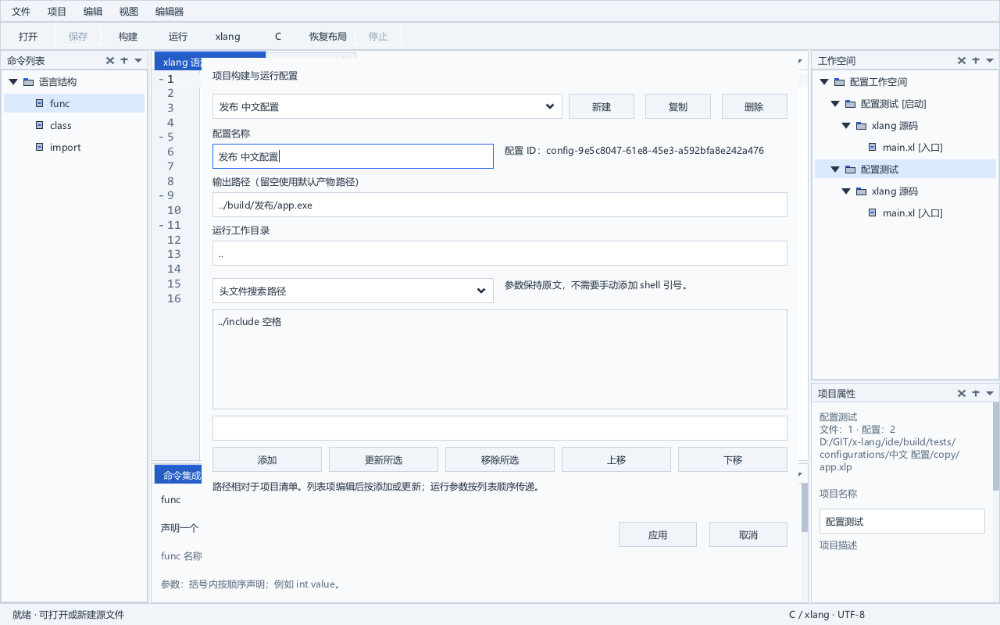

## 命令目录与原生补全增量

已实现独立 CommandCatalog、4,404 个公开条目、227 个扩展包的真实声明与版本、分类检索、单栏参数帮助、显式范例插入，以及按语言区分的目录补全。989 个注册函数中排除 251 个内部桥接条目；C11 的 44 个保留字独立提供。签名、默认值来自真实注册和 DEMO6 解析结果。原生补全负责过滤与一次撤销；输入后点号请求带文档身份、版本、光标和语言校验。

完整长章节、导航、C 头文件与项目语义仍未完成。数据来源、操作、生成流程和当前边界详见 [命令目录与帮助](commands-and-help.md)。

最终完整 Release 命令（含重建）退出码为 0：十三类测试、十六张基础/配置/目录图与五张任务图，共二十一张原生截图，真实 DEMO6 混编构建运行与 SDK 负面检查全部通过。目录再生成覆盖 227 个包、100 个类源导出，未解析问题为 0。


## 长帮助、内建类型和目录恢复增量

命令目录从实际语义类型注册表补齐 61 个内建类型，公开条目为 4,465：语言及类型 164、标准库 1,957、扩展库 2,344。六份语言/标准库设计和 39 个包 README 以共享文档 ID 保存。解析仍使用固定 SDK，GUI 不加载编译器或扩展库 DLL。

原生单栏帮助支持完整标题、段落、列表、引用、多代码块和逐行纵向表格。顶部章节选择在正文滚动后仍可使用，超过 SDK 64 项容量时分组提供全部章节。C/xlang 代码块分别使用对应的只读 CodeEdit；浏览和章节跳转不修改编辑文件。相邻命令复用共享文档控件。

目录缺失或损坏显示实际错误与路径，仍可编辑和构建。修复后通过真实“重新加载命令目录”按钮恢复；失败时保留已有有效目录和文档，成功时按稳定 ID 恢复所选命令并重绑补全。没有合成的替代 API。

当前未完成：来源一键打开、Markdown 行内样式/链接和图片交互、控件虚拟化、完整 DPI/字体、帮助位置恢复及真实语言服务。详见 [命令目录与帮助](commands-and-help.md)。

新增 help_document_test 已验证真实按钮和章节菜单、72 章分组跳转、只读双语法代码块、表格/列表、控件复用、目录修复与失败保留、编辑版本和焦点隔离。实际已查看浅色长帮助、深色 900×600 窄窗口与损坏目录界面的原生截图。


本轮完整 Release 重建及验收退出码为 0：十四类测试、十九张基础/配置/目录/长帮助与恢复图，加五张真实任务图，共二十四张原生截图；真实 DEMO6 混编构建运行、失败不运行旧产物和 SDK 负面检查全部通过，没有 XUI 错误回调。随后补充的重载生命周期测试也通过：已打开补全的旧目录引用被清理，搜索词与稳定命令 ID 恢复，编辑版本保持不变。

最后将默认章节入口显示为“章节导航 · 文档名”，Release 严格重建通过；help_document_test、catalog_view_test 及真实目录原生绘制再次通过。截图命令从实际 JSON 条目读取稳定 ID，最终显示图已核对并保存。

## 会话与布局恢复增量

工作空间和独立项目具有各自本机会话；同目录多个清单不会覆盖。启动能重开最近清单，并恢复 C/xlang/text 文档、语言覆盖、Unicode 光标和选区、滚动与匹配语法范围的折叠、当前项目和配置、主题、命令检索与所选帮助。工作空间另存为迁移当前会话而不关闭编辑标签。

未命名文档和脏正文写入独立不可变恢复文件，同时保存原始字节基线；恢复不写源文件，后续磁盘变化仍触发保存冲突。确认放弃后会话不再引用被放弃的脏正文；缺失文件引用和恢复文件保留，重新打开后不会重复记录。

逻辑 Dock 适配使用面板 ID 和文档 UUID，明确转换固定 SDK 的分割轴。运行编号变化、分割比例、活动标签、浮动、隐藏和自动隐藏均可恢复；过滤不可用面板后修复空区域。损坏输入回到可用工作台并保留原件，失败加载回滚原布局。元数据和布局保留扩展字段，JSON 整数或浮点写法均能用于数值位置。

750 ms 防抖自动保存、文件级进程锁、磁盘基线比较与原子发布已接入。布局先保留新旧提交，随后由会话引用发布，锁定元数据导致保存失败时上一次完整提交仍可恢复。CLI --session-root 用于隔离验证，--no-session 关闭读写；普通隐藏测试默认不使用真实用户会话。

最终完整 Release 重建及验收退出码为 0：23 个独立应用模块、16 类测试、21 张基础/配置/目录/长帮助/恢复图，加五张真实任务图，共 26 张原生截图。真实 DEMO6 混编运行、失败不运行旧产物和 SDK 负面检查全部通过，没有 XUI 错误回调。新增 state_test 和 session_test 覆盖恢复正文、原始基线、Unicode、独立项目、另存为、缺失引用、自动保存、整数数值、扩展字段及失败保护；两个独立原生进程验证重启恢复，900×600 最终图已查看并保存。

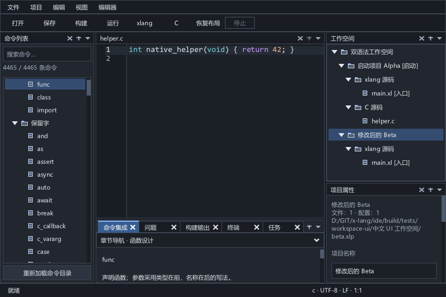

当前未完成：主窗口位置/最大化、树和帮助的详细阅读位置、恢复快照清理及损坏文件的界面修复；完整输入/IME/DPI、外部文件通知、工程资源与模板、真实语言服务、性能与发布仍需继续。下一阶段优先处理原生输入及窗口/字体边界。长期目标保持进行中，不把当前增量视为完整 IDE 验收。

实现与具体限制见 [会话与布局恢复](session-and-layout.md)。
## 有序输入与原生 IME 增量

IDE 改用固定 SDK 的 xuiProxyXgePumpInput，不再合成或重复消费键盘、鼠标和文本。XUI HotKey 注册文件和构建动作；Ctrl+Space 解除会被取消的原命令映射，再调用显式补全。Dock 在捕获阶段保留原重绘处理，但让子控件收到失焦通知，避免未提交组合串残留并吞掉后续输入。

中文组合串显示在代码区或输入框，提交前文档版本、脏状态与标签不变，提交能完整撤销。Windows TSF 文本快照和系统候选锚点由原生桥维护；不支持组合模式时回到原生模式。停靠、浮动、只读、配置模态、触摸取消、中键点击及窗口失焦边界都进入真实窗口的自动验收。

新增 input_test 覆盖有序文本/按键/焦点、事件修饰键、重复删除、C/xlang Unicode 组合、替换范围、一次撤销、失焦后继续输入、浮动候选锚点、模态隔离和同帧保存/关闭。不同实体输入法、真实硬件触摸、完整 DPI 和跨显示器候选定位仍需后续验收。具体接口和限制见 [原生输入与 IME](input-and-ime.md)。

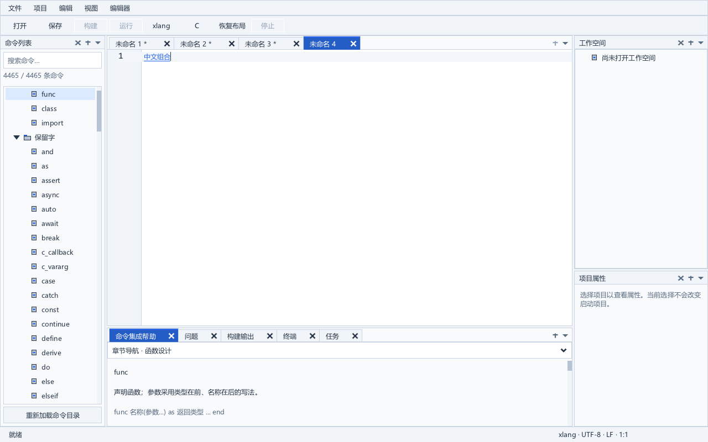

下一阶段处理 DPI、字体设置、主窗口位置和剩余恢复状态，再推进工程能力及真实语言服务。长期目标继续进行中。

最终输入增量的完整 Release 重建及验收命令退出码为 0：23 个独立应用模块、17 类测试、21 张基线原生图、五张真实任务图及一张 IME 图，共 27 张。真实 DEMO6 混编构建运行、失败不运行旧产物和 SDK 负面检查全部通过，没有 XUI 错误回调。最后版覆盖浮动候选锚点、失焦后普通输入、有序保存/关闭以及测试的实际执行/非零失败退出；原生 IME 图已查看并保存至文档资产。

## 代码字体设置增量

原生“视图 → 代码字体”支持 TTF/TTC 文件、8–40 整数字号、默认值草稿、取消、应用保存及重启恢复。字体与编译器共用一个应用设置对象，保留嵌套未知字段；Windows 字体路径由系统 API 获取。C、xlang、纯文本、关闭后复用的文档、语法演示、帮助代码块、输出和终端同步更新。

固定 SDK 按文件加载会把损坏字体静默替换成备用字体，IDE 改用严格内存加载并检查容器和表范围；无法加载的所选文件不会被保存。CodeEdit 未重绑的补全列表通过公共弹层接口更新，包含关闭后复用的列表。帮助高度依实际行高重新计算，终端网格依实际度量并按 SDK 规则对齐整数像素。

设置冲突和保存失败回到原字体，并恢复长文档的原滚动位置，避免临时缩小字号造成范围收窄。字体切换不重建文本、撤销文档、语言或 Unicode 选区。font_test 使用真实 XGE 窗口、真实 Windows 字体及中文路径，以原生按钮验证这些行为；settings_test 验证字体与编译器连续保存和未知字段保留。

详细说明见 [代码字体设置](editor-fonts.md)。当前界面字体仍为 16，代码字号是当前界面像素；完整 DPI、界面字体配置、主窗口位置及剩余恢复状态继续实施，长期目标保持进行中。

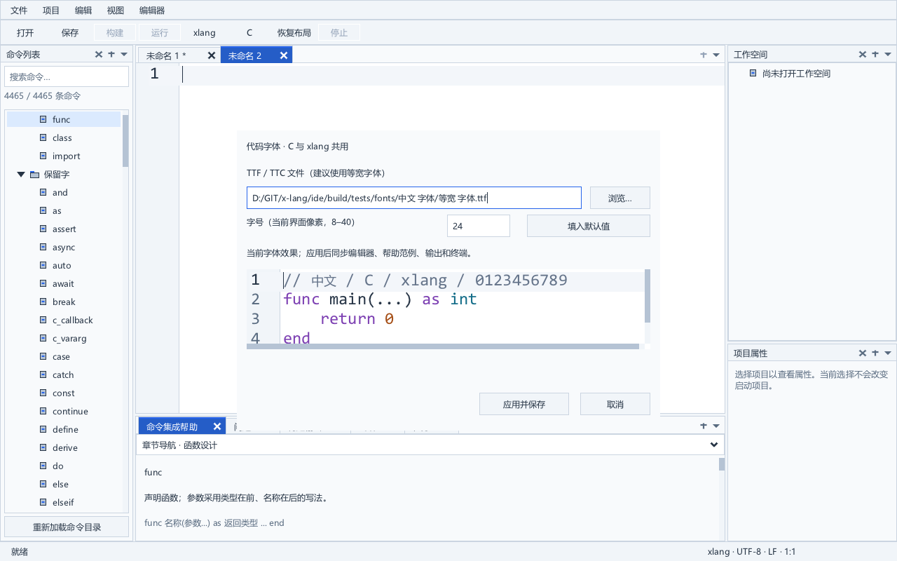

最终完整 Release 重建及验收退出码为 0：25 个独立应用模块、18 类测试、23 张基线原生图、五张真实任务图、一张 IME 图及一张字体图，共 30 张。真实 DEMO6 C/xlang 混编构建运行、失败不运行旧产物、原生输入和 SDK 负面检查全部通过，没有 XUI 错误回调；浅色和 900×600 深色字体设置页已查看，截图已保存。

## 主窗口位置与最大化增量

全局 window.json 保存正常位置、尺寸、显示器标识和最大化状态；最小化时仍保存可恢复的正常尺寸与最大化意图。切换工作空间不移动窗口；主窗口自动保存先于工作空间会话检查，损坏工作空间元数据不会禁用它。--size 覆盖启动恢复，--no-session 关闭持久化；隐藏 smoke 始终保留已有主窗口状态。

窗口几何按工作区相对位置与 96 DIP 保存，按目标有效 DPI 规划，显示器不存在时选邻近显示器，越界矩形裁剪到工作区。开启会话的可见窗口最小客户区为 640×480；原生消息通知触发按需绘制与 750 ms 防抖。原始窗口过程先接收消息，退出恢复过程链；窗口 JSON 保留未知字段、基线冲突保护和原子发布，损坏文件不被覆盖。

新增 window_test 在未切换到前台的独立 Windows 桌面运行真实 XGE/XUI，验证正常/最大化/最小化、正常尺寸保留、恢复重建、三个独立发布程序进程的最大化/普通重启及实际命令行覆盖、隐藏保留、工作空间切换、多次恢复无漂移、损坏会话独立自动保存、越界修复、最小尺寸、未知字段、外部冲突、锁定写失败和过程链清理。96/120/144/168/192 DPI、负显示器及任务栏原点是几何规划验收；多实体显示器切换和整套 UI 缩放仍需后续完成。

详细规则见 [主窗口状态](window-state.md)。长期目标保持进行中；完整 DPI、界面字体、树与帮助阅读位置、恢复快照清理、工程能力、真实语言服务及发布验收继续实施。

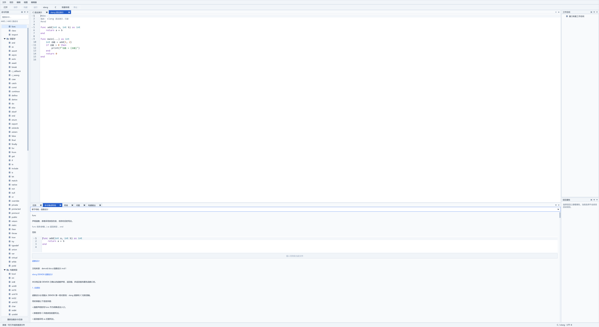

本轮 Release 的 26 个应用模块已严格重建，新增窗口测试也经同样编译选项重新链接；最终完整验收退出码为 0。19 类测试、23 张基线图、五张真实任务图、一张 IME 图、一张字体图及三张窗口图共 33 张，真实 C/xlang 混编与运行、失败构建不运行旧产物、SDK 混用拒绝检查均通过，没有 XUI 错误回调。三个独立发布程序进程验证最大化恢复、实际 --size 900 600 覆盖及后续正常窗口恢复；900×600 图和最大化原生布局已查看，固定 SDK 与发布 DLL 指纹一致。

## 全工作台 DPI 渲染增量

主程序开启高 DPI，按 Windows 窗口有效 DPI 同步逻辑视口，布局、Dock 和会话仍使用 96 DIP；避免固定 SDK 对取整尺寸求比值造成分数 DPI 拖动时的字体资源抖动。新增 DPI 代理覆盖字体、目标、绘制、剪裁、路径、表面和像素接口；保留逻辑字体度量，绘制使用实际物理字号与中文回退，目标和缓存使用物理分辨率。比例变化不重建文档、撤销和选区，也不改写字号偏好。

有序输入桥统一映射物理坐标和逻辑视口，IME 候选只由原桥反向换算一次。RGBA 接口保留逻辑 stride，截图读取实际像素；修正固定 OpenGL 目标上传/读回的上下行差异。缩放资源先准备再替换，失败保留原字体、比例、表面和采样器；四顶点映射使用栈数组。

新增 dpi_test 在独立后台 Windows 桌面运行真实 XGE/XUI，100/125/150/175/200% 验证定版 Dock、物理字体字号与目标、C/xlang 版本和选区、撤销、鼠标命中、模态输入和候选定位。像素检查验证剪裁、RGBA 行填充、目标和位图的上传读回、采样器、绘制中缩放拒绝与资源失败回滚。发布程序另有 125% C 和 200% xlang 的实际 CLI 截图。

比例由程序注入，没有更改用户 Windows 显示设置；实体混合 DPI 显示器、输入法设备、界面字体配置和缓存性能仍待后续验收。详细规则见 [DPI 与界面字体](dpi-and-ui-fonts.md)。长期目标保持进行中。


本轮最终版本的 27 个应用模块、GUI/诊断程序和测试以严格 Release 选项重建通过。执行 `test.bat -Configuration Release -SkipBuild` 的最终完整本地验收退出码为 0：20 类测试、25 张基线图、一张 IME 图、一张字体图、三张窗口图及五张 DPI 图共 35 张，SDK 混用负面检查通过，没有 XUI 错误回调。125% C、200% xlang 原生图已查看；文档的相对引用、PowerShell UTF-8 BOM 与发布/固定 SDK DLL 指纹均已核对。

早先的完整 Release 回归曾通过真实 DEMO6 混编和 40 张图。随后最终复验期间，`demo6/release/xl.exe` 与 `xlc.dll` 在 2026-10-06 09:10:12/09:10:11（本地时间）被重新生成，真实构建出现 `tcc: __xlvfs__/module.c:224: error: include file '__xl_runtime/xl6_array_erased.h' not found`。独立执行该编译器构建同一 `alpha.xlp` 也以 1 退出；源树存在该头文件，当前发布工具链的虚拟运行时未提供它。IDE 将错误写入问题/输出，未运行旧产物。

失败现场保留在 `build/tests/workspace-ui/中文 UI 工作空间/build/development/.xlang-ide-build/888e3df2-0bf3-44f7-ad55-edff3d93047f/build.log`。归档时编译器指纹未再变化：`xl.exe` SHA-256 为 `42B89FBE1F7CB58F410042ED23379271AAFDC2C4D1B7C752D892C40B1DB6498F`，`xlc.dll` 为 `06A1549AC1F53E5EAFAF74B09935B6D8041D6B8E13D2D5055B63F53C83B9B5D7`。早先通过记录不能代替这套工具链的验收，修复后需重做带 `-CompilerPath` 的完整回归。

长期目标保持进行中。下一增量继续界面字体配置和剩余会话阅读状态；实体混合 DPI/输入法、大文件与缓存峰值、语言服务和发布验收仍需完成。


## 独立界面字体增量

“视图 → 界面字体…”支持独立 TTF/TTC、8–40 DIP 整数字号、预览、默认值草稿、取消、应用保存和重启恢复。界面使用 ui.font，代码使用 editor.font，同一设置对象连续更新保留编译器与嵌套未知字段。共享严格内存字体加载，坏字体、坏路径和范围错误不提交；启动失败明确记录并保留原偏好。

更新覆盖菜单及下拉弹层、工具栏、状态栏、Dock、命令/工程树、项目属性、帮助正文与设置页。代码编辑、帮助代码块、输出和终端保持代码字号；界面行高、表单和模态内容随实际字体度量更新。大字号原生弹窗使用横向/纵向滚动，按钮可访问。保存冲突或锁定写失败恢复旧字体、布局和原阅读位置，C/xlang 文本、语言、Unicode 选区及撤销不重建。

UIFontService 使用无样式副作用的类型查找，避免固定 SDK 的 GetType 在每个控件遍历时反复触发整树样式重算；菜单、私有 Popup/ScrollView 内容及已打开的字体/配置弹窗作为实际根遍历，避免释放旧字体后遗留弹层引用。原生测试还在打开的配置窗格中更新字体，验证草稿保留与取消不改变项目。

严格 Release 重建 GUI、诊断程序与全部测试成功；随后执行 `test.bat -Configuration Release -SkipBuild -CompilerPath D:\GIT\x-lang\demo6\release\xl.exe`，退出码 0。21 类测试、27 张基线图、五张真实任务图、一张 IME 图、一张代码字体图、三张窗口图、五张 DPI 图及两张界面字体图，共 44 张本轮新图。真实混编、任务运行、编译失败不运行旧产物、SDK 混用拒绝全部通过，没有 XUI 错误回调。浅/深色 900×600 发布程序字体页已查看，文档链接、PowerShell UTF-8 BOM 及固定/发布 SDK 指纹检查通过。

真实工具链已恢复。最终独立模型清单和混编清单分别在 2026-10-06 10:10:59/10:11:00 构建并运行成功，晚于 xlc.dll 在 10:10:17 的再次更新；末次核对 xl.exe SHA-256 为 `42B89FBE1F7CB58F410042ED23379271AAFDC2C4D1B7C752D892C40B1DB6498F`，xlc.dll 为 `C7374527D94503410428C0A5A246F0B73CE1804A51130551D57F9B31AF06F288`。此前 09:10 的缺失头失败记录仍保留；本次未修改编译器源码。固定与发布 xge.dll 均为 `A48E028ACFB96DB59277D820A4DBEBC482D8635FD79C63EF3DA6B00C69382784`。


实现和设备边界见 [DPI 与界面字体](dpi-and-ui-fonts.md)。长期目标保持进行中；下一增量处理树与帮助的详细阅读状态及恢复快照维护，随后继续工程能力和真实语言服务。实体混合 DPI/输入法、性能和发布验收仍需完成。


## 树与帮助阅读状态增量

新增 ui/reading_state.c，reading/version=1 进入现有本机会话。工程树使用节点种类、项目及文件/分组身份，命令树使用类别、模块和命令 ID；分支展开与选择独立保存，顶部节点加行内比例在实际布局后恢复。项目文件和公开目录条目真实重排后不依赖旧 SDK 编号；缺失身份忽略或回退，启动项目不改变。选择工作空间级文件保留上一个有效项目属性所属者。

帮助保存命令、章节标题/同名序号、正文显示块的类型/内容摘要及同内容序号、块内比例和末尾标记。字体、宽度和重启变化后回到同一合理内容；锚点消失时按现存章节或裁剪的旧偏移回退，文档末尾按新范围恢复。界面字体的实时应用和失败回滚也使用这些锚点。属性滚动保存逻辑偏移；项目清单没有新增浏览字段。

工作空间切换先检查点当前状态，再清理浏览状态并恢复目标作用域，包括空搜索词。显式启动项目、命令/查询和章节优先于恢复位置。树及帮助变化进入原有 750 ms 防抖，只读位置变化也会保存。分支数组用稳定键保留未知字段，重复键、坏比例、错误类型和不支持的版本拒绝完整恢复并保留原 JSON；旧 session-1 没有 reading 字段仍可恢复文档并在后续保存中升级。

严格 Release 重建 GUI、诊断程序和全部测试后，执行 `test.bat -Configuration Release -CompilerPath D:\GIT\x-lang\demo6\release\xl.exe`，退出码 0：29 个独立应用模块、22 类测试、27 张基线原生图、五张真实任务图及十四张 IME/两套字体/窗口/DPI/阅读图，共 46 张完整回归图。真实 C/xlang 混编、构建运行、失败不运行旧产物和 SDK 负面检查通过，无 XUI 错误回调。两个独立发布程序跨 1280×800 与 900×600 核对长帮助块/章节身份；原生深色恢复图和两张 125% 阅读图已查看。

补充 reading_test 严格定向链接通过，并实际重启验证旧 session-1 兼容和损坏阅读元数据不部分恢复文档；同一测试还验证真实目录/文件重排、UIFont 实时与重启、窄视口重排、折叠/选择/行锚点、独立作用域、工作空间文件属性所属者、末尾、缺失身份、显式章节覆盖、仅树变化自动保存、未知字段和坏比例/重复键保护。应用业务源码在最终完整回归后未再修改。

固定与发布 xge.dll 仍为 `A48E028ACFB96DB59277D820A4DBEBC482D8635FD79C63EF3DA6B00C69382784`；编译器 xlc.dll 仍为 `C7374527D94503410428C0A5A246F0B73CE1804A51130551D57F9B31AF06F288`。文档相对引用、测试脚本 UTF-8 BOM 和 Git 空白检查通过。历史编译器失败记录继续保留。

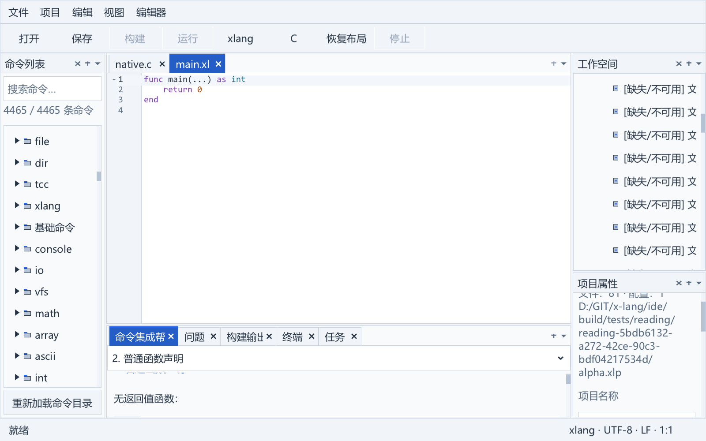

格式与边界见 [会话与布局恢复](session-and-layout.md)。长期目标保持进行中；下一增量处理恢复快照保留/清理及损坏状态修复入口，之后继续文件与清单协调、工程能力、真实语言服务、性能和发布验收。


## 恢复快照保留与维护增量

新增 platform/recovery_store.c，整个作用域的 checkpoint.lock 从任何正文写入之前持续到保留上一检查点、当前提交及维护完成。保存先核对加载的当前会话和布局基线，避免另一个 IDE 的提交被覆盖；独立 JSON 的锁与原子替换继续保留。previous-session.json 保存上一份完整元数据及其未知字段；两份已发布会话引用的正文/基线不会因年龄删除。

会话轮换前以原生句柄刷新正文最近引用时间，内容保持不可变。七天宽限按创建时间和最后写入/引用时间的较新者计算，因此很早创建但刚失去引用的正文也受到保护。只能在完整枚举、元数据验证及目录句柄保护后删除受支持命名的普通孤立文件；最多 20,000 个条目，不递归删除，硬链接、只读、被锁文件、连接点、陌生文件和未知备份目录均保留。成功检查点最多每小时维护一次；损坏上一份元数据时最新编辑仍可保存，清理停止。

严格 Release 重建 GUI、诊断程序和全部测试通过；最近引用宽限修正后的最终完整 `test.ps1 -Configuration Release -SkipBuild -CompilerPath D:\GIT\x-lang\demo6\release\xl.exe` 回归退出码 0：30 个独立应用模块、23 类测试、46 张原生图及 SDK 负面检查。真实 DEMO6 混编、构建运行、独立 601 条 IDE 元数据清单及失败构建不运行旧产物通过，没有 XUI 错误回调。

新增 recovery_test 使用实际 Windows 文件系统和第二个原生测试进程，验证作用域互斥、当前/上一引用、七天精确边界、刚取消引用的老正文宽限、新创建文件保护、锁定/只读/硬链接及外部链接内容、陌生文件/目录、损坏/未来格式/穿越引用、未知备份目录保护和真实 recovery 连接点拒绝。session_test 新增锁竞争时元数据不变、上一份引用轮换、损坏上一份仍保存最新编辑及维护停止/恢复验证；完整原生会话、阅读、字体、窗口和 DPI 回归也通过。

此次验收使用的外部工具链 xlc.dll 在 2026-10-06 11:05:58 更新，本轮未修改编译器。末次校验 xl.exe SHA-256 为 `42B89FBE1F7CB58F410042ED23379271AAFDC2C4D1B7C752D892C40B1DB6498F`，xlc.dll 为 `6EADADF11196BC7E6660FA8CC0548E8EA457C65116298C11FF64F9DBCA261D38`；固定/发布 xge.dll 仍同为 `A48E028ACFB96DB59277D820A4DBEBC482D8635FD79C63EF3DA6B00C69382784`。历史虚拟运行时缺头失败记录保留。文档链接、脚本 UTF-8 BOM 和 Git 空白检查通过。

协议和边界见 [恢复存储维护](recovery-maintenance.md)。长期目标保持进行中；下一增量实现可操作的恢复管理窗口，提供正文预览、按 C/xlang 取回为未命名文档和完整备份后的损坏检查点修复。后续仍须完成文件/清单协调、工程资源与迁移能力、真实语言服务、实体输入/DPI、性能和发布验收。

## 原生恢复管理与备份重建增量

新增 `platform/recovery_backup.c`、`services/recovery.c` 和 `ui/recovery_view.c`。“视图 → 会话与恢复…”显示当前作用域与保护原因，后台扫描当前/完整备份正文并只读预览，支持 C/xlang/纯文本选择和取回为未命名文件。只有成功预览的实际正文才能取回；原路径不绑定，已有源文件不被覆盖。刷新、按七天规则维护、明确确认后的备份重建均走真实原生按钮和服务。

备份保存损坏/二进制/超过通常元数据限制的原始 JSON 字节，以及 recovery 下全部可读普通文件的独立副本；版本清单从 copying 到 complete，逐块复制并 flush。完整备份成功后才按保持的原生句柄撤下原元数据，在 UI 线程与同一作用域锁内保存当前文档、布局、主题和阅读状态。失败/取消保留原件；完成但未消费的撤下在退出时回退。原始备份永久保留，活动孤立正文仍按受支持备份协议安全维护。损坏/陌生备份使维护停止。

原生恢复窗口加入独立 UIFont/代码字体绑定、主题、模态隔离与横向/纵向滚动。完成、失败或取消确认后回到顶部显示结果及备份路径。固定 SDK 的按钮在自己的点击处理中禁用后可能保留 disabled 绘制缓存，应用通过公开状态接口同步实际输入和缓存状态；重新启用后实际外观已核对，SDK 不改。

最终通过含重建的 `tools/test.ps1 -Configuration Release -CompilerPath D:\GIT\x-lang\demo6\release\xl.exe`，退出码 0：33 个独立应用模块、25 类测试、29 张基线原生图、五张真实任务图和十七张输入/两套字体/窗口/DPI/阅读/恢复图，共 51 张。真实 C/xlang 混编、include/library/link 及运行、601 条 IDE 元数据清单、失败构建不运行旧产物和 SDK 混用负面检查通过，没有 XUI 错误回调。

新增 recovery_backup_test 覆盖超过 8 MiB 的损坏元数据、二进制与未来格式的原字节副本、独立正文、原生撤下/回退、锁定/取消、后台服务退出和未消费结果回退、活动过期文件真实清理后备份仍能取回，以及坏备份阻止维护。新增 recovery_view_test 在独立 Windows 桌面通过真实按钮/列表输入验证双语法未命名恢复、只读/编码保护、模态隔离、40 DIP 滚动确认、锁定失败与完整重建、结果滚动复位、实际按钮缓存状态，以及原编辑版本/未保存状态/源字节保留。最终三张恢复窗口图及浅/深色 900×600 发布程序图已查看。

本轮外部工具链 xlc.dll 又于 2026-10-06 11:50:24 更新，最新完整回归使用该版本；本轮未改编译器。最终 SHA-256：xl.exe 为 `42B89FBE1F7CB58F410042ED23379271AAFDC2C4D1B7C752D892C40B1DB6498F`，xlc.dll 为 `717DA4F0AEF8F3ACDF5384EE19F8C8F4503DE11BE99F8D7F000F04E20ECB546F`。固定/发布 xge.dll 均为 `A48E028ACFB96DB59277D820A4DBEBC482D8635FD79C63EF3DA6B00C69382784`。此前工具链通过与缺头失败记录保留；文档相对引用、测试脚本 UTF-8 BOM 和 Git 空白检查通过。

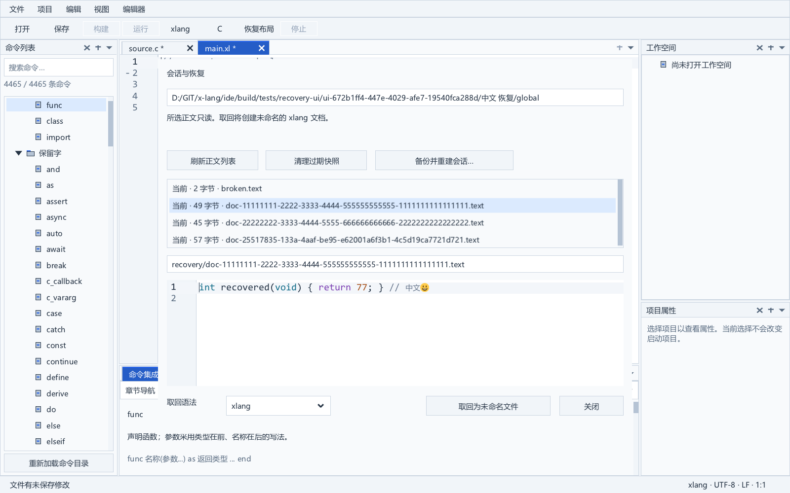

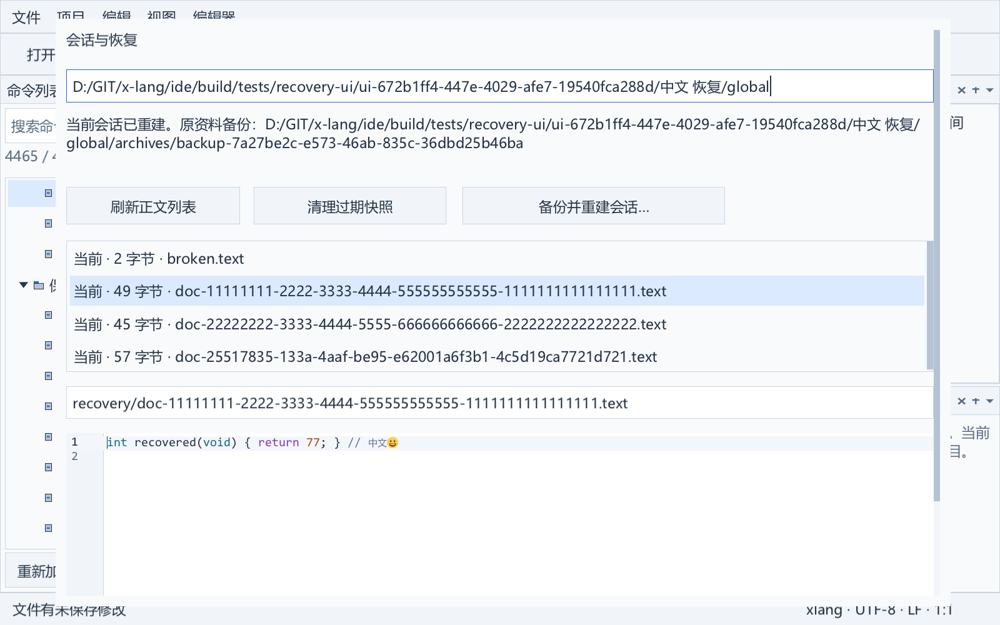

完整协议见 [恢复存储维护与恢复管理](recovery-maintenance.md)。此入口修复当前作用域，独立全局 recent/window/偏好文件、其他作用域及坏备份修复仍未实现。长期目标保持进行中；下一增量推进外部文件变化通知与清单双向协调，继续工程资源/模板/迁移、动作注册、工具链版本/查询、真实 C/xlang 语言服务、性能、实体输入/DPI 与发布验收。

## 外部文件监视与清单协调增量

新增 `platform/file_watch.c`、`services/file_sync.c` 和 `ui/file_changes_view.c`。后台使用 ReadDirectoryChangesW、重叠 I/O 和完成端口读取真实快照，线程仅持有已复制的路径/稳定令牌，不持有 UI/模型指针。订阅代次隔离旧结果，目标改变取消过期读取；每两秒补充重订阅与核对，缺失父目录恢复后继续观察。引用文件仅取元数据，变化使相关任务失效。

文档从观察到的有效快照接受更新，保留稳定身份、语法覆盖、Unicode 多选区方向、滚动、未变折叠及可撤销历史。自身保存与基线相同不产生冲突。“保留当前内容”在目标重新订阅、打开其他文档、打开同一模型清单后仍确认相同观察版本，新的磁盘版本重新通知；确认不修改保存基线。无效编码、锁定、缺失、二进制及超限保留当前内容。服务停止前用静态状态文本解除 XUI 状态栏对服务缓冲区的借用，再取消/回收线程；停止后重绘与重新启动已验证。

已绑定清单的文本保存先验证结构，成功后从实际提交正文事务刷新模型；错误草稿不会写磁盘。外部工作空间按引用身份协调，保留未改绑的项目、当前配置及独立源文档，新引用由后台加载；移除/改绑有未保存属性的项目须明确确认。未应用的右侧属性输入也受保护。模型导出只读保留原 JSON 基线及未知字段，树/属性刷新保留选择、展开和阅读锚点。构建前保存不再保留可能被清单协调释放的项目指针，按稳定项目 ID 重新查找。

“视图 → 磁盘变化…”提供列表、路径/原因、当前内容与实际磁盘正文的只读比较。C/xlang 使用真实双语法；清单比较还显示当前模型和未应用属性草稿。重载先确认，再核对观察序号、文档版本与实际模型/属性草稿；变化取消旧确认。取消、保留和重载不写源文件。弹窗适配浅/深主题、两套字体、40 DIP 及两向滚动；正常 Dock 与单栏命令帮助保留。

最终含严格 Release 重建的 `tools/test.ps1 -Configuration Release -CompilerPath D:\GIT\x-lang\demo6\release\xl.exe` 退出码 0：36 个独立应用模块、28 类测试、29 张基线图、五张真实任务图和二十一张输入/字体/窗口/DPI/阅读/恢复/磁盘比较图，共 55 张。真实 DEMO6 C/xlang 混编、include/library/link、中文路径构建运行、601 条 IDE 元数据清单、失败构建不运行旧产物和 SDK 混用负面检查通过。最终四张磁盘比较图已经查看并随文档保存。

新增 `file_watch_test` 验证实际内核通知、Unicode 路径的另一个原生进程写入、同长度修改、原子替换、硬链接、删除/恢复、缺失父目录、72 个目录、空订阅、订阅取消、重复令牌拒绝、4,096 条数量边界及 128 MiB 正文队列边界和溢出后的重新核对。新订阅打断旧的 1,024 个大文件读取，退出期间取消 I/O。测试等待实际 READY 正文，避免把外部原子替换短暂共享冲突误当作要确认的磁盘正文。

`file_sync_test` 验证干净更新/撤销/重做、多选区/语法/折叠、脏保护、保留跨重新订阅、后续新版本通知、保存冲突、旧编辑版本拒绝、坏编码与删除恢复、保存清单即时同步、坏 JSON 事务保护、未应用属性草稿、工作空间增删引用及稳定身份、状态栏停止后重绘与服务重启。`file_changes_view_test` 在未切换的独立 Windows 桌面通过实际列表/按钮输入验证只读比较、取消/保留/确认、模态隔离、过期确认、未应用属性变化、双语法、两套字体/DPI、40 DIP 按钮可访问和真实按钮状态缓存。

本轮未修改编译器；外部 `xlc.dll` 在验收期间于 2026-10-06 13:00:03 更新。结束后的真实编译器集成步骤通过，最终指纹为 `2187BC0269E794BF789B7AC7CF05BFEBD4CE9C2EF4F0BB286B36DCA40F61E811`，不将整个过程中更早的子测试归于这一指纹。`xl.exe` 仍为 `42B89FBE1F7CB58F410042ED23379271AAFDC2C4D1B7C752D892C40B1DB6498F`；固定/发布 `xge.dll` 均为 `A48E028ACFB96DB59277D820A4DBEBC482D8635FD79C63EF3DA6B00C69382784`。历史失败与通过记录保留。

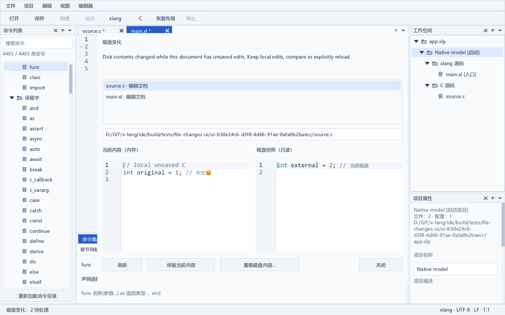

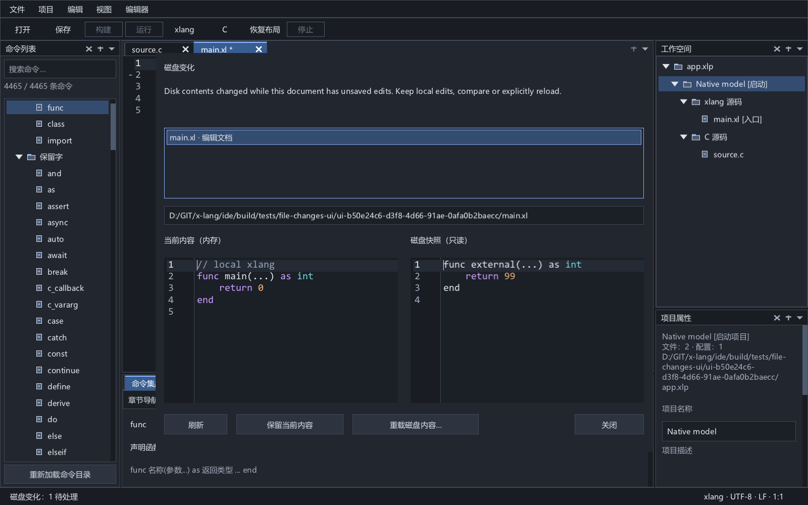

协议与内存边界见 [外部文件变化与清单协调](file-coordination.md)。只将 I/O 放在后台，UTF-8 解码、JSON 验证/模型协调及词法仍在 UI 线程；长期大量目标、UNC/网络文件系统和大文件 UI 延迟未完成性能验收。未保存 JSON 草稿不会实时覆盖模型，另存为引用改写仍待实施。长期目标保持进行中；继续动作注册、工程资源/库/模板/迁移、工具链版本/真实 C/xlang 语言服务、全局状态修复、性能与首版发布。

## 动作注册与统一状态增量

新增 app/actions.c 与 app/actions.h，注册 44 个既有公共动作（含公共“应用项目属性”入口），统一稳定 ID、名称、中文标题、快捷键、状态和执行。菜单、工具栏与属性按钮按实际条目 ID 刷新，主题、语法及启动项目标记来自当前状态，撤销/重做读取真实历史。无文档、未命名重载、不可用项目、DLL 启动项目、已关闭运行输入和模态状态受到执行前保护；停止任务在模态期间仍可用。

CodeEdit 焦点目标先于根快捷键处理，应用在公开目标 KEY_DOWN 处理器核对注册的编辑动作，保留其余原处理器；只读撤销不能绕过检查。COMMAND、provider 与核心原生右键命令按实际目标文档接入，底层编辑直接派发 COMMAND，显式补全走公开 API，普通输入框保留自身快捷键。右键菜单按应用拥有的标题识别动作，使用公开接口；没有改动 SDK 或借用私有数值。绑定记录在 XUI 销毁后释放。

原生右键菜单加入界面字体重绑及失败回滚。公共属性按钮同步 enabled 与实际绘制缓存；任务输入可用状态从服务及进程的真实关闭/取消/结束标志获取，线程仍不操作 UI。已派发动作仅表示交给处理器，取消和业务失败不被报告为保存成功。

最终含严格 Release 重建的 tools/test.ps1 -Configuration Release -CompilerPath D:\GIT\x-lang\demo6\release\xl.exe 退出码 0：37 个独立应用模块、29 类测试、29 张基线图、五张真实任务图及二十四张独立原生图，共 58 张。真实 DEMO6 C/xlang 混编、include/library/link、中文路径运行、601 条 IDE 元数据清单、失败构建不运行旧产物和 SDK 混用负面检查通过，没有 XUI 错误回调。

新增 actions_test 在未切换到前台的独立 Windows 桌面使用真实 XGE/XUI 与 125% 比例，检查 ID/名称/快捷键唯一性、重排条目仍按 ID 更新、菜单/工具栏/按钮及编辑目标/右键执行、只读保护和 C/xlang 标记。普通属性字段 Ctrl+Z 不改代码文档，DLL 启动项目即使条目被强制启用也无法排队运行；实际 F5 构建运行启动项目时保留另一个所选项目；关闭 stdin 后写入被拒绝，模态草稿打开时 Shift+F5 实际终止子进程。字体成功更换、锁定设置后的回滚与真实按钮缓存均验证。测试中的编译器为进程夹具，真实 DEMO6 在完整回归单独验证。

三张最终原生菜单图已经查看并随文档保存。此轮未修改编译器；外部 xlc.dll 于 2026-10-06 13:12:08 更新，最终完整回归的真实工具链步骤通过，记录指纹为 F8121F9F95651EAD100547EDCE4CDA7961CB54D0440BD45F6D3EB933B23B2642。xl.exe 为 42B89FBE1F7CB58F410042ED23379271AAFDC2C4D1B7C752D892C40B1DB6498F；固定/发布 xge.dll 均为 A48E028ACFB96DB59277D820A4DBEBC482D8635FD79C63EF3DA6B00C69382784。更早增量的指纹及失败记录保留。 文档相对引用、脚本 UTF-8 BOM、三张原图字节及 Git 空白检查通过。

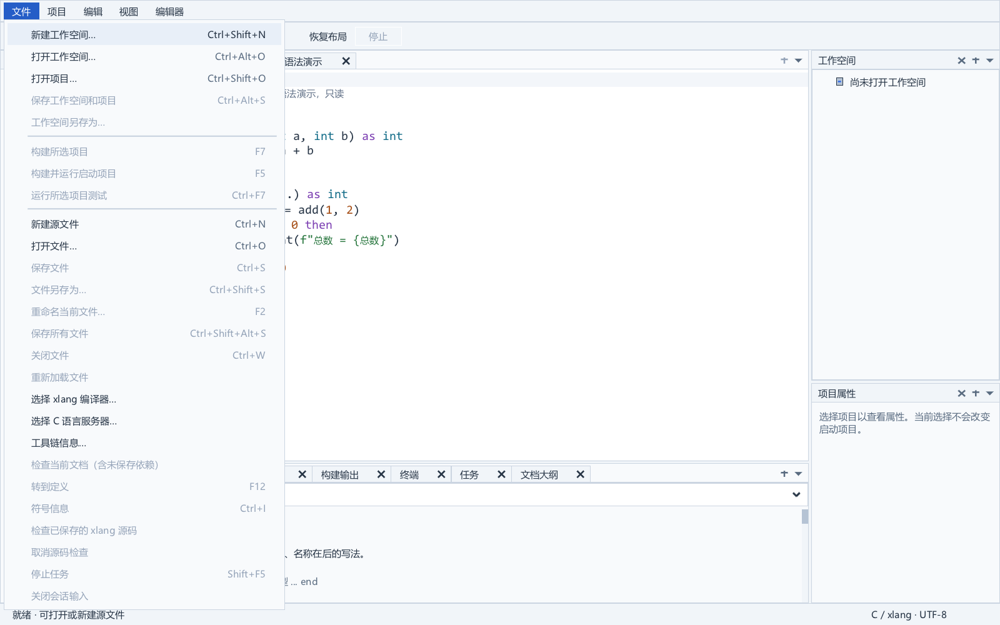

详细协议与编辑菜单图见 [动作注册与统一路由](actions.md)。当前覆盖既有应用动作及核心编辑命令；动态插件注册、快捷键定制、动作面板及其余 SDK 编辑动作尚未完成。长期任务保持进行中，下一增量推进工程资源/库引用，继续模板/重命名/旧格式迁移、工具链版本能力查询、真实 C/xlang 语言服务、全局状态修复、性能、实体输入/DPI 和发布验收。

## 工程文件、资源与库引用增量

新增 ui/references_view.c/.h，从项目菜单与右侧属性打开同一原生草稿窗格，并加入第 45 个公共注册动作。支持工程文件路径/种类/顺序，以及库管理元数据的添加、更新、移除和重排。独立草稿、打开时完整项目基线及项目稳定 ID 避免借用被刷新释放的模型指针；重复打开不丢弃当前草稿，新打开回到起始位置。

模型新增独立引用导出与一次验证的事务应用。入口引用必须保留为 xlang；C 源、头文件、xlang 及资源配置扩展名受到核对，重复真实路径（含硬链接）、显式库 ID/种类名称和 NUL 被拒绝。C 与编译资源分别同步根 cSources/resources，普通资源仅留 FileEntry，额外 xlang 文件遵循 import。稳定 ID、未知字段、旧无 ID 库及缺失文件保留；移除不删磁盘文件或关闭独立文档，另存为路径重算。没有变化不新增脏标记。

字段修改尚未按添加/更新加入列表时，应用保留窗口和原输入并明确提示；该遗漏在最终审查中由实际流程复现后修正并回归。未知现有种类可更新保留，新建选择明确文件种类或 package。过期项目基线、已打开清单的未保存正文及未应用右侧属性继续受到保护。引用提交保存库稳定选择和树阅读；真实外部清单在模态期间暂缓协调，取消后恢复有效磁盘模型。新窗格加入既有动作/模态、UIFont 绑定与回滚、DPI 布局和两向滚动。

最终含严格 Release 重建的 tools/test.ps1 -Configuration Release -CompilerPath D:\GIT\x-lang\demo6\release\xl.exe 退出码 0：38 个独立应用模块、30 类测试、29 张基线、五张真实任务和二十七张独立原生图，共 61 张。C/xlang 混编、include/library/link、中文路径运行、601 条 IDE 元数据清单、失败构建不运行旧产物、SDK 混用负面检查及全部原生绘制通过，没有 XUI 错误回调。

新增 references_test 验证 324 条引用、事务/无变化/编码/入口/硬链接保护、未知字段、相对路径另存为、真正项目属性按钮、分类/列表/重排及库稳定选择、取消/过期/脏清单/未更新字段、普通输入快捷键、实际外部清单暂停/恢复，以及 125% 比例、40 DIP 窄逻辑视口和两向滚动的原生输入。指定真实编译器时通过真实任务服务构建并运行 C/xlang 项目，随后 Windows 版本 API 从实际生成 EXE 读取 2.3.4.5，验证编译资源生效。普通资源故意使用非 JSON，库包含未导入包，二者未被隐式编译或导入。

最终三张图已经查看并随文档保存。测试曾误用 C free 释放 XRT 树键导致退出堆故障，已改为匹配的 xrtFree；大字号点击按可见行矩形核对，渲染目标与窄逻辑视口一致，SDK 未修改。本轮未修改编译器；完整回归前记录的外部 xlc.dll 指纹为 2063407097685C7701AF182D6B9AB6CA245E1F59401975660C9C23E40C47A607。记录验收时，它已于 2026-10-06 14:44:31 更新为 756D00DFD7272A9F46C9887DB60C4C70FC768AC59060613B55C717E2BE5D411D；新版本随后通过 references_test 和 task_test 的真实混编/链接/运行/失败构建及 PE 资源集成，均退出码 0。完整 30 类/61 图与追加工具链检查分别记录，不把更早的全部子测试归于新指纹。xl.exe 为 42B89FBE1F7CB58F410042ED23379271AAFDC2C4D1B7C752D892C40B1DB6498F。固定/发布 xge.dll 均为 A48E028ACFB96DB59277D820A4DBEBC482D8635FD79C63EF3DA6B00C69382784，历史失败和指纹保留。 文档 18 份、125 处相对引用、构建/测试脚本 UTF-8 BOM、三张原图字节及 Git 空白检查通过。

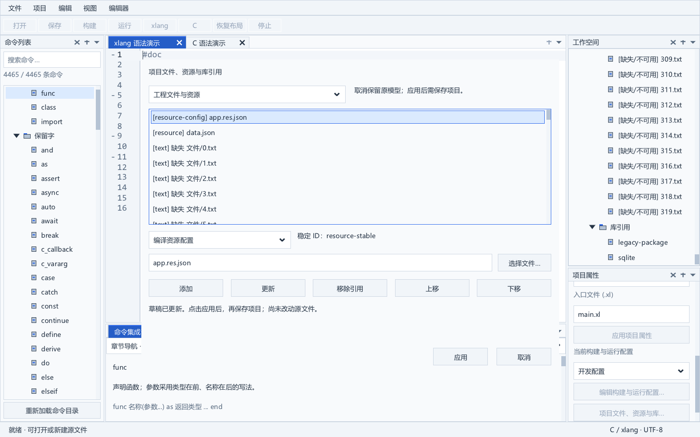

使用、事务和其余图片见 [工程文件、资源与库引用](project-references.md)。库文档/可用性查询、资源正文专用表单和依赖图尚未实现，JSON/xlon 可通过已有文本编辑器修改。长期目标保持进行中；下一增量推进项目模板与入口生成，继续重命名/另存为引用协调、旧格式迁移、工具链版本/能力查询、真实 C/xlang 语言服务、全局状态修复、性能、实体输入/DPI 与首版发布。

## 项目模板与入口生成增量

2026-10-06 新增 services/project_templates.c 和 ui/template_view.c，注册表沿用现有新建项目动作，共 45 个公共动作。从空工作台或现有工作空间打开原生向导，可选择空白、控制台、C/xlang 混合和 DLL 模板，预览所有文件与准确的 project.xlp；生成新目录、选中新项目并打开入口。项目清单已经保存，工作空间引用仍显示脏状态并单独保存；已有启动项目默认保留，真正勾选复选框才替换。

创建准备无磁盘写入，提交先预分配模型内存，在独立暂存目录 CREATE_NEW 写入并刷新，记录物理身份、关闭子文件后以持有的目录句柄重命名，禁止覆盖已有目标。失败仅清理自身已知文件，无法清理时明确显示暂存位置，不递归删除陌生内容。完整模型基线深拷贝阻止过期提交，未应用属性与未保存工作空间清单正文受到保护；文件监视继续接收通知，模态关闭后协调实际有效清单。

完整 tools/test.ps1 -Configuration Release -CompilerPath D:\GIT\x-lang\demo6\release\xl.exe 严格重建及回归退出码 0：40 个独立应用模块、32 类测试、29 张基线、五张真实任务和三十张独立原生图，共 64 张。四种模板均经真实 DEMO6 构建；三个应用实际运行，混合模板调用真实 C extern 函数，DLL 经 LoadLibraryW/GetProcAddress 验证实际导出函数的正负整数调用。已有真实 PE 资源、混编/链接、601 条 IDE 文件元数据、失败构建不运行旧输出及 SDK 混用负面检查继续通过。

template_test 验证 Unicode/emoji、稳定身份、完整内容与清单往返、预览无写盘、名称/设备/编码/路径保护、已有文件/目录、预览后竞争、父目录共享锁失败和工作空间保持。template_view_test 验证真实菜单/选择/按钮、只读 C/xlang/清单预览、当前版本 token、预览清单与实际文件逐字节一致、取消、默认/保留/实际勾选启动项目、文档和普通输入隔离、深拷贝基线、脏 JSON/属性保护、外部清单通知延后/恢复、两套字体失败回滚、125% 与 40 DIP 窄逻辑视口下两向滚动及实际创建；新增三张图均来自这次完整回归。

实现时发现先切语言再替换预览正文会留下旧版本 token，SDK 回退到 C 分词；已改为先设置正文再配置语言/词法折叠，并加入实际版本与 xlang func 关键字断言，修复后截图已查看。Windows 目录在子文件句柄打开时无法重命名，已关闭并保留物理身份后提交；失败回滚保留身份核对。大字号复选框测试按滚动视口内的可见矩形点击。固定 SDK 未修改。

首次完整重建曾在 GCC 任务进程夹具编译时报告内存分配失败，尚未进入全套测试；后续窗口重启子进程实际日志报告 XUI -5（内存不足）cache.prepare，原验收未放宽。新增标准流、超时/退出诊断和控件类型/世界坐标/缓存策略日志后，定向窗口重启及本次完整回归均通过；帮助窗格没有因此改变，未把内存错误归因于语法预览修复。历史失败保留在 build/tests/windows-template-diagnostic/window-428eaa94-365e-4933-9681-fa68e25ab656/中文 进程重启/restart-0.log；最新完整过程日志为 build/template-full-regression.log。

本轮未修改编译器，外部工具链在开发期间继续更新。最终完整回归前后 xl.exe SHA-256 均为 42B89FBE1F7CB58F410042ED23379271AAFDC2C4D1B7C752D892C40B1DB6498F，xlc.dll 均为 097DC5E847B183575DDA53EE8EFA292DEC67BAB9DB36319E598D5F8B86240C7B；早先模板定向通过与更早增量不归到这次指纹。固定及发布 xge.dll 仍同为 A48E028ACFB96DB59277D820A4DBEBC482D8635FD79C63EF3DA6B00C69382784，历史记录保留。

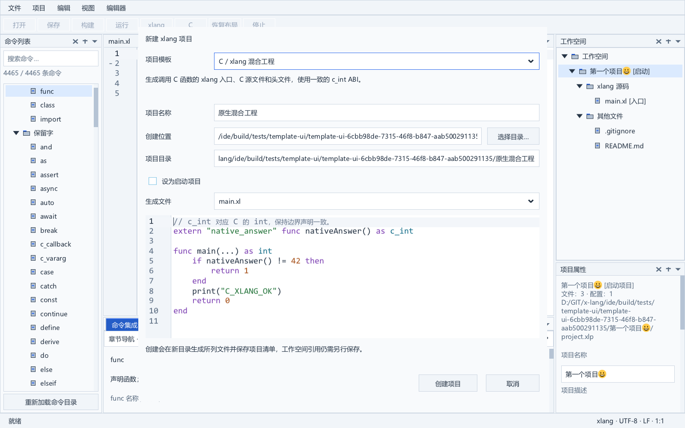

文档终检通过：19 份 Markdown、140 处相对引用，构建/测试脚本 UTF-8 BOM、三张完整回归原图字节、64 张新鲜测试图和 Git 空白检查一致。

使用、创建协议、C 预览和大字号操作图见 [项目模板与新建向导](project-templates.md)。长期目标保持进行中；继续重命名/另存为引用协调、旧格式迁移、库文档与资源专用表单、工具链版本/能力查询、真实 C/xlang 语言服务、全局状态修复、性能、实体输入/DPI 和首版发布。

## 文件另存为引用协调增量

2026-10-06 新增 services/file_rebind.c，共 41 个独立应用模块。已命名工程文件另存为成功后，当前工作空间中指向同一物理原文件的 FileEntry、项目入口、C 源、编译资源及工作空间文件引用统一切换新路径，包含共享项目与硬链接别名。稳定 ID、未知字段、启动项目、编辑器标签/版本/选区/撤销和会话 ID 保留；原文件继续在磁盘。受影响项目及必要的工作空间引用显示脏状态，随后沿用原子清单保存；不改其他未加载工作空间或源码 import/include。

准备阶段验证工程文件种类、重复引用、已绑定清单与当前属性/模态/未保存清单正文，预分配全部替换字符串及项目列表，保留原生阅读快照；文档原子写入成功后再无分配地提交模型。新增保存结果回调覆盖拒绝、编码/写盘失败、打开目标冲突、无变化及成功，每条完成路径释放计划与阅读快照。源码另存为不能改绑/覆盖已绑定 .xlw/.xlp；工作空间已有独立另存为入口，项目清单迁移仍待后续。

修正了干净文档另存为不同硬链接路径时误判为无变化的问题；现仅在完全相同规范化路径时快速返回，另一个拼写实际保存并绑定新路径。提交使受影响项目的旧构建失效，新文件路径触发监视重新订阅，会话按当前路径保存。

完整严格重建的 tools/test.ps1 -Configuration Release -CompilerPath D:\GIT\x-lang\demo6\release\xl.exe 退出码 0：41 个独立应用模块、33 类测试、29 张基线、五张真实任务和三十二张独立原生图，共 66 张。file_rebind_test 在后台独立桌面验证共享入口/C/头文件/资源/工作空间文件与硬链接、准备无写盘、稳定身份和未知字段、树/启动项目保留、实际锁定目标的原子失败、种类/重复/打开目标/清单/模态保护、保存结果计划清理、干净物理别名另存为、原文件字节、独立文档语法切换、选区/撤销/会话、新路径的实际外部修改和正在构建的旧请求失效。真实 DEMO6 使用更新清单中的新入口、C 源及资源配置构建并运行成功；既有模板/DLL、资源版本、混编/链接、601 文件元数据清单、失败构建与 SDK 负面检查继续通过。

新夹具首次已完成断言却遗漏主循环退出，达到既有 90 秒守卫退出 1；已补 xgeQuit，再次定向及完整验收均正常退出 0，没有放宽超时。两张实际原生图来自本次完整回归，已经查看并保存；完整日志为 build/file-rebind-full-regression.log。此前模板及窗口内存失败记录保留。

本轮未修改编译器和固定 SDK。完整回归前后 xl.exe SHA-256 均为 42B89FBE1F7CB58F410042ED23379271AAFDC2C4D1B7C752D892C40B1DB6498F，xlc.dll 均为 097DC5E847B183575DDA53EE8EFA292DEC67BAB9DB36319E598D5F8B86240C7B；固定/发布 xge.dll 均为 A48E028ACFB96DB59277D820A4DBEBC482D8635FD79C63EF3DA6B00C69382784。

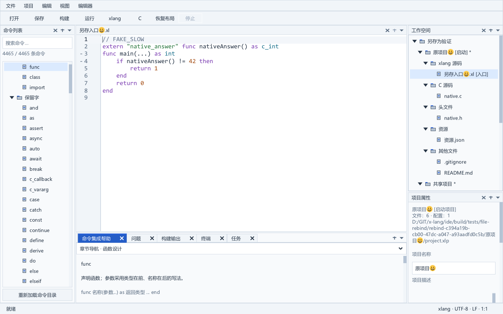

终检通过：20 份 Markdown、154 处相对引用、构建/测试脚本 UTF-8 BOM、两张原图字节、66 张新鲜测试图、固定 SDK 指纹及 Git 空白检查。

详细路径协议与 C 图见 [文件另存为与工程引用协调](file-save-as.md)。长期目标保持进行中；继续物理重命名/目录/项目清单迁移、旧格式导入、库文档/资源表单、工具链版本/查询、真实 C/xlang 语言服务、全局状态修复、编辑动作、性能、实体输入/DPI 与首版发布验收。

## 文件物理重命名增量

2026-10-06 新增 platform/file_rename.c 和 ui/rename_view.c，共 43 个独立应用模块，注册表增加 file.rename 为 46 个动作。文件菜单与代码编辑器 F2 打开同目录改名窗口。窗口保存独立模型/文档/磁盘基线，失败保留输入，模态保护、文件协调暂停、界面字体/DPI 及滚动协议均已接入。

磁盘事务预分配路径与 FILE_RENAME_INFO，持有源句柄排除并发写入/删除，核对普通文件、只读属性与原始字节，再执行禁止覆盖的重命名。成功保留文件身份及字节，沿用 services/file_rebind 更新共享入口/C/头文件/编译资源/工作空间引用；脏正文不隐式保存，文档/会话/文件 ID、版本、选区、折叠、撤销与未知字段保持。大小写重命名保留请求拼写，同语法改名保留实际语法缓存；独立文档变扩展名自动识别双语法。源路径相关旧任务失效，新路径的实际文件监视和会话已验收。

首次完整回归在新增只读源断言处停止：当前 Windows 句柄重命名实际上允许只读文件移动，故改为后端显式拒绝只读源，不改原属性。该失败保留于 build/rename-readonly-guard-failure.log；修正后定向真实工具链验收与最终完整严格重建均通过。未放宽断言，未把此前较窄的定向通过当作完整通过。

最终 tools/test.ps1 -Configuration Release -CompilerPath D:\GIT\x-lang\demo6\release\xl.exe 退出码 0，包含 43 模块、34 类测试、29 张基线图、五张真实任务图及三十五张独立原生图，共 69 张。rename_test 验证脏/干净 C/xlang、文件身份/字节/BOM/CRLF、稳定 ID/版本/选区/折叠/撤销、共享引用/未知字段/树选择、目标竞争与锁定/只读/外部变化、过期模型/文档/草稿/清单/模态、实际菜单/F2/字段/按钮、大小写与独立语法切换、字体回滚及 40 DIP 小窗口双向滚动。真实 DEMO6 用改名后的入口/C/头文件引用/资源清单构建运行通过；既有模板/DLL、PE 版本、601 文件、混编链接与失败构建保护继续通过。完整日志为 build/rename-full-regression.log，三张新图已经查看并保存。

完整回归前后 xl.exe SHA-256 均为 42B89FBE1F7CB58F410042ED23379271AAFDC2C4D1B7C752D892C40B1DB6498F，xlc.dll 均为 097DC5E847B183575DDA53EE8EFA292DEC67BAB9DB36319E598D5F8B86240C7B；固定和发布 xge.dll 同为 A48E028ACFB96DB59277D820A4DBEBC482D8635FD79C63EF3DA6B00C69382784。本增量未修改编译器和 SDK，历史记录保留。

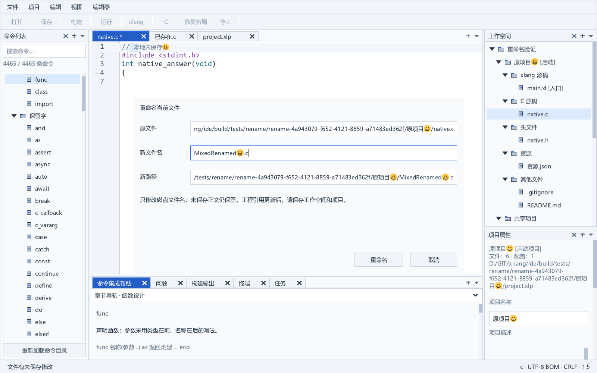

使用方法及事务细节见 [文件物理重命名](file-rename.md)。长期目标保持进行中；继续工程树未打开文件入口、目录/项目清单迁移、旧格式导入、库文档/资源表单、工具链版本/查询、真实 C/xlang 语言服务、全局状态修复、更多编辑动作、性能、实体输入/DPI 与首版发布验收。

终检通过：21 份 Markdown、169 处相对引用、构建/测试脚本 UTF-8 BOM、三张完整回归原图字节、69 张新鲜测试图、固定 SDK 与工具链指纹及 Git 空白检查。

## 工程树文件重命名增量

2026-10-06 新增 project.renameFile（稳定 ID 34），共 47 公共动作；工程树 F2 和项目菜单作用于所选文件，代码编辑器 F2 继续作用于当前文档。原有 43 应用模块中扩展流式文件基线、精确源路径文档 API 和共用 prepare/finish 引用事务，未引入参考项目的脚本业务。

未打开普通文件无需创建编辑器。SHA-256 以 64 KiB 分块计算，记录物理身份、长度、最后写入时间和属性；确认时锁定源再复核，禁止覆盖目标。工程树通过稳定文件 ID 获取当前模型路径，避免使用旧树缓存。已打开硬链接文档复用原对象，但磁盘操作只移动所选路径；其他活动标签、未保存正文、版本/选区/撤销和会话保持，模型共享引用及未知字段同步。失败释放计划并保留输入，旧构建失效。

专项新测试先修正了夹具清单基线、模态期间的服务级文档打开和 UTF-8 选区边界；硬链接磁盘事务实际成功，错误选区断言已修正为完整字符边界。真实编译器验收在既有文件协调完成后启动，旧事件失效保护继续有效；没有放宽原产品断言或修改 SDK/编译器。

最终 tools/test.ps1 -Configuration Release -CompilerPath D:\GIT\x-lang\demo6\release\xl.exe 退出码 0：43 模块、35 类测试、29 张基础图、五张真实任务图、三十七张独立原生图，共 71 张新鲜图，SDK 负面检查通过。tree_rename_test 验证 20 MiB 二进制已知摘要、不打开标签、保留另一脏文档、同长度修改后恢复时间戳、同字节原子替换、目标/源锁/只读/过期状态与脏清单保护、共享二进制与实际所选 C 硬链接、稳定 ID/未知字段/选区/撤销/会话、真实树 F2/项目菜单及未打开入口/头文件/资源改名。真实 DEMO6 使用新引用构建运行通过；既有当前文档重命名及全部旧测试通过。完整日志为 build/tree-rename-full-regression.log，指纹与新鲜图起点保存在 build/tree-rename-full-evidence.json，两张新增原图已查看并随文档保存。

完整回归前后 xl.exe SHA-256 为 42B89FBE1F7CB58F410042ED23379271AAFDC2C4D1B7C752D892C40B1DB6498F，xlc.dll 为 097DC5E847B183575DDA53EE8EFA292DEC67BAB9DB36319E598D5F8B86240C7B；固定/发布 xge.dll 为 A48E028ACFB96DB59277D820A4DBEBC482D8635FD79C63EF3DA6B00C69382784，均保持一致。本增量仅新增系统 BCrypt 依赖，未改工具链和 SDK。

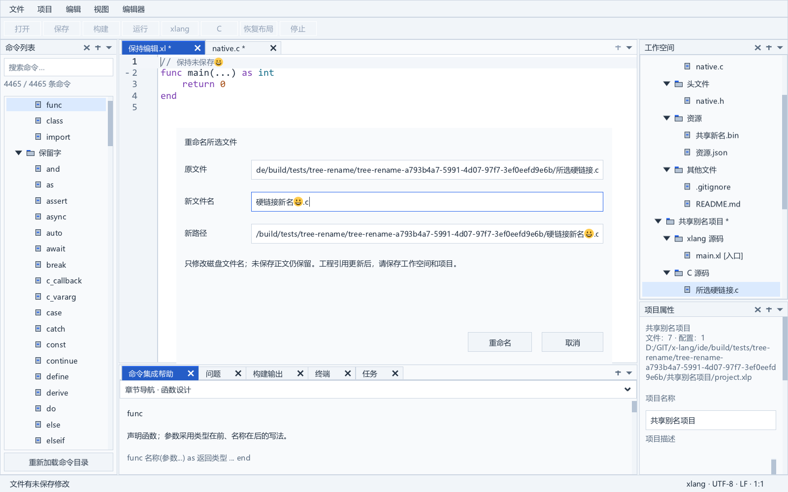

21 份 Markdown 的相对引用、脚本 UTF-8 BOM、五张重命名原图字节、71 张新鲜图及 Git 空白检查完成。使用协议与性能边界见 [文件物理重命名](file-rename.md)。长期目标保持进行中，继续目录/清单迁移、旧格式导入、库/资源专用属性、工具链查询、真实双语言服务、全局状态修复、更多编辑动作、性能和发布验收。

## 项目清单与目录迁移后端增量

2026-10-06 增加 services/project_migration.c，共 44 独立应用模块。清单与整目录移动先预分配路径补丁，保存完整模型和集合结构基线，验证过期数组后再进入物理操作；提交失败不改模型，磁盘成功后补丁无分配应用。目录根以物理身份保护，使用禁止覆盖的句柄迁移，不合并目录、不复制后删除；清单沿用原文件流式摘要与身份保护。

明确路径字段随目录边界更新，目录外硬链接保持原路径。工作空间位于目录内时绑定也移动，嵌套/缺失项目和缺失文件保留，未知字段、稳定 ID、启动项目与当前配置保持。参数、环境和库管理元数据不猜测为路径。受影响的可用项目及工作空间继续标记未保存，保存按新位置重算相对路径，原 JSON 保留为磁盘基线。

project_migration_test 使用真实文件系统验证清单重命名、跨父目录移动、嵌套清单移出、模型/结构/磁盘过期保护、源根真实替换、目标竞争、目录读取锁、只读、大小写改名、同名与重复提交。20 MiB 未列入工程的二进制保持字节与身份，外部硬链接及相似路径前缀不误迁移。真实 DEMO6 重新构建并运行原项目、共享项目与嵌套项目通过。目录锁夹具使用真实读取访问；大小写请求保留原拼写，并以实际磁盘名称核对。

严格完整 tools/test.ps1 -Configuration Release -CompilerPath D:\GIT\x-lang\demo6\release\xl.exe 退出码 0：44 模块、36 类测试、47 公共动作、29 张基线图、五张真实任务图及三十七张独立原生图，共 71 张新鲜图，SDK 负面检查通过。完整日志 build/project-migration-backend-full-regression.log，时间与指纹 build/project-migration-backend-full-evidence.json。现有当前文档/工程树改名、双语法、布局、恢复与文件协调回归通过；未把后端测试当作迁移 GUI 验收。

回归前后 xl.exe SHA-256 为 42B89FBE1F7CB58F410042ED23379271AAFDC2C4D1B7C752D892C40B1DB6498F，xlc.dll 为 097DC5E847B183575DDA53EE8EFA292DEC67BAB9DB36319E598D5F8B86240C7B，固定/发布 xge.dll 为 A48E028ACFB96DB59277D820A4DBEBC482D8635FD79C63EF3DA6B00C69382784，均保持一致；没有修改 SDK 或编译器。

协议和下一接入要求见 [项目清单与目录迁移](project-migration.md)。长期目标继续进行，下一增量接迁移原生入口、已打开文档的预分配路径/标签绑定、旧任务失效、稳定树阅读、监视与工作空间/独立项目会话，之后继续旧格式导入、语言服务及发布验收。

## 项目清单与目录迁移原生集成增量

2026-10-06 在现有 44 应用模块中扩展 editor/documents 的预分配批量路径/标签事务、services/project_migration 的初始基线 Retarget、file_sync 的立即订阅 epoch 和 ui/rename_view 的两种项目迁移模式。新增 project.moveManifest / project.moveDirectory（稳定 ID 35 / 36），共 49 公共动作；F2 的原文件作用域保持。目标输入只做路径预览，确认才完成工程级验证，不在每次键入执行完整路径比较。

窗口冻结完整模型/集合、源身份和全部打开文档，受影响清单正文、属性草稿与已打开目标受到保护。成功先统一改绑路径，再更新标签、旧任务、监视和稳定树阅读；C/xlang 编辑对象、原字节基线、脏正文、版本、选区、折叠、语法覆盖、撤销和会话 ID 保留，其他活动标签保持。受影响模型清单仍需保存，源码 import/include 不自动重构。

默认项目内 .xlang-ide 会话目录随整个目录实际移动；外置作用域保存新路径并保留旧资料，独立项目更新 projectSessionPath。确认前恢复检查点失败不移动；实际重新创建应用已验证 C/xlang、脏外部/未命名正文及默认项目内恢复。自定义 --session-root 位于待移动目录内的组合明确拒绝，默认项目内会话已支持。

专项夹具最初直接修改原清单基线却没有写回磁盘/标记元数据待保存，造成已有外部协调重载；已对齐夹具前置条件。新树键检查另误用 free 释放 XRT JSON 字符串，修正为 xrtFree 并为普通所有权列表复制；两项均未放宽产品断言或修改 SDK。修正后定向原生及真实 DEMO6 通过，最终完整回归通过。

严格完整 tools/test.ps1 -Configuration Release -CompilerPath D:\GIT\x-lang\demo6\release\xl.exe 退出码 0：44 模块、37 类测试、49 动作、29 张基线图、五张任务图及三十九张独立原生图，共 73 张新鲜图，SDK 负面检查通过。project_migration_view_test 验证实际菜单/按钮、过期全部文档/模型、同字节源清单原子替换、未保存清单、目标恢复文档、目录锁、共享引用、稳定树、C/xlang/未命名与其他活动编辑状态、旧任务失效、新路径外部修改、125% /40 DIP 滚动和两种会话作用域的实际重启。原项目与共享混编项目用真实 DEMO6 重新构建运行，其他 36 类回归继续通过。

完整日志 build/project-migration-ui-full-regression.log，时间与指纹 build/project-migration-ui-full-evidence.json。回归前后 xl.exe SHA-256 为 42B89FBE1F7CB58F410042ED23379271AAFDC2C4D1B7C752D892C40B1DB6498F，xlc.dll 为 097DC5E847B183575DDA53EE8EFA292DEC67BAB9DB36319E598D5F8B86240C7B，固定/发布 xge.dll 为 A48E028ACFB96DB59277D820A4DBEBC482D8635FD79C63EF3DA6B00C69382784，均保持一致；未修改工具链或 SDK。

两张实际迁移原图已经查看并保存，使用与事务协议见 [项目清单与目录迁移](project-migration.md)。长期目标保持进行中；下一步继续旧格式导入、库文档/资源专用属性、工具链版本/能力、真实 C/xlang 语言服务、全局状态修复、编辑动作、实体输入/DPI、性能及首版发布。

## 旧格式导入后端增量

2026-10-06 新增 services/legacy_import.c，应用为 45 独立模块、38 类测试，49 个公共动作保持。依据早期 C# IDE 的真实加载、保存与启动流程处理 Version=1 旧工作空间和项目，不混入新 format 清单，也不接受尚未实例化的旧模板占位符。

准备只读采集旧清单，生成独立新身份、文件分类和完整原始 JSON/未知字段；单一 xlang 候选自动选入口，多候选和零候选要求明确选择，清单外入口可显式添加。C 源进入 cSources，普通 JSON/XSON 资源不误作为编译配置，旧库/DLL、BootCode、图标、版本、字符集及其他构建差异列入报告。默认不选启动项目，缺失和损坏引用保留，Open/Status/NewFileIndex 另存会话提示，不改当前文档或会话。

确认后锁定原清单并复核字节、身份、长度、时间和属性，复核父目录身份；同字节原子替换、恢复时间戳后的同长度修改、父目录替换及缺失项目新出现使预览失效。新文件写入 GUID 暂存目录并刷新，关闭子文件后一次禁止覆盖发布；竞争失败只清理本次生成且身份匹配的文件。允许只读/BOM 输入，原清单和资产不修改，成功计划不能重复提交。

新增 legacy_import_test 验证历史真实清单逐字节来源、中文/非 BMP、硬链接合并与稳定身份、未知字段往返、缺失/损坏引用、候选入口和启动项目独立、显式外部/零候选入口、类型选择、模板拒绝、旧资源/库/BootCode 报告、只读/BOM、源锁、字节/身份/父目录变化、发布期间目标竞争与暂存清理，以及 40 个项目、301 个文件。真实 DEMO6 导入后的 C/xlang 工程构建运行通过。

首次完整基线通过后继续核对 MainWindow.MakeCode，确认旧 xl run 使用活动源目录，已将运行目录改为所选入口目录，并报告新 IDE 构建后运行产物的差异；未转换项目也补齐会话提示。两项修改后重新严格构建并从头执行最终完整回归，退出码 0：45 模块、38 类测试、49 动作、29 张基线、五张任务图与三十九张独立原生图，共 73 张新鲜图及 SDK 负面检查。全部既有双语法编辑、原生迁移、监视、恢复、输入、字体和真实构建回归通过。

最终日志 build/legacy-import-full-regression.log，时间与前后指纹 build/legacy-import-full-evidence.json；首次基线单独保留为 legacy-import-initial-full-*，不把它作为修正后验收。回归前后 xl.exe、xlc.dll、固定/发布 xge.dll 保持一致，没有修改编译器或 SDK。

完整协议及边界见 [旧格式导入](legacy-import.md)。该后端增量当时不包含新的原生导入动作、窗口或会话应用验收。长期目标继续进行，下一步接明确旧格式导入入口、逐项目入口/类型与长报告确认、现有脏文档和工作空间切换、旧会话状态应用，并执行原生 C/xlang 交互和重启验收；随后继续库/资源表单、工具链能力、真实语言服务、全局修复、实体输入/DPI、性能及发布。

## 旧格式原生导入与会话应用增量

2026-10-06 新增 ui/import_view.c、import_view_test 和 project.importLegacy（稳定 ID 37），现为 46 应用模块、39 类测试、50 公共动作。项目菜单原生窗口支持显式分析、每项目入口候选/指定入口、输出类型、独立启动选择、单栏换行只读报告与清单预览，修改选项需要重新确认；Dock 保持定版关系。

分析捕获独立当前模型与全部文档基线。生成模式保留当前工程、文档和会话；打开模式复用未保存确认，在发布前保存当前恢复检查点。源/目标事务仍由后端保护，发布后的打开失败保留目录并支持重试打开。服务把旧打开文件按物理路径去重，C/xlang/text 自动识别，缺失引用进入 unavailable 集合；展开提示映射到稳定键，完整提示以 legacyImportHints 扩展保存，已有或受保护的原生会话/布局不覆盖。

目标测试及最终严格完整 Release 回归退出码 0：39 类测试、29 基线图、5 真实任务图、42 独立原生图，共 76 张新鲜图及 SDK 负面检查。原生菜单/按钮、未转换项目、入口/类型/启动复核、只读报告、全部文档过期、未保存取消、会话锁、生成模式隔离、双语法 token、物理去重、缺失文件出现后恢复、树状态、原提示往返、新路径监视、125% 和 40 DIP 两轴访问均通过。导入混合项目用真实 DEMO6 构建运行成功；重新创建应用实际恢复语法、会话 ID 和树状态。

首次共享工具链回归虽然通过，但 xlc.dll 在验收期间从 B56BC336AEFB224F3A6D239D6BDD9661E3CC247CA6908FA7DB3469A386CD2A2C 变化为 084A929CE895DF4FC941BFE48F1FC9FED4E4D8E218BD2ECF38EF412DBF1F4672，记录保留为 build/legacy-import-ui-changing-toolchain-*.json/log，不能作为同一工具链指纹的最终验收。本次只读复制 Windows 运行依赖，2098 文件在复制前、源复制后和副本逐项一致；没有锁定或修改共享工具链。随后重新严格构建并完整回归，使用独立快照 D:\GIT\x-lang\ide\build\toolchains\demo6-a7d26d0a-4dba-470d-ac81-b355b4f37ab3，开始 2026-10-06T13:10:20.0177817Z，完成 2026-10-06T13:14:43.1841351Z。

最终日志 build/legacy-import-ui-full-regression.log，组件证据 build/legacy-import-ui-full-evidence.json，全部工具链文件清单 build/import-ui-compiler-snapshot.json。回归前后快照 xl.exe 为 42B89FBE1F7CB58F410042ED23379271AAFDC2C4D1B7C752D892C40B1DB6498F，xlc.dll 为 084A929CE895DF4FC941BFE48F1FC9FED4E4D8E218BD2ECF38EF412DBF1F4672，xl.dll 为 2D619259A102F8D34107674A22A69916089091F25AFC957FD35606569EED13E9；固定与发布 xge.dll 为 A48E028ACFB96DB59277D820A4DBEBC482D8635FD79C63EF3DA6B00C69382784，均一致。旧历史记录的其他工具链指纹保留其当时含义。

导入原图已经查看；另在复制的会话作用域和独立偏好路径中启动实际隐藏 IDE 进程，以正常字号预览导入后的 C 和 xlang 编辑器，原测试作用域不写入。使用步骤与实际截图见 [旧格式导入](legacy-import.md)。长期目标保持进行中；后续继续库文档/可用性、资源专用表单、工具链版本/能力缓存、真实语言服务、全局状态修复、编辑动作、实体输入/DPI、性能与首版发布。

## Windows 资源属性增量

原生项目菜单和右侧属性已加入 project.resources（ID 38），独立 model/resources 与 ui/resource_view 管理版本、ICO 与应用清单。配置切换保护未应用字段，JSON 和兼容 XLON 数据无损往返，当前未保存正文作为输入；应用生成一次撤销步骤并沿用文件保存，取消与无变化应用不写盘、不新增文档。未知根、版本和素材字段及原别名保留，明确删除资源段除外。

最终严格完整 Release 回归退出码 0：48 个应用模块、40 类测试、51 动作、79 张新鲜原生图（29 基线、5 任务、45 独立原生图）与 SDK 负面检查。起始 UTC 为 2026-10-06T14:18:43.8547132Z，结束为 2026-10-06T14:26:07.7086434Z；日志位于 ide/build/resource-properties-full-regression.log，证据为 resource-properties-full-evidence.json。所有原生绘制无 SDK 错误回调。

resource_view_test 验证真实菜单、右侧属性按钮、配置选择、空字段鼠标/键盘输入、只读预览、取消/无变化/未应用字段、一次撤销重做、BOM/CRLF、未保存正文、坏配置提示和原正文保护，以及项目、打开文档、磁盘内容和同字节文件身份替换的冲突。125% DPI、40 DIP 窄视口两向滚动通过，三张资源图已保存。真实 JSON 与有类型 XLON 均经 C/xlang 混编和运行，Windows API 读到 9.8.7.6 版本、图标组/图标和精确清单字节；路径、文本及 Base64 素材已覆盖。

固定 xge.dll 与原有 2098 文件 DEMO6 验收快照的前后指纹一致，继续使用上轮记录的快照与 DLL 指纹；共享 demo6/release 不写入。固定 SDK 只导出基础 Base64 解码接口，资源模型使用该接口而不引入第二份 XRT。空 TextEdit 使用原生背景/提示与按实际正文切换的缓存，正常素材正文和预览已实际检查。

首次完整回归因 D 盘只剩约 13 MiB，在原有 file_watch_test 的 16 MiB 写入处失败，记录保留为 resource-properties-low-disk-regression.log/evidence.json。44 个旧合成大文件先压缩并逐项 SHA 验证，再逐文件清理，约 808 MiB 原数据归档为 2.32 MiB；可恢复归档和清单位于 ide/build/old-large-test-fixtures-20261006.zip 与 old-large-test-fixtures-archive.json，历史图片、记录、源码和工具链均保留。空间恢复后的完整回归通过，补充错误提示后再次最终重建也通过。

使用步骤与实际原生图见 [Windows 资源属性](windows-resources.md)。长期目标保持进行中；资源创建向导、完整新 XLON 兼容、库文档/可用性、工具链版本能力、真实语言服务、全局修复、编辑动作、实体输入/DPI、性能与发布仍待完成。

## 库候选信息与包文档增量

新增 services/library_info；现为 49 应用模块、40 类测试、51 公共动作。原引用窗口提供只读首个候选清单、版本/ABI、声明文件与目录版本差异，库文档沿用中央底栏和单栏章节导航。收起/返回保留原项目独立草稿和基线，未加入列表字段受到保护；未应用新增库、取消隔离、目录重新加载和阅读期间项目变化已经通过真实原生输入验证。

最终严格完整 Release/CompilerPath 回归退出码 0：40 类测试，29 基线图、5 真实任务图、48 独立原生图，共 82 张新鲜图及 SDK 负面检查。开始 UTC 为 2026-10-06T14:52:04.7038985Z，完成为 2026-10-06T14:58:51.2972191Z；日志 build/library-references-full-regression.log，证据 library-references-full-evidence.json，逐项检查 library-references-final-verification.json。references_test 新增 Unicode/BOM、入口/环境/编译器上级 extlibs 顺序、明确路径、版本差异、缺失源、坏字段/NUL、未知库种类、静态文档发现及 40 DIP 检查结果滚动；真实 C/xlang 混编、运行和 PE 版本资源继续通过。

固定 SDK 与原有 2098 文件 DEMO6 快照逐项保持一致，继续使用 import-ui-compiler-snapshot.json 和已记录指纹；共享 demo6/release 未写入。固定 DLL 未导出头文件中的 xrtEnvGet，包环境读取使用 Windows Unicode 接口，不引入其他 XRT 实现。首次完整重建在 GCC 为现有 configuration_view.c 分配约 8 MiB 时失败，尚未进入回归测试；证据保留为 library-references-gcc-memory-regression.log/evidence.json。随后按相同编译/测试标准重试成功，没有终止其他进程或修改系统配置。

当前检查只描述候选清单和声明文件，真实源码 import、递归依赖、版本约束、链接/DLL 可用性仍由构建确认。首个坏清单不会被其他候选替代为成功结果；内置模块不能因无磁盘包清单判为不可用。同步检查及慢存储性能、真正依赖图仍待继续。使用与原生图片见 [工程引用与包文档](project-references.md)。长期目标继续进行，下一步推进工具链版本/能力和真实语言服务，随后继续资源创建/新 XLON、全局修复、编辑动作、实体输入/DPI、性能和发布。

## 工具链档案与原生信息窗口增量

新增 services/toolchain 与 ui/toolchain_view；当前 51 应用模块、41 类测试、52 公共动作。文件菜单后台查询真实 PE 文件版本、命令行能力和三文件指纹，最多 16 条、五分钟的观察缓存按工作目录隔离；强制刷新、取消、失败保留与关闭/退出交接已接入。DEMO6 未提供版本命令和 PE 版本资源，界面明确显示未提供，不生成虚构版本号。

最终严格完整 Release/CompilerPath 回归退出码 0：41 类测试，29 基线图、5 真实任务图、52 独立原生图，共 86 张新鲜图与 SDK 负面检查。开始 UTC 为 2026-10-06T15:39:33.2514914Z，完成为 2026-10-06T15:47:28.8164694Z；日志 build/toolchain-full-regression.log，证据 toolchain-full-evidence.json，逐项检查 toolchain-final-verification.json。固定 SDK 与独立 DEMO6 三个核心文件前后指纹一致，继续复核原 2098 文件快照与六份历史导入夹具。

toolchain_test 读取受控可执行文件的真实文件版本 1.2.3.4（产品版本另为 5.6.7.8），并覆盖命令/选项作用域、UTF-8/NUL/超量/空输出/退出/超时、缓存目录隔离、兄弟文件增删与同字节替换、只读检查、查询后指纹、取消与销毁。每次构建另做实际帮助核对；仅 run 行的选项不能批准 build，构建中工具链改变时不发布、不运行，旧产物字节保留。真实 C/xlang 混编与运行、任务档案、原生菜单/只读正文/失败结果与按钮状态、模态保护、125% DPI 和 40 DIP 两向滚动均通过。

首轮针对性构建混用了新增 app 状态字段前的旧对象文件，发生创建阶段崩溃；全部模块重新编译后通过。视觉检查补齐固定 SDK 按钮状态同步。首次完整包装脚本因既有损坏会话的预期 stderr 提示被 PowerShell Stop 当作 NativeCommandError 而中断，记录保留为 toolchain-session-warning-regression.log/evidence.json；包装器完整收集输出、严格按进程退出码检查，最终整套重跑通过，测试断言与编译警告门槛保持。

档案是帮助观察，缓存没有覆盖包、环境、其他 DLL 与递归源码依赖，不能推断 LSP/DAP 或语义成功；更新外部依赖需刷新。进程帮助限十五秒，扫描文件限 512 MiB/文件，慢存储性能仍待验收。使用与四份原生图见 [工具链信息](toolchain-profile.md)。长期目标继续进行，下一步推进真实 C/xlang 语义服务；资源创建/完整新 XLON、全局修复、编辑动作、实体输入/DPI、性能与发布仍需完成。


## 语言服务基础与真实诊断增量

新增 protocol/lsp_wire、services/language_check、services/language_client 和 ui/language_view 四个应用模块，以及独立 server/xlang_ls 入口。现为 55 个独立应用模块、43 类测试、54 公共动作。文件菜单提供 language.checkSaved（ID 66）和 language.cancelCheck（ID 67），真实保存后单入口检查通过 stdio 与版本关联接入 CodeEdit 标注和已有中央问题页；C/xlang 词法与编辑状态、定版 Dock 均保持。

最终完整 Release/CompilerPath 回归退出码 0：43 类测试、29 基线图、5 真实任务图和 56 独立原生图，共 90 张新鲜图与 SDK 负面检查。开始 UTC 为 2026-10-06T16:52:44.1563743Z，完成为 2026-10-06T17:01:42.1827705Z；日志 build/language-final-full-regression.log、证据 language-final-full-evidence.json、逐项复核 language-final-verification.json。应用与独立服务均在最终代码下严格重建，真实 C/xlang 混编和诊断继续通过。

lsp_test 覆盖分片/连续帧、ASCII 头和 UTF-8、坏长度/重复/截断、Windows URI 大小写与转义、中文/非 BMP/组合/CRLF 位置及批量原子转换。受控编译器的无能力、坏 JSON/字段/坐标/退出状态、超量与 stderr 洪流、源/工具链变化、取消和进行中修改都拒绝错误结果；真实 DEMO6 语义错误另经独立检查验证。服务按当前接口只声明 UTF-16 全文同步与保存后入口诊断，不宣告尚未实现能力。

language_view_test 在独立未切换桌面验证原生菜单、可选择节点与 Enter 定位、错误标注、中央底栏边界、两套语法 token、主题/字号、编辑/保存/取消/语言/改名/关闭/控件复用。真实结束本测试 PID 所拥有的 xlang-ls 子进程后，旧标注撤销，再次检查重新初始化并全文同步；新文档不会继承复用槽位的自动检查。process_test 另验证独立 stdout/stderr 环与完整日志、3 MiB stderr、丢弃计数、进程树及阻塞输入取消。

第一轮完整回归已通过，日志 language-full-regression.log/evidence.json 保留；之后补齐文档稳定 ID 和崩溃重连验收，再次完整重建和回归通过。初期原生验收发现任务/问题节点未启用选择，修复 bEnabled 和跳转后的事件消费；不是以直接调用跳转函数代替真实键盘行为。诊断字符串保留至标注撤销/控件销毁，批量 GUI 位置转换使用一次文本扫描。

固定 SDK 与 2098 文件独立 DEMO6 快照前后保持一致，六份历史导入夹具保持原字节。编译器源码未修改；已审计 xlcAddSourceFile/String 的单入口替换和 xl6ParseFile 的磁盘导入，目前没有公开依赖覆盖或完整符号查询接口。此次入口诊断不等于完整项目分析；递归依赖和未保存覆盖必须继续实现。

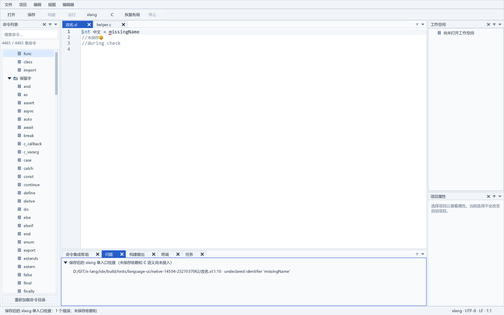

使用与边界见 [语言服务](language-service.md)。长期目标保持进行中；下一步推进未保存依赖和真实语义查询，随后继续全局修复、更多编辑动作、资源创建/完整新 XLON、实体输入/DPI、性能及首版发布。


## 编译器源码覆盖前置增量

2026-10-07 在 DEMO6 实现上下文持有的源码覆盖表，新增公开 Set/Remove/Clear API 和 CLI `--source-overlay`。文件入口、普通递归源码导入、源码包 `xlSources` 与包依赖展开使用同一覆盖表，可提供尚未落盘的新 `.xl` 文件；无覆盖时回退磁盘。词法/AST 输出和真实语义/XLIR 编译、Cgen、构建/运行共用该文本。最多 64 个独立路径、8 MiB/份、32 MiB 总量，复制严格 UTF-8 并拒绝 NUL；失败更新保留旧快照/单元，成功变更与工作目录变化使缓存失效。

parser/import/semantic 诊断携带真实文件标签，共享引用计数 AST 来源经过导入移动和类型克隆保留，同位置同消息的不同文件不合并。此次没有宣称完整起止范围、符号/类型/定义查询。GUI 与独立 stdio 服务仍使用此前保存后单入口检查；未保存依赖版本、分文件发布、取消/过期结果和重启全文同步须继续接入和验收，现有服务仍声明 unsavedDependencies=false。

所有编译在独立源码副本 build/source-overlay-compiler-68a34a78-e085-4c64-8662-9a061ea10315 内完成，未写共享 demo6/release 的三个核心产物。最终构建开始 UTC 为 2026-10-06T17:28:40.7462742Z，完成为 2026-10-06T17:34:52.0245791Z，退出码 0；日志 source-overlay-final-compiler-build.log，证据 source-overlay-final-build-evidence.json。新的 2098 文件运行快照为 build/toolchains/demo6-overlay-33e4287c-17cf-4870-97b1-6498cb92e089，共 177008293 字节，逐项复制后校验并再次执行覆盖质量门；manifest 为 source-overlay-toolchain-snapshot.json。旧 2098 文件快照、固定 SDK 和六份历史导入夹具继续保持原字节。

原生 public API 与 CLI 的 20 组质量门全部通过。包括入口/二级依赖、虚拟新文件、解析/语义来源、同位置跨文件错误、递归源码包、撤销和工作目录、Unicode 大小写别名、失败更新、文件/总量上限及并发上下文；真实虚拟源码 Cgen、构建可执行文件和 run 通过，全部原文件/工具链 SHA-256 保持。构建副本证据在 build/test/source-overlay-3579ced0-fefc-48e9-85ff-46d87526ba2e/evidence.json，新运行快照复测在 source-overlay-77b5c22c-95dc-4582-a14f-d60f22059ac0/evidence.json。

既有 import package source 全套通过。新工具链下的 IDE lsp_test 与 language_view_test 通过，生成四份独立原生图并逐图检查；双语法、诊断定位、进行中变化、关闭/复用、服务崩溃重连和定版布局保持。日志 source-overlay-ide-compatibility.log/evidence.json，图在 build/targeted/source-overlay-a6db9761-c0e0-4fd4-9773-ee00a5f30391；没有将这些图混入上一轮的 90 图全量基线。应用模块/测试类/动作数量仍为 55/43/54。本轮未修改应用可执行文件。

兼容验收如实保留失败：02_language_frontend 在旧 char* 泛型字符串 ABI 的文本断言退出，旧固定编译器同一生成样例也不满足该断言；未称整套前端已通过。既有 xlc_api_embed 的调试产物缺失 xrtStrBufAppendFormatV、xlc_dll_embed_string 的时间格式范例失败，在隔离旧 DLL 对照下都复现。最初 null/thread 宿主缺少正式工具链环境，补齐后两项通过；module dependency lifetime 和 XRT exports 也通过。相关证据为 source-overlay-compatibility-evidence.json、source-overlay-api-compatibility-evidence.json 和 source-overlay-baseline-comparison.json。

首轮原生覆盖全部断言通过后，宿主提前 FreeLibrary 导致退出崩溃；最小对照证明旧、新 XRT DLL 均有该限制。质量门改为按产品独立服务进程的生命周期保留 DLL，随后真实退出码通过；原失败与 compiler-unload-probe-evidence.json 保留。固定运行快照不用于证明这些既有边界已解决。

接口与可重复运行命令见 [DEMO6 IDE 源码覆盖接口](../../demo6/docs/IDE源码覆盖接口.md)。长期目标继续进行：下一步补齐加载依赖观测与服务版本关联，将未保存全文接到编译快照和 GUI，再实现完整来源/符号/类型查询、大纲、悬停、语义补全、定义及 C 语义，后续继续全局恢复修复、编辑动作、资源创建/新 XLON、实体输入/DPI、性能和发布。

本轮接线守门通过：C fixture core 为 1051 个入口、23 个包夹具；source wiring 为 327 份源文件、217 份直接编译、109 份 include、1 份 embedded 和 2 份生成直接源。最终逐项复核见 build/source-overlay-final-verification.json。

## 实际加载源码和包描述报告增量

2026-10-07 在 DEMO6 增加独立检查的 `xlcCheckWithSources` 与 `check --json --source-report`，原 `xlcCheck` 和普通 JSON 字段保持兼容。本次来源报告 scope 为 loaded-sources-and-manifests，记录入口、递归源码和实际读取的包描述文件；磁盘/覆盖/字符串入口分别标注，原字节与解析 UTF-8 正文分别持有 SHA-256，64 位身份与时间采用 JSON 字符串。没有把此报告解释为完整工程依赖图。

报告在检查内局部拥有最多 512 路径、8 MiB/文件、64 MiB 正文；同句柄取得身份/字节，重复加载共用首次不可变快照，输出前复核全部磁盘输入。改写、删除和同内容原子替换均拒绝旧结果。严拒坏 UTF-8、NUL、冲突 BOM、非普通文件、超量和不稳定读取，明确返回 complete=false/ok=false/source-report；解析或语义失败可以同时拥有完整的读取报告。包候选中实际读取的有效 UTF-8 描述文件也保留；未读取覆盖不列入。

独立源码构建目录为 build/source-report-compiler-8f24d4c5-9a83-4492-8e17-d72b4adb9e47，未写共享 demo6/release 的三个核心产物。最终重新生成 runtime/compiler VFS 后完整构建退出码 0，开始 UTC 2026-10-06T18:15:21.9464281Z，结束 18:21:38.5014708Z；日志 source-report-final-compiler-build.log，证据 source-report-final-build-evidence.json。初始完整构建 source-report-compiler-build.log、source-report-build-evidence.json 保留；没有使用只更新 shell 却仍含旧嵌入源码的状态作为最终结果。

报告原生/CLI 22 项质量门通过，快照宿主还确定性覆盖首次正文、BOM/CRLF、改写后重复读取、同内容替换、删除、编码/目录与 512/8 MiB/64 MiB 边界。公开 API 验证磁盘/字符串入口、撤销、未读覆盖、并发上下文隔离和真实错误文件；CLI 覆盖递归磁盘/覆盖组合、包依赖/重复描述加载、语义/解析报告、选项退出状态与参数值/分隔符。证据为 build/test/source-report-23b5cf81-79a8-4e81-9099-c7d9638bbf0e/evidence.json。旧源码覆盖 20 项质量门在最终编译器下再次通过，包括真实 Cgen/build/run，证据 source-overlay-3d988860-eaf6-439b-b929-a56fbf834b0b/evidence.json。

首次报告门发现 run 误用 --source-report 虽打印错误却退出 0；修正 shell 主入口退出协议，并补齐快照参数值/-- 分隔符扫描，没有削弱原失败断言。失败证据 source-report-0cf861af-66c6-4c5f-a2de-246068eb7b39/evidence.json 保留。一次性修复脚本在修改前断言失败后启动的重建，仅结束本轮唯一的构建辅助进程以补齐修复，再正式重建；中断日志 source-report-interrupted-compiler-build.log、source-report-interrupted-build-evidence.json 保留，不计为通过。

源码导入/包解析整个分类套件通过，日志 source-report-import-compatibility.log、source-report-import-compatibility-evidence.json。现有 IDE lsp_test 和 language_view_test 使用最终工具链通过，验证真实保存后检查、坏输出/取消/版本/工具链保护、崩溃重连、C/xlang token 和定版 Dock；四份新原生图在 build/targeted/source-report-e7ade1a4-6ffe-4d6a-b60f-a3ddee07e145，逐图检查浅/深主题、大字号及真实编译器结果。日志 source-report-ide-compatibility.log、source-report-ide-compatibility-evidence.json。本轮没有改动应用源文件或可执行程序；应用模块/测试类/动作仍为 55/43/54，没有声称重新运行此前 90 图全量套件，也没有新增 C 语义能力。

新的运行快照为 build/toolchains/demo6-report-62c1fc92-bdc8-48f6-a884-986f21154622，2098 文件、177026428 字节；逐项复制并核对全部 SHA-256，manifest source-report-toolchain-snapshot.json。复制后的 22 项报告门再次通过，证据 source-report-eb1b40db-3e01-4169-b803-2cc96f5a1b9a/evidence.json。两个历史 2098 文件快照、固定 SDK 和共享核心产物原字节保持；六份历史夹具与旧完整基线仅做复核，另存 source-report-language-baseline-verification.json。C fixture core 为 1053 个入口/23 个包，source wiring 为 328 份源、218 direct、109 included、1 embedded、2 generated direct。

报告和 IDE 文档本地链接检查通过；最终逐项复核见 build/source-report-final-verification.json，协议与可重复命令见 [源码覆盖与来源报告接口](../../demo6/docs/IDE源码覆盖接口.md)。GUI/stdio 仍为保存后的 `.xl` 单入口，unsavedDependencies=false 保持。下一增量需观察缺失候选/目录优先级及相关环境，接入所有打开 `.xl` 文档的全文/版本快照和分文件诊断，处理依赖修改/关闭、发布前复核与服务重启；真实来源范围/符号/类型、大纲/悬停/语义补全/定义、C 语义、全局恢复修复、更多编辑动作、资源创建/完整新 XLON、实体输入/DPI、性能和首版发布继续属于长期目标。

最终源码复核发现并行工作的 class-text 运行库新增，保留 `xl_api_symbols.c` 的头文件引用及 Windows/Linux/public-driver 三份构建清单中的新源项。本轮隔离副本在新增前捕获，21 份报告相关源码中 17 份与当前字节相同，其余四份仅相差该独立新增，报告补丁逐项一致；差异证据 source-report-concurrent-deltas.json。source-report-changes.diff 以已验收源码副本记录本轮 C 改动，避免把后续并行新增算作本轮验证；当前工作区未被快照覆盖。本轮 328 份 source wiring 数量为复制/检查时的范围，不宣称该后续运行库功能已构建或验收。

## 未保存全文快照后端与逐文件诊断增量

2026-10-07 新增 services/language_snapshot 和 snapshot_check_test；当前为 56 应用模块、44 注册测试类、54 公共动作。后端复制所有打开且已命名的 `.xl` 正文/版本，以不可变批次检查未保存入口、递归依赖及虚拟新文件。独立 stdio 新增 `xlang/check`，每文件发布 UTF-16 诊断；任意打开文档的打开/修改/关闭都会使在途批次失效，并撤销此前所有文件的结果。打开文档保留原 URI 和版本，未打开的磁盘输入省略版本；旧 `xlang/checkSaved` 继续兼容。

DEMO6 在既有来源报告旁增加 resolutionReport：记录实际查询的候选普通文件存在性、首次包环境值及是否读取该环境。缺失候选后来出现、目录变为普通文件、已存在候选消失、包环境变化都不能复用旧解析结果。最多 2048 个候选、1 MiB 路径、32767 UTF-8 字节环境值；未设置/空值/未观察分别表达。目录优先级通过实际走过的候选记录，范围仍是 xlang 源码导入和包描述；伴随 C 文件与链接输入尚未纳入。

IDE 仅在所选编译器实际声明 check 范围的覆盖/报告选项时启动新模式。严格复核加载报告、正文和原字节 SHA-256、同句柄文件身份与时间、候选存在性、环境及三个工具链文件；路径须为绝对驱动器或 UNC 路径，拒绝 drive-relative、重复别名、不完整报告、错误字段/坐标和不可控输出。每份诊断按自己的文件正文转换位置。检查最多 64 文档、8 MiB/份、32 MiB 合计；报告最多 512 文件/64 MiB 正文，输出限 4 MiB。检查结束发布前再次核对输入，能力明确为 before-publication；发布后持续磁盘依赖观察仍待接入。

临时正文使用既有 TEMP 下的 GUID 独立文件、CREATE_NEW 和内核 DELETE_ON_CLOSE 句柄，句柄不继承；正常结束、取消、输出拒绝及服务被强制结束均不会遗留本批文件，也不通过路径删除处理撞名。没有创建私人临时目录。原始源码和未保存正文分别持有，不把快照写回源文件。

最终编译器在独立源码副本 build/snapshot-check-compiler-4d697e2a-8ca9-41be-b2b0-83f8e5a16fb5 内重新生成 runtime/compiler VFS 后完整构建通过，开始 UTC 2026-10-06T18:42:31.9251093Z，结束 18:49:06.7062640Z。新运行快照 build/toolchains/demo6-snapshot-c2e0ba12-d082-4c88-8955-df18d8f62132 为 2098 文件/177037180 字节，manifest 为 snapshot-check-toolchain-snapshot.json；xl.exe 为 5C923DEF37B8CDF24F26E05AA8E657C7D109B59B36357E92AA33145C0A5009D1，xlc.dll 为 457519A1CDEA09F9462698088F85831CDF843EBDB0278AA9561C615CA6D19104，xl.dll 为 BD73428DBE89A60FA3F41F8BAB55925313BDE9422D706732A1AB045C0F7B2F39。

严格完整 IDE Release/Tests 编译退出码 0，全部 56 模块和 44 注册测试均编译；开始 UTC 2026-10-06T19:38:31.6912464Z，结束 19:40:33.3013068Z，日志 snapshot-check-ide-paths-build.log，证据 snapshot-check-ide-final-build-evidence.json。随后仅服务入口为保留原打开 URI 重新严格链接，使用该完整构建的九份对象，退出码 0；证据 snapshot-check-server-final-build-evidence.json。GUI 与 stdio 程序已更新，独立服务不导入 XUI 或 xl/xlc DLL。

最终 44 项真实/受控 stdio 检查全部通过：脏入口/依赖、递归虚拟文件、同错误跨文件、未使用打开文档清空、Unicode/非 BMP/CRLF 和 URI 保留、全批次修改/关闭失效、版本/路径/正文边界、损坏来源/候选报告、工具链/磁盘/环境变化、取消、重启全文同步与繁忙服务异常退出清理。受控输出先通过有效基线，再分别注入损坏项。日志 snapshot-check-protocol-final44-gate.log，证据 build/targeted/snapshots-9faae16e-2d6d-453f-9a25-7feabd33f660/evidence.json。强制结束测试包含编译器仍持有真实快照读句柄的情况。

导入观测原生宿主与实际 CLI 共 8 项操作通过，证据 demo6/build/test/resolution-report-fc2cb018-4cce-40e3-b9f4-c777103c6841/evidence.json。旧报告 22 项、覆盖 20 项（含实际 Cgen/build/run）及整个源码/包导入分类在新快照下继续通过，证据 snapshot-check-compiler-regression-evidence.json。首次针对性回归的 9 类原生测试通过，记录 snapshot-check-native-regression-evidence.json；最终重新验证 snapshot_check_test、lsp_test 和 language_view_test 三类，记录 snapshot-check-final-native-regression-evidence.json。前一组 11 张和最终四张原生图均逐图查看，双语法、旧保存后诊断、重启、主题/大字号和既定 Dock 保持；没有宣称本轮重新执行此前 43 类/90 图的全量基线。

验收发现并修复测试夹具的 Unicode 输出路径链接限制及 Python Windows 换行展开；失败日志与证据保留，修复后有效基线及最终 44 项重新执行。私人临时目录方案在繁忙服务被结束时留下空目录，故改为内核持有的独立文件，再通过真实持有读句柄的异常退出测试；原失败证据 snapshots-5959b484-4772-4677-96a2-256aee996613 保留，已检查并非递归删除唯一空测试目录的记录为 snapshot-check-empty-probe-cleanup.json。最终 TEMP 中本轮前缀文件为空。

四个独立工具链快照共 8392 文件逐项 SHA-256 保持一致，固定 SDK 也保持原字节；五份本轮编译器 C 文件与实际构建副本一致。本轮编译未写共享 demo6/release；观察到共享 xlc.dll/xl.dll 在其他工作中发生变化，记录 snapshot-check-final-input-verification.json，未将共享产物替换回旧文件，验收全部使用本轮独立快照。改动相对本轮 22 份原始文件备份及七份新增文件单独归档为 snapshot-check-changes.diff/json，最终复核见 snapshot-check-final-verification.json。

该后端增量时 GUI 仍使用保存后入口动作，菜单/旧视图尚未接入未保存依赖。当时下一增量计划直接实现全文检查动作和所有命名文档同步、逐文件标注/跨文件问题定位、关闭/改名/服务重启的全文恢复；定位未打开磁盘文件前还需传递并核对检查时的正文摘要和身份。随后继续发布后磁盘依赖失效、真实来源范围/符号/类型、大纲/悬停/语义补全/定义及 C 语义，连同全局恢复修复、更多编辑动作、资源创建/新 XLON、实体输入/DPI、性能和首版发布。长期目标继续进行。协议与边界见 [语言服务](language-service.md)，编译器合同见 [来源与解析观察接口](../../demo6/docs/IDE源码覆盖接口.md)。


## GUI 未保存全文快照、跨文件定位与自动复查增量

2026-10-07 文件菜单新增 `language.check`（ID 68），旧保存后检查和取消仍为 66/67。当前为 56 应用模块、45 注册测试类、55 公共动作。当前入口必须为命名 `.xl` 且显示 xlang 语法；收集所有命名 `.xl`，依赖显示语法覆盖不改变源码身份。最多 64 份、8 MiB/份、32 MiB 合计，协议正文另须留出 JSON/转义/URI 开销。没有保存原文件；C/xlang 词法、撤销、脏状态和定版中央底栏保留。

每批复制稳定文档 ID、版本、路径、显示语法与外部状态，逐组验证规范化正文摘要、打开版本或磁盘来源记录，全部成功后统一设置标注与中央问题树。当前模式忽略先到的逐文件通知，避免半组发布；诊断总数必须覆盖每组剩余容量，异常总数、重复组和坏摘要在 UI 修改前拒绝。撤销标注后再释放持有的诊断字符串。未打开 BOM/CRLF 文件定位先核对磁盘身份/时间/属性，打开后验证原字节和规范化正文摘要，再换算该文件的 Unicode 位置；同字节原子替换拒绝旧跳转。

显式启动后，任意参与文档打开/关闭、正文、路径、语法或外部状态变化撤销整批，在最后编辑后延迟 500 ms 复查原入口；切换活动 C 标签不会换入口。取消已完成的自动模式同样可用；关闭/复用入口停止自动模式。缺失的已命名恢复文档可以作为覆盖输入；其余外部冲突暂停检查，保留本地正文，冲突解除后重新检查。服务崩溃清除标注，再次显式启动重新初始化并完整同步。

最终严格 Release/Tests 构建退出码 0，开始 UTC 为 2026-10-06T20:41:08.8669972Z，结束 2026-10-06T20:43:25.2934436Z；全部 56 模块、独立服务和 45 类测试重新编译；随后只修改两个测试同步/诊断夹具并用相同产品对象严格重链接，应用源码没有再变化，[夹具链接记录](../build/gui-snapshot-migration-gate-test-build-evidence.json)。日志 [gui-snapshot-bounds-build.log](../build/gui-snapshot-bounds-build.log)，证据 [最终编译清单](../build/gui-snapshot-bounds-build-evidence.json)。snapshot_view_test 为回放异常响应直接编译相同 view 实现，排除重复 view 对象；产品没有测试接口或 Python 服务。

最终完整 CompilerPath 回归退出码 0，开始 UTC 2026-10-06T21:01:02.5918180Z，完成 2026-10-06T21:09:17.7153164Z：45 类测试、44 项真实/受控协议、29 基线图、5 任务图和 60 独立原生图，共 94 张本次新鲜图。真实 C/xlang 混编、模板/DLL、资源 PE、中文路径、保存/迁移/恢复继续通过，SDK 混入头文件负面门通过。日志 [完整回归](../build/gui-snapshot-full-regression.log)、[输入与图像证据](../build/gui-snapshot-full-evidence.json)、[44 项协议证据](../build/targeted/snapshots-3af26336-2f9f-483a-a0e4-f82e26337d58/evidence.json) 与 [最终逐项复核](../build/gui-snapshot-final-verification.json)。

snapshot_view_test 按真实主循环执行文件协调、菜单和问题节点 Enter，验证未保存递归依赖、虚拟新文件、Unicode 跨文件定位、两种语法、原入口延迟、进行中及完成后取消、改名/关闭/复用、拥有服务实际终止后完整恢复、磁盘摘要跳转与同字节替换。实际外部写入后等待稳定 READY 冲突，验证本地脏正文仍保留、诊断清除、动作禁用；原磁盘字节恢复后解除冲突。两次 64 文档全文关闭/重开成功，65 文档拒绝，关闭额外文档后可复查。四张新 GUI 图逐图查看；全部 94 张图只声明文件/退出/新鲜度门已执行，不将它们全部列为人工视觉检查。

历史失败如实保留：首轮完整编译后五个旧测试仍断言 54 个动作，在 rename_test 停止；更新为 55 后严格重链接，记录 [旧数量断言失败](../build/gui-snapshot-action-count-full-evidence.json)。真实文件协调首次测试等待任何非零状态，可能抓到原子替换中的暂时 MISSING；改为等待 READY，记录 [状态过渡失败](../build/gui-snapshot-conflict-transition-native-evidence.json)。随后 45 类和 44 项通过，渲染中文路径因 test.ps1 丢失 UTF-8 BOM 被 Windows PowerShell 误解，记录 [脚本编码失败](../build/gui-snapshot-render-encoding-full-evidence.json)；补回脚本 BOM，再补诊断总数容量守卫及四类异常响应验收，最终严格重建与完整回归通过，没有删除旧失败或削弱断言。

另一次完整回归在 project_migration_view_test 停止：原受控构建仅 Sleep(800)，大字号绘制后旧任务已进入 RUN，复合断言所需的“仍在构建”前提不成立；[失败任务日志](../build/gui-snapshot-migration-race-task-logs.json) 与 [整套失败](../build/gui-snapshot-migration-race-full-evidence.json) 保留。测试改用独占事件及实际 BUILD_GATE_WAITING 输出握手，刻意等待 1200 ms 后再以真实按钮迁移，仍要求 failed/invalidated/built=0/ran=0；[短路径原生任务验收](../build/gui-snapshot-migration-gate-final-native-evidence.json) 通过。初次链接的严格缩进警告修正后再链接，记录 [编译失败](../build/gui-snapshot-migration-gate-test-first-build.json)。最初较深的定向目录还导致恢复正文保存失败并拒绝迁移，[窗口提示](../build/gui-snapshot-migration-popup-probe.log) 保留；改用短而唯一的夹具路径，产品未放松保存或过期保护。当前恢复路径的完整长路径策略仍须后续验收。

四个独立工具链快照共 8392 文件逐项 SHA-256 保持，固定 SDK 与发布 DLL 保持原字节；[依赖复核](../build/gui-snapshot-final-protected-verification.json)。本增量未改 DEMO6 源码或共享 release 产物。相对 27 份增量前文件备份的改动与新增原生测试/四张文档图见 [独立改动清单](../build/gui-snapshot-changes.json)；language_client.c 的原始字节捕获遗漏，基线为仅还原两项队列宏的 UTF-8 重建，清单明确标记该局限。

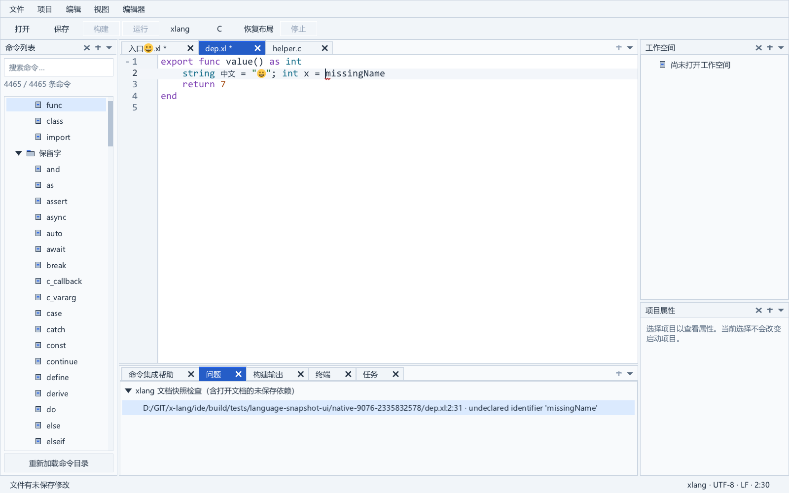

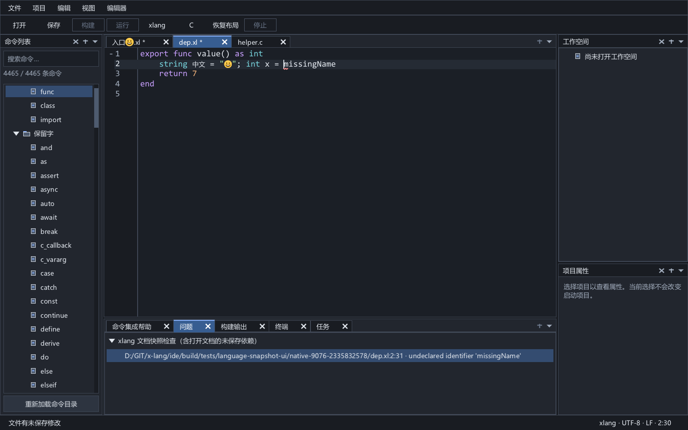

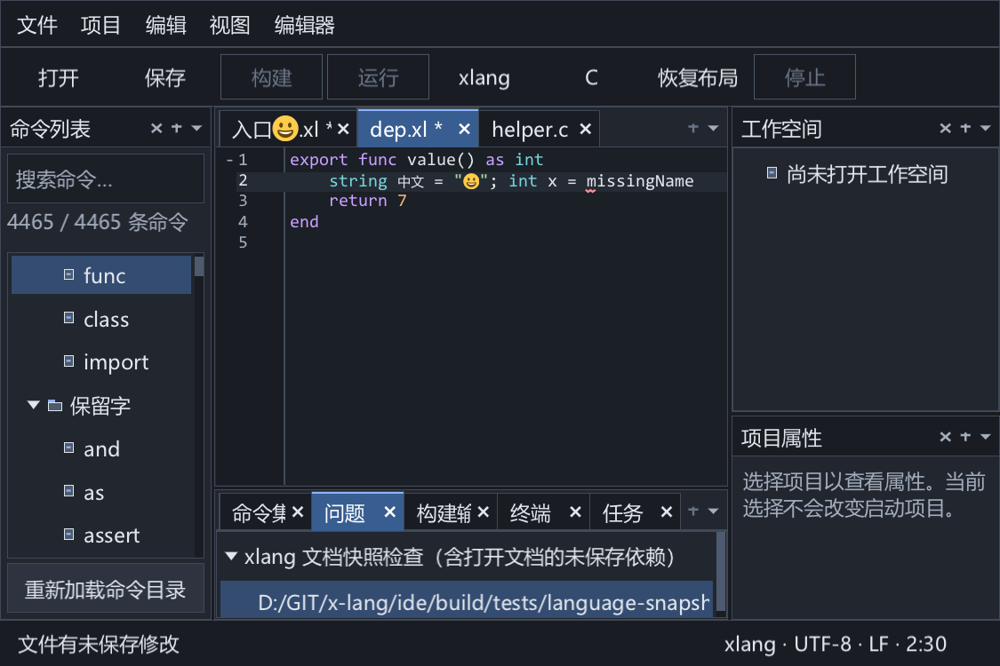

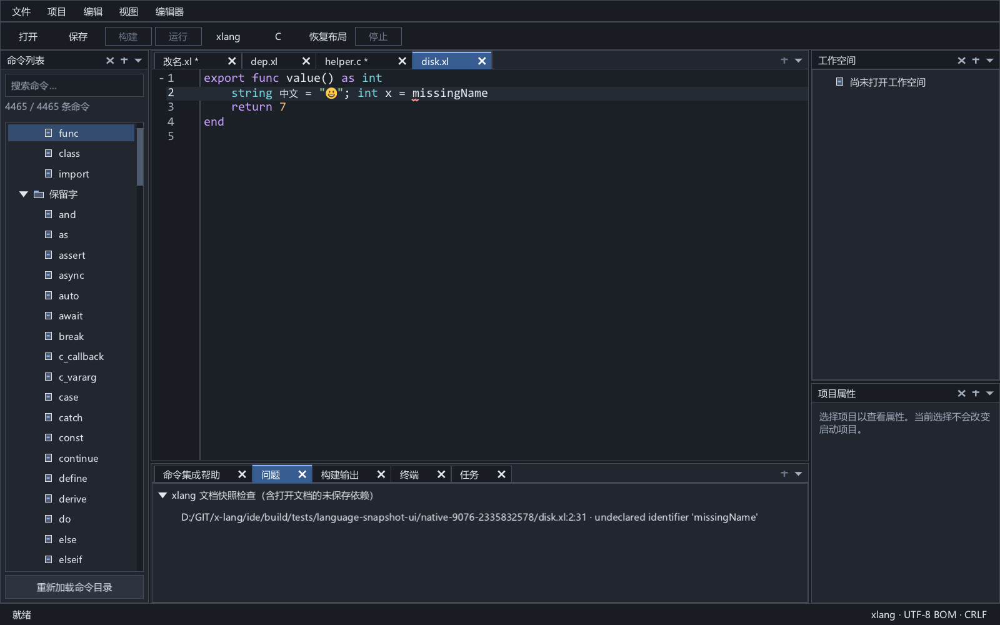

长期目标保持进行中。当前发布前复核 xlang 实际加载来源、候选、包环境与工具链；发布后持续观察尚未接入，跨文件跳转的临时核对不代替持续失效。下一步保留并观察加载报告、候选/环境/工具链输入，再推进真实来源范围/符号/类型、大纲、悬停、语义补全、定义与 C 语义。全局状态修复、更多编辑动作、资源创建/新 XLON、实体输入/DPI、性能与首版发布仍须继续。使用和边界见 [语言服务](language-service.md)。


## 发布后输入守护与自动恢复增量

2026-10-07 已完成本次实际 xlang 输入的持续守护。成功检查保留有界、独立的来源和候选报告；后台每轮复核后等待一秒，观察未打开磁盘源码、实际加载包描述、已查询普通文件候选、编译器/兄弟 DLL 指纹及服务进程包路径环境。变化、删除、只改变 BOM、不可读取或同字节身份替换使整批诊断永久失效；覆盖正文仍来自不可变打开文档快照，无关文件不撤销结果。

服务先发送含 checkId、入口 URI 和版本的整批失效通知，再清空全部逐文件诊断。GUI 验证对应请求/版本后撤销标注和问题树，500 ms 后复查原入口；暂时不可读取造成检查失败时按 1–10 秒退避恢复。GUI 包路径环境或所选编译器配置变化会在复查时重启服务并同步全文；其他进程/注册表环境变化不等于当前进程环境变化。取消、入口关闭/复用和崩溃清理定时器；旧守护异步退役，不会清除新结果，取消后禁止从对象取得新诊断副本。

客户端在消息入队和进程结束后调用只负责唤醒的回调，原生按需绘制主循环再处理消息；后台不操作控件。Guard 的磁盘/工具链扫描在 worker 执行，消息派发只轮询状态和已退出线程。服务最多保留一个旧守护与一个新检查，旧守护退出后才发布新结果。周期是复核耗时加一秒，网络/大文件性能仍待验收，没有固定一秒发现承诺。

严格完整 Release 构建的 56 模块和 45 注册测试通过，随后仅为取消后结果读取边界重新严格编译 language_check 并用同一精确 56 对象重链接全部产品与 45 测试；179 个 src/tests/tools/data 输入在最终回归结束后逐项匹配。固定 SDK DLL 和四套历史工具链共 8,392 文件指纹均未改变，独立服务只导入 xge.dll 的 XRT，不导入 XUI 或编译器核心 DLL。55 个公共动作、C/xlang 双语法、三层工程模型及既定 Dock 保持。

完整回归：45 类、57 项真实/受控协议、94 张新鲜且可解码的原生图、真实 C/xlang/Unicode 混编运行、模板/DLL/PE 资源、失败构建禁止旧产物运行、SDK 混用头拒绝全部通过。57 项中的新增 13 项在成功发布后实际改写/替换/删除输入、创建候选和工具链兄弟文件；原生额外验证独占锁失败后自动恢复、同字节复查、旧通知过滤、进程环境重启、取消停止以及正常消息/坏服务结束唤醒。四张本轮语言快照图逐张查看，其他 90 张验证指纹、新鲜性和解码；不把全部图计为人工逐图审查。

证据：

- [完整严格构建](../build/published-guard-retirement-build-evidence.json)、[取消边界严格重链接](../build/published-guard-cancel-relink-evidence.json)、[最终输入清单](../build/published-guard-link-inputs.json)。
- [目标原生验收](../build/published-guard-target-evidence.json)、[目标 57 项协议](../build/targeted/snapshots-9f33cdab-7703-401a-86de-28afd9901dc9/evidence.json)。
- [完整回归日志](../build/published-guard-full-regression.log)、[新鲜图与退出码](../build/published-guard-full-evidence.json)、[最终核验](../build/published-guard-final-verification.json)。
- [受保护文件指纹](../build/published-guard-protected-verification.json)、[独立服务导入表](../build/published-guard-server-imports.json)、[四张语言图查看记录](../build/published-guard-visual-review.json)。
- 保留 [首次严格构建失败](../build/published-guard-build.log) 和 [退出码](../build/published-guard-build-evidence.json)：新测试环境恢复代码的 else 缩进告警，补括号后完整重建及最终回归通过；没有将失败记为通过。

阶段 6 和完整首版仍未完成：下一步继续来源范围、符号/类型查询、大纲、悬停、语义补全、定义及 C 语义，并完成项目全输入图、资源创建/新 XLON、全局状态修复、性能、实体输入/DPI 和发布验收。实现仍为传统原生 IDE，不引入 AI/自动化业务面板。长期目标保持 active。


## 2026-10-07 编译器源码范围基础

DEMO6 AST 保存完整语法范围及构造 token 范围；真实 token 通过 Lemon 栈归约传播起止偏移与标量行列，在动作释放/重用语义值前捕获 RHS，避免将分隔符、标志或 token 联合体当成 AST 指针。插值包装表达式映射回原文件，保留嵌套/CRLF/非 BMP 位置；复制来源即使 source 指针同为 NULL 也保留范围，并保持引用计数生命周期。

新增 C API xlcEmitAstWithRanges 和 CLI parse --json --source-ranges。schema-1 只代表入口语法树，不加载依赖或提供语义符号；内存入口、覆盖优先级和虚拟入口沿用既有合同。完整/构造范围彼此独立，构造 token 不能自动当声明名称。输出在发布前限制深度 256、100,000 节点与保守 16 MiB 预算，超量丢弃缓冲并保留旧输出；原 AST/check 格式保持。CLI 识别选项时尊重快照/输出参数值和 -- 边界。

新增规范范围后处理器接入旧规范脚本所有分支。SQLite 官方 Lemon 3.51.0/3.45.0 的生成代码均通过严格 C 检查；3.51.0 的引擎/解析表及 441 条动作映射与改动前生成形态核对一致，并采用规范生成的 C 行号。修改前后均有 68 个既有解析冲突，Lemon 退出 1；这是仍存在的生成限制，不记为无冲突生成。后处理重复执行不改变字节。

独立工作区最终完整 DLL/CLI 构建通过，重新生成并校验 154 个 runtime、741 个 compiler VFS 资源。范围门禁通过 63 个实际命令，逐节点核对 1,468 个 AST 的字节边界、标量位置、来源和构造 token 包含关系，去掉新增字段后的 AST 与固定旧编译器一致。实际包含中文/非 BMP、BOM/CRLF/无尾换行、空源码、两种嵌套及跨行插值、匿名函数/泛型、真实 DLL 的内存入口/覆盖/错误恢复、宽/深输出拒绝保留，以及 AST 复制与来源引用生命周期。

同一最终编译器的覆盖 20 项、来源报告 22 项、解析观察 8 项回归通过。新冻结工具链通过 IDE 57 项真实/受控快照协议、6 项 C/xlang 中文混编与独立 C 的构建/CLI运行/产物运行，以及完整源码导入分类套件（含原生 union 包 ABI）。新成套快照 4,769 文件/434,570,862 字节，复制前后逐项一致，供后续查询接入使用；没有覆盖四套历史快照。

本轮 IDE 的 179 个源码/测试/工具/数据输入和四个发布二进制均保持已有指纹。固定 SDK 与历史 8,392 文件核验不变。本轮未修改 GUI，也没有将此前的 45 类/94 图重复记作新鲜截图验收；C/xlang 双语法、既定 Dock 与当前检查能力保持。

证据：

- [接口合同](../../demo6/docs/IDE源码范围接口.md)、[IDE 接入边界](compiler-source-ranges.md)、[生成器/幂等核对](../build/source-range-regeneration-evidence.json)。
- [最终完整构建](../build/source-range-contract-final-build-evidence.json) 与 [日志](../build/source-range-contract-final-build.log)。
- [63 命令/1,468 节点范围门禁](../build/source-range-compiler-0365497b-bb9a-48f5-b152-603771977732/build/test/source-ranges-8b85d99f-9ecf-4282-bba5-669352cbc3a7/evidence.json)。
- [覆盖回归](../build/source-range-compiler-0365497b-bb9a-48f5-b152-603771977732/build/test/source-overlay-45d8138f-782c-45c3-93b3-90e9bd6b94ae/evidence.json)、[来源报告回归](../build/source-range-compiler-0365497b-bb9a-48f5-b152-603771977732/build/test/source-report-a262ef3e-7ad3-486c-92a2-889ece28c8f9/evidence.json)、[观察回归](../build/source-range-compiler-0365497b-bb9a-48f5-b152-603771977732/build/test/resolution-report-8eafaeae-29c9-433c-b857-1e0a0f53ace3/evidence.json)。
- [57 项协议](../build/targeted/snapshots-34146dba-f629-4f0a-9d02-80d48404ef89/evidence.json)、[6 项实际混编/C运行](../build/targeted/range-mixed-87ce09c2-e04e-4573-9995-7d2d10b27228/evidence.json)、[导入分类日志](../build/source-range-imports-regression.log) 与 [退出码](../build/source-range-imports-regression-evidence.json)。
- [新工具链快照](../build/source-range-toolchain-snapshot.json)、[历史快照/SDK 核验](../build/source-range-protected-verification.json)、[最终输入与产物核验](../build/source-range-final-verification.json)。

保留已知失败：第一次范围门禁使用了旧编译器也拒绝的单引号插值测试，修正为支持的反引号/双引号；深度测试原先先触发已有固定 parser 栈限制，改用左结合表达式实际验证输出树深度。一次资源复用构建正确拒绝已修改 API 的旧 VFS，随后完整重打包。最终原生宿主在 FreeLibrary 后进程退出时触发已知 XRT FLS 回调失效；GDB 确认上下文已销毁、DLL 已卸载后才崩溃，按已有 source_overlay_host 明确的进程生命周期加载合同修正测试，未跳过上下文销毁。AST 宿主最初将 TCC 的 .def 导入方式用于 MinGW，改为 MinGW 直接导入实际 xl.dll 后通过。均没有将失败计作通过。

- [首轮测试失败](../build/source-range-first-gate.log)、[固定旧编译器拒绝证据](../build/source-range-fixture-baseline-evidence.json)、[原深度测试失败](../build/source-range-second-gate.log)。
- [资源复用拒绝](../build/source-range-final-build.log) 与 [退出码](../build/source-range-final-build-evidence.json)。
- [错误卸载宿主失败](../build/source-range-ranges-gate.log)、[逐步定位](../build/source-range-native-trace2.log)、[真实 GDB 堆栈](../build/source-range-native-gdb.log)；最终宿主按现有合同正常退出。

阶段 6 仍未完成：此接口尚未与同次已验证的来源报告及真实语义 Symbol/Type ID 合并，也未接 GUI 大纲、悬停、语义补全和定义跳转。下一步继续同一检查批次内的符号/类型/定义范围查询及 stdio/原生接入，再完成 C 语义、项目全输入图、资源创建/新 XLON、全局状态修复、性能、实体输入/DPI 与发布验收。首版仍为传统原生 IDE，长期目标保持 active。

## 2026-10-07 同次编译检查的语义索引基础

新增 `xlcCheckWithIndex` 和 `check --json --semantic-index`，从同一个已展开、完成语义及 IR 检查的 AST 导出平面节点事实，同时附带实际来源与解析观察报告，并在索引生成后重新验证输入。声明身份由实体分配/实际作用域声明写入独立字段，避免把同样携带 semanticSymbolId 的 NAME 引用误判为声明。CALL 保留实际选中的重载目标；函数实体与函数名称作用域 ID 可不同，但名称选择指向原 token。

按需保留实际符号类型的 AST 独占副本，包含 auto 与临时绑定类型，语义上下文释放后没有借用指针。canonical 类型复用原格式化器并增加查询专用的字节/深度/访问限额；普通检查不进行声明类型复制。索引最多 65,536 节点、深 256、保守/实际 JSON 8 MiB；声明类型副本总计 65,536 节点/4 MiB/深 128，单个规范类型最多 8 KiB/深 128/8,192 次访问。无事实或来源的生成/隐式实体保持 null/0，失败只返回 complete=false 与空节点，不发布部分结果。

源码/描述输入的 kind 是位标志，索引已修复单值比较导致混合角色文件被丢弃的问题。真实导入重命名后的函数可以通过语义 ID 回到原文件名称 token。全部偏移遵循去 BOM 的 UTF-8 半开区间与标量行列，保留 CRLF/非 BMP；后续 GUI 必须按同批次正文转换 UTF-16。

最终索引门禁通过 26 个实际命令，逐项核对 706 个节点、673 个范围。三层同名变量引用分别关联正确声明；两个重载调用分别指向实际函数；验证别名/类身份、auto 类型、导入原名、普通模块未保存覆盖、Unicode/BOM/CRLF/插值、内存入口/虚拟覆盖/入口正文优先级、失败恢复、深树/宽表和类型格式化拒绝。原生宿主销毁上下文，沿用既有 XRT DLL 进程生命周期合同。

已确认未解决边界：显式文件目标 `import "helper.xl"` 的覆盖可能与先行失败包探测的磁盘记录冲突。固定旧工具链的来源报告也拒绝同一输入；本门禁保留安全拒绝与空索引，不将它记为成功覆盖。`import helper` 的真实覆盖单独验证成功。后续需要区分失败包探测与实际来源观察，同时保留包解析优先级、发布前复核和发布后守护；该工作仍在原长期任务内。

最终完整独立 DLL/CLI 重建通过，重新生成并核对 155 个 runtime、746 个 compiler VFS 资源。成套冻结工具链 4,769 文件、434,599,309 字节，复制前后全部指纹一致；旧五套工具链清单的 13,161 文件保持。旧 import-ui 目录另有与外部清单完全相同的 snapshot-manifest.json 元数据，已单独记录，未删除。固定 SDK 与 IDE 四个发布二进制保持，179 个 IDE src/tests/tools/data 输入逐项保持。

同一最终编译器通过 63 命令/1,468 节点的范围回归、20 项覆盖、22 项来源、8 项解析观察、57 项真实/受控 IDE 快照协议、6 项真实 C/xlang Unicode 混编及独立 C 构建/CLI/产物运行，以及完整源码导入分类套件（含原生 union 包 ABI）。本轮没有修改 GUI，也没有把此前 45 类/94 图计为新 GUI 回归。双语法、三层模型与定版 Dock 保持。

证据：

- [编译器合同](../../demo6/docs/IDE语义索引接口.md)、[IDE 接入边界](compiler-semantic-index.md)。
- [最终完整构建](../build/semantic-index-contract-build-evidence.json) 与 [日志](../build/semantic-index-contract-build.log)。
- [26 命令/706 节点/673 范围](../build/semantic-index-compiler-f8599594-65ee-4f14-8b1c-ac816147cca2/build/test/semantic-index-5cc445d0-c160-491e-8887-d5d4ca5aa171/evidence.json)。
- [范围回归](../build/semantic-index-compiler-f8599594-65ee-4f14-8b1c-ac816147cca2/build/test/source-ranges-636b9aba-e79e-40bd-b3bf-b6fbeff9fb5b/evidence.json)、[覆盖](../build/semantic-index-compiler-f8599594-65ee-4f14-8b1c-ac816147cca2/build/test/source-overlay-d250b4dc-63a8-4728-bb47-272b62d047a9/evidence.json)、[来源](../build/semantic-index-compiler-f8599594-65ee-4f14-8b1c-ac816147cca2/build/test/source-report-fad983aa-c394-47d6-8786-babeb36bcf11/evidence.json)、[解析观察](../build/semantic-index-compiler-f8599594-65ee-4f14-8b1c-ac816147cca2/build/test/resolution-report-c4197a2d-8235-49ce-9667-0be43da2863c/evidence.json)。
- [57 项协议](../build/targeted/snapshots-69ffb632-a0b5-4329-a886-35e0bbd302e3/evidence.json)、[6 项实际混编/C运行](../build/targeted/semantic-mixed-1ff0e7d4-9054-404b-9fd8-479aba641fa8/evidence.json)、[导入分类日志](../build/semantic-index-imports-regression.log) 与 [退出码](../build/semantic-index-imports-regression-evidence.json)。
- [新成套快照](../build/semantic-index-toolchain-snapshot.json)、[历史指纹](../build/semantic-index-protected-verification.json)、[IDE 基线](../build/semantic-index-ide-baseline-verification.json)、[最终核验](../build/semantic-index-final-verification.json)、[独立改动清单](../build/semantic-index-changes.json) 与 [差异](../build/semantic-index-changes.diff)。

保留实际失败：首次完整构建遗漏内部 API 声明，补齐后重打包/重建成功。第一轮测试夹具写入时被 Windows 转为 CRLF，预期仍为 LF；固定写入字节后继续。第二轮发现混合来源位被单值过滤，修复产品并完整重建。第三轮撞到上述旧来源观察边界，保留同场景失败用例并增加独立模块覆盖成功验证；第四轮测试把 --json 放到旧 CLI 的必选文件位置，按已有参数顺序修正 -- 边界用例。没有把失败记为通过。

- [首次构建失败](../build/semantic-index-build.log) 与 [退出码](../build/semantic-index-build-evidence.json)、[内部声明修正后的构建](../build/semantic-index-final-build-evidence.json)。
- [夹具换行失败](../build/semantic-index-first-gate.log)、[混合来源位失败](../build/semantic-index-second-gate.log)、[旧来源冲突失败](../build/semantic-index-third-gate.log)、[固定旧编译器同一冲突](../build/semantic-overlay-baseline.json)、[CLI 测试顺序失败](../build/semantic-index-fourth-gate.log)。
- [历史目录计数首次失败](../build/semantic-index-protection-inventory-first-evidence.json)：多出的文件是已有快照清单本身，内容与外部清单完全一致；其指纹在最终历史核验中单独保留。

阶段 6 与完整首版继续进行：当前编译器索引尚未被 stdio/GUI 使用，仍需完善失败包探测观察、将事实保存在同一已复核的 snapshot 并受版本/持续输入守护约束，再实现实际定义、大纲、悬停和语义补全。C 语义、项目全输入图、资源创建/新 XLON、全局状态修复、性能、实体输入/DPI 与发布仍须完成。首版为传统原生 IDE，长期目标保持 active。

最终共享源码核验发现 DEMO6 同时新增了 array algebra 的运行库清单/描述项，涉及两个构建脚本、compile_unit 与 api_symbols。当前文件中的本次语义接入分支保持，完整文件字节与已编译快照有这四处独立差异；核验只在内存移除已观察到的新增片段后与阶段字节比较，没有改写或撤销其他任务。结果以冻结工具链为准，不声明并行新增后的整个共享编译器已重建。见 [当前差异记录](../build/semantic-index-live-drift.json) 与 [单独差异](../build/semantic-index-live-drift.diff)；最终核验区分完整字节匹配与本次改动范围匹配。


## 2026-10-07 同批次语义定义与原生 F12

编译器真实索引已接入快照、持续输入守护和 stdio 定义查询。声明 ID 和 CALL 实际目标区分同名遮蔽及重载；导入内部名称使用原始声明 token。排序扫描同时验证 UTF-8 偏移与 Unicode 标量范围，再转换为 UTF-16，覆盖 CRLF、BOM 和非 BMP。旧工具链继续诊断检查，失败编译不发布部分语义事实。查询不启动第二次编译器。

原生文件菜单/F12 使用稳定动作 69；请求后的正文/稳定身份、当前标签、光标、批次和目标来源均须一致。未保存依赖直接定位；未打开磁盘来源复核身份及正文摘要后打开。编辑、关闭、取消、输入变化及晚到回复不会使用旧位置。C/xlang 双语法和定版 Dock 保持。协议 stdout 使用明确的有界容量，默认任务/stderr 行为的洪流、日志、取消和进程树用例均通过。

最终严格 Release 完整构建与完整 CompilerPath 回归均退出 0：57 个应用模块、46 类原生测试、56 动作、97 张新鲜原生图；57 项旧快照和 32 项新定义协议通过，真实 C/xlang 混编运行、实际资源/迁移/导入运行、失败构建不运行旧产物及固定 SDK 负面检查通过。183 个最终 src/tests/tools/data 输入无漂移，全部 17,930 个冻结工具链文件与已有元数据保持；SDK 与发布 xge.dll 相同。32 份原字节备份保留，本轮只在 IDE 内实现服务接入，未修改共享 DEMO6 编译器或冻结 SDK。

证据：

- [定义导航合同与原生截图](definition-navigation.md)、[最终核验](../build/definition-final-verification.json)。
- [完整构建](../build/definition-build-final-complete.log)、[完整回归](../build/definition-full-regression.log)。
- [57 项快照协议](../build/targeted/snapshots-94623e81-1eb9-4f43-a249-ebbf2c3ba56e/evidence.json)、[32 项定义协议](../build/targeted/definitions-abce03c7-0706-46a3-ab66-49f5e3f8d7b7/evidence.json)。
- [最终输入指纹](../build/definition-link-inputs.json)、[原始备份清单](../build/definition-before.json)、[改动清单](../build/definition-changes.json)、[差异](../build/definition-changes.diff)。

保留实际修复过程：首次严格构建拒绝误导缩进，已修正；原生测试最初使用了不存在的主题 helper，改为真实公共主题动作。第一次协议夹具将导出字符串中的 answer 误当成声明，预期按实际 token 修正；超大对象数组夹具先触及 20 秒客户端等待，改为紧凑的 65,537 个节点数量用例直接验证节点上限。BOM 覆盖验收发现 CLI 会先移除快照文件 BOM，服务已按实际去 BOM 输入摘要核验，并保留打开正文的首行坐标。所有失败日志保留，最终完整门禁使用冻结的 183 个输入。

- [首次编译诊断](../build/definition-build.log)、[原生主题入口编译诊断](../build/definition-build-verified.log)。
- [导出名称夹具失败](../build/definition-protocol.log)、[大对象夹具超时](../build/definition-protocol-second.log)、[BOM 来源约定失败](../build/definition-protocol-final.log)。

长期目标保持 active。仍须完善显式文件导入覆盖与失败包探测观察，继续大纲、悬停、语义补全、C 语义、完整项目输入、资源创建/新 XLON、全局状态修复、性能、实体输入/DPI 与发布验收；本次定义跳转不代表这些事项已经完成。


## 2026-10-07 文档大纲与原生悬停

当前成功的 xlang 检查批次已提供标准 DocumentSymbol 和 hover 查询。大纲使用原源码名称和范围，按源码顺序显示顶层声明及类方法，真实重载分别列出；局部、参数和内部函数作用域名称不重复列入。原生提示使用实际解析目标的声明首行与编译器类型副本，标明声明、推导或语法来源，不按名字拼造类型。

新增稳定动作 74/75（language.outline / language.hover）：视图菜单打开中央底栏大纲，双击或 Enter 跳转；鼠标在实际文字停留约 350 ms 或 Ctrl+I 显示符号信息。默认活动页仍是命令集成帮助，左右 Dock 与右侧上下布局保持。旧十面板逻辑存档可恢复，新页可通过菜单打开。正文、标签、光标/鼠标、批次、来源或守护失效后撤销旧结果；提示文字独占保留至气泡关闭。

最终严格 Release 构建和完整 CompilerPath 回归均退出 0：57 模块、47 类原生测试、58 公共动作、99 张新鲜原生图；57 项既有快照协议、32 项定义协议及 26 项新增大纲/悬停协议通过。真实 C/xlang 混编运行、资源/迁移/导入运行、失败构建不运行旧产物、SDK 负面检查通过。185 个最终源码/测试/工具/数据输入被冻结并复核；17,930 个历史工具链文件、281 份原字节备份及固定 SDK 运行时核验保持一致。本轮没有修改共享 DEMO6 编译器或固定 SDK。

证据：

- [使用方法、协议和最终原生截图](outline-hover.md)、[最终核验](../build/outline-hover-final-verification.json)。
- [完整构建](../build/outline-hover-build-final.log)、[完整回归](../build/outline-hover-full-regression.log)、[最终输入指纹](../build/outline-hover-link-inputs.json)。
- [57 项快照](../build/targeted/snapshots-549e3e8d-643b-4a4c-9ba3-910c5c2391e4/evidence.json)、[32 项定义](../build/targeted/definitions-06a5ac7f-a80d-48c2-8ab5-9b2545de8031/evidence.json)、[26 项大纲/悬停](../build/targeted/symbols-8faa2b94-1b85-44a9-96e0-f82a02888fe5/evidence.json)。
- [原始备份清单](../build/outline-hover-before.json)、[改动清单](../build/outline-hover-changes.json)、[差异](../build/outline-hover-changes.diff)。

修复过程保留：快捷键最初使用不存在的 SDK 字母常量，改用已有 ASCII 按键约定；严格编译的缩进警告已修正。真实索引验收发现节点类型字段和独立 type 对象不能要求相同 ID，已按来源、格式和各自范围分别校验。独立包含真实视图的原生测试需排除同一对象文件，已修正链接注册。检查会激活问题页，原生导航用例先通过公开动作显示大纲再获取焦点。完整回归的布局断言曾要求所有隐藏标签保持停靠，现把“恢复默认大纲位置”与“用户关闭后仅恢复帮助页”分别验证。首次完整回归诊断保留在 [布局断言日志](../build/outline-hover-full-regression-layout-diagnostic.log)。最终两张原生截图均已视觉核对。

长期目标保持 active。语义补全、C 语义、完整项目输入、显式文件导入覆盖及失败包探测观察、资源创建/新 XLON、全局修复、性能、实体输入/DPI 与发布验收继续实施。大纲当前省略未提供完整选区的构造器、字段及生成实体，类型仍采用编译器规范格式；这些能力边界详见使用合同。


## 2026-10-07 按光标补全的编译器基础

已合入真实查询 API/CLI、专用解析 token 处理、作用域候选和 class 成员查询；保留原始输入哈希与范围，查询禁止 IR/产物生成。补全与成功索引分开，失败/容量超限空候选；C API 成功查询会清除内部临时失败状态，后续普通检查仍看到原文本。

42 项补全 CLI/C API 回归，以及来源报告 22 项、覆盖层 20 项、源码范围 46 项、语义索引 26 项全部通过，共 156 项。隔离测试首次缺少历史夹具而中止，补齐并验证 3902 个夹具后完整重跑通过。编译单元的并行资源改动按唯一上下文及实际偏移合并，未重写其他工作；所有既有 SDK/工具链继续受哈希保护。原编译脚本重复输入仅在私有验证命令去重，保持共享构建列表。

证据：[补全基础](compiler-completion.md)、[完整汇总](../build/completion-final-verification.json)、[新工具链](../build/completion-toolchain-snapshot.json)、[共享源码合并](../build/completion-root-merge.json)、[旧合同回归](../build/completion-legacy-gates.json)。

长期目标 active。下一步接标准 LSP completion 和真实原生候选，校验版本、请求、光标和全部来源，完成过期/取消/重启与 UTF-16 textEdit 验收后再开放能力；现有 C/xlang 双语法与静态命令补全继续可用。C 语义、完整项目输入、资源/XLON 创建、全局修复、性能、实体输入/DPI 和正式发布继续实施。

## 2026-10-07 当前光标语义补全服务

独立 C 语言服务 0.4 已提供标准 textDocument/completion、当前全文/未保存依赖查询、UTF-16 整段标识符 textEdit 和零宽度成员插入。候选使用真实类型与符号身份，独立于成功检查索引；查询成功不表示整份编译成功。已接取消、最新等待请求、全批次 generation 失效与持续磁盘/候选/环境/工具链守护。补全与正常检查及 hover 可以同时运行。

最终严格 Release 完整构建和完整 CompilerPath/CompletionCompilerPath 回归均退出 0：58 应用模块、47 类原生测试、58 公共动作、99 张新鲜原生图；66 项补全、57 项快照、32 项定义、26 项大纲/悬停协议通过，共 181 项协议检查。真实 C/xlang 混编运行、资源/迁移/导入、失败构建不运行旧产物及 SDK 负面检查通过。188 个最终源码/测试/工具/数据输入冻结后复核；22,699 个工具链文件与固定 SDK 继续受哈希保护。

列表容量在逐项追加前计算，计入重复声明 URI；整体 JSON 另限制为 7 MiB。真实 Windows 长路径覆盖用例测量服务峰值提交量增长，低于 96 MiB 门禁，超限查询拒绝后服务仍可处理请求。66 项协议还覆盖整个 token 后缀替换、BOM/CRLF/中文/非 BMP、未保存依赖目标的独立版本、64 份覆盖新增参数边界、恶意字段与文本/帧容量拒绝、字符串 ID、旧工具链诚实失败、取消/排队/响应性、检查共存、磁盘身份/候选/编译器及文档失效、恢复/重启和临时文件清理。

修复过程保留：首轮严格编译发现排序文本缓冲区警告，增大格式缓冲区；测试脚本分块拼接漏换行，修正后通过。新增 BOM 参数测试曾跑在重建前二进制上，首轮完整回归未通过；重建并冻结输入后完整回归通过。后续核对发现长声明 URI 可在最终序列化前重复占用大量内存，增加逐项预算与实际峰值门禁后再次完整重建、冻结输入并完整回归通过，没有把早期结果代替最终产物验收。

证据：[服务合同](semantic-completion-service.md)、[最终核验](../build/completion-lsp-final-verification.json)、[严格完整构建](../build/completion-lsp-build-uri-final.log)、[最终完整回归](../build/completion-lsp-full-regression-uri-final.log)、[最终输入](../build/completion-lsp-link-inputs.json)、[原字节基线](../build/completion-lsp-before.json)、[改动清单](../build/completion-lsp-changes.json) 与 [差异](../build/completion-lsp-changes.diff)。早期 [编译失败](../build/completion-lsp-build.log)、[测试拼接失败](../build/completion-lsp-protocol-first.log)、[BOM 边界的旧二进制回归](../build/completion-lsp-full-regression.log) 及 [URI 修正前完整通过](../build/completion-lsp-full-regression-final.log) 均保留。

长期目标保持 active。原生编辑器仍使用已有静态目录补全，新语义查询尚未接入候选窗格和提交交互；下一步实现候选组合、独立同步、稳定身份/版本/标签/光标/焦点校验，以及实际插入、后缀替换与撤销验收。C/xlang 双语法和定版 Dock 保持。本轮没有改写共享 DEMO6 编译器或固定 SDK。C 语义、完整项目输入、显式文件覆盖/失败包观察、资源创建/新 XLON、全局状态修复、性能、实体输入/DPI 与发布继续实施。

## 2026-10-07 原生语义候选与整段提交

命名 xlang 的原生候选已接入当前未保存正文及依赖，支持 Ctrl+Space/点号、真实类型/遮蔽/重载、语义与目录组合、整个标识符后缀替换和 Enter/Tab 的一次撤销。使用独立后台客户端，不覆盖诊断批次；补全时背景诊断更新问题数据并保留输入焦点，取消检查不撤销独立候选。

最终严格 Release 完整构建与冻结输入后的完整回归均退出 0：59 应用模块、48 类原生测试、58 公共动作、101 张新鲜原生图；66/57/32/26 项补全/快照/定义/大纲悬停协议通过，共 181 项。新原生补全类实际通过 180 条断言，覆盖提交/撤销、未保存依赖、目录去重、检查共存、12 组坏响应、输入版本、Esc/焦点/光标/标签/关闭复用/C、模态与环境、后台来源失效、停止后的提交拒绝/重启和旧工具链后备。

191 个源码/测试/工具/数据输入在验证前冻结并于验证后复核；292 份原字节备份与 22,699 个固定工具链文件复核通过，SDK 运行时保持一致。实际 C/xlang 混编构建运行、资源/迁移/导入、失败构建不运行旧产物及 SDK 负面检查通过。未改写共享 DEMO6 编译器和固定 SDK；C/xlang 双语法、定版左右 Dock/中央底栏及单栏帮助保持。

保留真实修复过程：测试枚举与临时对象选择错误已修正；SDK 正文会规范化换行，撤销比较以实际编辑器输入为准；重复查询按实际当前光标验证。输入提交回调仍位于 SDK 事务中，现延迟到 owner 帧读取完成后的版本。模态接口返回 1 已按实际合同修正。600 ms 等待短于已声明的一秒后台守护轮询，改为在覆盖该间隔后验证通知先于 Enter 处理，未宣称即时磁盘检测。并行诊断最初转移编辑焦点，现于补全期间只更新数据。排序索引和共享 LSP 范围核对避免两个大列表交叉扫描及逐项重扫长正文。提交再次核验服务存活，拒绝保留当前光标；80 ms 延迟显式唤醒按需帧。首轮完整回归虽通过，截图核对仍发现旧列表的 24 像素滚动偏移使首个语义候选不可见。现通过公开 ListView API 重置滚动并显示选中行，单行列表包含上下边框，词中替换清除与右侧后缀重叠的内联提示；原生测试新增候选名称、选中索引及整行可见性核对。最终视觉修正后完整重建并冻结重跑，以最终截图和产物验收。

证据：[原生使用合同及截图](native-completion.md)、[最终核验](../build/native-completion-final-verification.json)、[严格最终构建](../build/native-completion-build-visible-final.log)、[完整回归](../build/native-completion-full-regression-visible-final.log)、[最终输入指纹](../build/native-completion-link-inputs.json)、[原字节基线](../build/native-completion-before.json)、[改动清单](../build/native-completion-changes.json) 和 [差异](../build/native-completion-changes.diff)。保留 [初始测试编译诊断](../build/native-completion-targeted-build.log)、[换行预期诊断](../build/native-completion-targeted-fifth.log)、[事务内版本诊断](../build/native-completion-targeted-ninth.log)、[短于守护间隔的诊断](../build/native-completion-targeted-hardened-verified.log)、[检查转移焦点诊断](../build/native-completion-targeted-composition-detail.log) 、[首轮完整回归](../build/native-completion-full-regression-final.log)、[旧滚动偏移诊断](../build/native-completion-targeted-candidate-scroll-values.log)、[边框可见性诊断](../build/native-completion-targeted-visible-selection.log) 与 [早期完整构建](../build/native-completion-build-final.log)。

长期目标 active。C 语义、完整项目输入、显式文件覆盖及失败包探测、资源创建/新 XLON、全局状态修复、性能、实体输入/DPI 和正式发布继续实施。GUI 前缀上限为固定 SDK 的 255 字节；未命名文档及 C 使用目录，语义范围继续服从编译器查询合同；已声明的后台守护存在一秒加扫描耗时的检测延迟。


## 2026-10-07 C 语义会话后端

新增显式 C/header 工程编译参数与独立 clangd stdio 会话，复制正文、稳定 ID、IDE 版本和 generation。真实诊断、补全、定义、悬停与文档符号已验收；启用内存头文件覆盖，全部 didOpen 后触发重建屏障，wire 版本 1/2 与 IDE 版本独立，早期诊断不进入最终批次。取消后晚到回复不发布，新会话重新同步全部输入。

最终严格 Release 完整构建与冻结输入后的完整 CompilerPath/CompletionCompilerPath/CServerPath 回归均退出 0：61 模块、49 类测试、58 公共动作、101 张新鲜原生图。真实 C 后端通过 219 条断言；既有 xlang 补全/快照/定义/大纲悬停为 66/57/32/26 项，共 181 项协议；原生 xlang 补全本轮为 181 条断言。真实 C/xlang 混编运行、资源/迁移/导入、失败构建保护与 SDK 负面检查通过。

实际服务器读取未保存头文件 double 字段，而磁盘仍为 int；新会话读取 const char*，头文件包含随后同步的未保存头文件也得到 double 宏类型。原 C 文件及两份头文件的原始字节保持。受控夹具仅验证传输/协商/洪泛，不模拟语义。无 CServerPath 的合同门禁另通过 184 条断言，并明确输出真实服务门禁省略。

绝对路径、重复身份、版本/编码/UTF-16 范围、JSON 转义帧预算、64 个请求、取消/重启、独立 stderr、空/引号/反斜杠参数、caller 修改后的副本和有界通知消费均有验证。198 个最终源码/测试/工具/数据输入及三份合同冻结；296 份原字节基线、22,699 个固定编译器文件、354 个官方 clangd 文件和固定 SDK 继续保留并复核。官方 ZIP 摘要和版本核验通过，独立错误 ZIP 被拒绝。没有系统安装或正式打包 clangd。本轮没有改写共享 DEMO6 或生产 SDK。四张最终原生图已视觉核对 C/xlang 高亮、语义候选、三层工程/右侧属性和窄宽单栏帮助。

修复过程保留：受控 stdout 初次文本模式二次转换 CRLF，改为二进制输出；真实补全最初得到磁盘 int，核对固定上游源码后启用内存覆盖并加入重建屏障；严格编译的缩进/截断警告和测试 JSON 转义已修正。历史摘要大写十六进制曾触发核验失败，统一大小写后复核，实际工具链没有变化。

证据：[C 服务合同](c-language-service.md)、[最终核验](../build/c-language-final-verification.json)、[完整构建](../build/c-language-build-final.log)、[完整回归](../build/c-language-full-regression-final.log)、[最终输入](../build/c-language-link-inputs.json)、[固定依赖保护](../build/c-language-protected-verification.json)、[clangd 清单](../build/c-language-clangd-toolchain.json)、[原始备份](../build/c-language-before.json)、[改动清单](../build/c-language-changes.json) 和 [差异](../build/c-language-changes.diff)。保留 [传输诊断](../build/c-language-targeted-first.log)、[磁盘类型诊断](../build/c-language-targeted-raw-completion.log)、[测试转义编译诊断](../build/c-language-targeted-build-final-contract.log)、[头文件链验收](../build/c-language-targeted-complete-draft-barrier.log) 和 [错误依赖拒绝](../build/c-language-clangd-negative.log)。

长期目标 active。C 语义 GUI、持续 C 磁盘守护、TCC 系统头与 xlang 生成声明桥接尚未完成；C 编辑器保留已有高亮和目录补全。下一步接原生 C 交互及稳定身份/版本/路径/光标/焦点保护。完整项目输入图、显式文件覆盖/失败包观察、资源创建/新 XLON、全局状态修复、性能、实体输入/DPI 和成套发布/许可证验收继续实施。


## 2026-10-07 原生 C 补全与独立服务器设置

命名 C/header 已通过独立后台 clangd 接入真实候选，支持 Ctrl+Space、点号/箭头、未保存头文件类型、函数/宏/关键字、目录去重、整个标识符后缀替换和 Enter/Tab 一次撤销。新增稳定 ID 76 的 C 服务器选择入口与 toolchain.cServer 偏好；CLI --c-server 支持相对路径，与 xlang 构建工具链分别配置。保留既定左侧命令、右侧上工作空间/下属性、中央编辑器下方底栏及单栏帮助。

最终严格 Release 全量构建、最新原生测试重链接与冻结输入后的完整 CompilerPath/CompletionCompilerPath/CServerPath 回归均退出 0：63 模块、50 类测试、59 公共动作、103 张新鲜原生图。新 C 原生补全通过 135 条断言，既有真实 C 后端 219 条断言；xlang 补全/快照/定义/大纲悬停为 66/57/32/26 项，共 181 项协议，原生 xlang 补全本轮为 180 条断言。真实 C/xlang 混编、资源/迁移/导入、失败构建不运行旧产物及 SDK 负面检查通过。

135 条原生断言覆盖 Unicode/BOM/CRLF、成员/函数/宏/关键字、未保存头类型、12 组变异真实 LSP 回复、编辑/模式/光标/焦点/模态/配置/模型/服务器选择变化、显式磁盘内容/身份/删除/不可读、取消、真实服务器退出后提交拒绝与全量重启、关闭控件复用和原始 C/头文件字节保留。原始真实回复与两张最终浅色/深色候选图已留存并视觉核对。独立相对路径门禁另通过 131 条断言。

203 份最终源码/测试/工具/数据、6 份功能合同和 65 个发布目录程序/DLL 输入在完整回归前冻结，随后逐项复核；304 份原字节备份均保持，当前原文件全部存在。22,699 个固定编译器文件、354 个官方 clangd 文件及 SDK 摘要复核通过。测试后的 IDE 目录进程审计为 0；没有修改共享 DEMO6 或生产 SDK，也没有系统安装或正式打包 clangd。

后台 job 守护显式 compilation database C/header、拥有项目清单与 clangd.exe；打开文档使用复制正文/版本。启动/发布前及发布后每 1 秒加扫描耗时核对原始摘要、存在性和物理身份，旧 job 异步退役，最多 4 份；READY 后通知消费有 32 条/8 ms 加单条校验边界，并在循环内检查取消。UI 发布及 PREVIEW 提交复核稳定 ID、版本、模式、路径、光标、选区、焦点和项目/服务器选择。此范围不能替代完整 C 预处理图；未显式列出的 include、系统/内置头、目录候选、响应文件及 TCC/xlang 生成声明仍需继续观察。

修复过程保留：窄链接最初包含历史 server 对象，剔除后正常；测试期望函数附加括号与真实普通 textEdit 不符，改按实际函数名插入验证。CLI 相对服务器路径已在 owner 复制后规范化。首次完整回归因 9 处旧动作数量断言仍为 58 中止，更新为 59 后全量重建并完整重跑通过。就绪阶段通知消费增加取消与限额检查，磁盘测试等待实际后台失效状态后再注入 Enter，避免固定等待把扫描延迟误判为缺陷。测试最终用固定 63 模块对象中的 62 个重链接实际 C 适配器，原来的失败日志继续保留。

证据：[C 服务及原生补全合同](c-language-service.md)、[最终核验](../build/c-native-final-verification.json)、[严格完整构建](../build/c-native-build-final.log)、[最新原生测试重链接](../build/c-native-test-relink-final.log)、[完整回归](../build/c-native-full-regression-final.log)、[最终输入](../build/c-native-link-inputs.json)、[固定依赖复核](../build/c-native-protected-verification.json)、[原始备份](../build/c-native-before.json)、[改动清单](../build/c-native-changes.json) 和 [差异](../build/c-native-changes.diff)。保留 [动作数量失败](../build/c-native-full-regression-action-count-diagnostic.log)、[初次函数插入期望诊断](../build/c-native-initial-test.log) 和 [相对路径验收](../build/c-native-relative-test.log)。

长期目标保持 active。下一步继续 C 诊断、定义、大纲与悬停 GUI，补齐 C 依赖观察及 TCC 系统头/xlang 声明桥接；完整项目输入图、显式文件覆盖/失败包观察、资源创建/新 XLON、全局状态修复、性能、实体输入/DPI 和成套发布/许可证验收继续实施。


## 2026-10-07 C 原生诊断、定义、大纲与多行悬停

持久后台 clangd 分析已接入原生工作台：打开的命名 C/header 自动同步未保存全文，标准诊断按真实 UTF-16 范围映射到 CodeEdit 和中央问题页；F12 导航实际声明；同一个中央大纲 dock 在 C/xlang 客户端之间切换，Enter/双击选择真实符号名称。保留定版左命令、右上工作空间/右下属性及中央编辑器下方底栏。

C/xlang 问题页新增结果归属与独立导航回调，一方清理不会擦掉另一方或构建结果。后台更新标明已收到多少文档，不把部分批次说成全部通过，也不夺取补全焦点。当前检查/定义/大纲/悬停沿用稳定 ID 68/69/74/75，公共动作仍为 59；保存后 xlang 检查保持原范围，取消停止自动复查。

真实鼠标命中后 350 ms 查询，Ctrl+I 查询光标；只显示协商的 plaintext。固定 SDK 默认 Hint 的单行高度会裁切 clangd 多行原文，应用改用公开 popup/TextEdit API 的只读、换行滚动窗格，鼠标可进入阅读；未修改 SDK。保留全文与原始范围，版本、配置、标签、焦点、光标、模式、模态、补全或已观察输入改变时撤下结果。单会话 64 请求容量/30 秒上限，有界事件消费与单条取消；服务器退出后撤下旧结果，随后重新同步。

最终严格 Release 全量重建、原生测试严格重链接与冻结输入后的完整 CompilerPath/CompletionCompilerPath/CServerPath 回归均退出 0：65 模块、51 类测试、59 动作、106 张新鲜原生图。新增 C 语义原生门禁通过 162 条断言，C 后端 219 条和 C 原生补全 135 条保持；xlang 补全/快照/定义/大纲悬停为 66/57/32/26 项，共 181 项协议，原生 xlang 补全 180 条。真实 C/xlang 混编运行、失败构建不运行旧产物、资源/导入/迁移及 SDK 负面检查全部通过。

162 条原生断言覆盖未保存头文件 const char*/double、Unicode、问题跳转、打开/关闭文件 F12、大纲 Enter、真实鼠标及 Ctrl+I、多行与长文档完整保留/末行滚动、变异真实回复与版本拒绝、问题归属、模态、64 槽容量/单条取消、显示模式/配置/服务器选择失效、真实服务器退出/重启、清单身份变化、关闭控件复用及原 C/header 字节保留。真实标准 JSON 和三张最终原生图已留存；浅色完整字段信息、深色大纲与滚到末行的深色长提示均已视觉检查。

208 份源码/测试/工具/数据、6 份功能合同、66 个发布目录程序/DLL 在完整回归前冻结，结束逐项复核。309 份原字节备份均保持，当前原文件全部存在；22,699 个固定编译器文件、354 个官方 clangd 文件和 SDK 摘要均复核一致，测试后 IDE 路径进程为 0。此次只修改 IDE，未写共享编译器或生产 SDK。

磁盘观察仍是有限范围：显式 compilation database 文件、拥有项目清单和 clangd.exe；打开文档使用复制正文/版本。关闭定义目标必须初始化前已被观察，用户导航在最多 8 MiB 范围内核对读取前后、实际打开后的原始基线和物理身份；未观察的隐式/系统目标拒绝跳转，多个定义当前采用服务器第一个真实目标。每 1 秒加扫描耗时的后台守卫不能替代完整预处理输入图，也不能保证轮询间隔内即时失效。

保留修复证据：初次严格编译的缩进警告、定向链接误含历史 server main 对象、未处理完焦点队列便注入 Ctrl+I 的验收顺序、显式检查打开问题页后的编辑器焦点、测试原始项目清单恢复保护，以及原生多行提示的布局填充。均未放宽实际能力/范围校验；最终完整构建与冻结版本回归通过。

证据：[C 语义合同](c-language-service.md)、[最终核验](../build/c-semantic-final-verification.json)、[严格完整构建](../build/c-semantic-final-build.log)、[原生严格重链接](../build/c-semantic-native-relink-final.log)、[完整回归](../build/c-semantic-full-regression-final.log)、[冻结输入](../build/c-semantic-link-inputs.json)、[依赖保护](../build/c-semantic-protected-verification.json)、[视觉检查](../build/c-semantic-visual-inspection.json)、[进程审计](../build/c-semantic-process-audit.json)、[原始备份](../build/c-semantic-before.json)、[改动清单](../build/c-semantic-changes.json) 和 [差异](../build/c-semantic-changes.diff)。

长期目标保持 active。下一步继续完整 C 预处理依赖/候选观察、TCC 系统头与 xlang 生成声明桥接；完整项目输入图、显式文件覆盖/失败包观察、资源创建/新 XLON、全局状态修复、性能、实体输入/DPI 和成套发布/许可证验收仍需完成。

## 2026-10-07：C 分析环境与真实 ABI 头增量

长期目标保持 active。本轮增加活动配置独立的四类 C 分析输入：系统头目录、强制包含文件、宏定义和取消定义；原生配置窗口可直接编辑和排序，草稿应用保留事务校验与未知字段。保存/另存为、项目目录迁移及强制头重命名协调路径。每类最多 128 项，完整命令不超过 1,024 个参数；这些专用字段不改变 TCC 构建参数。

规范 -include/-imacros 的文件操作数在初始化前加入后台守卫，按内容、身份和存在性变化撤下结果；打开的强制头使用真实未保存覆盖。固定 clangd 23.1.0 的预编译强制头宏重定义问题已用真实输出复现，对此类会话启用完整解析；命令行宏、头中重定义、实际静态断言和未保存覆盖均通过。普通 C 会话继续原有预编译行为。

新增 c_environment_test 通过 700 条断言：配置事务、容量/参数边界、未知字段、另存为、真实 clangd 系统/强制头、宏设置、重定义和失效。另实际调用 DEMO6 cgen --emit-header，使用真实 runtime 声明及生成 ABI 头分析 C 对 xlang 导出函数的调用；缺少声明时报告真实错误，接入后通过诊断、悬停、混编和运行。保存的原始命令、标准 JSON、生成头与实际 PE 产物见最终证据；此测试的单个原始过程日志保留最后运行阶段，编译结果由退出状态、声明和产物断言验证。

最终严格 Release 构建及完整 52 类回归退出码均为 0：C 后端 219 条、原生 C 语义 176 条、原生 C 补全 135 条、原生 xlang 补全 180 条，以及 181 项 xlang 协议门禁。新增原生配置点击、宏提示和强制头失效、另存为/引用重绑/项目迁移通过；共 108 张新鲜原生图。700 条环境断言包含容量循环，不以数量代替实际编译与界面验收。

209 份源码/测试/工具/数据输入、6 份合同和 67 个可执行/DLL 指纹冻结核对；314 份原始字节备份保留。历史 22,699 份编译器文件、官方 clangd 的 354 份文件及固定 SDK 分别核验。早期宏值错误、配置末项不可见及局部变量编译错误日志继续保留；最终图已实际查看，布局没有变更。完整归档见 [C 分析环境最终核验](../build/c-environment-final-verification.json) 和 [服务说明](c-language-service.md)。

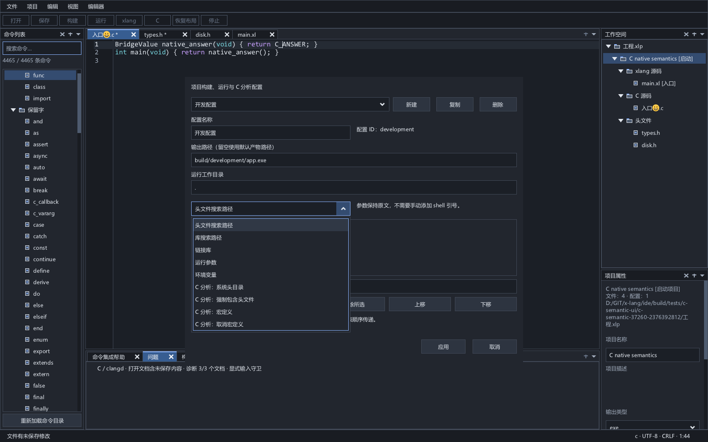

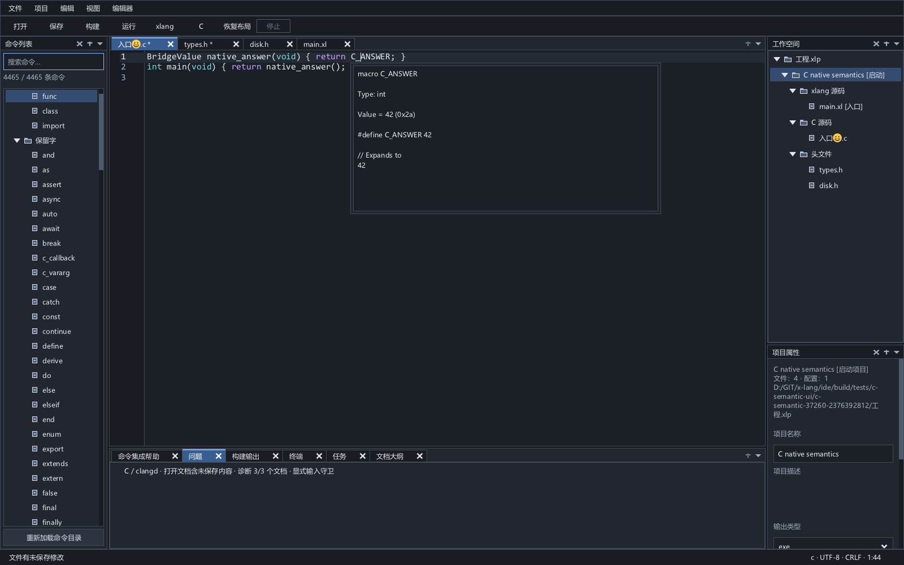

下一步继续编译器自动导出并核验未保存 xlang 声明与 TCC 系统环境、完整预处理/项目输入图。强制头内的间接 include 和系统头仍未自动完整入图，复杂工程完整解析的性能待测。全局状态修复、资源创建/新 XLON、实体输入/DPI、正式依赖/许可证及干净环境安装发布仍未完成；不据本轮成功宣布整个 IDE 完成。

## 2026-10-07 同批次 C 声明桥接查询基础

长期目标保持 active。编译器新增 c-bridge --json 与 xlcCBridge：一次新单元加载、真实 XLIR lowering 和 native ABI 头生成后，最终复核同批来源/候选/包环境；未保存入口和递归 xlang 源码沿用已有覆盖合同。实际 C wrapper 与查询共用运行时前导和 XL6_MODULE_H 保护符，未推断或补造原型。失败返回 complete=false/空声明，结果上限为 1 MiB，普通 Cgen 不受此查询上限影响。

最终完整隔离编译器重建退出 0，内嵌资源与新驱动一致。冻结后的 31 次真实 CLI/DLL 调用核验 23 份结果：入口 BOM/CRLF/Unicode、递归覆盖、虚拟新文件、语法/语义/导入/来源冲突、恢复、同上下文已缓存编译后的磁盘刷新、内存入口权威性与上下文隔离，以及近限/超限整批行为。查询声明、普通 Cgen 与实际 TCC sidecar module.h/wrapper 逐字节一致，真实 C/xlang 混编产物运行退出 0。运行版 xl.dll 延续精简合同，不导出 XLC 查询，负面门禁已实际确认。

同一冻结工具链的现有快照/定义/大纲/补全协议为 57/32/26/66 项，共 181 项，全部通过；公开语义索引 API 另通过 26 次调用、706 节点/673 范围核对。真实 clangd 环境和混编门禁通过 700 条断言。本轮未改动 IDE 应用、测试、工具和数据源码；其先前完整 65 模块/52 类验收的输入和 67 个程序/DLL 原指纹逐项保持。本轮没有重跑整套 GUI 截图，不把此前图算作新增验收。

1,440 个隔离编译器源/资源输入与 10 份本轮合同/源码输入冻结核对；新工具链的 10,156 份文件在回归前冻结并在结束后复核，325 份原字节基线保留。历史 22,699 份编译器文件、官方 clangd 354 份文件和固定 SDK 核验一致，共享 DEMO6 发布二进制保持原指纹。实际 IDE 目录进程审计和本轮差异见最终证据。

保留修复过程：测试工具编码名、相对输出根与字节常量修正；xlang C ABI 采用实际 c_double，CLI 去 BOM/保留 CRLF 按真实注册正文验证；项目混编使用驱动实际 cSources 字段，运行版 DLL 按真实导出范围验收。门禁另发现新 CLI 将参数值 --json 当作标志，已改用尊重值和 -- 边界的现有扫描器；完整资源重新生成后冻结重跑成功，没有放宽来源或声明校验。

证据：[查询设计](../../demo6/docs/IDE原生C声明桥接接口.md)、[最终核验](../build/c-bridge-query-final-verification.json)、[完整编译器构建](../build/c-bridge-query-final-compiler-build.log)、[最终门禁](../build/c-bridge-query-final-gates.log)、[桥接记录](../build/c-bridge-query-final-bridge.log)、[新工具链指纹](../build/c-bridge-query-toolchain-snapshot.json)、[冻结输入](../build/c-bridge-query-final-inputs.json)、[原字节备份](../build/c-bridge-query-before.json)、[差异](../build/c-bridge-query-changes.diff)。早期诊断留在 c-bridge-query-initial/second/third/fourth/fifth/sixth/seventh 日志，已通过的阶段记录保留在 eighth 日志；最终验收以 final 文件为准。

此基础尚未被原生 C 会话自动消费，当前 GUI 的生成声明仍需显式强制头配置。cInputsObserved=false；TCC 有序搜索环境、内嵌系统/运行时头、完整 C 预处理/项目输入图和未保存 xlang 声明的 GUI 自动撤销/重建继续接入。全局状态修复、资源创建/新 XLON、性能、实体输入/DPI 及成套发布/许可证/干净安装仍需完成，不据本轮查询通过宣布整个 IDE 完成。

## 2026-10-07 TCC 配置与真实内嵌头桥接基础

长期目标保持 active。编译器新增 opt-in --c-environment / xlcCBridgeWithEnvironment，复用真实 TCC 配置访问器，按调用顺序输出 exe/shared 选择、选项、定义、目录与原生 C 模块选择。原声明查询保持原合同。准确内嵌头读取使用现有解包路径，返回原始字节、长度、摘要和 Base64；公开/内部 VFS 头同步声明，调用方提供缓冲区，内部内存仍在原堆释放。

完整隔离编译器重建通过。新增门禁通过 17 次实际命令、12 份响应：9 份成功环境各含 165 个公开头，共 1,485 次原始字节/长度/摘要对照，单份共 13,972,580 字节。覆盖实际未保存声明、exe/shared 与项目 kind 冲突、原生 C 特性选择、参数值/边界、语义失败清空、公开 API 大小查询/容量、规范准确名，以及同名磁盘/动态覆盖优先级。超限环境被整体拒绝，普通声明查询仍可继续。真实 clangd 消费导出的运行时头和生成 ABI 声明检查退出 0，真实 C/xlang 混编产物运行退出 0。

同一工具链的旧声明门通过 31 次调用/23 份响应；快照/定义/大纲悬停/补全协议为 57/32/26/66，共 181 项。公开语义索引 API 通过 26 次调用、706 节点/673 范围；实际 C 环境与混编门通过 700 条断言。本轮 IDE 应用、测试、工具、数据的 209 份输入和 67 个发布程序/DLL 均保持上次完整验收指纹；没有重建 GUI 或新增截图，不把历史图计入本轮。

新工具链冻结的 10,180 个文件与 721 项资源来源/关键编译输入、12 项仓库源/测试输入结束复核；331 份原字节基线保留。历史 22,699 个编译器文件、上轮桥接工具链的 10,156 个冻结文件、官方 clangd 354 文件及 SDK 均核验。上轮工具链另有 30 个早于本轮基线的非冻结缓存/sidecar 输出，独立记录；新工具链的混编新增 4 个 sidecar 输出亦独立归档。共享 DEMO6 发布二进制保持。验收后 IDE 目录进程审计为 0。

修复日志保留：长隔离路径使既有批处理 GCC 命令超过 Windows 长度边界，改用短目录后解决；公开 libtcc.h 包含的 VFS 头缺少新增原型，同步必要声明后完整重建通过。依赖集合初次核验把上轮已存在的非冻结临时输出当成新增，核对原冻结文件摘要及输出创建/修改时间后单独登记，没有放宽源/二进制指纹检查。

证据：[接口合同](../../demo6/docs/IDE原生C声明桥接接口.md)、[最终核验](../build/c-bridge-environment-final-verification.json)、[完整重建](../build/c-bridge-environment-rebuild.log)、[新增真实门禁](../build/c-bridge-environment-initial-gate.log)、[兼容回归](../build/c-bridge-environment-regression-gates.log)、[新工具链指纹](../build/c-bridge-environment-toolchain-snapshot.json)、[冻结输入](../build/c-bridge-environment-final-inputs.json)、[依赖保护](../build/c-bridge-environment-protected-verification.json)、[原字节基线](../build/c-bridge-environment-before.json)、[差异](../build/c-bridge-environment-changes.diff) 和 [服务接入说明](c-language-service.md)。初次构建/短路径原型错误与集合诊断日志继续保留，本轮以 rebuild 和通过门禁为准。

原生 C 会话尚未自动消费本接口，GUI 仍使用显式强制头。下一步把同批未保存 xlang 声明、配置和准确头输入接入异步会话，绑定文档/模型/工具链版本，输入变化时撤下过期结果并全量重建。环境 complete 只覆盖配置和资源传输，完整 C 预处理图、TCC 内建宏及 ABI 等价性明确未保证。完整项目图、全局状态修复、资源创建/新 XLON、性能、实体输入/DPI、许可证、干净安装与成套发布仍需完成。

## 2026-10-07 原生 C/xlang 自动声明与环境桥接

原生 C 分析与补全现在自动复制活动工程、配置、工具链及全部打开命名 xlang 草稿，在后台查询真实编译器的同批 ABI 声明和 C 环境。未保存入口及递归 xlang 来源使用原快照合同，不向用户 C 文档插入前导、不修改正文或坐标。工作台布局保持左命令、右上工作空间/右下属性、中央编辑器下方底栏和单栏帮助。

同一工具链的 165 份准确内嵌头按原始长度与 SHA-256 核对，共 13,972,580 字节；多个工程共享只读资源缓存，各自使用独立真实 ABI 声明与有序配置。VFS fallback 保持真正磁盘头优先和原包含路径。拥有项目的显式 C/header 输入、强制头、真实工具链、查询来源/包环境及同名磁盘候选持续观察；xlang 编辑、语言绑定、项目/配置或已观察磁盘变化会撤下旧诊断、提示和补全，再异步重建。旧编译器明确提示后退回普通 C 分析，不沿用旧声明。

实际 clangd 对空主文件前导的强制头函数补全需要额外索引：补全会话先分析本轮真实私有 ABI 头并等待当前版本通知，再查询用户原坐标；没有补造声明或重写标准结果。普通 C 用户文档上限仍为 64，补全仅额外拥有一个私有头。该头只供会话使用，普通 F12 拒绝打开它成为可编辑用户文件；映射到真实 xlang 导出来源尚未完成。分析会话保留完整解析以覆盖强制头宏重定义；补全的预编译宏回放与 TCC 内建宏/ABI 等价性仍需继续核验。

完整严格 Release 构建和冻结输入后的 54 类回归均退出 0：66 模块、59 个公共动作、181 项 xlang 协议检查、110 张本轮最终运行产生的原生图，真实 C/xlang 混编运行、失败构建拒绝旧产物和 SDK 负面门禁通过。新增后端覆盖两个工程各自的 double/int ABI、复制草稿隔离、真实系统/运行时头、磁盘优先级与出现失效、错误草稿、旧工具链回退、重复归属拒绝和取消。新增原生门禁覆盖 double/int 的真实诊断/悬停/函数补全、自动重建、旧 Enter 拒绝、错误草稿撤下与有界恢复、语言绑定、取消及原始 C/xlang 文件字节保留；36 条后端与 60 条原生断言只用于定位门禁，不以数量代替实际行为验收。

最终两张浅/深色原生图已实际查看，候选原始 JSON 和诊断/悬停输出保留。213 份源码/测试/工具/数据、7 份功能合同及 62 个构建产物在最终回归前冻结，回归后逐项复核；319 份原字节备份保留。历史 22,699 份编译器文件、上轮桥接的 10,156 份文件、本轮所用环境工具链的 10,180 份文件、官方 clangd 的 354 份文件、SDK 和共享 DEMO6 发布二进制分别核验。既有非冻结输出与环境工具链的 4 份 sidecar 单独验证，没有修改这些固定依赖。测试后的 IDE 目录进程审计为 0。

首次整套回归在 3840×2097 的独立最大化窗口截图返回 -5；SDK 头确认该码为内存不足，当时系统虚拟内存余量偏低。失败日志保留。同一冻结版本的单独窗口门禁及随后整套回归通过，未修改或放宽窗口测试；不能据此证明所有高压力设备问题已经解决。修复期的大响应管道吞吐、过期私有测试辅助函数和真实 clangd 强制头补全诊断也保留，本轮验收以最终冻结运行记录为准。

证据：[接入合同](c-xlang-bridge.md)、[最终核验](../build/c-bridge-native-final-verification.json)、[严格完整构建](../build/c-bridge-native-release-build.log)、[最终完整回归](../build/c-bridge-native-final-regression.log)、[冻结输入](../build/c-bridge-native-final-inputs.json)、[最终运行绑定](../build/c-bridge-native-final-run.json)、[依赖保护](../build/c-bridge-native-protected-verification.json)、[视觉检查](../build/c-bridge-native-visual-inspection.json)、[进程审计](../build/c-bridge-native-process-audit.json)、[原字节基线](../build/c-bridge-native-before.json)、[改动清单](../build/c-bridge-native-changes.json)、[差异](../build/c-bridge-native-changes.diff) 和 [文档链接核对](../build/c-bridge-native-doc-links.json)。另保留 [首次截图失败](../build/c-bridge-native-full-regression.log) 与 [同版窗口门禁](../build/c-bridge-native-window-isolation.log)。

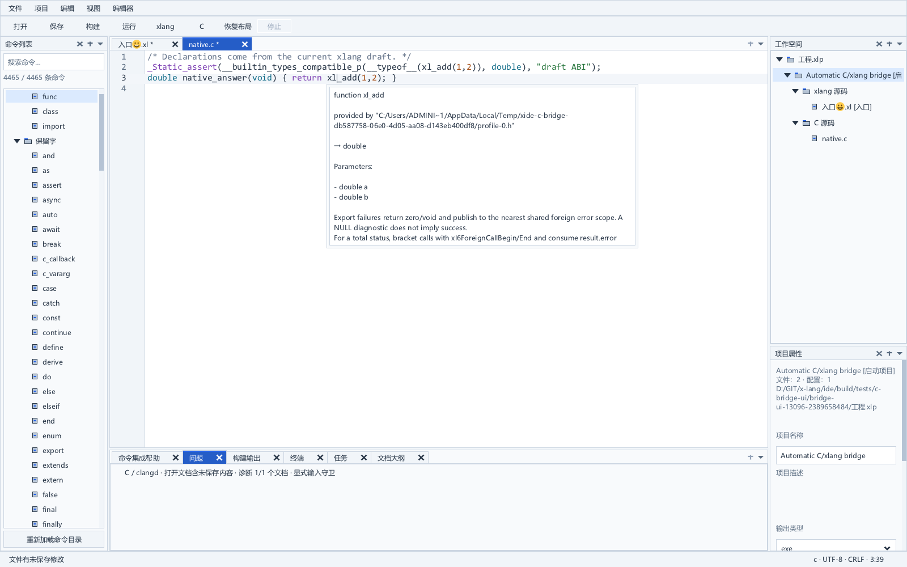

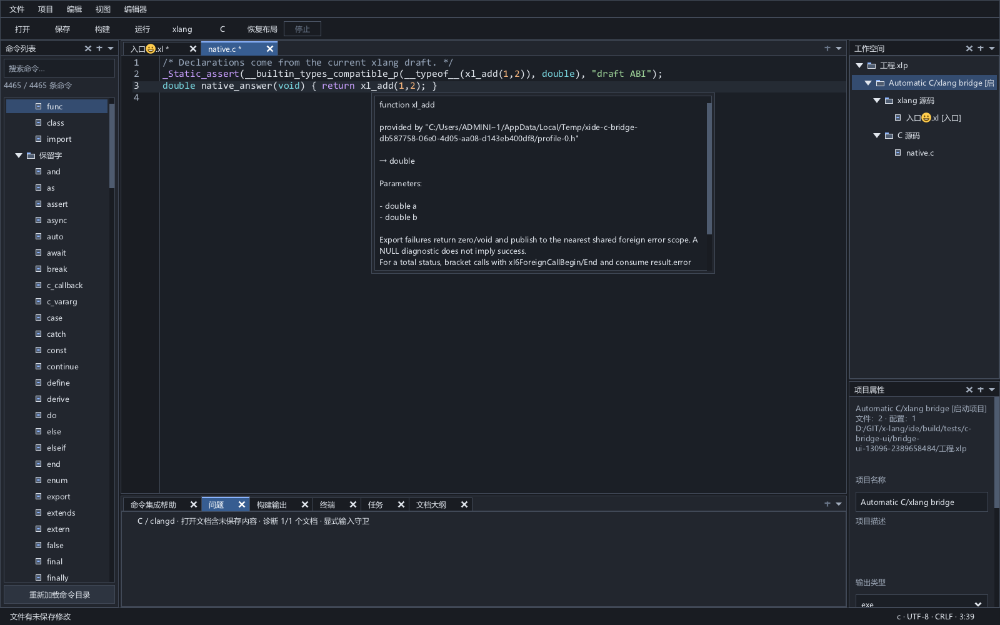

长期目标继续 active。下一步补齐完整 C 预处理与项目输入图、失败包观察、C 导出到 xlang 来源的定义映射，以及 TCC/clang 宏和 ABI 兼容边界。全局状态修复、资源创建与新 XLON、复杂工程性能、实体输入/混合 DPI、正式依赖/许可证、干净安装和完整首版验收仍有必需工作。


## 2026-10-07 导出声明的同批源码映射基础

编译器 c-bridge 查询现在附带 declarationMap。真实 ABI 头发射器记录导出函数和全局变量 C 标识符的准确字节区间，并提供 lowered symbol/storageSymbol；来源连接使用同次 checked AST 的 semanticDeclaredSymbolId 与同批 sourceReport，不按函数名猜测。导出别名、同名重载、递归导入和未保存草稿保留各自真实源码名称范围；编译器生成的辅助入口与公共类型不在本次映射种类中。

headerRange 位于 declarations 原文，组合私有头时需要核算实际 runtimePreamble；xlang 范围沿用可选 BOM 之后的 UTF-8 半开区间及一基 Unicode scalar 行列。未知范围、没有加载来源或声明身份不唯一返回 null；complete 不把未映射条目冒充成功。映射预算不足时明确 records=[]/complete=false/source-map-unavailable，原本有效的 ABI 查询可继续；普通头文本与 1 MiB 查询上限保持原合同，失败不返回旧声明或映射。

最终独立编译器和内嵌资源完整重建通过。冻结后的 11 组相关门禁全部退出 0：新增映射 14 次实际命令/10 份有效范围响应，另实测 32,769 个 C 整型导出：生成 949,094 字节真实 ABI 头，导航记录超限时 complete=false/records=[]，声明查询成功且与同保护宏的普通 Cgen 头逐字节相同，原声明 31 次命令/23 份响应，环境 17 次命令/12 份响应与 1,485 次准确头比较；公开语义索引 API 26 次调用、706 节点/673 范围，xlang 快照/定义/大纲悬停/补全 57/32/26/66 共 181 项。真实 C 环境和混编运行通过 700 条断言，自动桥接后端 36 条，原生草稿诊断/悬停/补全、失效重建与取消通过 70 条；两张本轮新产生的浅/深色兼容图已查看。原生断言包含就绪轮询，不以数量代表质量。

本轮 IDE 的 213 份源码/测试/工具/数据、7 份既有功能合同与 62 个构建产物保持上次完整 66 模块/54 类验收指纹，没有重建 GUI 或把两张兼容图说成新的整套验收。新工具链 8,622 份文件及 9 份仓库来源/合同输入在门禁前冻结，结束全部复核；83 份新增 semantic-index 测试输出与混编 sidecar 独立登记。334 份原始字节基线保留。历史固定编译器、原桥接/环境候选、上一份映射候选的 8,622 个冻结文件与 83 个输出、官方 clangd、SDK 和共享 DEMO6 发布程序保持；对已授权仓库源码变更记录原基线与新摘要。最终 IDE 目录进程审计为 0。

修复记录保留：首次真实查询没有启用解析器范围采集，虽有正确 C 声明，目标明确为 null；随后为桥接启用已有来源元数据并重建，真实范围门禁通过。额外复核去掉了早于原 1 MiB 头检查的别名限制，且导航元数据容量不再缩小普通 ABI 成功范围。最后复核又修正头发射回调的记录数量上限，使可选映射预算不足不会中止 ABI 发射，并在新的独立候选完整重建。容量用例首次因 xlang int 声明长度触及原 1 MiB 头上限；改用实际 c_int 后回退成功，再统一普通头文件名对应的保护宏完成严格字节对照，均保留失败原日志且没有放宽上限。一次批处理重建无输出返回非零，明确 call 的后续完整构建与最终冻结运行通过；没有使用该失败阶段作为验收。

证据：[接口合同](../../demo6/docs/IDE原生C声明桥接接口.md)、[真实映射门禁](../../demo6/tools/check_c_bridge_map.py)、[最终核验](../build/c-bridge-map-final-verification.json)、[最终完整构建](../build/c-bridge-map-final-build.log)、[相关冻结回归](../build/c-bridge-map-final-gates.json)、[映射实际输出](../build/c-bridge-map-final-map.log)、[冻结输入](../build/c-bridge-map-final-inputs.json)、[新增输出](../build/c-bridge-map-post-freeze-artifacts.json)、[依赖保护](../build/c-bridge-map-protected-verification.json)、[原字节基线](../build/c-bridge-map-before.json)、[视觉核对](../build/c-bridge-map-visual-inspection.json)、[进程审计](../build/c-bridge-map-process-audit.json)、[改动清单](../build/c-bridge-map-changes.json) 和 [差异](../build/c-bridge-map-changes.diff)。首次 [null 目标诊断](../build/c-bridge-map-initial-gate.log)、[范围修复验证](../build/c-bridge-map-second-gate.log) 与 [空输出构建失败](../build/c-bridge-map-rebuild-evidence.json) 均保留。新增 [头字节上限用例记录](../build/c-bridge-map-capacity-int-final-gates.log)、[保护宏差异记录](../build/c-bridge-map-capacity-guard-final-gates.log) 和 [上一份候选验收](../build/c-bridge-map-pre-capacity-final-verification.json)；最终证据绑定本轮新候选。

长期目标继续 active。本轮完成编译器准确来源映射基础，原生 F12 尚未消费该映射；下一步在 C 后台会话中把真实私有头目标转换为同批来源元数据，补齐较大映射的客户端解析预算、打开/关闭或虚拟 xlang 文档版本与磁盘守卫，再通过真实 GUI 验收。完整预处理/项目图、宏与 ABI 兼容、全局状态修复、资源创建/新 XLON、复杂工程性能、实体输入/DPI、依赖许可证、干净安装和完整首版验收继续实施。


## 2026-10-07 原生 C 到 xlang 导出定义跳转

C 编辑器的 F12 和公共“转到定义”现消费编译器 declarationMap，把真实 clangd 私有生成头目标转换为同批 xlang 源码位置。先核对查询 C 文件的拥有项目、准确私有头及 C 标识符区间，再使用 checked AST/sourceReport 的绑定；两个项目中的相同 C 导出分别跳转，导出别名与重载保留真实 xlang 名称。原始标准回复保留，转换目标为独立事件元数据。

打开的 xlang 目标重新校验稳定文档身份、版本、显示语法和正文摘要。未打开来源必须已有本会话磁盘观察；调用时复核最多 8 MiB 原始正文、物理身份和打开后的基线，保留 BOM/CRLF。命名恢复草稿可直接定位，尚未存在的物理文件不会因此创建；旧版本、变更磁盘或不再绑定 xlang 语法的结果被拒绝。每个来源经过一次有序扫描，从原始 UTF-8/Unicode scalar 转为 UTF-16，覆盖中文、非 BMP、BOM、CRLF。

桥接专用输出上限为 80 MiB，普通进程仍为 16 MiB；JSON 值/容器预算可消费较大真实映射。映射和紧凑绑定各有 8 MiB/32,768 条上限，整个会话导航注册表限 32 MiB。旧接口缺少、超限或无效的可选映射会撤下相应导航，已经验证的 ABI 分析与补全仍可使用。公开类型及编译器生成的辅助符号仍不在此次映射范围。

完整严格 Release 构建通过；更新进程容量边界测试后使用相同严格参数单独重链，再冻结最终 217 份源码/测试/工具/数据、7 份功能合同和 64 个活动产物。最终 56 类完整回归、181 项 xlang 协议检查、真实混编构建运行及 SDK 负面门禁均退出 0，本次最终运行共 113 张新鲜原生图。新增实际 4,097 条导出验证原生解析、坐标、非法范围拒绝和可选接口降级；原生键盘 F12 验证草稿函数、全局、两个重载、未打开导入文件、同名导出的项目隔离、磁盘变化拒绝、恢复草稿与语言绑定。后端使用真实回复检验错误项目/区间拒绝和等价 LocationLink。三张浅/深色及导入目标图已实际查看。

本轮保留 335 份原文件和 69 份发布程序/DLL 原字节备份。当前映射工具链的 8,622 份冻结文件、83 份既有输出及 9 份仓库输入复核，历史工具链、官方 clangd 与固定 SDK 也分别核验；共享编译器源码合同和发布二进制在本轮保持。新编译器/clangd 的正式依赖配置、许可证和安装验收继续实施。

失败记录保留：桥接最初请求 80 MiB，扩展进程接口仍限 68 MiB，随后同步有界接口并验证 80 MiB 可用、81 MiB 拒绝。来源路径的斜杠差异改为词法路径核对；Windows 临时目录短名称与 clangd 规范长名称的差异，通过创建私有缓存前规范化已有临时根解决。恢复草稿夹具改用工作空间实际项目 ID。首次完整回归因旧 69 MiB 超限断言失败；修正后重新冻结并完整重跑，本节以最终运行证据为准。

证据：[接入合同](c-xlang-bridge.md)、[最终核验](../build/c-navigation-final-verification.json)、[完整严格构建](../build/c-navigation-final-build.log)、[最终完整回归](../build/c-navigation-final-regression.log)、[冻结输入](../build/c-navigation-final-inputs.json)、[运行绑定](../build/c-navigation-final-run.json)、[依赖保护](../build/c-navigation-protected-verification.json)、[视觉检查](../build/c-navigation-visual-inspection.json)、[进程审计](../build/c-navigation-process-audit.json)、[原字节基线](../build/c-navigation-before.json)、[改动清单](../build/c-navigation-changes.json)、[差异](../build/c-navigation-changes.diff)、[文档链接核对](../build/c-navigation-doc-links.json)、[首次回归失败](../build/c-navigation-first-final-regression.log)、[容量边界门禁](../build/c-navigation-process-boundary.log) 和 [严格边界重链](../build/c-navigation-process-relink.log)。

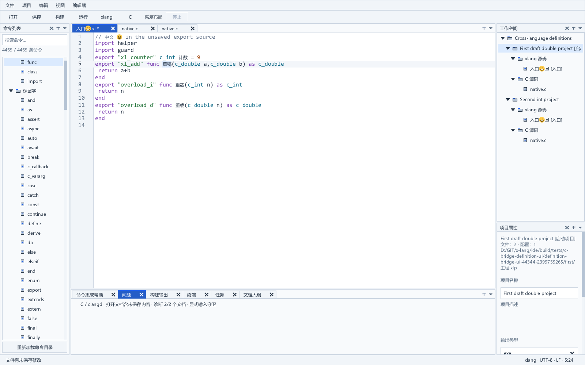

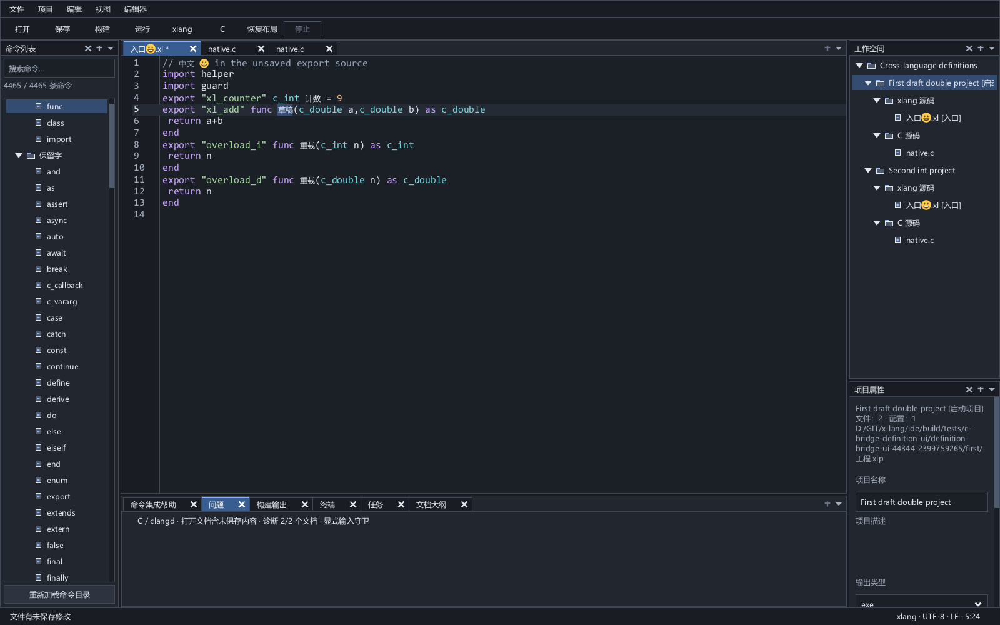

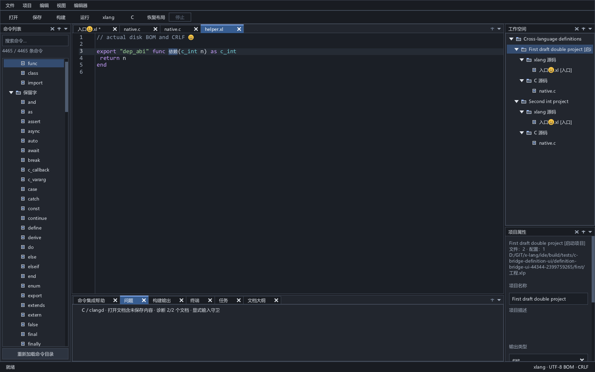

长期目标继续 active。下一步补齐 C 预处理与项目输入观察图、失败包观察、公共类型及更多跨语言导航、TCC/clang 宏与 ABI 边界。全局状态修复、资源创建与新 XLON、复杂工程性能、实体输入/混合 DPI、正式依赖/许可证、干净安装和完整首版验收仍有必需工作。


## 2026-10-08 Windows 便携候选与工具链路径迁移

首个通过验收的独立候选保存到 [portable-20261007](../dist/portable-20261007/)，包含主程序、诊断程序、xlang 服务、固定 xge.dll、4,465 条命令/45 份内嵌长文档、独立 xlang/clangd 工具链和来源材料。载荷 2,472 个文件，manifest 列示 296,426,147 字节（另含 manifest）；ZIP 107,277,761 字节。开发 release 的测试程序、探针、工具脚本和用户 option 未复制。完整扩展资产保留，核心 PE 导入已核对；不据此声称所有扩展均经过运行。命令目录保留原始生成来源，未把其 compilerSha256 冒充随包工具链指纹。

装配器检查冻结输入、资源目录、连接点、文件预算、每份复制件及 ZIP 的字节，发布到新建阶段后一次改名，不覆盖既有候选。默认设置使用相对编译器和 C 服务器路径。程序自身默认设置选回 toolchains 下的工具仍保存相对路径；外部设置和外部工具保持绝对绑定。未知字段和用户选择的系统字体/字号保持。候选运行不要求 Python 或 GCC；开发 Python 仅用于装配和验收驱动。

新原生 portable_view_test 使用隔离桌面上的实际默认 GUI 设置分支，从 ZIP 私有副本启动；无 compiler/cServer/catalog/settings 参数覆盖，PATH 只含 Windows 系统目录。它确认两个工具确实位于当前包，检查真实 C/xlang token、准确 Dock 几何、离线帮助数据、未保存中文/emoji xlang 的 C F12 和混编打印 PORTABLE_MIXED_42。保存相对工具和两套字号/未知字段后，整个程序目录迁移到新的中文空格路径，原运行目录消失，再次启动、分析、跳转、构建/运行和恢复设置。实际 GUI/诊断主程序各启动两次，并打开可见单栏帮助。新增夹具只注入私有验收副本，未进入 ZIP。

15 项真实文件与归档负面检查覆盖越界、驱动器/反斜杠、大小写重复、符号链接、设备名、文件目录冲突、错误根、超限条目、既有解压目标、既有候选、范围外发布、已修改用户数据、篡改目录及缺失运行头；无效归档在创建解压目录前失败。包及原提供者字节在运行后复核。便携专门验收包含 12 张新原生图；校正后的独立门禁中三张帮助、F12 和迁移混编图已实际查看并保存，完整串行回归另生成同样内容的新图。

迁移实际暴露编译器的 ANSI 模块目录定位。demo6/src/api/xl_api_path.c 改为 Windows Unicode 模块接口后转为 UTF-8；保留现有 512 字节缓冲，不宣称所有长路径可用。修复在全新 portable-compiler-60c184ee-409c-4b75-a215-e6744c121225 来源快照完整重建；8,622 个文件和 10 份仓库输入冻结，新产生的 83 份非冻结输出独立登记。11 组工具链相关门禁全部退出 0，包括实际映射/超限降级、准确内嵌头、C 环境、语义 API、181 项协议和原生桥接/混编。共享 demo6/release 和历史工具链/SDK 未覆盖。

完整严格 IDE Release 构建通过；修正命令选择的布尔返回值断言后，用同样严格参数重链便携夹具，再冻结最终 221 份源码/测试/工具/数据、7 份功能合同及 65 个活动产物。测试脚本的提前 exit 已调整，新增门禁在退出之前执行。最后串行完整回归覆盖 67 应用模块、57 注册测试类、181 协议检查、125 张新鲜原生图、真实混编及 SDK 负面门禁，退出 0。343 份原文件（含修改前补录且核对旧候选的模块路径文件）和 71 份原发布程序/DLL 字节备份保留。

失败保留：初次负面 ZIP 夹具缺少普通文件类型位，后来补齐以实际触发容量边界；Windows 环境变量名在 Python 中为大写，驱动已按不区分大小写定位；原工具链在中文运行目录中无法收集 C 环境，原 first 候选已标记失败；原生夹具把命令选择的布尔成功错判为 XUI_OK，已修正。首次并行全回归的链式未保存头文件悬停未返回预期 double，219 断言独立回放和最终串行回归通过，原因尚未确认，不称已修复，纳入 C 输入图/时序观察后续工作。首次串行回归因脚本提前退出，仅覆盖原 56 类；保留该次日志，最终证据绑定修正入口后的完整运行。

证据：[发行合同](portable-distribution.md)、[最终核验](../build/portable-final-verification.json)、[严格完整构建](../build/portable-final-build.log)、[夹具严格重链](../build/portable-fixture-relink.log)、[最终串行回归](../build/portable-final-regression.log)、[冻结 IDE 输入](../build/portable-final-inputs.json)、[本轮编译器构建](../build/portable-compiler-build.log)、[工具链 11 组门禁](../build/portable-compiler-final-gates.json)、[编译器冻结输入](../build/portable-compiler-final-inputs.json)、[非冻结输出](../build/portable-compiler-post-freeze-artifacts.json)、[便携运行绑定](../build/portable-last-run.json)、[装配回执](../dist/portable-20261007/package-receipt.json)、[原字节基线](../build/portable-before.json)、[依赖保护](../build/portable-protected-verification.json)、[三图视觉检查](../build/portable-visual-inspection.json)、[进程审计](../build/portable-process-audit.json)、[变化清单](../build/portable-changes.json)、[差异](../build/portable-changes.diff)、[链接核对](../build/portable-doc-links.json)、[原工具链中文路径失败](../build/portable-third-gate.log)、[原生夹具失败](../build/portable-standalone-gate.log)、[首次全回归悬停失败](../build/portable-first-final-regression.log)、[悬停独立回放](../build/portable-c-language-replay.log) 和 [提前退出的串行回归](../build/portable-before-script-final-regression.log)。

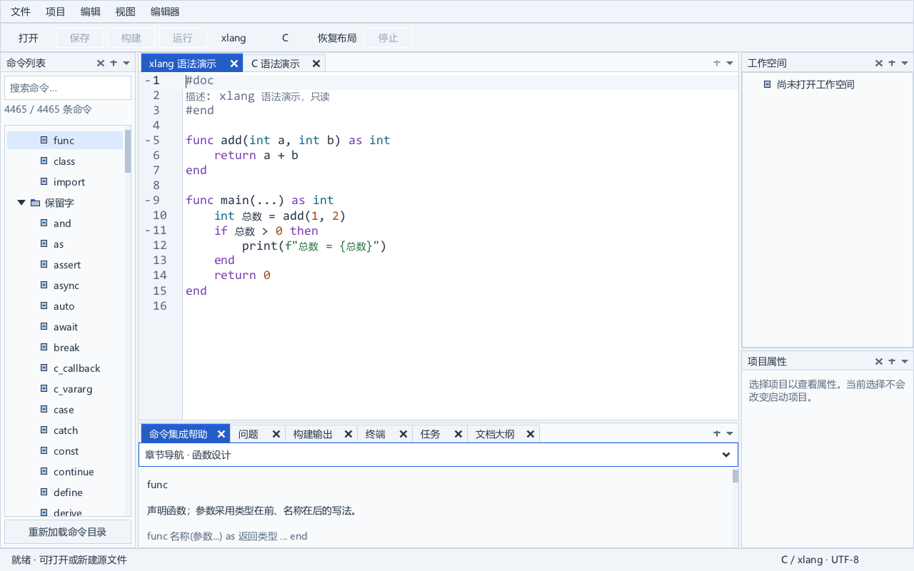

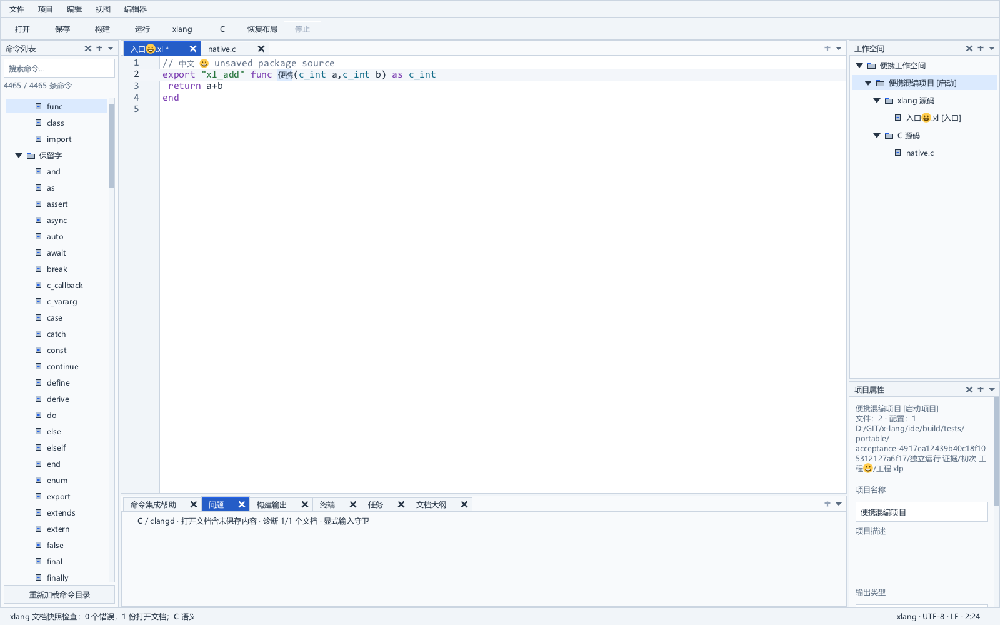

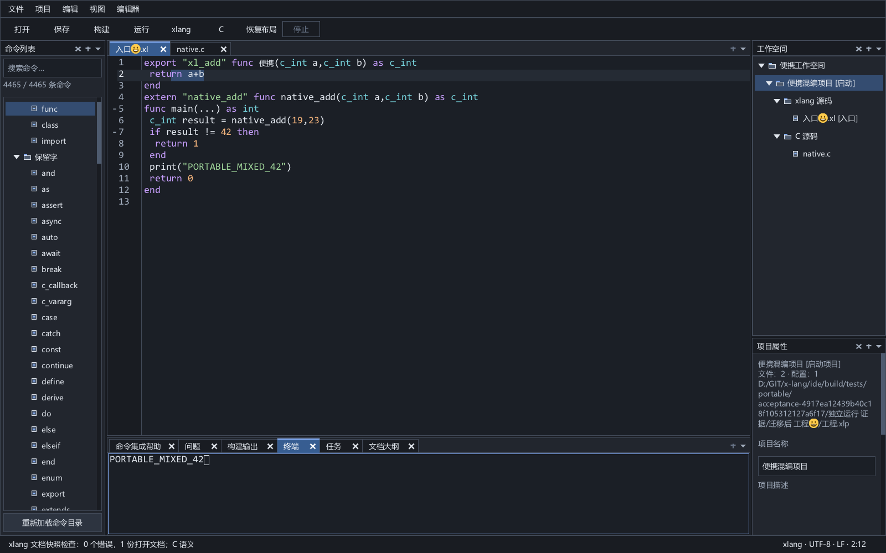

长期目标继续 active。候选不是正式首版或全部干净设备安装证明；完整 C/项目观察图、头文件时序、公共类型和更多导航、宏/ABI 边界、全局状态修复、资源/XLON 创建、跳转行与编辑定位、复杂项目性能、实体输入/混合 DPI、全部依赖/发布材料和最终逐项首版验收仍需实施。

## 2026-10-08 C 首次解析的完整草稿快照

当前严格 Release 构建及完整串行回归退出码均为 0：**67 个应用模块、58 类测试、181 项 xlang 协议检查、126 张本次运行的新鲜原生 PNG**。新增草稿启动门为 42 项断言，既有 C 后端为 221 项，原生 C 语义为 183 项；完整回归也执行了新便携包的实际验收。定版布局、C/xlang 双语法、桥接 F12 和构建运行保持通过。

修复启动时父头文件可能读取依赖磁盘旧类型的问题。clangd 的 forceRebuild 异步更新 preamble，空 didChange 不是就绪屏障。现在启动进程前把整批复制的 C/头文件写入会话独立的临时 VFS，注入全部编译条目并保留原始路径；首次解析即可读取全部草稿。文件以 CREATE_NEW 创建、句柄禁止其他写入并在关闭时删除；停止或失败先回收服务器再清理自有文件和空目录。用户项目、原始头文件和调用者的 compilation database 不改写。

确定性对照使用真实 clangd，故意把依赖头的 didOpen 延迟到首个语义回复以后。旧服务返回 **Type: int**，修复后悬停与补全读取草稿 **double**。旧服务来自本轮开始前的原字节备份，独立重链程序、源码、66 个关联对象、SDK 和真实失败 JSON 共 73 项输入固定核验。上轮偶发回归没有记录失败响应，不能证明其精确因果；原失败日志仍保留，本轮依据有真实响应的时序对照与完整验收报告修复。

新门还验证并行 generation 的不同类型、新建未落盘头文件、带保护的循环包含、普通物理头文件回退、用户 VFS/-- 参数优先级、调用者编辑后已复制正文不变、写入拒绝和停止清理。原生界面验证 types.h → 未保存 leaf.h 的 double 悬停；随后修改 leaf 为 const char*，旧语义失效并重新返回新类型，磁盘头文件原字节保持。

新候选在 [portable-20261008-drafts](../dist/portable-20261008-drafts/)，运行 [xlang_ide.exe](../dist/portable-20261008-drafts/xlang-ide/xlang_ide.exe)，归档为 [Windows x64 ZIP](../dist/portable-20261008-drafts/xlang-ide-windows-x64.zip)。载荷 **2,472 文件、296,433,739 字节**；15 个实际归档/提取拒绝门、两次默认原生运行、四次包内 GUI/控制台运行与 12 张便携截图通过。中文空格目录迁移、相对工具路径、保留偏好和真实混编仍通过。上一便携候选及固定编译器目录原字节保留。

本轮保存 342 份 IDE 原文件、72 份发布程序/DLL 原字节备份；222 个源/测试/工具/数据输入、7 份合同及 66 个活动构建输出在验收前冻结并在验收后核对。独立编译器 8,622 份冻结文件、83 份既有非冻结输出和 10 份仓库输入保持；历史工具链、官方 clangd 和 SDK 另做验收后核对。源码、测试、入口及文档等 10 项本轮变化单独记录，原有仓库工作状态不作为本轮改动归因。

证据：[C 服务合同](c-language-service.md)、[最终核验](../build/c-draft-final-verification.json)、[严格完整构建](../build/c-draft-build.log)、[完整回归](../build/c-draft-final-regression.log)、[冻结输入](../build/c-draft-final-inputs.json)、[运行绑定](../build/c-draft-final-run.json)、[旧服务确定性失败](../build/c-draft-original-replay/proof.json)、[便携运行](../build/c-draft-package-run.json)、[装配回执](../dist/portable-20261008-drafts/package-receipt.json)、[依赖保护](../build/c-draft-protected-verification.json)、[视觉检查](../build/c-draft-visual-inspection.json)、[进程审计](../build/c-draft-process-audit.json)、[原字节基线](../build/c-draft-before.json)、[本轮变化](../build/c-draft-changes.json)、[差异](../build/c-draft-changes.diff) 和 [文档链接核对](../build/c-draft-doc-links.json)。

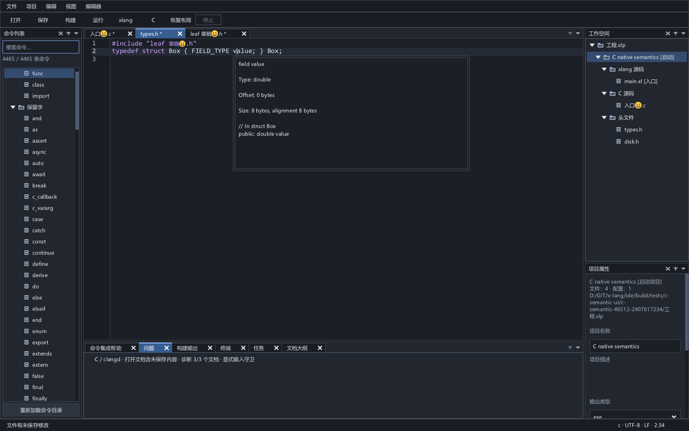

长期目标保持 active。完整 C/项目/预处理输入图、公共类型与更多跨语言导航、宏/ABI 边界、全局状态修复、资源/XLON 创建、跳转行、复杂项目性能、实体输入/混合 DPI、完整发布材料、干净 Windows 设备矩阵及正式首版逐项验收仍需实施。

## 2026-10-08 原生行列定位与导航便携候选

定版阶段 3 要求的跳转行已接入。编辑菜单、真实 CodeEdit 右键菜单和 Ctrl+G 共用稳定 ID 77 的 `editor.gotoLine`，当前注册表为 60 个动作。C/header、xlang、纯文本、未命名及只读文档均支持行号和“行:列”；坐标沿用编辑器状态栏的 Unicode 字素簇规则，中文、emoji、组合字符与 Tab 不按字节数计算。打开预填并全选当前位置，取消不改变多选区、折叠或滚动，确认不修改正文、版本、脏标记、磁盘或撤销/重做记录。

窗口确认时复核活动文档的稳定身份和版本；关闭后复用控件也不能接受旧请求。普通字段不抢占 Ctrl+G，空或非空的活动输入法组合期间 Enter 不提前确认；公共模态、文件监视暂停及界面字体回滚规则沿用既有协议。跳入折叠代码只展开包含目标行的祖先，保留其他折叠；实际文本几何与扣除滚动条后的视口提供一行相邻阅读余量，首尾由 SDK 钳制。

新增真实原生测试通过 **93 项断言**：菜单/右键/按键/按钮、正负边界和整数溢出、末尾空行、Unicode 字素簇、取消多选区及提交清除额外选区、真实组合输入、只读与三种语法、正文/磁盘/撤销/重做保留、身份/版本失效、折叠及视口几何、40 DIP 字号滚动和锁定设置回滚。125% 与 200% DPI 的四张最终实际图已查看；文档图从冻结后的完整回归输出按原字节复制。身份/版本协调器测试使用直接后端注入，菜单、输入与渲染均使用固定 SDK 的实际控件。

最终严格 Release 及完整功能验收通过 **68 模块、59 类测试、181 项 xlang 协议和 130 张新鲜原生图**，包括真实 clangd、未保存头文件首次解析、自动 ABI 声明、C → xlang F12、资源、迁移、导入、C/xlang 混编构建运行、失败构建不运行旧产物及 SDK 负面门。冻结的 **225 份源码/测试/工具/数据输入、8 份接口说明和 67 个构建产物**在验收后保持。独立编译器 **8,622 份冻结文件、83 份既有输出及 10 份仓库输入**保持；历史工具链、官方 clangd 与 SDK 另经验收后核对。

当前候选为 `dist/portable-20261008-navigation-final`：**2,472 份载荷文件、296,449,895 字节清单载荷、107,286,278 字节 ZIP**。归档 SHA-256 为 `af75d9a0fd28884487133ea41feb0fa6ef4b95a4df94427f1683dcfb41bf721e`。实际执行 15 个载荷/解压拒绝门、2 次默认原生验收、4 次打包程序启动和 12 张新图；中文空格目录、相对设置、目录迁移、未保存跨语言导航和真实混编 `PORTABLE_MIXED_42` 均通过。这是开发候选，正式首版状态保持未完成。

第一次导航版本的功能门已通过，但视觉检查发现目标行贴近底部滚动条，随后增加真实视口余量及两项几何断言并重做完整构建/回归。`portable-20261008-navigation` 保留并标记为被替代；其输入、67 个程序/DLL、日志和回执存于 `build/goto-pre-margin/`，不作为当前候选。上一完整草稿候选 `portable-20261008-drafts` 和历史 `portable-20261007` 保留原字节。本轮开始前保留 **344 份 IDE 原文件和 73 份 Release 程序/DLL**；旧 C 服务重放涉及可变 Release 对象的 **73 份历史输入**在重建前另存原字节，避免将当前对象误当旧证据。本轮 **30 项**源码、测试入口、说明和图像变化单独记录，当前原文件清单为 **350 份**。

证据：[行列定位](goto-line.md)、[最终核验](../build/goto-final-verification.json)、[严格构建](../build/goto-final-build.log)、[完整回归](../build/goto-final-regression.log)、[冻结输入](../build/goto-final-inputs.json)、[运行绑定](../build/goto-final-run.json)、[便携运行](../build/goto-package-run.json)、[装配回执](../dist/portable-20261008-navigation-final/package-receipt.json)、[依赖保护](../build/goto-protected-verification.json)、[视觉检查](../build/goto-visual-inspection.json)、[进程审计](../build/goto-process-audit.json)、[原字节基线](../build/goto-before.json)、[本轮变化](../build/goto-changes.json)、[差异](../build/goto-changes.diff)、[首次导航记录](../build/goto-pre-margin/verification.json) 和 [历史重放输入副本](../build/goto-historical-c-draft-evidence/preserved-inputs.json)。

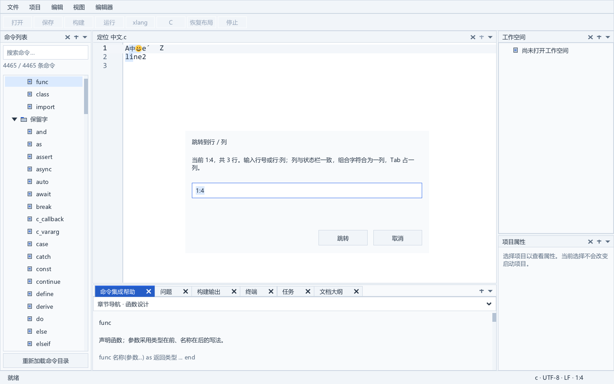

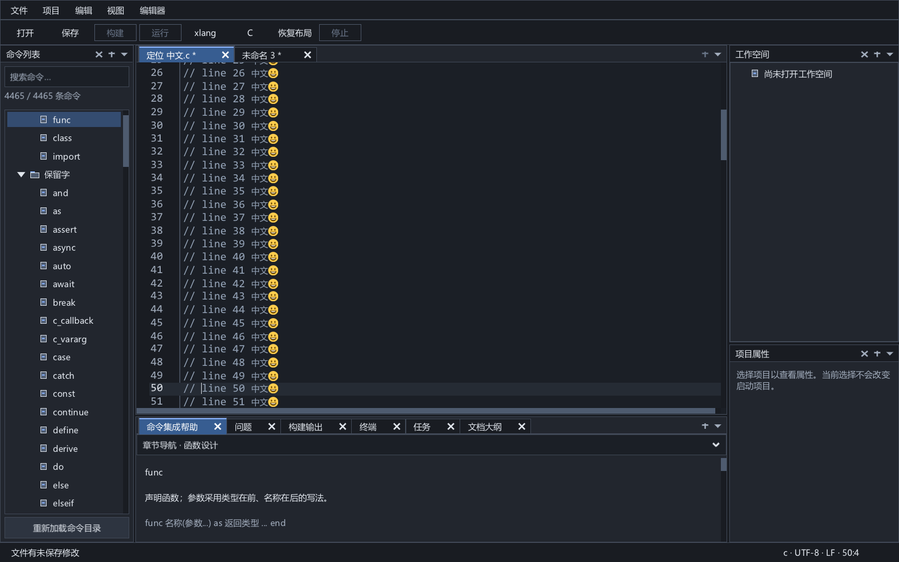

长期目标保持 active。继续完整 C/项目/预处理输入图、公共类型和更多跨语言导航、宏/ABI 边界、全局索引/窗口/偏好状态修复、资源/XLON 创建、大文件与复杂项目性能、实体输入/混合 DPI、完整发布材料、干净 Windows 设备矩阵和正式首版逐项验收。阶段 3 的跳转行已完成，阶段 3 及完整首版的其余验收要求保持。


## 2026-10-08 实际 C 编译输入观察基础

当前严格 Release 构建和最终完整串行回归均退出 0：**70 个应用模块、61 类测试、181 项 xlang 协议检查与 133 张本次运行的新鲜原生图**。定版 Dock、C/xlang 双语法、未保存草稿、跨语言 F12、Ctrl+G、真实混编构建运行和 SDK 负面门保持通过。IDE 主体保持 C；新增 C++ 适配仅位于独立的既有 LLVM/clangd 进程。

已接入可协商的 `xlangInputTrace=1`。同一固定提交的隔离 clangd 在真实物理 VFS 和响应文件展开入口记录实际读取字节、Windows 卷/文件索引、时间/长度/属性、失败存在性探测、物理路径及实际目录候选。读取和返回 Clang 的 MemoryBuffer 绑定同一个原生句柄。输入矛盾、无法观察或超限使会话失效，不伪造语义响应。IDE 在发布前和后台轮询复核服务器已经观察的基线，不能把结果返回后新采集的文件状态当作旧语义依据。

同一后台 job 现可守护未列入项目的真实间接头。真实门通过 **113 项断言**：宏展开的 `__has_include` 从缺失到出现、更靠前目录的头文件遮蔽、`include_next`、普通及嵌套 Unicode 响应文件、内置头、悬停与成员补全的实际旧/新类型，以及内容变化后的整批撤销和重建。独立协议/原子替换组件通过 56 项；原始缺失探测观察与标准悬停/补全 JSON 保留。原生界面通过 21 项，验证隐式头修改撤下旧悬停、诊断和大纲，随后返回当前类型，并通过受守护的 F12 准确定位原本未打开的头文件声明。三张本轮最终图已查看并原字节复制。新增提供者另外通过实际自动 C/xlang 桥接后端 44 项和原生桥接 60 项；断言中的轮询计数不代替语义证据。

扩展通知按 sequence/previous 有序分块，最多 65,536 个路径、单记录 256 KiB、记录区 512 KiB/128 条、去重读取内容 1 GiB、元数据 128 MiB；IDE 同时验证协议和容量。complete 仅标记待发记录已经发送，不能用于宣告所有未来操作或完整项目/TCC 预处理已完成。目录状态不把无关子文件创建时间当作语义变化；实际枚举才另行比较准确候选集合。普通官方 clangd 仍使用原有有限显式守卫。

隔离提供者来自固定上游提交 `ea7d852a70e8bdfaf601d6626a760f9771b2c4b4`。六处上游变更和五份新增适配输入、原 Git blob、patch、编译回执及原执行脚本均核验；354 份运行文件单独冻结，其中 352 份内置头与许可证沿用官方原字节。源码生成头是 LF，官方头是 CRLF，原生成文件保留，没有把两者说成逐字节一致。当前提供者摘要为 `4e1601afb4a56e87bdbc812f6964fbd47dceb232b96ea8afc8da20e9d3e107bc`，运行导入仅为 Windows 系统 DLL。复现器准备配置通过，并实测篡改自有回执在配置前拒绝；原提供者和官方依赖未覆盖。

新客户端便携候选位于 [portable-20261008-input-trace-client](../dist/portable-20261008-input-trace-client/)，[主程序](../dist/portable-20261008-input-trace-client/xlang-ide/xlang_ide.exe) 与 [Windows x64 ZIP](../dist/portable-20261008-input-trace-client/xlang-ide-windows-x64.zip) 可运行。载荷 **2,472 文件、296,482,429 清单字节**，ZIP **107,304,261 字节**，SHA-256 为 `e9d1079f212ceb8cd788a32ecd9f7d487366291023e3e6fa9cdf66fd21c80c42`。15 项实际拒绝门、2 次默认原生迁移验收、4 次包内程序运行及 12 张便携图通过。包内默认仍是官方 clangd；实验性服务器留在开发目录，需要通过现有服务器选择或 `--c-server` 显式选择，新增静态 GNU 运行库与全部许可尚未完成发布审计。

第一轮完整回归的功能、混编和包内迁移均通过，但最终原始输入核对发现旧导航包回执指向已重建的 release 主程序，整轮因此退出 1；该失败和对应 69 份程序/DLL 原字节单独保留。随后以当前真实产物创建新候选，用相同未变源码/产物重新冻结并完整串行重跑，最终退出 0。上一导航候选和历史候选保留原字节；旧包不能作为本轮产物的构建来源证明。

早期失败另行保留：原子替换测试的 MoveFileEx 对打开读句柄返回访问拒绝，夹具改用真实 ReplaceFileW；首次完整 LLVM 构建因长依赖文件路径失败，后经核对的新自有短连接点继续同一源码构建。响应文件走另一全局 FS 入口，因此第二原型补充两处真实展开观察；第一原型、其服务器/适配原字节、语法错误与首次门禁日志仍留存。新增原生夹具的严格缩进错误在目标重编前修正。最终核验最初误用官方清单外层目录键匹配 runtime，已按真实相对根规范化并重新核验，首个核验错误日志保留。上述失败没有被最终日志覆盖。

冻结 **235 份源码/测试/工具/数据、8 份接口说明及 69 个构建产物**在门禁后保持；350 份 IDE 原文件、74 份 Release 原程序/DLL 和上一导航的 225 输入/67 产物原字节已复核。独立宽字符编译器 8,622 份冻结输入、83 份输出与 10 份仓库输入保持；历史语义/桥接/映射工具链、官方 clangd 和固定 SDK 另行核验。源码、测试、入口、合同及图像等本轮 23 项变化独立记录。

证据：[最终核验](../build/c-input-trace-final-verification.json)、[服务合同](c-language-service.md)、[严格完整构建](../build/c-input-trace-final-build.log)、[最终完整回归](../build/c-input-trace-final-regression.log)、[冻结输入](../build/c-input-trace-final-inputs.json)、[运行绑定](../build/c-input-trace-final-run.json)、[提供者运行输入](../build/c-input-trace-provider-inputs.json)、[提供者来源核验](../build/c-input-trace-provider-source-verification.json)、[复现检查](../build/c-input-trace-reproducer-check.json)、[观察边界审计](../build/c-input-trace-observation-audit.json)、[真实桥接](../build/c-input-trace-bridge-real.log)、[原生桥接](../build/c-input-trace-bridge-native.log)、[装配回执](../dist/portable-20261008-input-trace-client/package-receipt.json)、[依赖保护](../build/c-input-trace-protected-verification.json)、[视觉检查](../build/c-input-trace-visual-inspection.json)、[原字节基线](../build/c-input-trace-before.json) 和 [首次完整回归失败](../build/c-input-trace-first-final-regression/c-input-trace-final-regression.log)。

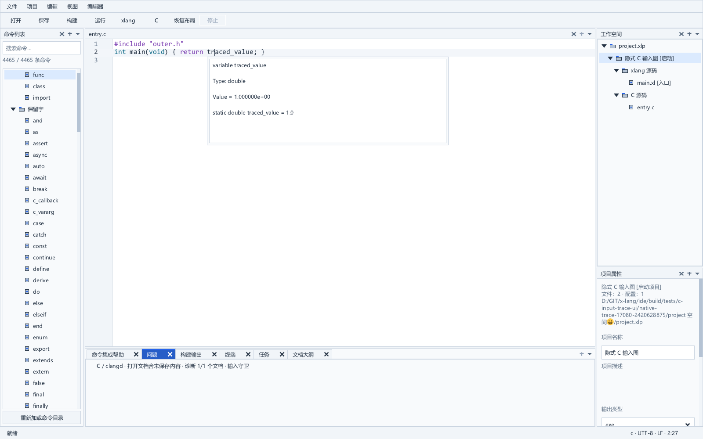

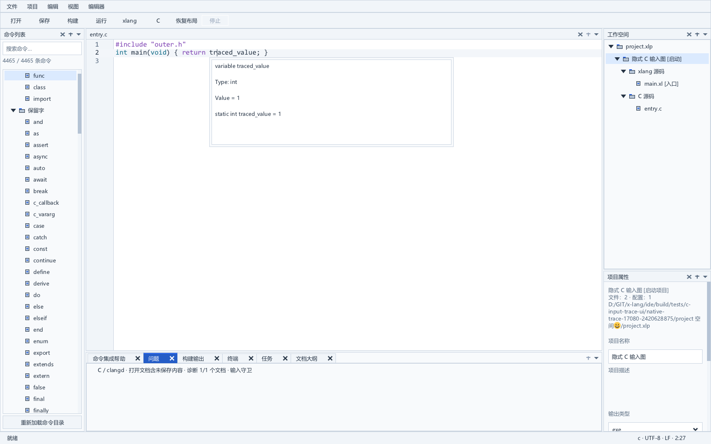

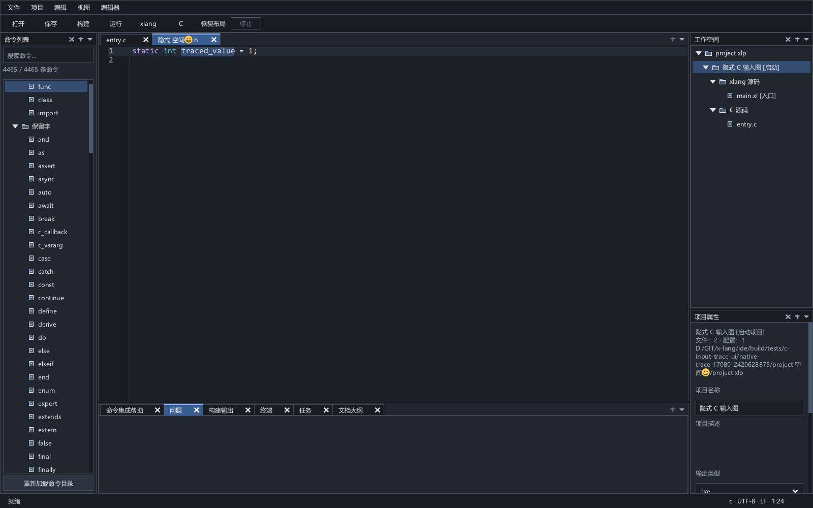

长期目标继续 active。物理 VFS 覆盖不是完整项目观察审计；启动时的驱动/PATH 与资源目录探测还有绕开 VFS 的入口，模块/序列化索引/外部驱动与实际目录枚举仍需更广矩阵。TCC 宏及 ABI 等价性、公共类型和更多跨语言导航、全局索引/窗口/偏好修复、资源/新 XLON 创建、复杂工程性能、实体输入/混合 DPI、完整依赖与发布材料、干净 Windows 设备及正式首版逐项验收仍需实施。


## 2026-10-08 独立全局文件备份与修复

“视图 → 会话与恢复…”新增全局文件选择及实际路径，分别确认最近工程索引、主窗口位置和程序偏好修复。最近索引绑定当前工作空间或项目；窗口保存当前真实几何，重新加载后不移动主窗口；偏好保留当前字体、已加载工具配置及有效未知字段，临时命令行工具覆盖不写入。`--no-session` 时作用域操作不可用，独立程序偏好仍可修复。

新后台服务逐块复制并 flush 原始字节，在所选文件父目录的 `state-backups/backup-UUID/` 中记录长度与实际 SHA-256。准备阶段保持原件；完整备份后由 UI 捕获当前小型 JSON，使用同一文件写锁和原生句柄发布，失败尝试回退且保留完整副本。只读、硬链接、锁定、重解析祖先、竞争文件和取消受到保护；超出状态读取限制及坏 UTF-8 原件仍能按原字节保存。普通字体和工具偏好保存现在也使用共同写锁。原生界面没有关闭或重读当前编辑文档；真实 C/xlang 正文、版本、语法、选区、脏状态、撤销与重做保持。

最终严格 Release 构建与完整串行回归均退出 0：**71 个应用模块、63 类测试、181 项 xlang 协议检查、136 张本次运行的新鲜原生图**。新增后端 **49 项**边界检查通过，实际 Win32 目录连接点、发布失败后原件回退、待消费后台结果回收、缺失文件竞争均已执行。新增原生夹具用真实按钮验收三类修复、取消与锁定失败、窗口几何、40 DIP 滚动和独立偏好入口。普通偏好写锁、已有 C 输入观察 113/56 项、原生观察 21 项、行列定位 93 项、真实混编与 SDK 负面门继续通过。

新候选位于 [portable-20261008-state-repair-final](../dist/portable-20261008-state-repair-final/)，提供 [主程序](../dist/portable-20261008-state-repair-final/xlang-ide/xlang_ide.exe) 和 [Windows x64 ZIP](../dist/portable-20261008-state-repair-final/xlang-ide-windows-x64.zip)。载荷 **2,472 文件、296,513,545 清单字节**，ZIP **107,318,442 字节**，SHA-256 为 `ef31ec694c233d5d54ef66aa76542418e66e8841a6277f95b40f70fcf72827ac`。15 项实际拒绝门、2 次默认原生迁移验收、4 次包内运行及 12 张便携图通过。默认仍使用官方 clangd；实验性服务器与适配留在开发目录。上轮客户端候选及其原始回执保留，未改写成当前构建证据。

239 份源码/测试/工具/数据与 11 份设计合同在最终构建前冻结，严格构建后再冻结 71 个活动产物；完整回归复核同一输入与产物。实施计划合同保持原字节，本轮进度记录落在本页。修改前 363 份项目原文件、76 个原始产物、70 份证明以及另存的 149 份历史图/语义证据继续按摘要复核。独立编译器、官方/实验性服务器和固定 SDK 仍受保护。三张本轮原生图已经查看并按原字节保存：

- [最近工程索引确认](assets/native-global-index-confirm-20261008.png)
- [程序偏好修复结果](assets/native-global-repaired-20261008.png)
- [40 DIP 滚动确认](assets/native-global-large-confirm-20261008.png)

本轮首次完整回归在渲染阶段失败：修改测试/构建脚本时丢失了原有 UTF-8 BOM，Windows PowerShell 将中文路径字面量读成 ANSI 乱码。实际清单完好，先前功能及 181 项协议门均已通过，便携门尚未执行。已恢复两个脚本的 BOM，使用 Windows PowerShell 对同一中文工作空间的[实际启动渲染](../build/global-state-path-render-smoke.log)通过，随后重新冻结并严格完整构建，再执行最终完整回归；[首次失败原日志与产物](../build/global-state-first-final-regression.json) 保留 640 份原字节记录及 106 张图。首次状态修复候选[未验收状态](../dist/portable-20261008-state-repair/acceptance-status.json)保留，不作为当前候选。恢复编码后的第二次完整运行在原窗口测试 60 秒总时限结束，未记录断言失败；[现场与日志](../build/global-state-second-final-regression.json)及 24 张新图保留。同一窗口测试二进制在[独立运行](../build/global-state-window-isolated.json)中用 38.8 秒通过，第三次完整回归沿用原有程序、断言和时间限制；精确超时原因尚未确定。早期严格构建中的缩进错误和测试 Windows 版本宏重复已修正，原日志保留。一次文件符号链接测试因 Win32 权限 1314 不可用，记录明确为当时工具输出摘要；最终使用实际目录连接点检验同一重解析拒绝边界。验证启动器曾继承 PowerShell 7 模块搜索目录，Windows PowerShell 因而无法加载 `Get-FileHash`；[该构建失败日志](../build/global-state-final-build-3.log) 保留，后续只为验证进程恢复 Windows PowerShell 的默认模块查找。第一次完整构建在最后复核中发现失败状态残留上一备份路径，修正后重新严格完整构建并冻结，再执行本次完整回归；[被替代记录](../build/global-state-first-full-build-superseded.json) 保留。预览时曾将弹窗边缘外的帮助文字误判为透底，多余背景试验已经撤回，最终程序未加入这些改动。

证据：[最终核验](../build/global-state-final-verification.json)、[严格完整构建](../build/global-state-final-build-4.log)、[完整回归](../build/global-state-final-regression.log)、[冻结输入](../build/global-state-final-inputs.json)、[运行绑定](../build/global-state-final-run.json)、[恢复合同](recovery-maintenance.md)、[候选装配回执](../dist/portable-20261008-state-repair-final/package-receipt.json)、[便携验收](../build/global-state-package-run.json)、[依赖保护](../build/global-state-protected-verification.json)、[历史来源核验](../build/global-state-history-provider-verification.json)、[原字节基线](../build/global-state-before.json)、[历史图/语义原件](../build/global-state-prior-evidence.json)、[视觉核验](../build/global-state-visual-inspection.json)、[变化范围](../build/global-state-changes.json) 和 [进程审计](../build/global-state-process-audit.json)。

长期目标保持 active，正式首版尚未完成。完整备份不等于两个原生重命名之间发生进程崩溃后可自动重放；原件仍在备份，当前未加入自动重放、备份删除或长期保留管理。累积备份与复杂工程/大文件性能、资源/新 XLON 创建、完整 C/项目/预处理观察审计、公共类型导航与 TCC 宏/ABI 矩阵、实体输入/混合 DPI、完整依赖/许可材料、干净 Windows 设备及逐项发布验收仍需实施。


## 2026-10-08 Windows 资源创建与最终验收

项目菜单与项目属性新增动作 39 `project.newResource`，旧公共动作编号保持。没有资源引用的项目也能打开。表单提供 JSON/兼容 XLON、默认相对路径 `app.res.json`、版本、图标及应用清单，单栏显示精确序列化正文。创建保存新配置并加入 `resource-config` 引用，项目标记未保存，现有 C/xlang 编辑状态及启动项目保留。完整使用与事务边界见 [资源创建](resource-creation.md)。

提交冻结并复核项目、所有打开文档、清单身份/摘要与普通父目录，预分配引用变更，创建同目录独占暂存文件、写入刷新并以不替换的句柄改名发布；成功后转移引用。原生验收覆盖零资源项目、真实菜单/属性按钮、取消/预览不写入、中文 emoji、两种格式、父目录和清单替换、实际祖先连接点、锁定及竞态。另一个使用实际服务的 [失败注入探针](../build/resource-create-failure-probe.json) 通过 17 项检查，包含最后发布前目标竞争、刷新/发布失败与只清理本次暂存文件。两种创建配置均已真实 C/xlang 混编运行，并核对 PE 版本 9.8.7.6、图标及清单原字节。

资源窗格改为首次打开初始化，并单独绑定当前界面字体/度量。40 DIP 首开、随后字体切换、125% DPI 窄窗口和两向滚动已通过；默认启动不创建这些控件。新建路径、正文预览和大字号创建按钮的三张最终图已逐张检查并保存下方。

严格 Release 构建和随后 `-SkipBuild` 完整回归均退出 0，冻结 242 个源码/测试/工具/数据输入、13 份协议文档和 72 份构建输出；64 类测试、181 项 xlang 协议检查、139 张新鲜原生图通过。最终源码、产物、失败原件、旧候选、工具链/SDK/实验性提供者与图像绑定的交叉核验见 [最终核验](../build/resource-create-final-verification.json)，[冻结输入](../build/resource-create-final-inputs.json) 与 [整轮日志](../build/resource-create-final-regression.log) 保留。

本轮第一次完整回归在原 60 秒窗口用例时限失败，[395 条原件](../build/resource-create-first-final-regression.json) 及 [31 条独立失败原件](../build/resource-create-isolated-window-failure/preservation.json) 保留。测试在拥有窗口的线程中改用处理消息的进程等待，原 15 秒子进程与 60 秒整轮时限和全部断言保留；规则见 [Windows 官方窗口线程文档](https://learn.microsoft.com/en-us/windows/win32/procthread/creating-windows-in-threads)。测量收窄到资源窗格三个背景面板的初始化开销，延迟创建后仍记录了一次独立子进程超时；全部混合诊断结果分别保存 [171 条](../build/resource-create-window-diagnostics/preservation.json) 与 [146 条](../build/resource-create-deferred-evidence/preservation.json)，不据此宣称所有超时原因已解决。相同未加诊断程序的独立重测在 38.45 秒通过；最终整轮的三次子 IDE 分别在约 2.25、1.67、1.95 秒退出，实际窗口恢复、最大化、显式尺寸和原断言通过。

后一次冻结完整回归在实验性输入观察服务重新解析响应文件时以 `0xC000001D` 退出；随后 PowerShell 7 初始化单独报告内存不足，因果关系没有证实。该轮 [365 条原始记录](../build/resource-create-second-final-regression/preservation.json) 保留，没有遗留本轮原生验证进程。相同冻结测试和服务的 [独立 113 项复测](../build/resource-create-trace-isolated.json) 在 13.48 秒通过；最终完整回归重新包含该服务与全部门，退出 0。

当前开发候选 [portable-20261008-resource-create-final](../dist/portable-20261008-resource-create-final/)、[主程序](../dist/portable-20261008-resource-create-final/xlang-ide/xlang_ide.exe) 和 [Windows x64 ZIP](../dist/portable-20261008-resource-create-final/xlang-ide-windows-x64.zip) 绑定最终实际构建。2472 个载荷文件通过 15 项拒绝门、2 次默认原生迁移、4 次包内执行及 12 张新鲜图；采用官方 clangd，实验性观察服务继续只在开发验证目录。包摘要如下：

- ZIP SHA-256：`b68724f770f959598ee7ae0e83b65c9388f2c5284b258ccf3bfd3e0adce142ba`。
- 清单 SHA-256：`0480a4a6ba0389fdcdb2bede76f8951625475538b39d5acc8a7897d748ab8cf4`。
- 载荷总字节：`296547595`。

初步 [resource-create 候选](../dist/portable-20261008-resource-create/acceptance-status.json) 已标记验收前被替代；历史候选和失败原件保持。当前候选为开发验收候选，首版目标仍进行中；完整现代 XLON、依赖/版本图、C 预处理与项目输入图/公共类型导航、累积规模性能、实体输入/混合 DPI、许可证及干净 Windows 发布矩阵继续完成。

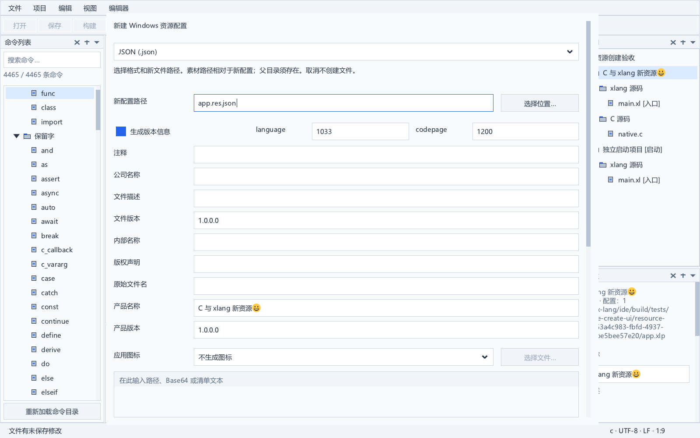

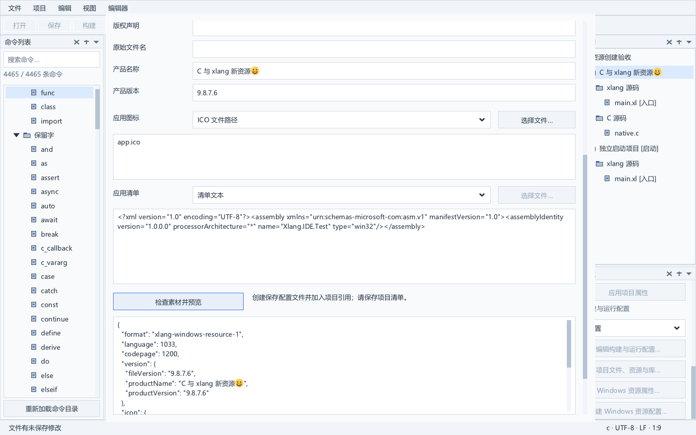


## 显式项目测试增量（2026-10-08）

定版阶段五的项目测试入口已经接入 [项目测试配置与使用](project-tests.md)。原生配置窗口新增“测试参数与程序”和“测试环境变量”；文件菜单与 Ctrl+F7 的 `task.test` 使用所选项目当前配置，不要求 xlang 编译器，不隐含构建，也不改变启动项目。程序留空关闭入口，脚本明确配置解释器；仅主动操作执行。

任务保留独立 `test.log`、真实进程启动标记与退出结果，共用串行队列、合并、停止及终端 stdin。已保存清单、直接输入、排队失效和取消保护已验证。新测试对象导出使用深复制，验证失败或取消不会提前改写模型；未知字段、另存为、测试程序引用改名和实际整目录迁移均已验证。执行前保存相关 C/xlang 文档，配置草稿操作保留原编辑状态。

最终严格 Release 编译与完整回归通过：72 模块、66 类测试、62 动作、244 项源码/测试/工具/数据输入、16 份冻结合同、74 个构建输出，181 项 xlang 协议和 146 张本轮新鲜原生图。新后端测试有 48 项检查，原生界面有 36 项检查，另有四套主题的实际 `--task test` 截图。原生窗口恢复仍使用原 15 秒子进程和 60 秒整体门限，三次实际启动分别为 2609、1844、2203 毫秒。

便携候选 [portable-20261008-project-tests-final](../dist/portable-20261008-project-tests-final/) 已通过 15 项实际拒绝门、2 次默认原生解压/迁移、4 次包内执行与 12 张图。原生便携验收在迁移前后实际配置并执行 C/xlang 混编的测试程序；包内 C 服务仍为官方 clangd。它仍是开发验收候选，正式发布未完成。完整记录见 [最终核验](../build/project-test-final-verification.json) 与 [冻结输入](../build/project-test-final-inputs.json)。

首轮定向检查发现测试环境导出共享模型对象，导致无效草稿校验后模型已变化；改为深复制后同项检查及最终回归通过。原程序、初始模型对象、日志和归一化重建的源码文本保留在 [初轮诊断保留清单](../build/project-test-focused-1/preservation.json)，源码文本重建方式在清单中明确记载。新增回归夹具每轮使用独立 GUID 目录，实际目录迁移不会碰到旧目标。上一资源创建候选、242 项原输入、72 个原构建输出及原始工作区副本均经摘要复核。SDK、编译器、官方及实验性提供者没有本轮修改，最终进程审计无残留。

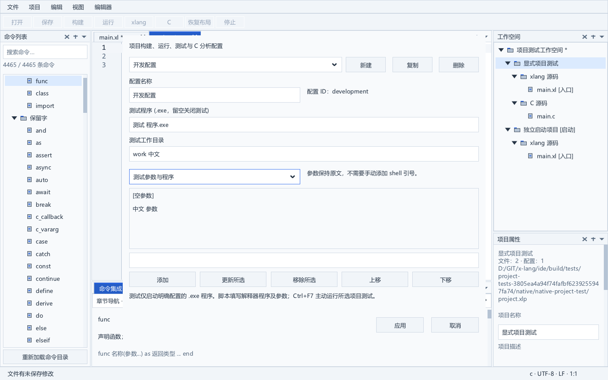

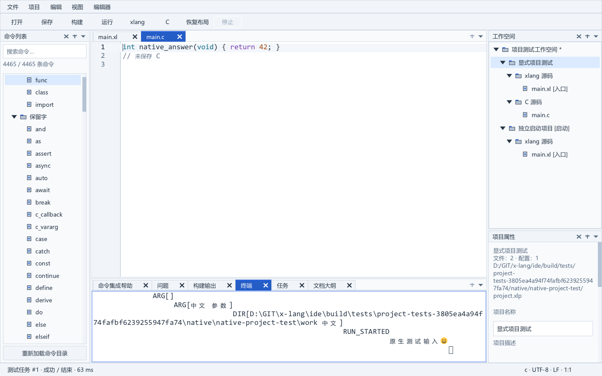


完整依赖/版本图、现代 XLON 类型和资源资产协调、全 C 项目及预处理输入图、公共类型导航、ABI/宏矩阵、累积规模性能、物理输入/混合 DPI 设备与正式发行材料仍按原计划继续验收；本增量不宣告整个 IDE 完成。


## 2026-10-08 资源构建输入与重复请求守护

构建与构建运行现从资源配置的捕获正文中发现图标、应用清单文件，按配置目录解析并加入同一字节基线。路径字符串遵循实际 DEMO6 素材优先级；Base64、直接正文和 null 不产生文件依赖。未知 XLON 容器/标签不转换或改写，整体有效性继续由编译器决定。见 [资源构建输入](resource-build-inputs.md)。

工作线程完成输入发现前保留未匹配编辑通知，发现后核对路径和实际硬链接身份。UI 在工作线程启动前冻结目录外仍脏的命名文档；相关素材阻止本次旧结果，无关 C/xlang 文档保持原修改。输入扩容与通知访问有锁，单文件 16 MiB、总基线 128 MiB 均覆盖新增素材，输出不能覆盖素材文件。

构建/运行重复请求现在还比较完整已保存项目快照和独立脏文档守护；新传入的脏路径同时通知旧请求。改变项目快照、守护或配置会独立排队，不能被原请求替代。测试任务继续按显式程序运行，不隐含资源构建。

最终严格 Release 重建与完整串行回归退出 0：**73 个应用模块、67 类测试、62 动作、181 项 xlang 协议检查及 146 张本轮新鲜原生图**。新资源输入测试通过 **97 项**检查，包括真实事件门控进程、外部字节变化后保留旧输出、内存/发现前排队/硬链接通知、预先脏输入、完整请求合并、缺失素材、单文件及总预算、输出保护，并实际 C/xlang 混编运行 typed XLON 项目，核对 PE 清单原字节。原任务原生夹具还验证目录外脏清单拒绝、显式保存后成功、无关 C 文档脏状态及选择/启动项目不变。原 Windows 窗口门限和断言保持，完整 DPI、字体、恢复、资源创建、桥接和原生语义验收继续通过。

另以实际 IDE 程序打开中文/emoji 路径项目，执行缺失图标的构建运行请求：界面显示真实输入失败，旧可执行文件 SHA-256 不变，built/ran 均为 false。原生图已查看，左侧命令列表、中央编辑器与其下方输出、右侧上方工作空间和下方属性布局保持。见 [原生探针记录](../build/resource-input-native-probe.json)。

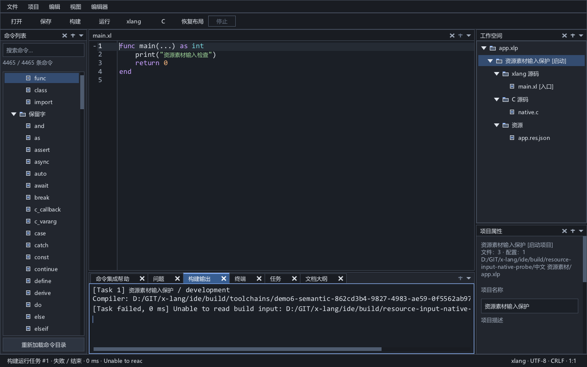

本轮最终冻结 **247 份源码/测试/工具/数据、17 份合同和 75 个构建产物**。上一已接受项目测试版本的 463 份项目/程序原件、244 个输入、74 个输出及 150 份截图/协议原字节复核保持；SDK、独立编译器、官方和实验性服务器没有本轮修改。当前验收范围无残留原生进程。

首轮完整回归也退出 0，随后静态复核补齐重复请求快照/守护分支，再重新冻结、严格重建并执行最终完整回归。首轮包保留为 [被替代开发候选](../dist/portable-20261008-resource-input-final/acceptance-status.json)，[576 条记录](../build/resource-input-first-full/preservation.json) 包含原程序、73 个原编译对象、日志、图片及协议结果。归档脚本最初因尚不存在的状态文件提前退出，发现时三份源码/合同已加入修正：这三份以反向补丁重建并明确标记；测试源码和合同恢复字节匹配原冻结摘要，tasks.c 的 LF 归一化文本匹配保留差异与原基线，但不宣称恢复了原混合换行字节。首轮原冻结摘要和编译对象另存；最终验收只使用当前完整冻结输入和新产物，不依赖这些重建文本证明最终构建。

证据：[最终核验](../build/resource-input-final-verification.json)、[严格构建](../build/resource-input-final-build.log)、[完整回归](../build/resource-input-final-regression.log)、[冻结输入](../build/resource-input-final-inputs.json)、[运行绑定](../build/resource-input-final-run.json)、[便携验收](../build/resource-input-package-run.json)、[原件基线](../build/resource-input-before/preservation.json)、[上一验收图与协议原件](../build/resource-input-prior-evidence/preservation.json)、[依赖保护](../build/resource-input-protected-verification.json)、[历史/提供者核验](../build/resource-input-history-provider-verification.json)、[变化范围](../build/resource-input-changes.json) 和 [进程审计](../build/resource-input-process-audit.json)。

当前 [便携开发候选](../dist/portable-20261008-resource-inputs-final/) 提供 [主程序](../dist/portable-20261008-resource-inputs-final/xlang-ide/xlang_ide.exe) 与 [Windows x64 ZIP](../dist/portable-20261008-resource-inputs-final/xlang-ide-windows-x64.zip)。2472 个载荷文件、15 项实际拒绝门、2 次默认原生迁移、4 次包内执行及 12 张便携图通过；迁移前后继续执行显式 C/xlang 项目测试。默认服务器仍为官方 clangd，实验性服务不打包。

ZIP SHA-256：`7ee7a27398df925b9720ec85fe1ce8e9ac0d523239f9341cbfd492d543a75a33`；清单 SHA-256：`43e2cee251175aed3ec084bdbe5b4dc6f19179a31752e005c3aefb6679a5bcb8`；ZIP 大小：`107343065` 字节。

长期目标仍为 active。目录外已打开的脏素材目前需要显式保存后再请求构建；资源闭包不是整个项目依赖图。现代 XLON 表单及素材改名协调、完整编译器/C 预处理输入图、公共类型导航与 ABI/宏矩阵、累积规模性能和保留管理、实体输入/混合 DPI、许可及干净 Windows 发布矩阵仍需完成。


## 2026-10-08 现代 XLON 资源属性编辑

Windows 资源属性现在可以打开含现代 XLON 扩展值的配置。版本、ICO 图标及应用清单的已知字段仍使用既有表单；根、版本和素材对象中的 char/time/非有限 float/intmap/set/bytes 保留原始文本，不交给旧 SDK 转换。JSON 及兼容 XLON 也走相同的字段替换流程，保留未知值、键的原始转义、未变化的值和注释。主动关闭资源段仍删除该段全部数据。使用与精确边界见 [Windows 资源属性](windows-resources.md)。

实现保持一份 XRT：不可变原正文与可编辑字段投影分开持有。已知字段校验保持，重复的已知键、坏边界、NUL、超过 512 层或 16 MiB 会拒绝并保持原状态；新字段、字段移除和素材模式切换通过投影重新解析核对。扩展标签的完整语法/类型语义由实际编译器决定；表单没有新增任意扩展类型编辑器。

严格 Release 重建及完整串行回归退出 0：**74 个应用模块、68 类测试、62 动作、181 项 xlang 协议检查、147 张本轮新鲜原生图**，SDK 负面门保持。新增资源文本测试 **72 项**检查通过；资源输入原 **97 项**守护及资源创建事务继续通过。原生资源窗口实际修改现代 XLON，保存前一次撤销返回原正文、一次重做恢复修改；真实 C/xlang 混编运行成功，PE 版本 9.8.7.6、ICO 与应用清单字节均核对。独立 [8 个值样例的 no-op 探针](../build/resource-text-noop-probe/result.json) 另验证这些值单独出现时完整根模型与原正文保持。

原生单栏预览图已经查看，显示 char/time/float/intmap/set/bytes 原拼写，与该轮实际 fixture 及冻结输入绑定。大字号/125% DPI、窗口恢复原门限、双语法、桥接与 C 语义门保持。

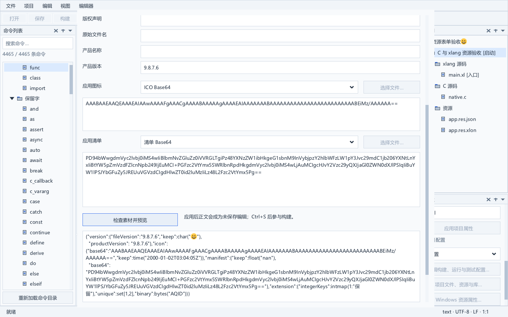

本轮冻结 **250 个源码/测试/工具/数据输入、17 份合同及 76 个构建产物**。修改前直接保存的 [693 条原件](../build/resource-text-before/preservation.json) 包含上一已接受源码、程序、编译对象、合同、日志和当轮图片/协议证据；原始字节复核通过，没有反向重建源码。上一资源输入候选、回执、状态及 ZIP 保持原字节。SDK、编译器、官方与实验性提供者核验通过，最终原生进程审计无残留。

证据：[最终核验](../build/resource-text-final-verification.json)、[冻结输入](../build/resource-text-final-inputs.json)、[严格构建](../build/resource-text-final-build.log)、[完整回归](../build/resource-text-final-regression.log)、[运行绑定](../build/resource-text-final-run.json)、[原生图绑定](../build/resource-text-native-image.json)、[便携验收](../build/resource-text-package-run.json)、[依赖保护](../build/resource-text-protected-verification.json)、[历史与提供者](../build/resource-text-history-provider-verification.json) 及 [变化范围](../build/resource-text-changes.json)。开发定向检查的源码、程序和日志分别保留在 resource-text-focused-1/2/3，最终验收使用重新冻结的完整输入与新产物。

当前 [便携开发候选](../dist/portable-20261008-resource-text-final/) 提供 [主程序](../dist/portable-20261008-resource-text-final/xlang-ide/xlang_ide.exe) 和 [Windows x64 ZIP](../dist/portable-20261008-resource-text-final/xlang-ide-windows-x64.zip)。2472 个载荷文件通过 15 项拒绝门、2 次默认原生迁移、4 次包内执行及 12 张便携图；继续实际执行显式 C/xlang 项目测试，默认采用官方 clangd。

ZIP SHA-256：`0c8a815b0f93cc021db3379eaeb6ae9c6ab6948ba53a766a0fe409c77af63295`；清单 SHA-256：`201f247464e84d9dbb6a861b85f57137f099281bba8157f28ceeeb706c0b3a53`；ZIP 大小 `107352814` 字节。

长期目标 active，当前仍为开发验收候选。后续继续完整项目/编译器/C 预处理输入图、公共类型与 ABI/宏矩阵、资源素材改名协调、规模性能/保留管理、实体输入及混合 DPI、许可材料及干净 Windows 发布验收。目录外脏素材仍需显式保存后构建。


## 2026-10-08 资源素材改名与配置引用联动

图标或应用清单素材改名时，当前已加载可用项目的资源配置路径现在会同步更新。根字符串、素材对象的有效 path、相对和绝对路径、共享配置及素材硬链接都受到核对；未启用 Base64/text、现代 XLON 扩展的原字节拼写及已有未保存内容保留。素材没有被打开为文本；受影响配置预先进入编辑标签，原活动 C/xlang 文档及其真实选区、版本和撤销保留。相同文件名确认不改别名路径，也不新开资源标签。完整边界见 [文件重命名](file-rename.md#资源素材引用联动)。

每份配置正文更新作为一个可撤销的未保存编辑，磁盘配置不自动写入；撤销正文不会撤销素材物理改名。预打开或物理改名失败关闭本次新开的干净配置文档。固定 SDK 缺少可预备/回滚的 CodeDocument 事务，物理提交后若某份正文编辑失败，会明确保留“文件已改名”的状态和剩余补丁，允许重试，阻止取消及普通退出；本轮真实注入一次编辑失败验证了部分完成、重试、单步撤销及模态屏障。生产程序不包含注入入口。队列尚未持久化，强制终止/崩溃后的跨文件重放继续实施。

配置磁盘身份/摘要、正文及文档版本在窗口打开与确认间冻结。只读、外部变化、同字节配置替换、过期文档和素材源共享锁均拒绝改名。多个项目共享同一配置路径只编辑一次；同一配置通过不同硬链接路径加载会拒绝，要求先统一配置路径，防止目录基准歧义及未冻结的别名身份变化。配置仍限 16 MiB，整批冻结正文限 128 MiB；完整预处理依赖与大规模性能继续验收。

修订版严格 Release 和完整串行回归均退出 0：**75 模块、69 类测试、62 动作、181 项 xlang 协议检查、149 张新鲜原生图**，新 **51 项资源改名检查**、原 **72 项资源文本检查**、**97 项资源输入检查**及 SDK 负面门通过。真实 C/xlang 根据新素材路径构建运行，读取 PE 图标和清单字节一致。窗口、字体、DPI、语义桥接、任务与显式项目测试保留原有门限。

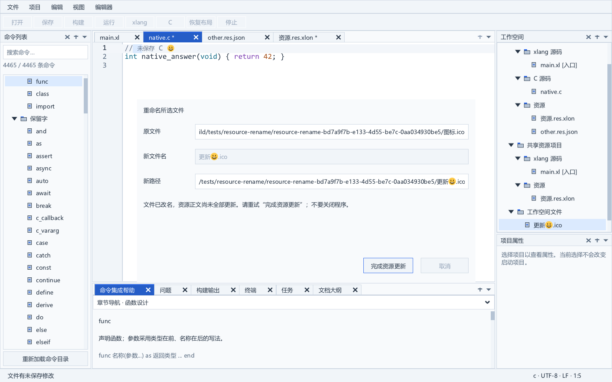

本轮冻结 **253 个源码/测试/工具/数据输入、18 份合同及 77 个构建产物**。上一已接受版本的 [700 条原件](../build/resource-rename-before/preservation.json)、上一资源文本候选和回执/状态/ZIP 保持原字节。首次整轮通过后发现配置硬链接边界，补齐检查并以新输入重建、重新执行完整回归；首次版本未作为最终候选，353 条源码/合同/产物记录、75 个原编译对象、149 张原图、4 份协议和运行/打包日志等共 588 条原记录直接保存于 [初版证据](../build/resource-rename-attempt-1/status.json)，没有反向重建源码。定向开发各次源码、程序和日志保存在 resource-rename-focused-1 至 8。

最终证据：[核验报告](../build/resource-rename-v2-final-verification.json)、[冻结输入](../build/resource-rename-v2-final-inputs.json)、[严格构建](../build/resource-rename-v2-final-build.log)、[完整回归](../build/resource-rename-v2-final-regression.log)、[运行绑定](../build/resource-rename-v2-final-run.json)、[原生图绑定](../build/resource-rename-v2-native-image.json)、[便携验收](../build/resource-rename-v2-package-run.json)、[依赖保护](../build/resource-rename-v2-protected-verification.json)、[历史与提供者](../build/resource-rename-v2-history-provider-verification.json)、[修改范围](../build/resource-rename-v2-changes.json)。最终图片已查看；SDK/工具链/提供者守护通过，验收作用域无残留原生进程。

当前 [便携开发候选](../dist/portable-20261008-resource-rename-v2-final/) 提供 [主程序](../dist/portable-20261008-resource-rename-v2-final/xlang-ide/xlang_ide.exe) 和 [Windows x64 ZIP](../dist/portable-20261008-resource-rename-v2-final/xlang-ide-windows-x64.zip)。2472 载荷文件、15 拒绝门、2 次默认原生迁移、4 次包内执行与 12 张便携图通过；显式 C/xlang 项目测试在初始和迁移后均实际执行，默认官方 clangd，实验性输入观察提供者仍不打入包。

ZIP SHA-256：`5f8b884a53299e5062ea5e1ccf2f8ba8335957e1488a7ec38de7851655805bb1`；清单 SHA-256：`34de5f2175251158517d32289009ff32ad684099271ce278eff2d97db7b4f13e`；ZIP `107363400` 字节。

长期目标 active，当前为开发验收候选，formalRelease 为 false。后续继续完整项目/编译器/C 预处理输入图、公共类型与 ABI/宏矩阵、跨文件改名崩溃重放与目录迁移素材引用、规模性能/保留管理、实体输入及混合 DPI、许可和干净 Windows 发布验收。目录外脏素材仍需显式保存后构建。

## 2026-10-08 实际构建输入记录的编译器基础

为下一步 IDE 任务的递归依赖守护增加 DEMO6 `build --input-report`。记录来自同次 xlang 解析、导入与包描述，以及 TCC 实际只读打开的 C 头、对象/库、外部运行库源码、资源配置和素材；首次磁盘读取得到不可变原始字节，再次打开使用同一份字节。失败搜索候选和包搜索环境也保留。完成链接后将新产物摘要、身份绑定到上下文，写成功记录前复核输入及产物；输入、硬链接别名、失败候选和产物的覆盖被拒绝。编译器内部接口、协议、预算及不支持的组合见 [构建输入记录接入](build-input-receipt.md) 与 [DEMO6 协议](../../demo6/docs/IDE构建输入记录.md)。

当前编译器源码的 Windows 全量 DLL/CLI 构建在新的私有目录通过。原有长 GCC 参数超过 cmd.exe 8 KiB 限制，已改为保存实际参数的 response file；修正私有构建混用旧公开 TCC 头的问题，采用同套源树中的声明。记录模块已加入 Windows/Linux 构建清单，但 Linux 尚未实测。

编译器侧实际验收通过：**60 条快照断言、184 条构建校验、9 条 TCC transport 校验、67 条递归包及环境校验、24 条共享库/静态库校验**。覆盖宏和传递 include、xlang 导入、递归包描述、目录外包 C 实现及头文件、现代 XLON 和 PE 资源、TCC 对象与静态归档、实际 DLL 导出调用；构建后改变头/导入/产物、出现同名 C 候选或改变包路径时，API 拒绝成功记录。重复读取确实使用先前字节，读取期间的变化、同字节身份替换、空文件/二进制/Unicode、输出碰撞及快照超限均受检查。

同一私有编译器的兼容回归通过：源码报告 22 条、源码范围 46 命令/1,468 节点、语义索引 26 命令/706 节点、补全 42 条、C 桥接 31 命令/23 响应、C 环境 17 命令/12 响应/1,566 头比较、C 声明映射 14 命令/10 响应。声明映射仍在 32,769 个导出项时保留完整有效 ABI，并按既有规则报告导航映射不可用。XRT 导出宿主实际执行通过。

保留兼容边界：既有 `xlc_api_embed` 在调试构建缺少 `xrtStrBufAppendFormatV`，用旧固定编译器在独立目录做同样的测试也复现；该范例没有计为通过。普通 Windows GCC COFF 对象在新编译器有/无输入记录时均未被接受，本轮链接用例证明的是 TCC 自身对象/归档格式，未宣称完整 GCC 对象互操作。调试输出及程序运行后的文件访问不在本记录协议的验收范围内。

本轮保留上一验收版 **708 条原始源码/文档/程序/对象/日志/图及协议原件**；私有编译器冻结 **1,512 个源树文件、20 个本轮根项目输入及 3,270 个编译器输出/载荷文件**，原 Windows 构建的各次失败目录和用例失败也保留。固定 SDK、已固定编译器、默认官方和实验性 clangd 及现有便携候选的原字节保护通过。汇总：[编译器基础核验](../build/build-input-foundation-verification.json)、[冻结输入](../build/build-input-foundation-inputs.json)、[严格构建日志](../build/build-input-compiler-build-5.log)、[固定依赖保护](../build/build-input-foundation-protected-v2-verification.json)。

**IDE 任务服务尚未读取这份新记录，没有新的 IDE Release 或便携包。** 最新完整 IDE 验收仍为上面的 resource-rename-v2 候选（75 模块、69 类、149 张图）；本轮的编译器专项不能替代该轮原生验收。下一步接入任务专用记录路径、后台协议/摘要复核、目录外脏依赖与早期编辑通知、失败搜索候选、配置输出防覆盖，以及发布/运行前复核，再执行新的完整 IDE 和便携验收。长期目标 active，formalRelease 仍为 false。


## 2026-10-08 IDE 实际构建输入核验与便携 Unicode 工具链

IDE 任务现接入同次编译的 `--input-report`，在工作线程中严格解析记录，并按身份、时间、大小和 SHA-256 核验实际输入及新产物。它覆盖未列入项目的 xlang 导入、包描述、C 宏和传递头、目录外文件、链接及资源输入，并保留失败搜索候选；队列提交时捕获包搜索环境。新编译器一旦声明记录支持，缺失或非法记录便使任务失败，不退回旧守护。旧编译器继续使用直接文件及资源基线。见 [输入记录合同](build-input-receipt.md) 与 [任务和工具链](tasks-and-toolchain.md)。

发现依赖前收到的编辑通知一直保留，图扩容后重新核对路径和硬链接；UI 预先捕获的目录外脏文档也进入守护。发布、运行前复核实际图与工具链，输出不能覆盖依赖、失败候选、记录或阶段文件。记录异常、字节变化、同字节身份替换及原缺失文件出现时，保留旧输出并阻止旧程序运行。实际调用参数和输入记录保留在每次任务的日志目录，状态栏先显示依赖核验结果。

最终严格 Release 重建及完整串行回归均退出 0：**76 个应用模块、70 类测试、95 项构建输入专项、181 项 xlang 协议检查及 149 张本轮新鲜原生图**。旧/新编译器任务、97 项资源输入守护、现代 XLON、真实 C/xlang 混编、窗口与 DPI、字体、恢复、文件协调和语义桥接继续通过。冻结 256 个源码/测试/工具/数据输入、20 份合同及 78 个构建产物；没有混用旧 ABI 对象。

便携检查通过全部实际拒绝门与原生迁移。新候选 [portable-20261008-build-input-task-v4-final](../dist/portable-20261008-build-input-task-v4-final/) 含 [主程序](../dist/portable-20261008-build-input-task-v4-final/xlang-ide/xlang_ide.exe) 和 [Windows x64 ZIP](../dist/portable-20261008-build-input-task-v4-final/xlang-ide-windows-x64.zip)，载荷 2472 个文件。默认仍为官方 clangd；实验性输入观察提供者没有打包。ZIP SHA-256：`82767163941aaa80614a96f6af1993df85d03853cb3283b9d910b80fdefa8494`；清单 SHA-256：`14378c48a27c1e5a1dc7bcdedc90e9d6905ce7fb0e9662a9f6542b2acbf6f070`；ZIP 大小 107339240 字节。

原生探针以中文/emoji 路径打开 xlang 和 C 文档，宏选择的目录外传递头参加同次真实构建；xlang 实际调用 C 函数并输出 `BUILD_RECEIPT_UI_42`。移走头文件后 built/ran 均为 false，旧程序摘要不变。三张新图已经查看，左命令列表、中央编辑器及其下方底栏、右上工作空间和右下属性保持原定布局。见 [探针绑定](../build/build-input-task-v4-native-probe.json)。

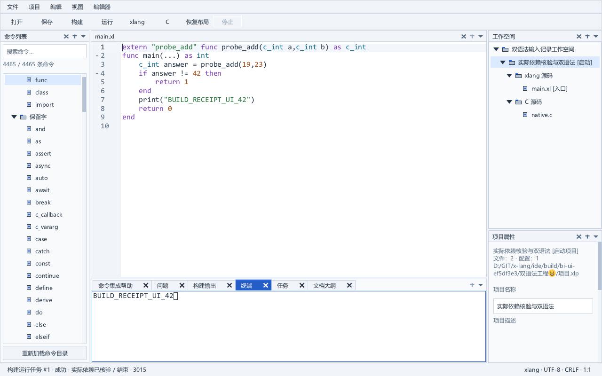

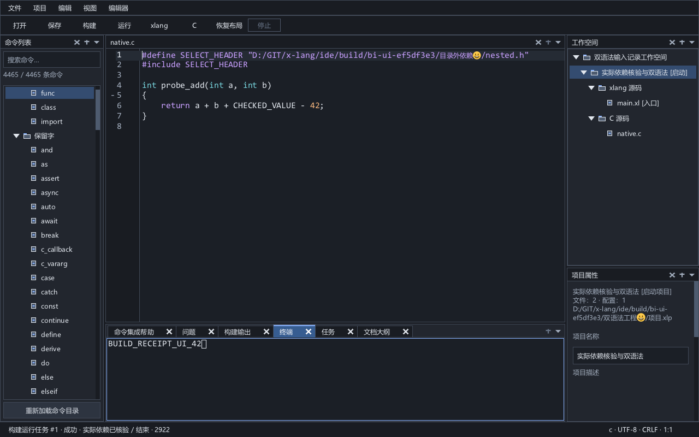

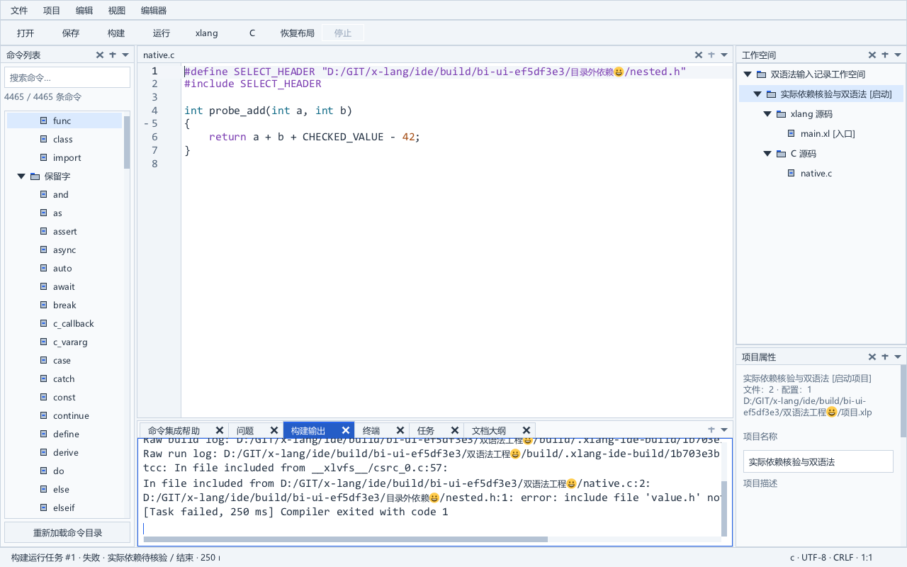

前两轮完整检查分别保留了旧恢复备份夹具的深路径失败，以及便携工具链位于中文目录时输入记录失败。前者用上一已接受程序复现，短测试根目录继续通过，未宣称长路径已修好；后者来自 TCC 的 Windows ANSI 模块路径和字节大小写转换，已改为宽字符 API 明确转换 UTF-8。新私有编译器从已冻结的 v5 基础复制，只调整 `lib/tcc/libtcc.c`，全量 Windows DLL/CLI 构建和中文/emoji 工具链位置有/无记录的实际混编运行通过。根 `demo6/src/api/xl_api.c` 的同期其他变更保留，没有回退或纳入这份私有编译器；以前的完整编译器专项仍属于原基础验收，未计为本次重新执行。

第三轮在 4K 窗口及长帮助截图出现缓存分配失败，原程序/对象/源文本和日志直接保存在 [458 条 v3 原件](../build/build-input-task-v3-attempt/preservation.json)。关闭 dock 缓存的私有试验虽然通过功能检查，却丢失标题/页签，已按视觉检查拒绝。最终仅取消普通帮助正文标签的逐块位图缓存，保留 dock 和代码块；原窗口断言与 15 秒子进程等待门限不变，完整重建与回归重新通过。私有各轮图和判断见 [缓存试验评估](../build/build-input-task-cache-evaluation.json)。早期编译器/定向用例失败、第一轮重建内存分配失败及两次完整回归的原证据均保留，未计为通过。

上一已接受资源改名候选、708 条基础前原件、557 条任务前原件、原编译器基础 958 个证据绑定、固定工具链/SDK、默认及实验性服务器复核通过。最终验收作用域无残留原生进程。详见 [最终核验](../build/build-input-task-v4-final-verification.json)、[冻结输入](../build/build-input-task-v4-final-inputs.json)、[严格构建](../build/build-input-task-v4-final-build.log)、[完整回归](../build/build-input-task-v4-final-regression.log)、[运行绑定](../build/build-input-task-v4-final-run.json)、[变化范围](../build/build-input-task-v4-changes.json)、[依赖保护](../build/build-input-task-v4-protected-verification.json)、[历史与提供者](../build/build-input-task-v4-history-provider-verification.json) 及 [终态证据绑定](../build/build-input-task-v4-evidence-bindings.json)。

长期目标仍为 active，formalRelease 为 false。当前核验是本记录协议的磁盘构建范围，尚未覆盖调试输出、动态 loadlib/程序运行后访问及完整 C 对象互操作。接下来继续公共类型与 ABI/宏矩阵、改名崩溃重放与目录迁移素材引用、规模性能/保留、实体输入与混合 DPI，以及许可和干净 Windows 发布验收。


## 2026-10-08 显式类型身份 F12 导航验收

本次接通 xlang 显式类型标记的同批次 TypeId 导航：class、union、enum、typedef 和 extern type，以及泛型/数组/可空内部类型。两个底层同为 int 的别名仍定位各自声明，类型别名链定位实际写出的别名。导入公开类型支持磁盘源码和未保存依赖，BOM/CRLF/中文/非 BMP 坐标沿用实际来源范围转换。变量引用仍按 SymbolId 定位变量声明；类型身份重复、未知/零、ABI 不一致或缺失位置均返回空结果。详见 [定义导航](definition-navigation.md)。

严格全量重建和完整串行回归均为退出码 0：76 个应用模块、70 类测试、257 个 authored 输入、21 份契约、78 个构建输出。整套协议 210 项（其中新增类型门禁 29 项）；另以便携包内语言服务器和默认编译器重跑 29 项类型门禁，通过。新原生交互实际用 F12、菜单和动作跳到未保存模块中的两个同底层别名及 class，原磁盘源码不变。完整回归生成 151 张新 PNG（主测试根 139、单独便携验收 12），新增两张类型目标图已查看。

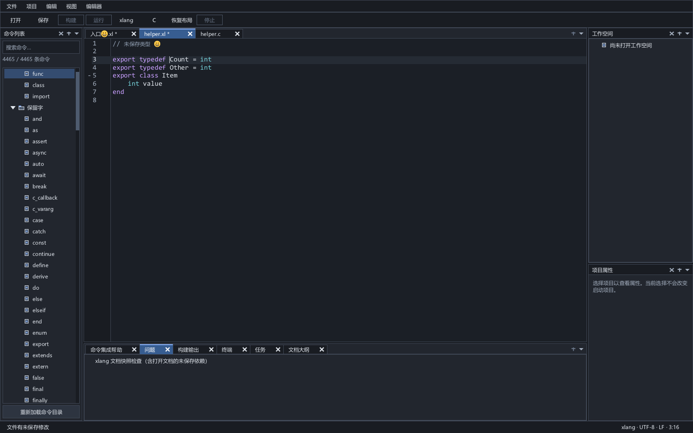


新 [便携候选](../dist/portable-20261008-type-navigation-final/xlang-ide/xlang_ide.exe) 保持开发验收状态。2472 个载荷文件、2468 个来源输入；15 项实际解压/产物拒绝门禁、2 次默认原生启动（含迁移）、4 次包内可执行程序运行和 12 张新图均通过。归档 SHA256 为 `2ce93d8ddf5179c04da60b2429cefbd7e899ba200b3081e2e9ced8e5a60b6438`，载荷清单 SHA256 为 `82999cd11a39df7154cc39ca3b04a99b249ae595075d88a4c248d99f582077d8`；前一通过候选及归档保留。

此次不修改编译器、SDK、C 提供者或默认布局。重新核验 1512 份私有编译器源码及其固定输出、22699 份原固定工具链文件、默认和实验性 C 提供者，并用增量前 436 条原件复核前次 17285 条终态绑定。最终原生验收作用域无残留进程。首次探针提前使用旧语言服务器、初始 extends 能力假设和 GCC 中文输出路径夹具失败均保留，未计为通过；后者改为 ASCII 路径编译后复制到中文测试目录，实际语义断言保留。

核验见 [最终报告](../build/type-navigation-final-verification.json)、[冻结输入](../build/type-navigation-final-inputs.json)、[严格构建](../build/type-navigation-final-build.log)、[完整回归](../build/type-navigation-final-regression.log)、[包内类型协议](../build/type-navigation-packaged-protocol.log)、[变化范围](../build/type-navigation-changes.json) 和 [终态绑定](../build/type-navigation-evidence-bindings.json)。

长期目标保持 active，formalRelease 为 false。extends 基类 NAME 尚无类型身份；protocol 与泛型参数声明缺少选择事实，保持不可导航。C 生成头文件仍仅映射函数/全局变量，公共类型映射、ABI/宏矩阵、改名崩溃重放与目录迁移素材引用、规模与保留、实体输入/混合 DPI及许可/干净 Windows 发布验收继续实施。


## 2026-10-08 protocol、基类和泛型参数类型导航验收

新增编译器类型声明/引用字段，接通 protocol、`extends` 基类、CLASS/PROTOCOL 泛型约束和作用域泛型参数的 F12 导航。protocol 与泛型参数可没有运行时声明符号；六个同名 T 使用各自真实 TypeId，泛型参数 ABI 保持零。变量仍按符号导航，只有已检查的类型位置使用类型后备查找。大纲包含 protocol/interface 和类型参数子项；单态化副本仅在身份、角色及完整/名称源码范围完全一致时合并，不同范围或无位置的相同 TypeId 保持不可导航。见 [定义导航](definition-navigation.md) 与 [编译器合同](../../demo6/docs/IDE语义索引接口.md)。

根项目及隔离编译器只修改两份语义检查/索引 C 源文件，未添加 AST 字段或公开 API，也没有分配额外运行时 SymbolId。隔离编译器沿用前次冻结 Unicode 工具链的其余源码，完整 Windows DLL/CLI 构建退出 0。同一实际源码的所有运行时 SymbolId、普通生成头和 C 桥接查询头字节与冻结旧版一致。重新执行九套编译器兼容检查：语义索引 26 次调用、补全 42 项、源码范围 46 次调用/1468 节点、来源报告 22 项、解析观察 8 项、源码覆盖 20 项，以及 C 桥接/源码映射/环境三套检查。冻结 1512 个编译器源树文件、4232 个编译器输出及测试文件；根项目同期其他 API/IR 改动保留，没有引入该隔离版本。

最终严格重建及完整串行回归均退出 0：76 个应用模块、70 类测试、258 个源码/测试/工具/数据输入、22 份 IDE 合同、3 份根编译器源码/合同和 78 个构建产物。整套协议 276 项，包括新类型事实 37 项、新编译器类型兼容 29 项及原工具链 210 项；另外使用便携包内服务器和默认编译器重新执行 37+29=66 项协议检查，通过。单独比较旧编译器符号与头文件的专项为 39 项，不重复计入完整协议数量。

完整回归产生 159 张本次新鲜原生 PNG（主测试根 147、独立便携验收 12）。原生测试实际对未保存模块执行 protocol、基类和泛型参数的 F12/菜单/动作跳转，保留原文件字节。三张新增目标图已查看；左命令列表、中央编辑器及其下方底栏、右上工作空间和右下项目属性保持定版布局，C/xlang 双语法和浅/深色主题通过。


新 [便携主程序](../dist/portable-20261008-type-facts-final/xlang-ide/xlang_ide.exe) 和 [Windows x64 ZIP](../dist/portable-20261008-type-facts-final/xlang-ide-windows-x64.zip) 为开发验收候选。载荷 2472 个文件、2468 个来源输入；15 项真实拒绝门禁、2 次默认原生启动（含迁移）、4 次包内可执行运行和 12 张新图通过。归档 SHA256：`7d82f9ed70f32621251e4073108b6ef4212b9860b8c59d11db162287a37c9cda`；载荷清单 SHA256：`604db32ba786c5e59baac3e80d3d0042b3507c0c2b89adc13deac250ae6ee708`；归档 107351237 字节。默认仍为官方 clangd，实验性提供者未打包，SDK 与两类 C 提供者原字节不变。

重新核验前轮 25290 条绑定，增量前 443 条原件、已接受便携归档、固定工具链与提供者均保留；最终原生验收作用域无残留进程。早期探针错误地假定约束 AST 为 NAME、普通变量引用具有声明 ID，均保留失败原件。补测发现初始负向夹具先被源码覆盖报告拒绝，已由真实覆盖索引替换，并先验证合法夹具，再核对错误来自语义索引；初始探针不能替代最后完整门禁。

证据见 [最终报告](../build/type-facts-final-verification.json)、[冻结输入](../build/type-facts-final-inputs.json)、[严格构建](../build/type-facts-final-build.log)、[完整回归](../build/type-facts-final-regression.log)、[编译器构建](../build/type-facts-compiler-build.json)、[编译器九套兼容检查](../build/type-facts-compiler-checks.json)、[包内类型事实](../build/type-facts-packaged-type-facts.log)、[包内类型兼容](../build/type-facts-packaged-types.log)、[变化范围](../build/type-facts-changes.json) 和 [终态绑定](../build/type-facts-evidence-bindings.json)。

长期目标保持 active，formalRelease 为 false。C 生成头文件仍仅映射函数/全局变量；公共类型源映射、ABI/宏矩阵、恢复备份长路径、改名崩溃重放与目录迁移素材引用、规模/保留、实体输入与混合 DPI，以及许可和干净 Windows 发布验收继续实施。


## 2026-10-08 C 名义 union 类型跨语言导航验收

C 编辑器的 F12 现支持公开 ABI 实际使用的命名 union，C 的 union 标签和 typedef 名称均定位实际 xlang 类型声明。嵌套 union、别名 canonicalize 后的底层类型、闭合导入源码和未保存依赖使用同次来源。两项目同名 C 类型分别定位自己的未保存 xlang 声明；目标版本和磁盘正文变化会拒绝旧结果。三个新增目标图已查看，原文件字节、双语法、定版布局和浅/深色主题保留。见 [桥接合同](c-xlang-bridge.md)。


编译器只在真实 tag/typedef 发射点使用既有 nominalSymbol，并关联 checked union 的声明 SymbolId、TypeId、非零 ABI 和准确来源。未新增运行时符号、IR/AST 字段或公开 API。相对已冻结类型事实编译器仅修改五份 Cgen/索引文件，1512 份源树文件均核对；根项目同期其他 API/IR 变化保留。普通头、查询头、语义索引与旧 function/global 记录逐字节/身份兼容。九套真实编译器专项重新通过，4737 个编译器输出及测试文件冻结。

严格全量重建及完整串行回归退出码均为 0：76 模块、70 类测试、259 个源码/测试/工具/数据输入、22 份 IDE 合同、6 份根编译器源码/合同和 78 个构建输出。276 项既有及类型事实协议通过；新增 18 项真实 C 类型发射/来源/混编执行检查另计，17 项原生类型映射断言及实际 clangd F12 通过。包内服务器/默认编译器的 66 项类型协议和 18 项 C 类型发射混编检查也通过。对旧编译器的 20 项兼容专项不重复计入完整回归数量。165 张本次新鲜 PNG，包括主测试根 153 张与便携验收 12 张。

新 [便携主程序](../dist/portable-20261008-public-type-map-final/xlang-ide/xlang_ide.exe) 与 [Windows x64 ZIP](../dist/portable-20261008-public-type-map-final/xlang-ide-windows-x64.zip) 为开发候选。2472 个载荷文件、2468 个来源输入，15 项真实拒绝门禁、2 次默认原生启动（含迁移）、4 次包内可执行运行通过。归档 SHA256 `f4e6fd7fd1bf34a1a2f5a138cf5429b32a40a15b4c4ba367cef382c58110b484`，载荷清单 SHA256 `d31b0eff7e9d2ca7ff4c88592b81e6a9eebb3e60bbeea6ffb486fe467a434124`，归档 107361684 字节。默认官方 clangd、SDK 和实验性提供者均保持原字节；前次候选保留。

复核前次 39693 条绑定及增量前 447 份原件；终态原生验收作用域无残留进程。早期探索的错误类型语法和工具 bytes 字面量错误保留失败日志与类型夹具，未计为通过。导出含 c_int 字段的 class 会触发既有 XLIR 布局错误，已用旧/新编译器分别复现并记录 [已知 ABI 问题](../build/public-type-map-class-limitation.json)，仍需处理。

证据见 [最终报告](../build/public-type-map-final-verification.json)、[冻结输入](../build/public-type-map-final-inputs.json)、[严格构建](../build/public-type-map-final-build.log)、[最终完整回归](../build/public-type-map-final-regression-retry.log)、[编译器构建](../build/public-type-map-compiler-build.json)、[九套兼容](../build/public-type-map-compiler-checks.json)、[包内类型协议](../build/public-type-map-packaged-type-facts.log)、[包内 C 类型](../build/public-type-map-packaged-public-types.log)、[变化范围](../build/public-type-map-changes.json) 和 [终态绑定](../build/public-type-map-evidence-bindings.json)。

长期目标 active，formalRelease=false。共享的 class/protocol、擦除的标量别名及 tuple/nullable/callback 结构载体没有唯一名义 C 声明，不补造跳转；union 字段尚无独立映射。继续 ABI/宏矩阵与已知 class 问题、恢复备份长路径、改名崩溃重放与迁移素材引用、规模/保留、实体输入/混合 DPI、许可及干净 Windows 发布验收。

首次完整回归在工程树重命名时静默退出，未记录原生数值退出码、断言或错误原因。原源码/构建产物未改，单次直接运行、调试器运行及六次直接诊断通过；随后相同冻结源码和产物的全新完整串行回归退出 0，直接观察到工程树测试退出 0。首轮失败及其 971 份原件保留于 [未解决记录](../build/public-type-map-first-failure.json)，不计入最终通过数量，也不声称已查明或修复原因。这份开发候选仍需完成该问题调查后才能进入正式发布。


## 2026-10-08 深路径恢复存储验收

恢复备份在深目录中失败的问题已用上一已接受程序重新复现；131/191/239 个 UTF-16 单元的测试根目录分别在更深的备份清单或恢复目录上失败。IDE 现在仅在原生 I/O 边界转换绝对 Windows 扩展路径，界面及 JSON 仍使用普通 UTF-8 路径。修复覆盖恢复目录/锁、原始副本、扫描/预览、元数据撤下与回退，以及会话正文、状态 JSON 与重开读取。SDK、编译器和 C 提供者未修改。见 [恢复合同](recovery-maintenance.md)。

新增深目录实际检查使用至少 400 个 UTF-16 单元的中文/emoji 作用域，保留无效/超过 8 MiB 元数据及完整原字节副本，执行撤下/回退、锁定失败、取消、未消费后台结果销毁、活动 GC 和损坏备份拒绝。另一组真实原生会话检查在同样深度保存和重开 C/xlang/未命名脏文档，验证上一检查点、冲突、选区/布局、放弃更改及损坏状态保护。测试根目录参数保持 ASCII，Unicode 路径由测试内构造；初始探针误将 Unicode 直接传入旧 char argv，其编码失败不作为产品故障证明。

严格全量 Release、完整串行回归和便携验收均退出 0：76 个应用模块、70 类测试、259 个源码/测试/工具/数据输入、22 份 IDE 合同、6 份未改根编译器合同/源码和 78 个构建产物。276 项完整协议、包内服务器/默认编译器的 66 项类型协议，以及主/包内各 18 项 C 类型发射混编执行继续通过。167 张新鲜原生图（主测试根 153、标准便携验收 12、额外深目录包内启动 2），三张恢复窗口图与两张双语法包内图均已查看；定版布局、双语法和浅/深色主题保持。包内主程序还实际完成 C/xlang 各两次深中文目录启动/重开，语法标识和文档身份保持，原源文件字节不变。编译器九套历史兼容证据只复核原字节，本轮没有重新执行，也没有宣称修复 class ABI。


新 [便携主程序](../dist/portable-20261008-recovery-path-final/xlang-ide/xlang_ide.exe) 与 [Windows x64 ZIP](../dist/portable-20261008-recovery-path-final/xlang-ide-windows-x64.zip) 为开发候选。2472 个载荷文件、2468 个来源输入、15 项真实拒绝门、2 次默认原生启动/迁移与 4 次包内可执行运行通过。归档 SHA256 `614443e11944f72776fbc42307168f08f935010be9fe21747a204bf26f77f8ce`，清单 SHA256 `9d31687760ec06fd785a309bf59a8ac0d171f8129fc521b078a6c55ceeafa8e3`，归档 107363398 字节。主/包内混编测试要求保存的临时 C 文件另行保留，载荷与 ZIP 原字节不变，严格载荷核验未放宽。

本轮增量前 571 份原始源码、合同、程序、对象和文档已保存；前次 56124 条绑定按原件复核，旧候选保留。定向构建助手首次漏计 tools 下一个对象而停止，保留该轮目录；修正助手后专项通过，产品源码未为此改变。固定依赖核验和终态原生进程审计通过。

证据：[最终报告](../build/recovery-path-final-verification.json)、[冻结输入](../build/recovery-path-final-inputs.json)、[严格构建](../build/recovery-path-final-build.log)、[完整回归](../build/recovery-path-final-regression.log)、[深路径旧版复现](../build/recovery-path-baseline-ascii.json)、[定向验收](../build/recovery-path-focused.json)、[变化范围](../build/recovery-path-changes.json)、[终态绑定](../build/recovery-path-evidence-bindings.json)。

长期目标 active，formalRelease=false。恢复存储的深路径问题已在上述范围通过；任意源文件写入/外部工具路径、实际 UNC 共享和最大路径长度仍需单独验收。此前工程树重命名静默退出保持未解决，固定 SDK 的原子引用计数检查不能证明其原因；测试现在在夹具失败信息中记录原生数值退出码。剩余包括 class ABI/宏矩阵、改名崩溃重放与迁移素材引用、规模/保留、实体输入/混合 DPI，以及许可与干净 Windows 发布验收。


## 2026-10-09 Class 原生标量混编验收

此前导出 class 的 c_int 字段触发 XLIR 布局错误，现已在私有编译器中修复；扩大测试又复现了原生标量成员分类和默认构造降级的遗漏，一并补齐。生成与校验接受相同默认零值集合，C 标量读取复用精确类型投影，构造复用带字段 TypeId 的 foreign-scalar 装箱，float32 复用已有 binary64 载体。相对已接受公共类型编译器仅改两份 IR C 源码，1512 份源树均核对；未新增 IR/API 字段、运行时符号或 C 声明形式，根仓库其他 API/IR 改动保留。见 [桥接合同](c-xlang-bridge.md#class-标量字段与混编)。

源级契约重新链接真实编译器与运行时，通过 23 个标量字段、一份 managed string 及 70 次非法初始化拒绝。21 种字段类型分别通过桥接；完整矩阵实际检查默认值、赋值回读、继承、泛型、BOM/CRLF 和未保存 Unicode 草稿。C 使用生成的声明创建、验证并释放 xlang 对象，真实混编返回 42，主程序退出 0。原失败夹具与旧编译器对照共 28 项专项通过；完整回归与包内各 25 项，不重复计入 276/66 项语言协议。

严格全量 Release、完整串行回归及标准便携验收均退出 0：76 个模块、70 类原生测试、260 个源码/测试/工具/数据输入、22 份 IDE 合同、9 份根源码/合同和 78 个构建产物。九套编译器兼容检查全部重新运行并通过。主/包内各 18 项公共 C 类型发射及混编继续通过；本轮 167 张新鲜原生图包含主测试根 153、标准便携验收 12 和包内 class 任务 2。包内默认配置的相对工具链路径实际运行 C/xlang 项目，两次构建运行退出 0，文档语法与原源字节保持；两图已查看，左命令、中央编辑器/底栏、右工作空间/属性和双语法保留。


新 [便携主程序](../dist/portable-20261009-class-scalar-abi-final/xlang-ide/xlang_ide.exe) 与 [Windows x64 ZIP](../dist/portable-20261009-class-scalar-abi-final/xlang-ide-windows-x64.zip) 为开发候选。2472 个载荷文件、2468 个来源输入，归档 SHA256 `59ee30b0de1aad19d57551df01d1b3fbc91d780b453bd467497bdd25fc8b7556`，清单 SHA256 `f0a4c294c252b154b8c84b93a0c8057a798ab54e0decaf02d8c8867eb22ffe8a`，归档 107375870 字节。SDK、官方 clangd 和实验性提供者保持原字节，前次候选保留。显式 save-temps 的四份包内测试临时 C 文件另行保留，严格载荷核验未放宽。

原件 574 份及前次 64763 条绑定复核。首轮私有编译器只修布局校验，随后发现字段读写链路问题；测试构建入口漏链补全、夹具错误枚举/stdlib 字段范围、头模块名、旧释放符号、原生会话相对路径和隐藏模式空工具链偏好等失败证据均保留。最终测试使用真实补全模块与随包工具链配置，未降低产品断言或等待边界。终态原生进程审计通过。

证据：[最终报告](../build/class-scalar-abi-final-verification.json)、[冻结输入](../build/class-scalar-abi-final-inputs.json)、[严格构建](../build/class-scalar-abi-final-build.log)、[完整回归](../build/class-scalar-abi-final-regression.log)、[编译器构建](../build/class-scalar-abi-v2-compiler-build.json)、[九套兼容](../build/class-scalar-abi-v2-compiler-checks.json)、[源级契约](../build/class-scalar-abi-v2-contract.json)、[包内原生任务](../build/class-scalar-abi-packaged-native.json)、[变化范围](../build/class-scalar-abi-changes.json)、[终态绑定](../build/class-scalar-abi-evidence-bindings.json)。

长期目标 active，formalRelease=false。本组检查仅覆盖 Windows x64 的 20 种 C 标量与 float32 字段及上述调用路径；任意平台/宏与全部 class ABI 仍需矩阵验收。原工程树重命名静默退出继续调查；当前通过不会关闭其记录。继续改名崩溃重放与目录迁移素材引用、规模/保留、实体输入/混合 DPI，以及许可和干净 Windows 发布验收。

## 2026-10-09 工程树退出诊断与重放

本轮为原生测试补齐退出诊断。工程树夹具记录阶段与最后断言位置，初始化、线程创建/等待/退出和 XGE 返回失败均有明确日志；任务等待失败记录任务状态、实际错误与构建日志路径。保留行为断言及原 30/90 秒等待边界。`tools/test.ps1` 新增可选 `-NativeDebugTrace`，使用 Windows x64 事件观察器记录数值退出码、线程与异常事件，并在未处理异常时保存上下文转储。见 [使用说明](native-test-diagnostics.md)。

诊断器通过七类原生结果：正常退出、显式非零、程序自行恢复异常、未处理访问异常、未处理断点、线程非零退出和超时。转储的异常码、线程和寄存器上下文由独立解析核对。最初转储绑定遗漏 pack(4)，检查正确拒绝该轮；修正接口后通过，原失败输出保留。实际 PowerShell 集成块执行七类检查、一次真实树改名/构建运行以及预期的参数错误拒绝，确认恢复已有/空的跟踪环境变量；没有将预期失败计作成功运行。

最终六次重放使用原始失败程序的已归档字节与旧编译器，以及增强夹具配旧/当前编译器，分别直接运行和调试观察。隔离目录带上对应冻结命令目录，每次两张新鲜图，未打开的入口/头文件/资源改名、旧任务失效以及真实 C/xlang 构建运行全部通过。原图已查看，左侧 4465 条命令、中央编辑器下的帮助、右侧工作空间/项目属性与保留的脏标签可见。早期隔离重放漏带命令目录，已单独保留，只将带完整目录的最终六次计入本轮诊断验收。


另有长测试根下的任务快照失败复现：`Unable to create compiler project snapshot`，原生退出 1，有明确断言且没有未处理异常。该轮停在旧任务构建前；历史静默失败已经留下 request/invocation 原件，两者分别记录。长项目构建快照写入问题待修复，不能据此关闭原始静默退出。

本轮只修改测试与工具：新增诊断器、七类检查器和 C 结果夹具，修改工程树测试及可选回归入口。76 份 IDE 业务模块、编译器、SDK、78 个当前发布产物和既有便携包保持原摘要；复用已验证业务对象，严格编译/链接最终改名夹具。前次 95947 条证据全部复核，增量前 585 份原件保留。本轮为专项诊断，没有重做或声称通过一轮新的完整发布回归。当前可运行候选仍为上节 class 标量版本。

证据：[本轮报告](../build/tree-exit-diagnostics-verification.json)、[最终六次重放](../build/tree-exit-diagnostics-replay-v3.json)、[实际 PowerShell 集成](../build/tree-exit-diagnostics-powershell-v4.json)、[长目录任务失败](../build/tree-exit-diagnostics-task-path.json)、[终态绑定](../build/tree-exit-diagnostics-evidence-bindings.json)。历史 [静默退出记录](../build/public-type-map-first-failure.json)保持未解决。

长期目标 active，formalRelease=false。继续任务快照长路径修复、原始静默退出调查、ABI/宏矩阵、改名崩溃重放与迁移素材引用、规模/保留、实体输入/混合 DPI，以及许可和干净 Windows 发布验收。

## 2026-10-09 任务文件 I/O 长路径修复

长目录下的任务快照失败已在本轮范围修复。新增薄层文件 I/O 适配器，仅在 Windows 磁盘访问边界使用扩展路径，覆盖项目清单、直接输入、请求/调用记录、实际输入收据、原始日志和产物发布。模型、JSON、界面与编译器参数继续使用普通绝对 UTF-8 路径，既有句柄身份、摘要、防覆盖和发布失败保护保持生效。显式超长绝对程序路径在启动边界转换，参数与工作目录保持配置值；SDK/XRT 实现、编译器及语言服务提供者未改动。

旧程序在长工程树目录下仍退出 1，明确报告 `Unable to create compiler project snapshot`；修复后配当前和旧版编译器均完成工程树改名与真实混编运行。此失败发生在快照写入阶段，历史静默退出已经留下 request/invocation，不能合并原因。原 [静默退出记录](../build/public-type-map-first-failure.json)继续保持未解决。

`task_path_test` 已进入正式构建/回归入口。SDK 26 项、真实编译器 31 项检查通过：请求路径 254 个 UTF-16 单元、调用记录 264 个单元、深目录 430 个单元；覆盖实际 C/xlang 混编及输入核验、长日志、清单往返、收据/产物校验、硬链接源防覆盖，以及锁定发布目标时保留旧产物字节。长程序在短工作目录下启动并保留 Unicode、引号和尾部反斜杠参数。

严格全量 Release 构建、完整 IDE 回归、便携组装和标准便携验收通过：77 个模块、71 类原生测试、266 份源码/测试/工具/数据、23 份 IDE 合同和 79 个构建产物/对象。276 项主语言协议、66 项包内协议，以及主/包内各 18 项公共 C 类型和 25 项 class 标量混编继续通过。七类原生退出诊断重新执行；本轮工程树观察退出 0、184 个事件、没有未处理异常。主测试根 153 张、标准便携 12 张、最终包内长任务 2 张，共 167 张新鲜原生图。编译器保持上一版本字节，九套既有兼容证据核对，本轮没有重新计为新执行的编译器矩阵。

包内默认配置的工具链完成两次长目录原生构建运行，分别打开 C 和 xlang 文件，实际输入状态为已核验；两次请求/调用记录长度均为 254/264 单元，产物实际退出 0。两图已查看，左侧 4465 条命令、中央编辑器及其下方底栏、右侧工作空间/项目属性和双语法正常。


新 [便携主程序](../dist/portable-20261009-task-io-path-final/xlang-ide/xlang_ide.exe) 与 [Windows x64 ZIP](../dist/portable-20261009-task-io-path-final/xlang-ide-windows-x64.zip) 为开发候选。2472 个载荷文件、2468 个来源输入，归档 SHA256 `49255077b584d50fd90cf14f8832820a5c373e3d6d58b63bda4689cdcdd2f567`，清单 SHA256 `d2032b072c78d1e654a1d082b657bd5b45620589559803eee2c32b830cc6bcd6`。前次候选保留；显式 save-temps 产生的四份包内测试文件另行保留，严格载荷核验未放宽。

增量前保存 591 份原件并核对前次 97995 条绑定。完整 IDE 回归退出 0 后，冻结核验发现根仓库 `demo6/src/ir/xl6_ir.c` 在测试期间发生变化，初始驱动因此退出 1 并停止在打包之前。已保留该外部变化快照及九份根引用的冻结原件，未覆盖根源码；确认 IDE 输入、私有编译器和产物均保持冻结摘要后继续打包。该根源码不是本轮 IDE 构建或私有编译器的输入，没有将当前根编译器状态算作验收通过。

早期 SDK 探针的深工作目录启动、夹具构建的缩进告警、过短基线根和包内夹具路径长度/阶段目录定位失败均保留。最终包内夹具加深输出目录后，两次实际 IDE 运行均退出 0；独立观察器改为读取配置对应的阶段目录，核对原日志、图像、收据及产物，未重写早期失败记录或放宽路径长度断言。终态当前 IDE/本轮原生夹具进程审计为 0。

证据：[最终报告](../build/task-io-path-final-verification.json)、[冻结输入](../build/task-io-path-final-inputs.json)、[严格构建](../build/task-io-path-final-build.log)、[完整回归](../build/task-io-path-final-regression.log)、[旧版失败与修复对照](../build/task-io-path-focused-tests-v2.json)、[长路径专项](../build/task-io-path-contract.json)、[包内原生任务](../build/task-io-path-packaged-native-v3.json)、[外部根引用变化](../build/task-io-path-external-contract-drift.json)、[变化范围](../build/task-io-path-changes.json)、[终态绑定](../build/task-io-path-evidence-bindings.json)。

长期目标 active，formalRelease=false。任意深度的工作目录仍未支持；本机 430 单元工作目录的 `CreateProcessW` 返回 267，未改变用户配置或全局策略。任意源码写入、外部编译器深路径及真实 UNC 共享仍需单独验证，见 [任务边界](tasks-and-toolchain.md#windows-长目录)。继续原始静默退出调查、ABI/宏矩阵、改名崩溃重放与迁移素材引用、规模/保留、实体输入/混合 DPI，以及许可和干净 Windows 发布验收。


## 2026-10-09 任务历史内存保留

任务页现在保留最新 64 项完成记录，当前选中项与自动跟随项另受保护；未完成队列上限 32，达到上限仍先合并重复请求，再拒绝新的不同请求。任务 ID 保持递增，列表重建通过保留句柄同步选中行，避免裁剪后的行号变化误选。见 [任务历史](task-history.md)。

日志和终端缓冲从 4 KiB 按需增长至各 1 MiB；完成状态出现后仍等待线程句柄确认退出，再由所属 UI 线程释放请求快照、参数、环境、编辑通知和校验对象，关闭句柄并收缩缓冲。历史保留诊断、输入路径、工具链和原始日志路径。裁剪只释放内存，磁盘阶段目录、收据、产物与日志继续保留。

新测试已加入正式构建和默认回归入口。903 项检查覆盖 32 项队列、上限去重/拒绝、取消、保护条目、外国服务句柄拒绝、裁剪后稳定选择和日志存在性。400 次实际失败编译器请求后保留 66 条；从第 100 次到第 400 次，私有内存为 283824128 → 283824128 字节。3 MiB 原始输出为 3145746 字节，末尾 1 MiB 与缓冲逐字节相同，丢弃游标准确。该测试验证任务数量的持续增长，不代表任意项目规模或整个 IDE 的内存预算。

C 文档在实际构建动作前保存，随后未保存的编辑在压力测试中保留；三张新鲜原生图已查看，C/xlang 语法、4465 条左侧命令、中央编辑器及其下底栏、右侧工作空间/属性均保持。任务列表压力夹具故意使用不存在的编译器，图中的失败信息是预期结果。


最终严格 Release、完整 IDE 回归、便携组装和标准便携验收均退出 0：77 个模块、72 类原生测试、267 份源码/测试/工具/数据、24 份 IDE 合同、9 份冻结根引用、80 个构建产物及 79 个对象。主语言协议 276 项、包内 66 项、主/包内各 18 项公共 C 类型与 25 项 class 标量混编均通过；七类原生退出诊断重新执行。主测试根 156 张及便携 12 张，共 168 张新鲜原生图。私有编译器字节保持前一版本，既有九套兼容证据核对，本轮没有将其计为新运行的编译器矩阵。

新 [便携主程序](../dist/portable-20261009-task-history-final-v3/xlang-ide/xlang_ide.exe) 与 [Windows x64 ZIP](../dist/portable-20261009-task-history-final-v3/xlang-ide-windows-x64.zip) 为开发候选。2472 个载荷、2468 个来源输入，ZIP SHA256 `d69286b35f156448e13874f4413c964cae45a1449c5854b6a32327cd2a0e9730`，清单 SHA256 `78078fd3d745978d076b18c6b85a48a0715016211f2af215afae6f19093bc49f`，归档 107379245 字节。上一 task-io-path 候选及原回执保留。包内显式 save-temps 的四份测试 C 文件另行保留，严格载荷核验继续生效；终态当前 IDE/本轮原生夹具进程为 0。

增量前保留 598 份原件并核对前次 107962 条绑定。首轮即时输出压力夹具混入底层进程队列的丢弃，调整为按块限速以单独核对任务缓冲；稳定选择测试增加请求后曾漏更新夹具的最终 ID，修正其记账。失败记录均保留，产品断言和等待边界未放宽。正式构建前两轮因主机可提交内存不足退出 1；低内存 GCC 探针也失败。系统资源恢复后，用原有严格选项完成全量构建/回归，没有采用探针参数。首轮终态绑定脚本误读旧版保留元数据字段，改为使用最终核验报告中的原始失败摘要后重新核对全部绑定，失败记录保留。根仓库 IR 在本轮期间再次变化，保留冻结引用和独立 [观察副本](../build/task-history-root-reference-observation.json)，未写回根源码；这些引用不属于 IDE 或冻结私有编译器的实际输入。

证据：[最终报告](../build/task-history-final-v3-verification.json)、[冻结输入](../build/task-history-final-v3-inputs.json)、[严格构建](../build/task-history-final-v3-build.log)、[完整回归](../build/task-history-final-v3-regression.log)、[八项定向检查](../build/task-history-focused-tests-v4.json)、[变化范围](../build/task-history-changes.json)、[终态绑定](../build/task-history-evidence-bindings.json)。

长期目标 active，formalRelease=false。本轮仅完成内存任务历史策略，磁盘保留、活动锁与路径身份保护的阶段目录清理，以及完整工程规模仍需验收。原工程树静默退出保持未解决；继续 ABI/宏矩阵、改名崩溃重放与迁移素材引用、实体输入/混合 DPI、许可和干净 Windows 发布验收，以及任意深工作目录、外部工具与 UNC 边界。


## 2026-10-09 任务阶段磁盘保留

新增任务阶段所有权与后台保留：每次请求新建空 GUID 目录，隐藏 848 字节记录保存根/目录身份、完成时间及十种允许文件的身份、时间、长度与 SHA256。默认保留最近 64 个有效完成阶段和七天宽限；旧版未标记、未知/修改内容、只读、链接、占用及不完整枚举均保留。维护记账最多 64 个根，超出后替换较早记录，因此一小时冷却不是无限工程数量下的硬限。见 [阶段目录保留](task-stage-storage.md)。

任务历史、缓存输入和实际编辑文档持有按物理目录身份命名的共享内核事件，命名互斥量协调引用加入与清理；进程退出释放事件。完成后关闭磁盘标记及祖先句柄，可移动完成项目的父目录。编辑器打开/恢复时保护缓存，另存为或关闭时释放；实际测试程序即便来自旧缓存且已退出，完成的消费任务历史仍保护其原阶段，销毁历史后才清理。

删除前先完成缓存根枚举（上限 20000 项），再通过所有候选句柄核对身份、原记录与摘要，最后按持有句柄删除，标记最后删除。取消或设备失败可能留下部分旧目录；剩余文件继续保留，没有自动修复或崩溃重放。计数是已请求删除的文件长度，不保证即时物理可用空间。UNC/映射网络缓存自动删除禁用，本机租约无法协调其他机器。

66 项默认原生阶段检查、22 项冻结源边界检查、11 项实际缓存程序依赖检查，共 99 项通过。覆盖共享/跨进程租约及退出释放、完成父目录移动、Unicode 深路径、旧/未知文件、锁定/只读/硬链接、同长度同时间改动、复制目录身份不符、parent/child junction、物理别名、同字节文件替换，以及部分取消后保留。实际 document/task 流程与默认回归均通过。文件符号链接创建探针因本机权限 1314 未执行；改用实际可创建的 junction 验证相应重解析边界，未将文件符号链接记为已通过。

严格完整 Release、完整 IDE 回归、便携组装及标准便携验收均退出 0：78 个模块、73 类原生测试、270 份源码/测试/工具/数据、25 份冻结 IDE 合同、9 份冻结根引用、81 个构建产物及 80 个对象。主协议 276 项、包内 66 项、主/包内各 18 项公共 C 类型和 25 项 class 标量混编均通过；七类原生退出观察器重跑，工程树回归本次退出 0（178 个事件、无未处理异常），仍未解释历史静默失败。编译器与 SDK/语言提供者未改动；既有九套私有编译器兼容证据仅核对，没有记为本轮重跑。

任务历史 903 项仍通过，400 次实际请求后保留 66 条；私有内存 284012544 → 284033024 字节。3 MiB 原始输出与最后 1 MiB 缓冲逐字节核对，丢弃游标准确。主 156 张和便携 12 张，共 168 张新鲜原生图；三张双语法/历史图已查看，既定左命令、中央编辑器及其下底栏、右工作空间/属性保持。图中不存在的编译器是压力测试的预期失败夹具。


新 [便携主程序](../dist/portable-20261009-task-stage-storage-final-v1/xlang-ide/xlang_ide.exe) 和 [Windows x64 ZIP](../dist/portable-20261009-task-stage-storage-final-v1/xlang-ide-windows-x64.zip) 是开发候选。2472 个载荷、2468 个来源输入，归档 107419995 字节，ZIP SHA256 `b78e2153ff4392b51eb6843cd5e25c4bac99c0b2bf705a77ac9ce2d458d0e13c`，清单 SHA256 `0eca9f7a5a4ad0e0a58be36d268905553fe65593efb3e1e8bb567418838f350c`。前一候选及回执保持；包内显式 save-temps 的四份 C 文件已保留在包外，严格载荷核验通过，当前 IDE/候选/阶段探针进程审计为 0。

增量前核对 120768 条既有绑定并保留 604 份原件。初版持有标记文件的方案在目录移动检查中失败（Win32 5），改为内核事件后移动与清理均通过。边界夹具的权限不足、缩进告警及依赖夹具误链接服务端 main 的失败文件均保留；通过实际 junction、修正夹具缩进和只链接声明的业务模块完成验证，没有修改 SDK、放宽产品保护断言或覆盖早期记录。主仓库引用本轮保持摘要，冻结副本继续作为参考，未写回根源码。验收后仅澄清保留文档的根数量冷却边界与下一项包路径工作，原构建前合同副本和文档变化摘要分别保留。

证据：[最终报告](../build/task-stage-storage-final-v1-verification.json)、[冻结输入](../build/task-stage-storage-final-v1-inputs.json)、[严格构建](../build/task-stage-storage-final-v1-build.log)、[完整回归](../build/task-stage-storage-final-v1-regression.log)、[22 项边界](../build/task-stage-storage-boundaries.json)、[11 项真实依赖](../build/task-stage-storage-dependency.json)、[验收后文档澄清](../build/task-stage-storage-postbuild-doc-review.json)、[终态绑定](../build/task-stage-storage-evidence-bindings.json)。

长期目标 active，formalRelease=false。下一步补齐相对 XLANG_PACKAGE_PATH 按实际编译器工作目录解析的预先租约，并做版本对照；现版编译后的实际收据仍核验/保护绝对路径。继续完整工程规模、总大小保留与清理崩溃重放、原始工程树静默退出、ABI/宏矩阵、迁移素材引用、实体输入/混合 DPI、许可和干净 Windows 发布，以及任意深工作目录/外部工具/UNC 边界。


## 2026-10-09 相对包目录阶段保护

修复任务开始前的包缓存租约：捕获的 `XLANG_PACKAGE_PATH` 仍按原始值传给真实构建进程，保护层独立按项目清单目录（编译器实际工作目录）解析普通相对项。IDE 启动目录和运行配置目录不再影响该租约查找；空项忽略，重复项去重，Unicode 与绝对项保持。完成历史继续保留引用，历史销毁后释放。见 [包搜索目录](package-search-paths.md)。

新增 26 项默认原生回归：可控真实编译器子进程报告原始环境和 Windows 解析结果，等待期间不打开缓存文件。IDE、项目和运行目录分别设置，并建立同名的无关启动目录缓存。活动与故意失败后的历史保留实际项目缓存，无关缓存正常清理；提交后改变父进程环境不改变已提交请求。销毁历史后缓存可清理，用户项目清单和正文保留。相同测试源码链接修改前的业务对象时复现断言失败（退出 1），只替换修复模块后通过（退出 0）；原始源码、程序、输出与保留对象均归档，没有修改产品断言。

26 项包路径、66 项默认阶段、22 项冻结源边界和 11 项实际缓存程序依赖，共 125 项通过。完整严格 Release、默认 IDE 回归、便携组装及标准便携验收均退出 0：78 个模块、74 类原生测试、271 份源码/测试/工具/数据、26 份冻结 IDE 合同、9 份冻结根引用、82 个构建产物和 80 个对象。主协议 276 项、包内 66 项，主/包内各 18 项公共 C 类型与 25 项 class 标量混编通过；七类原生退出观察重新运行。工程树本次退出 0，记录 176 个事件、无未处理异常，历史静默失败仍未解释。编译器、SDK 和 C 提供者未改动；既有九套编译器兼容结果只核对，未算作本轮重跑。

任务历史 903 项仍通过；400 次实际请求后保留 66 条，私有内存 283639808 → 283639808 字节；3 MiB 原始输出与最后 1 MiB 缓冲逐字节一致，丢弃游标准确。156 张主测试图与 12 张便携图，共 168 张新鲜原生图；三张双语法/历史图已查看，左侧命令、中央编辑器及其下底栏、右侧工作空间/属性保持。图中的不存在编译器是历史压力夹具的预期失败。


新 [便携主程序](../dist/portable-20261009-package-stage-lease-final-v1/xlang-ide/xlang_ide.exe) 与 [Windows x64 ZIP](../dist/portable-20261009-package-stage-lease-final-v1/xlang-ide-windows-x64.zip) 是开发候选。2472 个载荷、2468 个来源输入，归档 107420252 字节，ZIP SHA256 `4155597affbb48367611386006b70a94e8e91dc60da3ddbffb58c8fa81c7a6d4`，清单 SHA256 `690fa7951e6a06d7fe4952a751bf66a4adafaee4154869f1e55318c41634d0c3`。前一阶段目录候选保留；包内显式 save-temps 的四份测试文件移至包外保留，严格载荷核验通过。当前发布/候选/原生夹具路径的进程审计为 0。

增量前核对 130504 条既有绑定并保留 613 份原件。原版重放、修复定向检查、完整冻结源和本轮报告分别保留；旧对象的原始字节使用构建前副本归档，不以重建后的对象冒充旧程序输入。根仓库引用仅作冻结参考，未写回根源码。

证据：[最终报告](../build/package-stage-lease-final-v1-verification.json)、[原版复现](../build/package-stage-lease-baseline.json)、[修改后定向检查](../build/package-stage-lease-focused-v1.json)、[冻结输入](../build/package-stage-lease-final-v1-inputs.json)、[严格构建](../build/package-stage-lease-final-v1-build.log)、[完整回归](../build/package-stage-lease-final-v1-regression.log)、[22 项边界](../build/package-stage-lease-boundaries.json)、[11 项真实依赖](../build/package-stage-lease-dependency.json)、[终态绑定](../build/package-stage-lease-evidence-bindings.json)。

长期目标 active，formalRelease=false。普通相对包目录的预先租约已通过；驱动器相对/当前盘根相对路径、跨盘当前目录、任意深工作目录与外部工具/UNC 仍需发布矩阵验证。继续原始工程树静默退出、ABI/宏矩阵、迁移素材与改名崩溃重放、工程规模/磁盘配额/清理崩溃重放、实体输入/混合 DPI、许可和干净 Windows 发布。网络缓存自动清理继续禁用。


## 2026-10-09 Windows 显式工作目录路径

路径服务补齐显式基目录下的同盘驱动器相对、盘根相对与跨盘目录语义。项目在 D 盘、IDE 启动目录不同的情况下，`D:packages`、`D:`、`D:.` 以项目目录解析；盘根相对以实际编译器的卷解析。不同盘沿用继承环境的 `=X:` 目录项，未设置时以该盘根解析。原始包环境仍按捕获值传给编译器，没有改写参数或临时切换 IDE 的全局当前目录。词法与物理入口共用此解析；完整绝对及设备路径保持显式输入。见 [Windows 工作目录路径](windows-path-context.md)。

修改前路径探针用真实独立子进程复现驱动器相对偏差。新增默认 `path_context_test` 和驱动脚本，25 项检查比较实际路径服务、Win32 子进程和固定 XGE/XRT 的自定义继承环境启动，包括普通、Unicode、盘符大小写、盘符单独形式、跨盘根相对、隐藏盘目录项存在/未设置、设备前缀与缺失基目录。本机跨盘实际执行；其他盘环境只向测试子进程注入，不改变父环境或系统盘映射。设备前缀工作目录的两处偏差在首次定向检查中暴露，按本机真实 Win32 结果修正后保留原用例通过；没有删除或改弱这些断言。

包缓存测试独立执行普通相对和驱动器相对两种模式，各 26 项。驱动器模式没有普通相对项代为保护同一缓存。活动任务及故意失败后的历史保护实际项目缓存，无关启动目录缓存仍可清理；销毁历史后释放，用户正文和项目清单保留。相同原生源码链接上一候选业务对象时复现断言失败（退出 1），仅替换路径模块后通过（退出 0）。旧对象使用增量前的原字节副本归档。

完整严格 Release、默认 IDE 回归、便携组装与标准便携验收均退出 0：78 模块、75 类原生测试、273 份源码/测试/工具/数据、27 份冻结 IDE 合同、9 份冻结根引用、83 构建产物及 80 个对象。默认 Windows 路径 25 项、包缓存 52 项、阶段所有权 66 项，以及冻结源边界 22 项和实际缓存程序依赖 11 项通过。主协议 276 项、包内 66 项，主/包内各 18 项公共 C 类型与 25 项 class 标量混编通过；七类原生退出观察重新执行。工程树本次退出 0，180 个事件、无未处理异常；此前静默退出仍未解释。

任务历史 903 项仍通过，400 个实际请求后保留 66 条；私有内存 283742208 → 283742208 字节。3 MiB 原始输出与最后 1 MiB 缓冲逐字节一致，丢弃游标准确。156 张主测试图和 12 张便携图，共 168 张新鲜原生图；三张双语法/历史图已查看，定版布局和 C/xlang 高亮保持。图中缺少编译器是压力夹具的预期失败。


新 [便携主程序](../dist/portable-20261009-windows-path-cwd-final-v1/xlang-ide/xlang_ide.exe) 与 [Windows x64 ZIP](../dist/portable-20261009-windows-path-cwd-final-v1/xlang-ide-windows-x64.zip) 为开发候选。2472 个载荷、2468 个来源输入，归档 107422429 字节，ZIP SHA256 `5f37d9c4e1a5c8930c4160285282c37224f7b3d2e698ff8ff9360694a6a2619b`，清单 SHA256 `65bf62fe3a60c0ff2c2b795686fc1d9d27826abf0c48e0d052853ed492f8100e`。上一候选与回执保留；包内显式 save-temps 的四份测试文件已移至包外保留，严格载荷核验继续通过。本轮当前发布/候选/原生夹具路径的进程审计为 0。SDK、编译器与语言提供者没有修改；九套既有编译器兼容结果仅核对，未算作新运行。

增量前核对 140093 条既有绑定并保留 619 份原件。路径探针最初选取的两个目录共用同一父目录，无法区分 `..`，改用不同层级后复现；初期 helper 字符串/Path 元数据和 C 夹具 SDK 接口编译错误保留。全量构建使用正常严格参数。根仓库文件仅冻结为参考，没有写回；参考副本不算 IDE 或私有编译器的实际构建输入。

证据：[最终报告](../build/windows-path-cwd-final-v1-verification.json)、[路径原版对照](../build/windows-path-cwd-baseline.json)、[驱动器缓存原版/修复对照](../build/windows-drive-stage-replay.json)、[冻结输入](../build/windows-path-cwd-final-v1-inputs.json)、[严格构建](../build/windows-path-cwd-final-v1-build.log)、[完整回归](../build/windows-path-cwd-final-v1-regression.log)、[22 项边界](../build/windows-path-stage-boundaries.json)、[11 项真实依赖](../build/windows-path-stage-dependency.json)、[终态绑定](../build/windows-path-cwd-evidence-bindings.json)。

长期目标 active，formalRelease=false。本机同盘、跨盘与继承盘目录已经验证；真实 UNC/映射网络驱动器、任意深工作目录和外部工具自身的路径预算继续验收。其他盘的环境目录在解析/启动时继承，本轮没有增加所有环境变量的提交时快照。继续原始工程树静默退出、ABI/宏矩阵、迁移素材/改名崩溃重放、工程规模/磁盘配额/清理崩溃重放、实体输入/混合 DPI、许可与干净 Windows 发布。网络缓存自动删除保持禁用。


## 2026-10-09 固定来源与发行材料

本轮推进首版发行材料，产品 C 来源、83 个 Release 产物、80 个对象、SDK、编译器和语言提供者均保持上一通过候选的字节。冻结 276 份当前开发输入、29 份协议/文档；完整 78 模块/75 类原生回归及 276 项协议记录仅核对既有结果，没有记作新运行。增量前核对 150439 条既有绑定，保留 626 份原件。

固定 SDK 来源找到 AutoTestIDE 的 theme-20260916 旧快照，5723 个文件、135668160 字节全部匹配原 SDK 来源清单，旧快照 DLL 也匹配固定 SDK。当前 XGE 工作树已有额外/更新依赖，不能归于旧 DLL。按旧构建 profile 对 119 个 C 编译单元做实际 GCC -MM，核对 206 个项目内依赖；加入构建资源入口、原 lib 文件及具名文本后，236 文件/39941790 字节进入 sources/xge。7 份具名文本包含之前未选取的 LICENCE，6 份内嵌文本保留在完整原头文件中。原快照的无关字体、开发工具和测试二进制未打包。sources/tcc 保留编译器冻结清单内 95 份文件；对应源码/修改和重新链接核对仍待完成。

新增 --sdk-source-root/-SdkSourceRoot，材料表固定 DLL/原来源清单/选择文件摘要；完整校验在创建阶段目录前完成，复制后和发布前复核。不给出来源时显式记录缺失，不拿当前 XRT LICENSE 代替旧 DLL 的来源。既有文件/字节/Windows 路径预算保持。18 项材料检查通过，覆盖真实快照、缺失 LICENCE、同长度篡改、长度变化、错误 DLL/来源清单、遗漏依赖/构建入口、越界/重复/未知条目及还原。最初来源审计修正了 GCC CRLF 续行解析；首次测试删到了构建入口而预期依赖错误，首次汇总错将主程序默认图尺寸等同夹具图尺寸，首次绑定遗漏 README 的验收后文档更新例外。核验辅助脚本问题均已修正并保留原脚本/记录，产品不需修改。

新候选通过 15 项拒绝门、中文空格目录下 2 次原生运行及真实迁移、4 次包内程序运行、12 张新原生图；只使用 Windows 系统 PATH、包内官方 clangd 和 xlang 编译器，实际未保存分析、双语法、F12、混编构建运行与显式项目测试通过。已查看迁移后的 C/xlang/终端图，定版左右 Dock 和中央底栏保持，终端输出 PORTABLE_MIXED_42。相关产品/夹具进程审计为 0。

新 [主程序](../dist/portable-20261009-release-materials-v1/xlang-ide/xlang_ide.exe) 与 [Windows x64 ZIP](../dist/portable-20261009-release-materials-v1/xlang-ide-windows-x64.zip)：2804 个载荷，2800 个输入，归档 117109499 字节；ZIP SHA256 `476e0cd5aa1c46567f2e66e53dcfba53f5e4059ad62170e5508cc624fc983bd7`，清单 SHA256 `50fca3a3f6f48f76307a450c9efe98c5532ce37448e39ec4d6890fb9db4d211c`。2469 个既有载荷字节保持，仅材料索引改变，原当前 XRT inspection 文本被新包中的固定头文件来源替代，新增 333 个文件。上一 Windows 路径候选及回执保持原字节。

证据：[最终核验](../build/release-material-final-v1-verification.json)、[来源审计](../build/release-material-sdk-audit-v2.json)、[18 项检查](../build/release-material-sdk-check-v2.log)、[冻结输入](../build/release-material-final-v1-inputs.json)、[便携验收](../build/release-material-final-v1-portable.log)、[终态绑定](../build/release-material-evidence-bindings.json)、[材料协议](release-materials.md)。

长期目标 active，formalRelease=false，legalDistributionReviewComplete=false。此增量完成的是发现来源的机械核对和复制；XGE/xlayout 条款、TCC 对应来源/重新链接、扩展素材和 IDE/xlang 自有分发条款仍需审查。其他剩余项保持：原始工程树静默退出、ABI/宏矩阵、迁移素材/改名崩溃重放、工程规模/配额/清理崩溃重放、实体输入/混合 DPI、干净 Windows、任意深工作目录/外部工具/真实 UNC 矩阵。网络缓存自动删除保持禁用。


## 2026-10-09 文件改名检查点与真实中断

原版对照复现两个数据保护缺口：当前会话已被其他写入改为冲突内容时，树文件改名仍返回成功并移动素材；正常物理改名后、首份资源补丁前强制终止，重启不能找回刚修改的 C、xlang 和未命名正文。原版包含真实 XGE/XUI、源文件、工程和会话，通过同一测试来源重编旧 rename_view.c；原快照和结果保留。

确认改名现在预打开资源、恢复原活动文档、发布全部脏/未命名正文检查点，再核对资源基线并执行原来的句柄移动。检查点失败阻止移动并回退本次新开的干净标签，已有正文与模型保持。物理成功后在恢复原活动文档/阅读/焦点后发布新路径及资源正文；资源部分失败与完成更新重试也保存当前正文。提交后的检查点失败显示“文件已改名；会话检查点写入失败”，不虚报移动失败或再次移动。同名操作不强制检查点，--no-session 不启用持久化。

9 类原生用例通过：提交前、物理移动后及提交后 3 个真实测试进程由持有 Popen 句柄的核验器在已确认的生产调用屏障处终止；重启实际 XUI 并核对 C/xlang、未命名、资源正文及原活动 C 标签。正常完成、资源待重试、真实会话文件提交前/提交后冲突、同名和禁用会话行为同时核对。完整四份恢复正文另做磁盘内容核对，资源的未保存扩展字段保持。测试屏障仅在原生测试程序编译真实视图时注入，生产/发行程序没有故障入口。原版 2 类对照和早期 9 类定向结果保留，新完整构建产物又独立执行 9 类。最初链接辅助脚本误把独立服务对象计入应用对象，未进行编译就被数量断言拒绝；修正筛选后使用严格参数编译，旧 helper 和失败目录保留。

严格完整 Release 构建和回归退出 0：78 模块、76 类测试、278 个冻结开发输入、29 份协议/文档、9 份根仓库参考、84 个产物及 80 个对象。276 项 xlang 协议与 18 项公共 C 声明/25 项 class 标量检查通过。156 张主测试图和 12 张便携图，共 168 张新图；已查看迁移后的真实 C/xlang/终端图，定版布局和双语法高亮保持，混编输出 PORTABLE_MIXED_42。SDK、提供者和编译器未修改，九套既有编译器兼容结果仅核对，没有记作新运行。

任务历史 903 项仍通过，400 个请求保留 66 条，私有内存 283574272 → 283574272 字节；66 项阶段所有权、52 项包缓存和 25 项 Windows 路径上下文通过。新候选含 2804 个载荷、2800 个输入、117110061 字节；15 项拒绝门、2 次原生解压迁移、4 次包内执行和实际项目测试通过。ZIP SHA256 `02badae1a2e0743eb5a6f7a8c47f8baba3ef257fe276532cc33d5773f81dec38`，清单 SHA256 `0d2cf45f348b54a0c53167151b804054ccaa29818483649743b2d8fccb06ae07`。236 个固定 SDK 来源、95 个 TCC 来源仍随包保留。相关产品/夹具进程审计为 0。上一发行材料候选及回执/载荷保持原字节。

证据：[新主程序](../dist/portable-20261009-rename-checkpoint-final-v1/xlang-ide/xlang_ide.exe)、[ZIP](../dist/portable-20261009-rename-checkpoint-final-v1/xlang-ide-windows-x64.zip)、[最终核验](../build/rename-checkpoint-final-v1-verification.json)、[完整回归](../build/rename-checkpoint-final-v1-regression.log)、[原版失败对照](../build/rename-checkpoint-baseline-v1.log)、[9 类真实中断](../build/rc-77231543/rename-checkpoints/evidence.json)、[冻结输入](../build/rename-checkpoint-final-v1-inputs.json)、[终态绑定](../build/rename-checkpoint-evidence-bindings.json)、[协议](file-rename.md)。

长期目标 active，formalRelease=false。此增量是正文检查点保护；工程清单未保存引用和进程内资源补丁队列尚未成为持久事务。物理改名后立即中断时，已保存工程仍可引用旧名称，实测保留此未完成事实。后续继续改名/迁移事务日志与引用恢复、迁移素材、实际电源故障持久性，及原始树静默退出、ABI/宏矩阵、工程规模/磁盘配额/清理崩溃重放、实体输入/混合 DPI、完整许可和干净 Windows 发布；网络缓存自动删除仍禁用。

## 2026-10-09 · 文件改名事务恢复

在原有改名前后正文检查点之上，加入同目录文件名改动的持久记录。控制记录在物理移动前发布，保存文件身份、摘要、完整工程模型与磁盘基线，以及独立正文和待应用资源补丁。启动时先完成身份/内容校验，再恢复内存工程引用和可撤销资源编辑；用户磁盘清单与资源仍需显式保存。连续改名和后续检查点更新保留编辑、资源撤销及稳定 ID。相关工程与资源全部保存后退役记录，未完成记录保护恢复正文不被清理。

上一版的缺口由保留的原 UI 源码和 77 个原业务对象重新链接并实际中断复现：C/xlang/未命名正文取回，工程引用、未保存属性和资源补丁未取回。原证据为 [基线中断](../build/rename-journal-baseline.json)。首轮完整回归另在 rename_test 的目标冲突后重试处失败，已保存原输入与全部输出，见 [首轮失败](../build/rename-journal-v1-failure.json)。修正根据原源文件身份取消准备记录，随后重试通过；此问题与早期未经解释的原生静默失败分开记录，后者仍未解释。

本轮额外验证主会话已发布但事务更新被实际文件共享锁拒绝的窗口：新会话配对有效时优先保留后续 C/资源草稿和撤销；只有实际待完成队列才继续应用补丁。事务完成标记写入失败后撤销也保持。项目迁移与未完成文件改名同时存在时，会要求先保存此前相关工程和资源，以保护当前作用域。

- 严格 Release 构建和完整回归退出码均为 0：79 模块、76 类原生测试，281 份实现输入、84 份构建输出、30 份文档契约与 9 份根仓库参考核对通过。
- [事务恢复证据](../build/rc-f73beb38/rename-journal/evidence.json) 包含 20 类用例；原有检查点 9 类同时通过。共 14 个进程在持久屏障处由父进程准确终止，后续进程真实打开原工作空间。包括连续改名、大小写、属性、资源、后续编辑、撤销、全部保存、损坏/同字节身份替换和外部清单/资源冲突保护。
- 276 项语言协议、18 项公共 C 类型、25 项类标量 ABI，任务历史 400 个真实请求/903 项检查、66 项阶段所有权、52 项包缓存和 25 项 Windows 路径上下文检查通过。编译器、固定 SDK 与 C provider 未改动；既有 9 套编译器兼容报告复核，不计为本轮重新执行。
- 156 张主回归及 12 张便携原生 PNG 共 168 张新鲜图；7 项原生调试观察合同及工程树调试运行退出码 0，无观察到的异常。15 项便携拒绝门、2 次原生迁移和 4 次包内执行通过。载荷 2804 个文件、2800 份输入；SDK/TCC 来源材料分别 236/95 份。

开发候选：[主程序](../dist/portable-20261009-rename-journal-final-v2/xlang-ide/xlang_ide.exe)、[ZIP](../dist/portable-20261009-rename-journal-final-v2/xlang-ide-windows-x64.zip)。ZIP `30d9d3d24bd215ee1781d0486847ae1082be1011adf755cd4546ab809743ee2d`，包清单 `c13746a7e0c3bf20f760d1a3f837999fb9aefccfa84ff07851a9dfb7bbc9a8ac`，ZIP 长度 117142749 字节。最终报告 [rename-journal-final-v2-verification.json](../build/rename-journal-final-v2-verification.json)，报告摘要 `f003e7bb52ce64fabe166f0252b3fa44bcf29628353e81fd8ca10145499be411`。历史候选和原失败证据保留。

本轮完成文件名改动的工程/正文恢复实现与所列验收。项目清单/目录迁移的持久事务、存储配额、遗留准备正文回收、慢速存储、电源故障、真实物理 DPI/输入法设备、干净安装环境及正式发行材料核对仍继续，长期目标保持 active。

## 2026-10-09 · 项目迁移事务恢复

项目清单或整个项目目录迁移前，在项目目录之外发布独立事务，保存移动前与预演后的完整模型、清单基线、稳定标识、未保存属性、布局及独立 C/xlang/外部/未命名正文。启动先按原始或新所有者发现事务，再验证文件/目录身份和正文。物理移动完成后恢复新路径；未移动时恢复移动前属性。恢复不自动保存清单或源文件。连续迁移、准确大小写和默认/自定义会话目录均覆盖。

当前会话与配对布局已经发布、事务更新被实际共享锁阻止时，取回较新正文。另一 IDE 的准备阶段记录由 PID 与进程创建时间保护，运行中的事务不能被回滚。恢复后的正文通过插入、撤销继续编辑；未完成事务保护会话正文维护。上一版使用原窗口源码和 78 个原业务对象重新链接、实际终止复现：自定义目录迁移后正文不可见，未保存属性丢失，见 [基线复现](../build/migration-journal-baseline.json)。

- 严格 Release 构建和完整回归退出码 0：79 模块、77 类原生测试，284 份实现输入、85 份输出、31 份文档契约、9 份根仓库参考。
- [迁移恢复证据](../build/mj-662a8339/migration-journal/evidence.json) 27 类通过，22 个原生进程由持久屏障准确中断；包括三个阶段、内外工作空间、独立项目、默认/自定义目录、连续迁移、较新正文，以及标记/正文损坏、目标替换、清单修改、所有者错配和活跃进程保护。文件改名原有 29 类同步通过，总计 56 类、36 个实际中断。
- 276 项语言协议、18 项公共 C 类型和 25 项类标量检查通过；400 个真实任务/903 项历史、66 项阶段所有权、52 项包缓存和 25 项 Windows 路径检查通过。SDK、C provider 和编译器未修改，既有 9 套兼容报告复核。
- 203 张主回归和 12 张便携图共 215 张；7 项原生观察合同通过，树调试进程退出码 0，无观察到的异常。原有首次原生静默失败仍未解释，保留其证据。便携 15 项拒绝门、2 次原生迁移、4 次包内执行通过。2804 个载荷、2800 份输入，SDK/TCC 来源文件为 236/95。

开发候选：[主程序](../dist/portable-20261009-migration-journal-final-v1/xlang-ide/xlang_ide.exe)、[ZIP](../dist/portable-20261009-migration-journal-final-v1/xlang-ide-windows-x64.zip)。ZIP SHA256 `cdae7bc855a43d51bb48dcb2befb57501ab48cc8b49097e857a11a7400c24e91`，包清单 `f5e4cc1ed21fddf737c7c2ab8004e1a56367d1a176708f465fcd5d0ed7084659`，ZIP 长度 117165199 字节。最终报告 [migration-journal-final-v1-verification.json](../build/migration-journal-final-v1-verification.json)，SHA256 `f777a628aa28704b640b2100f3ad56a2bf0edfa7793810ccd87d093d6000ea86`。历史候选、失败的定向测试和备份空间不足的首次尝试保留；后续备份完整校验了 638 个文件。

本轮完成所列项目迁移中断恢复。全局退休事务存储回收、存储配额、慢存储/断电验证、物理 DPI/输入法设备、干净安装和正式发行材料仍继续。完整 xlang 调试器按定版计划留在后续独立阶段。长期目标保持 active。

## 2026-10-09 · 未命名工作空间与正文存储

未命名工作空间的空所有者路径不再解析成目录。事务更新被真实共享锁阻止、主会话和配对布局已发布时，仍识别同一未命名工作空间的较新检查点，恢复后续 C 草稿、xlang/外部/未命名正文、语言覆盖和工程属性。目录与清单迁移、三个中断阶段、默认会话目录均验收。上一版 78 个真实业务对象和原窗口重新链接后，两类情况都恢复成旧 C 正文；该复现保留在 [基线证据](../build/unnamed-migration-baseline.json)。

迁移存储按长度和 SHA256 检索当前记录的相同正文，验证实际文件后复用不可变引用。两轮各 20 次真实会话保存，文件数保持 8 和 9；仅修改 C 草稿时增加一个正文。写入新内容前核算整个正文目录，未知文件也计入每个存储 512 MiB / 10000 文件上限。真实 512 MiB 未知文件触发容量拒绝，原事务与未知文件保留，较新的主会话 C 草稿仍恢复。相同正文在超限情况下仍可复用。本轮没有删除正文或退休事务。

- 严格 Release 构建与完整回归退出码 0：79 模块、77 类测试、284 份实现输入、85 份输出、31 份文档契约和 9 份根仓库参考。
- [迁移证据](../build/um-ac6fccc3/migration-journal/evidence.json) 41 类通过，其中 14 类未命名工作空间新增覆盖、4 类正文存储检查，30 个原生进程按实际屏障中断。文件改名原有 29 类同步通过，总计 70 类恢复和 44 个实际中断。
- 276 项语言协议、18 项公共 C 类型、25 项类标量、400 个真实任务/903 项历史、66 项阶段所有权、52 项包缓存和 25 项 Windows 路径检查通过。SDK、C provider 和编译器未修改，既有 9 套兼容报告复核。
- 231 张主回归与 12 张便携图共 243 张；7 项原生观察合同通过，树调试进程退出码 0、无观察到的异常。原有首次原生静默失败仍未解释，保留原证据。便携 15 项拒绝门、2 次原生迁移和 4 次包内执行通过；2804 个载荷、2800 份输入，SDK/TCC 来源文件为 236/95。

开发候选：[主程序](../dist/portable-20261009-unnamed-migration-final-v1/xlang-ide/xlang_ide.exe)、[ZIP](../dist/portable-20261009-unnamed-migration-final-v1/xlang-ide-windows-x64.zip)。ZIP SHA256 `30860ca61e82b4707a367d7167414b11a185e28b862b6f29cdaa820ba12af222`，清单 `023da8c83ee4f22ac96c247f56320c958a43d5a6535048023a1fc58a1ddd77ce`，ZIP 长度 117166489 字节。最终报告 [unnamed-migration-final-v1-verification.json](../build/unnamed-migration-final-v1-verification.json)，SHA256 `e5a7356ec94fe3085164dca6b851ec22a4ea2c6faca7d22fcb39eeada9bcfa85`。既有 206366 项证据绑定复核，修改前 643 份源文件、文档、根参考及构建输出已原样备份，历史候选与失败证据保留。

本轮完成未命名工作空间较新检查点恢复和迁移存储去重/容量保护。退休事务与历史正文回收、累计存储规模和性能、慢存储/断电验证、物理 DPI/输入法、干净安装和正式发行材料仍继续。xlang 调试器按定版计划留在后续独立阶段。长期目标保持 active。

## 2026-10-09 · 迁移正文所有权与维护：开发预览

迁移记录新增 `ownedBodies` 保存历次不可变正文身份和 SHA256；相同内容在校验实际文件后复用，包括 A→B→A 编辑。事务退休、正文创建及已记录修改时间均满七天后，通过同一个句柄核对卷号、文件索引、长度、属性、时间及摘要，才删除已知副本。后台按小时维护，恢复窗口和手动维护使用同一实现；当前草稿和原用户文件保留。每轮最多 64 个存储、128 个正文及 64 MiB，持久游标支持后续续跑，陌生前缀不会阻挡已知存储。详见 [迁移正文维护](migration-storage.md)。

旧版 78 个真实业务对象及原生产窗口重新链接后，手动维护仍留下 8 份退休正文；[基线](../build/migration-storage-baseline.json) 保留。当前 Release 的 20 类真实 API 测试通过 2996 项检查，包括历史复用、保护文件、发布失败后重试、取消、真实目录联接、后台线程、304 个正文的分批清理、字节预算和 130 个陌生前缀/66 个真实存储的推进。三个 [实际窗口入口](../build/msremaining-b88afd8b/migration-storage/evidence.json) 均删除 8 份退休副本，C/xlang/外部/未命名草稿、语法覆盖、选区、工程属性、稳定身份和主会话副本保留。41 类项目迁移及 29 类文件改名恢复专项通过，共 70 类/44 个实际中断。

严格 Release 构建通过：79 模块、78 类测试程序、286 份实现输入、86 份输出、32 份契约和 9 份根参考。完整回归尚未通过：第一次在行列跳转 125%→200% DPI 更换资源时返回 `XUI_ERROR_GPU_FAILED (-9)`；同一程序单独重放通过 93 项检查，但根因未解释。第二次在独立 GUI 进程恢复 4K 最大化窗口时，缓存准备和截图返回 `XUI_ERROR_OUT_OF_MEMORY (-5)`。当时系统提交内存接近上限，后续仍需对渲染内存进行定位；不能将环境压力直接当作根因。两次 [原始失败](../build/migration-storage-v1-failure.json)、[第二次记录](../build/migration-storage-v2-failure.json)、各自源码冻结及 86 份程序产物均保留。既有首次静默失败也继续保留。

开发预览：[主程序](../dist/portable-20261009-migration-storage-preview-v1/xlang-ide/xlang_ide.exe)、[ZIP](../dist/portable-20261009-migration-storage-preview-v1/xlang-ide-windows-x64.zip)，供新增功能检查，完整验收候选继续使用页首上一版。预览版独立便携验收通过：2804 个载荷、2800 份输入、15 项拒绝门、2 次原生迁移、4 次包内执行及 12 张新鲜图。ZIP SHA256 `97b40695c606796e4edaf6aceadbde5cc2214e4eddf8d502b28829f2bb70b830`，清单 `ed896e29f561b48d75843e790e7ab21ed260f79646b59ad2b21717c46b2c1807`。[专项报告](../build/migration-storage-preview-v1-verification.json) SHA256 `4885e71bf960788fb141e96db94e0e8dd36b963c809fa4ce9f590164594d879e`。SDK、C provider、编译器未修改；此前 222512 项证据及修改前 643 份文件继续保留。

已知退休正文的维护功能已实现并通过专项验收。未记录所有权的旧历史副本、未完成事务及退休目录/标记保留。下一步定位渲染内存与 DPI 失败，继续完整回归、累计存储规模、慢存储/断电、物理 DPI/输入法、干净安装和正式发行核对。xlang 调试器按定版计划留在后续独立阶段。长期目标保持 active。

## 2026-10-09 · 迁移正文所有权与维护

迁移记录新增持久 `ownedBodies`，保留历次检查点的正文身份与 SHA256；相同内容在完整校验后复用，包括 A→B→A 编辑。退休时间及正文时间满七天后，后台线程、恢复面板实际按钮和手动维护可回收已知副本。删除在同一文件句柄上完成身份、元数据和 SHA256 校验；只读、硬链接、共享锁、替换、损坏、重解析点和未知文件保留。每轮最多 64 个存储、128 个正文、64 MiB，持久游标避免锁定或陌生前缀阻挡后续记录。

旧版 78 个实际业务对象和原生产窗口重新链接后，手动维护仍遗留 8 份退休正文；[原始基线](../build/migration-storage-baseline.json) 保留。新版本 20 类真实 API 测试通过 2996 项检查，覆盖七天保护、历史内容复用、删除后的标记发布失败与续跑、真实目录联接、后台线程、304 个正文的分批清理、64 MiB 字节预算和 130 个陌生前缀/66 个真实存储的游标推进。三个 [实际 IDE 入口](../build/ms-aaab2857/migration-storage/evidence.json) 均清空 8 份已退休副本，重新核对 C/xlang/外部/未命名草稿、语法覆盖、选区、稳定身份及未保存属性，用户源文件、清单和主恢复副本摘要未变。

- 严格 Release 构建指纹复核及全新完整回归退出 0：79 个模块、78 类测试、286 份实现输入、86 份输出、32 份契约和 9 份根参考。本轮复用第三轮通过严格构建的原始程序，源码及全部输出摘要一致；第三轮中途停止、无最终退出码的记录也保留。
- 既有 41 类迁移、29 类文件改名恢复继续通过，共 70 类/44 个实际中断；276 项协议、18 项公共 C 类型、25 项类标量和任务/路径/缓存检查通过。SDK、C provider 及编译器未改，既有 9 套兼容报告复核。
- 主回归 237 张、便携 12 张，共 249 张新鲜原生图；7 项观察合同和树原生进程验收通过。首次静默失败的原始原因仍未解释，原证据保留。本轮前两次完整回归分别在行列跳转 DPI 资源更换返回 `XUI_ERROR_GPU_FAILED (-9)`，以及独立 GUI 恢复 4K 最大化窗口返回 `XUI_ERROR_OUT_OF_MEMORY (-5)`；[第一次](../build/migration-storage-v1-failure.json)、[第二次](../build/migration-storage-v2-failure.json) 日志、各自 86 份原始产物及源码冻结均保留。系统提交内存回升后，相同实现的本次全新完整回归通过，包括 DPI 和最大化场景，但两个原始失败的根因仍未解释。便携 15 项拒绝门、2 次原生迁移和 4 次包内执行通过。

开发候选：[主程序](../dist/portable-20261009-migration-storage-final-v4/xlang-ide/xlang_ide.exe)、[ZIP](../dist/portable-20261009-migration-storage-final-v4/xlang-ide-windows-x64.zip)。ZIP SHA256 `b6f7165258e24b4441123e39917973ca6bd8457f3e08ab68c7f05189afc96b8f`，清单 `63d21887f0b9f77d3ef707bfc759b633d415ed88772e30bf55f98edb543d0b03`；最终报告 [migration-storage-final-v4-verification.json](../build/migration-storage-final-v4-verification.json)，SHA256 `7db46d49ee0be130c860a2954823e5f86699d6cae064db93465138c04d260a21`。开发预览的 240379 项证据绑定复核，重建前源文件、文档和程序产物原样保存，历史候选与失败记录保留。

本轮完成已知退休迁移正文的安全回收和有界后台维护。无所有权记录的旧历史副本、未完成事务和退休目录/标记仍保留；整目录回收、累计存储规模、慢存储/断电、物理 DPI/输入法、干净安装及正式发行材料继续。xlang 调试器按定版计划留在后续独立阶段。长期目标保持 active。

## 2026-10-09 · 长帮助代码块缓存

长命令文档的只读 C/xlang 围栏编辑器保留正文、语法、章节和布局，仅对当前阅读视口中的代码块保留绘制位图。屏幕外和已隐藏帮助页的代码块清空缓存槽；进入视口时按当前主题、字体与 DPI 重建。生产帧在最新布局、会话锚点和控件更新后管理缓存。固定 SDK 的可见 CodeEdit 仍走原缓存绘制回调，真实语法颜色经过读取像素验证。见 [长文档渲染](help-rendering.md)。

修改前的固定 79 个业务模块、原生产窗口和相同测试源重新链接，默认 4K 长文档的 40 个屏幕外代码块持有 57,511,968 字节（约 55 MiB）逻辑 RGBA 位图；隐藏帮助后也保留这些缓存。该 [基线](../build/help-render-baseline-c9aacf7aded745c7888e99e1eb55d2a9/evidence.json) 通过 132 项原生检查，原对象和产物已保存。新版本同一生产帧经过 131 项检查，默认屏幕外位图为零；40 次逐块滚动、章节跳转、隐藏重开、主题、125%/200% DPI 和恢复比例均没有屏幕外代码块位图，C/xlang 的可见代码仍产生真实关键字颜色。现有双语法草稿、正文版本、选区和真实撤销重做保留；[专项证据](../build/help-render-focused-df55d83fe8af4b298d3d9ffa6f759571/evidence.json) 和原生截图保留。

- 本轮重新执行严格 Release 构建及全新完整回归，均退出 0：79 个模块、79 类测试、287 份实现输入、87 份程序输出、33 份契约和 9 份根参考；测试与源码冻结后核对摘要。
- 新原生检查 131 项、40 次逐块滚动、51 个缓存阶段通过；既有迁移正文 20 类/2996 项、三个实际维护入口、70 类事务恢复/44 个实际中断、276 项协议、18 项公共 C 类型、25 项类标量、任务与 Windows 路径验收继续通过。
- 主回归 243 张、独立便携 12 张，共 255 张新鲜原生图；便携 15 项拒绝门、2 次原生迁移、4 次包内执行通过。2804 个载荷保留 236 个 SDK 和 95 个 TCC 来源文件；固定 SDK、C provider 和编译器未改，既有 9 套兼容报告复核。

开发候选：[主程序](../dist/portable-20261009-help-render-final-v1/xlang-ide/xlang_ide.exe)、[ZIP](../dist/portable-20261009-help-render-final-v1/xlang-ide-windows-x64.zip)。ZIP SHA256 `ce33a3708ea8599ac573468271003f34742163280b5b6eff10f5b795033208bb`，清单 `dc056135b1ca653cdf76ebb7e1fc008c16f8615ece8a8cff8459a7ba6da44df8`；最终报告 [help-render-final-v1-verification.json](../build/help-render-final-v1-verification.json)，SHA256 `087f2df86f681156a903b212691ac37c16724e9afb7547aae504114fd0077f3f`。上一 [迁移正文维护候选](../dist/portable-20261009-migration-storage-final-v4/) 与原始验收保留；改动前 490 份源码、文档、构建对象及产物已原样保存。

本轮解决已测到的长文档屏幕外代码块位图保留。位图统计不等于整个进程或 GPU 驱动内存；此前 DPI GPU 资源失败、4K 最大化内存失败及首次原生静默失败的原始原因仍未解释，各自记录和产物继续保留。单个超长代码块、累计存储规模、慢存储/断电、物理 DPI/输入法、干净安装和发行材料继续核对。xlang 调试器保留在后续独立阶段，长期目标保持 active。

## 2026-10-09 · 渲染失败退出的草稿检查点

原生帧返回错误时原有退出路径绕过正常关闭的会话保存。实际固定 79 个业务对象的 [基线](../build/frame-failure-checkpoint-baseline-v2-758218da108b41d8933730fec4977f39/evidence.json) 在 C/xlang 草稿修改后立即返回 GPU 错误，新进程仅恢复之前正文，两份最新修改都丢失。基线为私有返回码注入和真正分进程重新启动，不作为历史 GPU/静默失败的原因解释；最初在同一运行循环内尝试重开被 `xgeBegin` 拒绝的探针也保留。

生产 `xideAppFrame` 现在在记录原错误码后、销毁文档前尝试 `cleanExit=0` 的会话检查点。复用既有锁、摘要、额度和原子发布；失败记录原因并保留旧检查点，源文件不会自动保存，正常退出的确认/放弃语义不变。见 [错误退出恢复](runtime-failure-recovery.md)。

- 新 [专项原生验收](../build/frame-failure-checkpoint-focused-39bc91154e7f423cbddef05578818e93/evidence.json) 155 项检查、五个场景、八个进程与三个真正重新启动通过：GPU 和内存返回错误均恢复 C/xlang 最新未命名正文、稳定身份、语言和选区；锁定会话仍恢复之前快照，外部损坏原字节及禁用会话保留。保存期间真实撤销/重做保留；第一次夹具因相邻插入被 SDK 合并而使用了错误撤销预期，原副本/输出保留，新夹具以正式 BeginEdit/EndEdit 明确事务边界。
- 本轮严格 Release 重建及全新完整回归均退出 0：79 个模块、80 类测试、289 份实现输入、88 份程序输出、34 份契约、81 个对象和九份根参考；输入冻结后核对摘要。
- 既有长帮助 131 项检查/40 次滚动/51 个缓存阶段、迁移正文 20 类/2996 项与三个原生维护入口、70 类事务恢复/44 个实际中断、276 项协议、18 项公共 C 类型及 25 项类标量继续通过。任务、路径、会话和真实混编回归通过。
- 主回归 246 张、独立便携 12 张，共 258 张新鲜原生图。便携 15 项拒绝门、两次原生迁移和四次包内执行通过；2804 个载荷继续保留 236 个 SDK 和 95 个 TCC 来源文件，SDK、官方 C provider 和编译器未改，既有九套兼容报告复核。

开发候选：[主程序](../dist/portable-20261009-frame-recovery-final-v1/xlang-ide/xlang_ide.exe)、[ZIP](../dist/portable-20261009-frame-recovery-final-v1/xlang-ide-windows-x64.zip)。ZIP SHA256 `252df1daf2d1d50be8ae7051224349ecdd661d9aaca72857abf0183cbda3f140`，清单 `b5cccac729578557a15b1fa799d1b0ed2fcea1a5627dae6dc27dded9a9dbd438`；最终报告 [frame-failure-final-v1-verification.json](../build/frame-failure-final-v1-verification.json)，SHA256 `3878bd72fee460be198553d8074b92bca91483c07abbca3a2fcfed9c4ce5b998`。上一 [长帮助完整验收候选](../dist/portable-20261009-help-render-final-v1/) 与原始产物保留，改动前 494 份源码、文档、构建对象和程序输出已原样保存。

本增量保护可以返回错误并正常清理的帧退出。注入内存错误不代表实际低内存条件下必然成功写入；访问异常、强制终止、断电，以及历史 DPI GPU、最大化内存和首次静默失败的原始原因继续独立调查。实体输入法/混合 DPI、干净 Windows 安装、单个超长代码块和发行材料仍需核对；本机未发现 Windows Sandbox 可执行程序，没有因此启用功能或修改系统。调试器仍为后续独立阶段，长期目标保持 active。

## 2026-10-09 · 单个超长帮助代码块

实际 [固定业务对象基线](../build/help-single-block-baseline-v3-46b359dee0ac4937bca4c27850b70f84/evidence.json) 以真实 Windows/XGE 窗口加载 2,500 行 C 围栏，布局为 808×46,879 DIP。滚入可见区后错误回调记录尺寸错误 -2；SDK 处理该缓存错误后帧函数返回 0，两种原始记录均保留。最初尚未滚入代码块的探针、错误使用帧返回码作为断言的探针及随后修正的基线保留，没有作为产品修复试验覆盖。

围栏现在用无位图容器保存完整高度和阅读身份，原生只读 CodeEdit 保留完整正文、语言、行号与选区，只渲染可见窗口及 128 DIP 余量。代码窗口位置与垂直偏移相抵；纵向滚轮与光标导航使用外层阅读视口，内部纵向滚动条在容器外裁剪。可复制整个代码块，跨视口注释不重新切词或截断。普通段落、短示例、章节和中央底栏设计沿用既定方案，见 [渲染契约](help-rendering.md)。

- 新 [专项验收](../build/help-viewport-focused-v6-2113ef1863b24fb396a2bfdace8818c2/evidence.json) 65 项检查通过：2,500 行 C、3,200 行 xlang、真实完整复制、滚轮、Ctrl+Home/End、跨视口多行注释的实际像素与关键字/类型颜色排除、选区、末尾说明、阅读恢复、隐藏释放、24 DIP 字号和 200% DPI。剪贴板在真实应用初始化入口注入私有代理，不改系统剪贴板。初始 SDK 常量、禁止更换已使用代理和 `int` 属于类型颜色而非关键字颜色的夹具错误均保留原源码与日志，修正后再验收。
- 严格 Release 重建、全新完整回归均退出 0：79 个独立模块、81 类测试、290 份实现输入、89 份构建输出、34 份契约、81 个对象与九份根参考；冻结来源与当前输入逐项核对。固定 SDK、官方 C provider 和真实编译器均未修改，既有九套兼容报告复核。
- 既有帮助缓存 131 项/40 次滚动/51 个阶段、错误退出恢复 155 项/八个进程/三个真正重新启动、70 类事务恢复/44 个实际中断、迁移维护 2996 项/20 类及三个原生入口、276 项协议、18 项公共 C 类型和 25 项类标量继续通过。真实构建运行、任务、路径、会话与撤销继续通过。
- 主回归 256 张和独立便携 12 张，共 268 张新鲜原生图。便携 15 项拒绝门、两次原生迁移和四次包内执行通过；载荷 2804 文件及 236 个 SDK、95 个 TCC 来源材料继续核对。已目视检查 C 注释和 200% DPI 的 xlang 长代码原生图，单栏帮助位于编辑器下方且夹在两侧 Dock 之间。

开发候选：[主程序](../dist/portable-20261009-help-viewport-final-v1/xlang-ide/xlang_ide.exe)、[ZIP](../dist/portable-20261009-help-viewport-final-v1/xlang-ide-windows-x64.zip)。ZIP SHA256 `de10a0c89eda35daa08f53cab1e4f70db43521ac8362afac76ae8a737ea3b73a`，清单 `13ec2381f7f11bae15a5b25c43322c1e8685b0ca4cb70ff95d184294b03a9306`；[最终核验](../build/help-viewport-final-v1-verification.json) SHA256 `08f6a59fd22f3902d215a4d507967f862814b3110ae8a4bcc10347999645e126`。上一 [错误退出恢复完整候选](../dist/portable-20261009-frame-recovery-final-v1/) 与原始产物保留，改动前 498 份输入、文档、对象和程序输出已原样保存。

本项解决本轮独立复现的全文高度缓存尺寸错误。此前原生静默失败、DPI GPU 和最大化内存错误的原始原因未据此宣告解决。实体输入法/混合 DPI、干净 Windows、发行材料与剩余外部工具路径矩阵继续核对；完整调试器仍是后续独立阶段，正式发行和长期目标尚未完成。

## 2026-10-09 · GUI 故障提示与诊断

固定 [真实 GUI 基线](../build/gui-failure-baseline-v2-9066b07ce11847389edec57cef02466f/evidence.json) 在从未切换到前台的独立 Windows 桌面中启动原程序，指定不存在的中文/emoji 工作空间。程序退出 1，错误原因只在 stderr，实际错误对话框数量为零。原程序、SDK、命令数据、夹具源码和输出保留。

GUI 现于资源释放后显示原生错误提示，包含原始原因、错误域/代码、恢复检查点的实际状态和诊断路径。初始化仍在恢复流程中的保存空操作不再被误报为新快照。原错误域、退出码与已有恢复区保持可核对。SDK 可恢复的缓存警告沿用原处理方式，不因本轮变成终止提示。

UTF-8 报告默认写入程序旁的 `option/diagnostics`，不可写时尝试进程的本地用户目录。`--diagnostic-root` 显式目录完全隔离；报告最多 64 个文件、512 KiB，单份不超过 8 KiB，持锁串行写入，以新名称独占创建，不覆盖或自动删除旧文件。报告不收集参数列表、环境、任务输出和未保存文档正文。自动化和 console 不弹窗；隐藏/限定帧运行默认不写报告，显式目录仍可记录。完整行为见 [运行故障契约](runtime-failure-recovery.md)。

- [专项验收](../build/gui-diagnostic-focused-v2-9919d84e4b93428cb6717d54a6136820/evidence.json) 通过真实 GUI/console 的九次启动、212 项检查、七张原生错误提示图，覆盖缺失工作空间、初始化未生成检查点、参数错误、隐藏/console、已有目标文件、默认目录和回退、文件数/字节数额度、中文/emoji、长路径及持锁。已目视确认提示的恢复状态和诊断写入失败分支。首轮关闭对话框未成功的夹具保留实际提示文字、图像、诊断和超时退出；修正独立桌面中的关闭操作后重新验收，没有覆盖失败记录。
- 帧错误恢复验收 260 项、十二个进程、五次真正重新启动通过。真实 XUI GPU/内存错误和 XGE 帧开始/结束错误注入、持锁/受保护恢复区和关闭会话恢复的提示状态都对应实际保存结果；C/xlang 最新编辑文本、文档身份、语言、光标与撤销继续核对。诊断报告中没有源文件正文。
- 严格 Release 重建和全新完整回归均退出 0：80 模块、82 类测试、294 份实现输入、90 份构建输出、34 份契约、82 个对象和九份根参考。固定 SDK、官方 C provider、真实编译器及既有九套兼容报告逐项核对，本轮未修改。
- 276 项协议、18 项公共 C 类型、25 项类标量、70 类事务恢复和 44 个实际中断、迁移维护 2996 项/20 类及三个原生入口继续通过。既有帮助缓存 131 项/40 次滚动/51 个阶段以及完整 2,500 行 C、3,200 行 xlang 代码示例的 65 项验收继续通过。
- 主回归 265 张和独立便携 12 张，共 277 张新鲜原生图。便携 15 项拒绝门、两次原生迁移和四次包内执行通过；载荷 2804 文件，236 个 SDK 和 95 个 TCC 来源材料继续核对。

开发候选：[主程序](../dist/portable-20261009-gui-diagnostic-final-v3/xlang-ide/xlang_ide.exe)、[ZIP](../dist/portable-20261009-gui-diagnostic-final-v3/xlang-ide-windows-x64.zip)。ZIP SHA256 `3af731c93a90c3eb2857632825ebea087f816bddbcfd7dc85671c5e2bb3420a6`，清单 `8d7d74e2e5c699ddc456c8097d25eaedee90bfd870fb0ec100ab7e71bd44a3f1`；[最终核验](../build/gui-diagnostic-final-v3-verification.json) SHA256 `8e90ac93ecbd8a922cbd15faf18758a6b5ca2ec88a7f58284ceff4f025d436d1`。上一 [完整长帮助候选](../dist/portable-20261009-help-viewport-final-v1/) 保留，改动前 500 份输入、契约、对象、程序及已发布文档均原样保存，专项通过和失败的二进制输入也独立保留。

发布审查进一步以真实应用帧入口复现 XGE 开始/结束错误误记为 XUI 的问题，原数值和恢复检查点正确。已分别记录错误域，并加入 XGE -8/-15 的退出和重新启动检查；PNG 导出也保留其 XGE 域。首轮 82 类完整回归和便携通过的中间包未发布，172 份对象/程序及完整冻结来源原样保留，修正后再次严格重建、全新完整回归和独立便携验收通过。

最终图像复核发现一次对话框截图仅完成标题栏绘制，原文字、恢复状态和退出检查通过。该中间包及 172 份对象/程序保留，不作发布候选。测试夹具改为限定重绘/打印重试，并核验真实 Static 正文区同时存在前景和背景像素，PNG 验收也核验正文区对比度；七张专项原生图已全部目视确认。最后仅改动测试夹具和图像验收脚本，产品代码未变，再次严格重建、完整回归和独立便携验收通过。

本轮补齐可见错误原因和诊断定位。此前原生静默失败、DPI GPU 和最大化内存错误的原始原因未据此宣告解决。实体输入法/混合 DPI、干净 Windows、发行材料与剩余外部工具路径矩阵继续核对；完整调试器仍属后续独立阶段。正式发行及长期目标尚未完成。

## 2026-10-10 · 离线中文字体与便携偏好

系统字体目录为空的原生基线启动返回 -1，未创建 UI/代码字体。已增加随包 Noto Sans Mono CJK SC Regular 2.004，系统默认字体仍优先；缺失、损坏或失效外部偏好会尝试随包字体。中文备用字形从内存载入，支持深路径字体文件；字体页增加 OTF，默认便携设置将随包字体保存为相对路径。首次自动回退保留原设置文件。

- 真实字体专项 217 项检查、8 个独立进程、14 张原生截图通过，包含四个不同中文字形与缺字方框的像素比较、C/xlang 实际编辑高亮、默认值草稿、损坏系统字体、仅有拉丁字体、失效偏好、资源缺失拒绝、深路径文件以及搬移目录后恢复独立字号。既有字体设置/回滚/选区/撤销和 DPI 验收继续通过。
- 严格 Release 重建及全新 83 类完整回归通过：80 模块、301 份实现输入、39 份契约、91 份构建输出、82 个对象和九份根参考。字体资源六项拒绝门全部通过。固定 SDK、实际编译器、C provider 及既有九套兼容材料核对，本轮未修改。
- 276 项协议、18 项公共 C 类型、25 项类标量、70 类事务恢复/44 次真实中断、迁移维护 2996 项/20 类、任务历史 903 项继续通过。长帮助 65 项、缓存 131 项、GUI 错误诊断 212 项、帧故障恢复 260 项继续通过。
- 主回归 279 张与独立便携 12 张，共 291 张新鲜原生图。便携 15 项拒绝门、两次原生迁移和四次包内执行通过；载荷 2808 文件。字体、完整上游许可证、版权及来源一并分发。236 个 SDK 和 95 个 TCC 来源材料继续核对。

开发候选：[主程序](../dist/portable-20261010-font-fallback-final-v2/xlang-ide/xlang_ide.exe)、[ZIP](../dist/portable-20261010-font-fallback-final-v2/xlang-ide-windows-x64.zip)。ZIP SHA256 `acef4256e80850df455bd61309dade73ebe085a5cd3274d0fa92be04b504d7b0`，清单 `7b64088f7f13397cafc7c382084e5c1f23d63c8852d6334272e93518acbfad2e`；[最终核验](../build/font-fallback-final-v2-verification.json) SHA256 `821ed8267103bdf16d321b079735ba4a8cc9d33c059e2abfa4900ae0800244cf`。上一 GUI 诊断候选及 506 份原始输入/输出、1263 个规范报告槽、两份字体契约均保存；全部失败夹具、通过夹具、进程日志和图像保留。

第一次完整回归在最后的中文工作空间截图检查失败：保存 PowerShell 脚本时丢失 UTF-8 BOM，Windows PowerShell 5.1 误读了中文路径。1085 份当次构建输出与规范报告、301 份冻结输入及失败日志均保留；真实解析复现实验确认旧字面量错误、加回 BOM 后正确。修复仅为两份脚本编码，不改产品 C 代码。随后从新目录严格重建、完整回归和便携验收全部通过。

超长程序目录另有未解决边界：真实测试进程退出 `0xc0000409`，独立原生调试把异常地址定位到 AMD `atio6axx.dll` 并保存 minidump。这不等同于底层原因确认；深路径字体文件的成功读取也不能证明该启动问题已解决。测试命令全程继承隔离桌面，不切换用户桌面。

实体输入法/混合 DPI、干净 Windows、发行材料审查、驱动兼容性及剩余外部工具路径矩阵继续核对；完整调试器仍属后续独立阶段。正式发行及长期目标尚未完成。

## 2026-10-10 · 深程序路径启动与命令目录

独立 Win32/WGL 复现将本机深程序目录失败缩小到 `ChoosePixelFormat` 中的 AMD 驱动。实际 minidump 栈、模块匹配和窄范围反汇编确认驱动的固定容量目录复制；ASCII/中文各四个边界实验在 254/255 字节成功、256/257 字节触发快速失败。原始 348 宽字符目录来自驱动内部 GBK 字节扩展。驱动版本与全部原始观察保留，未修改驱动或系统。

已加入图形初始化前的自动短别名启动：核对原程序与别名文件身份，传递参数、CWD、环境、标准流与真实桌面，返回子进程退出码。没有可用短别名时仍沿用原路径，不能承诺该驱动的深目录可用。命令目录改用扩展路径读取，避免别名解析回原中文目录后丢失命令和帮助。

- 54 项真实启动检查通过：三个参数夹具、三个实际 C/xlang GUI/控制台进程、五次自动子进程转交、三张原生截图。空参数、引号、反斜杠、中文、emoji、长参数、大小写环境覆盖及退出码 37 均验证；三次打开具体命令帮助，4465 条命令正常加载。外部深路径字体、原文件与设置保持不变。
- 严格 Release 重建、全新 84 类完整回归与独立便携验收通过：81 模块、306 份实现输入、42 份契约、92 份输出、83 个对象及九份根参考。SDK、实际编译器和 C provider 固定，既有九套编译器兼容材料核对通过。
- 276 项协议、公共 C 类型 18 项、类标量 25 项、事务恢复 70 类/44 次真实中断、迁移维护 2996 项/20 类、任务历史 903 项继续通过。中文字体 217 项/8 个进程、帮助 65 项/缓存 131 项、GUI 诊断 212 项/7 个可见错误对话框和帧故障 260 项/5 次重启继续通过。
- 主回归 282 张和独立便携 12 张，共 294 张新鲜原生图；便携载荷 2808 文件，15 项拒绝门、两次原生迁移和四次包内执行通过。236 个 SDK、95 个 TCC 来源材料及字体开放许可保持核对。

流水线改用真实 `CreateProcessW` 的 `STARTUPINFOW.lpDesktop`。旧 Python 附加属性没有传给系统，不能证明旧流水线的父进程桌面隔离；各自创建并核对桌面的原生夹具仍有独立证据。首次新启动器构建因 Windows 大小写环境变量重复而无法加载 PowerShell 哈希命令；失败日志与冻结输入保留，修正环境块后重建与全回归通过。辅助脚本的解析及准备失败记录也保留，没有作为通过证据。

开发候选：[主程序](../dist/portable-20261010-startup-alias-final-v4/xlang-ide/xlang_ide.exe)、[ZIP](../dist/portable-20261010-startup-alias-final-v4/xlang-ide-windows-x64.zip)。ZIP SHA256 `65765a4b93b0c7a953ef8235c6955e9e63ae8fd16c60ad95f0977b1354f3a183`，清单 `8ae2aa90103e0be9f09f1ea3df1c49edee4857dddb3a62d10def4153109fd3e6`；[最终核验](../build/startup-alias-final-v4-verification.json) SHA256 `f6d80fbd09432e509ce701ba45b586b1c163024c1108f8e93739e931d1a3f09b`。上一字体候选、344997 份已绑定证据及 878 份变更前材料保留。

长期任务继续 active。无可用短名卷、不同驱动、实体 IME/混合 DPI、干净 Windows、完整 C 预处理输入图/ABI 与正式分发核对仍待完成；旧静默树/DPI GPU/最大化内存故障的根因未用成功回放代替。参见 [深程序路径启动](startup-paths.md) 与 [实施计划](implementation-plan.md)。

## 2026-10-10 · C 导航目标的项目上下文

真实失败复现确认：项目源文件的宏把声明解析成 `double`，F12 打开未列入工程的隐式头后却变回默认 `int`。源文件和头文件正文没有变化。新增文档分析关联，导航目标继承已核验来源的项目/源文件，而后续分析从当前配置生成参数；关联同时纳入输入过期判断和原生会话。

- 52 项新增原生断言通过：配置变化撤下旧诊断/悬停/大纲、两个项目到同一头文件的上下文切换、未保存覆盖和撤销、来源源码改名、会话恢复、未知字段保留、非法关联拒绝、来源删除失效和关闭清除。实际 `double`、`float`、`long`、关闭后独立 `int` 悬停保留。稳定文件 ID 跟随改名，隐式头没有被加入工程编译输入。
- 严格 Release 重建与全新 85 类完整回归通过：81 模块、307 份实现输入、43 份契约、93 份输出、83 个对象及九份根参考。SDK、实际编译器、普通官方及实验观察 C provider 均固定，九套既有编译器兼容材料重新核对。
- 276 项协议、公共 C 类型 18 项、类标量 25 项、事务恢复 70 类/44 次真实中断、迁移维护 2996 项/20 类与任务历史 903 项继续通过。54 项自动短名启动、217 项中文字体、65 项帮助视口/131 项缓存、212 项 GUI 诊断和 260 项帧恢复继续通过。
- 主回归 287 张、独立便携 12 张，共 299 张新鲜原生图；便携载荷 2808 文件，15 项拒绝门、两次原生迁移和四次包内执行通过。236 份 SDK、95 份 TCC 来源材料和随包字体许可保持核对。流水线继续使用实际私有桌面的 `CreateProcessW`。

初始失败复现、一次复现夹具编译错误、两次误用工程树重命名入口导致的保护拒绝、一次项目会话夹具误用工作空间保存入口，以及发布后文档摘要准备错误均保留。正确使用现有文档改名和项目保存入口后再运行全部新门；这些辅助失败没有计入通过结果。

发行候选继续使用固定官方 clangd，额外真实原生回归验证已打开目标的 F12 后保持 `double`；上下文本身不依赖实验扩展。首次关闭隐式头 F12 的观察门使用开发目录的实验提供者；普通服务器的关闭目标仍限于既有显式守卫范围。本轮没有把完整预处理图或 TCC ABI 等价性标为完成。

开发候选：[主程序](../dist/portable-20261010-c-header-context-final-v1/xlang-ide/xlang_ide.exe)、[ZIP](../dist/portable-20261010-c-header-context-final-v1/xlang-ide-windows-x64.zip)。ZIP SHA256 `324fb74061ad028684f1543e52e6202056fe1a371accd9d0286dffed84263ea6`，清单 `6e84e5dfa0d06fe39e6d76274e5cdaa36ad9eba4b071f3d1d1496fef4fdf4b09`；[最终核验](../build/c-header-context-final-v1-verification.json) SHA256 `85ff006d074227e204245141d255e1931f7c268b0921fa69191765fbd2c85094`。上一启动别名候选、362948 份已绑定证据、900 份变更前材料和 42 份契约快照保留。

长期任务保持 active。实体 IME/混合 DPI、干净 Windows、无可用短名卷/不同显卡驱动、完整 C 输入图/ABI、原历史故障原因和正式分发仍待验收。方案布局和传统 IDE 首版范围沿用已定版设计。参见 [导航上下文](c-navigation-context.md) 与 [实施计划](implementation-plan.md)。

## 2026-10-10 · 无可用短名的安装目录启动

只对新建私有 NTFS 目录移除短名，已有别名目录仍达到 378 个 ANSI 字节。旧实际 GUI 在图形初始化时以 `0xc0000409` 退出，原日志和 957 份修改前材料保留。新增启动分支在用户临时目录只复制 EXE 与图形库，固定只读来源并核对 SHA256；命令目录、字体、默认配置、语言服务器和工具发现仍使用核验后的原安装位置。完成子进程来源核验后清除内部关联环境变量，不传给构建工具。正常退出按文件身份清理本次副本；替换文件和外来文件保留。

47 项原生断言与 62 项真实启动检查通过：参数、中文/emoji、标准输入输出、非零退出码、私有桌面、来源关联、文件固定、正常清理和失败拒绝。9 次专项启动保留五张原生图，含默认配置驱动的实际 C/xlang 混合项目构建与运行。深目录默认配置读取同时接入已有扩展路径 I/O，字体和编译器设置可以加载。

严格 Release 全新重建与 86 类完整回归通过：82 模块、311 份实现输入、43 份契约、94 份输出、84 个对象、九份根参考。276 项协议、52 项 C 导航上下文、54 项短名启动、217 项中文字体、65/131 项帮助视口与缓存、212 项 GUI 诊断、260 项帧恢复、70 类事务/44 次真实中断、2996 项迁移维护和 903 项任务历史继续通过。主回归 292 张、独立便携 12 张，共 304 张新鲜原生图；便携 2808 文件、15 项拒绝门及两次迁移/四次包内执行通过。SDK、编译器与固定服务器保持核对。

准备阶段保留命名偏移、标准流换行、超长 TEMP 回退、隐藏模式跳过配置及深配置读取问题；较早两份辅助通过报告不用于证明默认配置加载。首次全流水线冻结后发现内部环境关联需要清理，主动终止本次控制器及其作业管理的子进程，保留 178 份输出快照；该未完成回归不计为通过。最终版本重新冻结、完整执行和核验。

开发候选：[主程序](../dist/portable-20261010-noalias-startup-final-v2/xlang-ide/xlang_ide.exe)、[ZIP](../dist/portable-20261010-noalias-startup-final-v2/xlang-ide-windows-x64.zip)。ZIP SHA256 `d2b818a1d1d4c6f7b7132fb27a375932ebd736cd26654f6786a1441a165a85c9`，清单 `5fb4e3643dafa4951e9442a0c5db08fb9caf4d9ea4cbdf1b4e078fe2aeb5057d`；[最终核验](../build/noalias-startup-final-v2-verification.json) SHA256 `090c3c99326eaa3b5c5a7fca2b5e944d479a63d860186dc111e28cf8f1aa2e2a`。上一候选及 379275 份既有证据继续保留。

长期任务保持 active。完整禁用短名的卷、ReFS/UNC、不同显卡驱动、强制结束父进程后的临时副本维护仍待验收。没有可用短名的深工程工作目录出现真实外部工具启动失败，原实验保留；本轮实际混合工程采用独立普通工作目录，未把这一分支标为完成。实体 IME/混合 DPI、干净 Windows、完整 C 预处理图/ABI、历史故障原因和正式分发继续。布局与传统 IDE 首版范围沿用定版方案。见 [启动合同](startup-paths.md) 与 [实施计划](implementation-plan.md)。

## 2026-10-10 · 外部工具深工作目录与真实失败边界

Windows 工作目录超过路径限制时，普通路径与扩展前缀均在独立真实启动中返回错误 267。985 份修改前来源、对象、输出、契约和原报告保留；没有把扩展路径 I/O 成功当作工作目录启动成功。进程服务在后台核验已有短名与原目录的卷号、文件身份和目录属性，短名可用时启动同一真实目录；句柄保持至进程结束，父 IDE 工作目录不变。没有创建目录连接或复制工程。SDK 进程错误保留其 Windows 系统码，已有深目录没有核验短名时显示 UTF-16 长度和缩短位置建议。

19 项原生检查通过：真实目录身份、相对文件、父目录、盘符根和盘符相对路径、参数、环境、标准输入/独立 stderr、退出码及原始日志、无短名拒绝、缺失目录系统码和父目录不变。四次专项启动保留三张实际 GUI 图。真实 C/xlang 混合项目在普通项目目录构建，配置的运行目录位于已有短名的深目录；C 的相对 `fopen("input.txt")` 必须读取原深目录文件才能退出 0。无短名深工程失败时不构建或运行，旧输出及用户输入摘要不变。成功的运行目录验收范围明确，不声称深工程输入读取通过。

另一真实工具链边界已保留：已有短名的深工程成功启动 compiler-help 和构建进程，但固定编译器拒绝超长请求清单，原始 build.log 为 `cannot read xlp`，退出 1。准备阶段还保留扩展前缀预期错误、Python 普通深目录枚举失败、严格 C 测试三处缩进警告，以及夹具将 workingDirectory 放在错误层级而导致程序退出 -43 的结果。修正夹具后从新目录重新执行；见 [失败与范围记录](../build/process-workdir-preparation-failures-v1.json)。

严格 Release 全新重建、87 类完整回归和独立便携验收通过：82 模块、313 份实现输入、43 份契约、95 份输出、84 个对象和九份冻结根参考。276 项协议、52 项 C 导航上下文、54/62 项两种启动、47 项原生启动阶段、217 项字体、65/131 项帮助视口与缓存、212 项 GUI 诊断、260 项帧恢复、70 类事务/44 次中断、2996 项迁移维护和 903 项任务历史继续通过。主回归 295 张、独立便携 12 张，共 307 张新鲜原生图；便携 2808 文件、15 项拒绝门及两次迁移/四次包内运行通过。固定 SDK、编译器和 C provider 未改动。 最终核验另外发现根仓库 xl6_ir.c 与 xl6_ir_lower.c 在运行期间发生变化；冻结的九份背景参考、变化后的观察副本和首次拒绝核验日志均保留。本轮实际使用的独立 1512 份编译器源码与其产物、IDE 构建输入/输出及包内固定工具链继续逐项核对，不声称当前根仓库参考仍等于冻结版本。见 [根参考变化记录](../build/process-workdir-root-reference-drift-v1.json)。

开发候选：[主程序](../dist/portable-20261010-process-workdir-final-v1/xlang-ide/xlang_ide.exe)、[ZIP](../dist/portable-20261010-process-workdir-final-v1/xlang-ide-windows-x64.zip)。ZIP SHA256 `2f0f9c25205af1863d0445d860b0b1d7f9c6bc14094bcbf624253f18bfccec45`，清单 `879dfac942508a1262658586434f81ff4338f78ba1163540fd6abbcc5503ee4c`；[最终核验](../build/process-workdir-final-v1-verification.json) SHA256 `a6868ce003ff868a0307b3b30770343a1110f3418ec18b3086a1c5b91726bbba`。上一候选和 396432 份既有证据继续保留。

发布记录阶段的旧字段映射在写入前被拒绝，未完成的首个证据绑定控制器已仅按核验身份终止；没有终止原生测试进程，也没有将未完成绑定计为通过。修正继承文档基线映射后重新生成发布与绑定记录。

长期任务保持 active。无短名深工程/工作目录、外部编译器读取深请求与源码、完整禁用短名的卷、ReFS/UNC、不同显卡驱动、异常父进程启动缓存维护、实体 IME/混合 DPI、干净 Windows、完整 C 预处理输入/ABI、历史故障原因和正式分发仍待完成。布局与传统 IDE 首版范围沿用定版方案。见 [任务合同](tasks-and-toolchain.md) 与 [实施计划](implementation-plan.md)。

## 2026-10-10 · 编译器真实深文件输入与混合工程

此前 `cannot read xlp` 的真实失败已定位到两层：Win32 普通文件路径，以及 CLI 项目/输入路径的 512 字节缓冲。适配应用于固定独立编译器，原种子和根仓库 `demo6` 保留。文件边界解析相对路径/点段后使用原生长路径，输入存在性检查和 TCC 磁盘 I/O 同步；公共逻辑路径、输入摘要与身份保护继续。项目缓冲调整为 4096 字节，清单超过 4095 个 UTF-8 字节时在读取前用固定消息拒绝，开启和关闭输入报告都保留原产物。

- 真实原始深目录包含项目清单、C/xlang 源码、中文/emoji 头文件与点段路径。开发版 30 项/14 次启动、包内版 28 项/12 次启动通过：构建、C/头文件输出、语义检查、同次输入记录及产物摘要、实际 IDE 构建运行、读取原目录相对文件。无短名目录的文件访问从普通工作目录通过；其 IDE 工作目录启动仍以错误 267 拒绝，不构建、不运行，旧产物不变。
- 私有编译器完成真实 DLL 全构建和 v6 CLI 构建，1512 份源码及九套兼容性检查通过。七份适配的[精确补丁](../third_party/compiler_patches/native-file-paths-v6/README.md)和[准备工具](../tools/prepare_native_path_compiler.py)从固定种子复现相同源码；该额外复现只证明源码准备，未计作另一遍完整构建。XRT/xruntime 元数据明确标记私有适配，公共 API 不变。
- IDE 的 C 实现、头文件、构建脚本与 95 份输出未变，复用已有严格构建。本轮 v5 编译器实际执行 87 类完整回归，82 模块、315 份开发输入、47 份契约及 313 张新鲜图通过。补充发现开启输入报告时超限消息仍可能为空，v6 只增加读取前拒绝；有效路径分支和 DLL 不变，因此复用该有效路径全套记录。v6 另冻结 50 份契约，重新执行九套编译器检查、开发/包内深工程及独立便携验收，新增 18 张原生图，六张工程界面已人工核对。
- 新包独立运行及搬迁通过：2808 份载荷、15 项拒绝检查、两次原生迁移和四次包内执行。固定官方 clangd、236 份 SDK 和 95 份 TCC 来源材料继续核对。定版布局、C/xlang 编辑、工作空间—项目—文件、帮助与各项已有语义交互保持。

早期夹具参数/编码错误、CLI 缓冲与格式化消息失败、v5 额外超限探针及候选均保留。一个耗时元数据导出器只在核对 PID/创建时间/命令后退休，没有终止原生进程。另有准备工具抢先读取尚未生成报告而被拒绝的结果，未生成候选，未计为通过；随后依赖完成再运行。v5 候选保留其通过范围并明确标记被补充修复替代。来源、输出、原始日志及上一已发布候选继续保留。

开发候选：[主程序](../dist/portable-20261010-compiler-native-path-final-v6/xlang-ide/xlang_ide.exe)、[ZIP](../dist/portable-20261010-compiler-native-path-final-v6/xlang-ide-windows-x64.zip)。ZIP SHA256 `a08a207cd17457e5e8765715e8e0f495f149cce32fde5db052cb8af15d3f8e2e`，清单 `de94eef71c8f57e0916a40a67ac8110897346dce2eed71e2bf9fd24805f7d702`；[最终核验](../build/compiler-native-project-final-v6-verification.json) SHA256 `f65a33c9b619d73a7ca5f0bd11f4de5fecc627bdcafb8271e42879bdeb9db5d3`。本轮全套复用版本及新测范围均在报告中明确记录。

长期任务保持 active。无可用短名的深工作目录、完整禁用短名的卷、ReFS/UNC、深路径动态库/其他外部工具、不同驱动、异常父进程启动缓存维护、实体 IME/混合 DPI、干净 Windows、完整 C 预处理输入图/ABI、历史故障原因及正式分发继续验收。参见[深文件路径合同](compiler-native-paths.md)和[实施计划](implementation-plan.md)。

## 2026-10-10 · 启动副本独立租约与过期维护

深安装目录的短副本现在写入所有权记录，绑定当前用户 SID、临时根/目录/记录自身身份和两份二进制的时间、大小及 SHA256。父进程与已核验子进程各自持有不共享删除权限的租约；原生租约夹具中只终止本次实际父进程后，子进程仍可阻止清理，子进程退出后才回收。正常退出仍按本次身份立即清理。工程、命令目录、字体及工具链继续使用原安装位置。

- 131 项原生断言通过：存活租约、七天保留/未来时间、外来文件、修改与缺失内容、损坏/替换记录、硬链接、真实连接点目标保护和 65 份副本按 64 份分批回收。独立私有桌面中的五次实际进程启动包括一次仅针对本次父进程的中断，子进程租约和原文件保留均核对。
- 标准构建/测试已接入模块和门。严格 Release 重新构建 83 模块、319 份开发输入、51 份契约、96 份输出、85 个对象及九份冻结背景参考；88 类完整回归实际使用固定 v6 编译器全新执行，既有协议、C/xlang 语义/导航、事务、迁移、窗口/DPI、帮助、字体和深安装启动继续通过。编译器 1512 份源码、产物及九套既有兼容性材料重新核对，编译器本身未重建；继承的历史编译器构建字段由[来源说明](../build/startup-cache-compiler-lineage-v1.json)明确限定。
- 真实原始深 C/xlang 工程在开发和包内版本通过构建、输入记录及实际运行，两种超限报告模式仍明确拒绝。主验收 301 张及便携 12 张，共 313 张新鲜原生图；便携保持 2808 份载荷、15 项拒绝门、两次迁移/四次包内执行及固定官方 clangd。SDK 与来源材料不变。

维护每次最多检查 64 个新格式目录、摘要读取 128 MiB，并限制单文件 64 MiB。只按已验证句柄删除完整匹配成员及空目录，不递归处理其他文件。无记录或未完成准备的副本、外来/修改/链接内容继续保留，不推断其可删除。

545 份修改前来源、脚本、文档、对象及产物已保存。三个严格测试夹具缩进诊断、一次就绪文件写入期间的观察冲突、一次符号链接权限不足均保留。观察器重试临时共享冲突；连接点测试改用新建私有目录中的真实挂载点，不修改用户权限或卷策略。未通过的夹具与原始日志不作为成功证据。

最终核验 v2 曾在总日志中查找原生断言数而被拒绝；原始输出实际保存于独立 native stdout。v3 保留拒绝脚本/日志及其摘要，在已核验摘要的原始 stdout 中要求恰好 131 项，并核对总日志中的同一验收目录；其他核验未放宽，未重跑测试来替代失败记录。真实 GUI 正常深安装启动另经实际截图与混合构建运行确认，不声称已测试强制结束 GUI 父进程后的存活。

开发候选：[主程序](../dist/portable-20261010-startup-cache-final-v1/xlang-ide/xlang_ide.exe)、[ZIP](../dist/portable-20261010-startup-cache-final-v1/xlang-ide-windows-x64.zip)。ZIP SHA256 `819b6150a50b456612fbf50501c25f8f10781146e86717d0abbb49a3a532f655`，清单 `6a7e8682507f7a13c7df8204ffb2f20252590c28b89344669c9b8ce60cca9bef`；[最终核验](../build/startup-cache-final-v1-verification.json) SHA256 `78fa0532b38ce10c03005c735359b94e321b628ddd2567b8162cd32fa21e09b6`。上一候选及全部已绑定历史来源继续保留。

长期任务保持 active。实体 IME/混合 DPI、干净 Windows、完整 C 预处理输入图/ABI、无可用短名的深工作目录、其他卷/驱动/动态库路径、准备中途异常退出的记录覆盖和正式分发继续验收。参见[维护合同](startup-cache.md)与[实施计划](implementation-plan.md)。

## 2026-10-10 · 实际 GUI 父进程中断与双语法验收

此前只由原生租约夹具证明的父进程中断，现在补齐实际 GUI。新增 `tools/check_startup_cache_gui.py`：开发产物与便携包来源的 GUI 程序、命令目录和字体复制到各自新建的无可用短名深目录；C/xlang 四个场景分别使用独立私有桌面、自有缓存和原始设置/源码。真实窗口 PID、父 PID、镜像与进程创建时间共同确认子进程身份。只终止四个自己启动的父进程，Job 保留至 GUI 子进程正常结束。

子窗口在有界等待中继续响应，所有权记录仍被子进程独立租约保护；自有根的七天后维护不能回收存活副本。四个实际 GUI 各完成 600 帧、正常返回 0，随后同一维护回收对应副本。共四个实际 GUI 子进程、八个维护进程和 16 份进程记录；四张新鲜原生图已核对，保留中文、C/xlang 高亮、定版 Dock 和单栏命令帮助。原程序、SDK、目录、字体、设置和源码字节不变，没有更改系统时钟、驱动或卷策略。

两次早期观察失败保留：新桌面尚无窗口时枚举返回 0/错误 0，首个观察器立即断言并关闭自己的 Job；修正后同一存活过程持续等待实际成功枚举。第二次父进程退出后的复合断言缺少中间状态，不能据此确定退出或响应失败原因；后续记录每次真实进程等待、身份与窗口响应，并对同一存活子进程作有界等待。两次原始脚本、冻结输入、日志和失败报告保留，不计为成功，不宣称已证明第二次失败的具体原因。

本轮新增一份验收工具，320 份开发输入及 96 份既有输出重新核对，371 份修改前来源/契约/文档保存。C 实现、构建清单、SDK、工具链和便携包未改动；沿用上轮 83 模块严格构建、88 类完整回归与便携验收的已核验材料，未把它们计作本轮重新执行。现有[开发候选](../dist/portable-20261010-startup-cache-final-v1/xlang-ide/xlang_ide.exe)与 ZIP 不变。

见[实际 GUI 最终核验](../build/startup-gui-final-v3-verification.json)、[截图记录](../build/startup-gui-visual-inspection-v1.json)和[维护合同](startup-cache.md)。长期目标保持 active；准备中断且缺少完整记录的副本、实体 IME/混合 DPI、干净 Windows、完整 C 预处理输入/ABI、无短名深工作目录、其他卷/用户/驱动、动态库路径及正式分发继续验收。


## 2026-10-10 · C 原生标量目标与分析配置

实际 C/xlang 混合程序测得 TCC Windows x86-64 的 long double 大小/对齐为 8、含前导 char 的聚合大小为 16；旧默认 clangd 分别为 16/16/32。原始版本在三个布局和四个编译器身份宏上出现七条静态断言失败。新增编译器可选 scalarTarget 查询，按实际源码类型映射调用 type_size；IDE 后台只在匹配 Win64 目标时应用 64 位 long double 和有限身份宏默认值。用户分析宏维持后续覆盖顺序，独立 C 和旧查询不被误套用。完整预处理图和 ABI 等价标记仍为 false。

- 83 模块严格 Release 重建通过；修正后的私有编译器完成真实 DLL/CLI 全构建。1512 份源码和十一份根构建脚本固定核对，三份精确源码补丁和准备工具可复现相同 1523 份输入。额外复现只证明源码准备，不算另一遍编译；根仓库 demo6 未修改。
- 37 项实际标量/对齐/宏对照通过真实 IDE 后台桥接与官方 clangd；旧 v6 无 scalarTarget 的兼容性、700 项 C 环境、221 项独立 C、64 项原生桥接、44/59 项两种原生跨语言定义和 25 项 class 标量混编检查通过。十次顶层检查调用均退出 0；新旧编译器公开声明及来源映射一致。
- 三个实际原生 UI 场景新增十一张图，四张已人工核对：浅深色 C 高亮/真实悬停、Unicode xlang 源码与 union 类型跳转，定版 Dock 布局保持。322 份开发输入和 103 份现存顶层 EXE/DLL 指纹保护通过；该指纹总数包含已有输出，不声称全都由本轮重新产生。修改前 512 份来源、脚本、对象、文档及产物保留。

新增夹具的错误接口名称曾使首个严格构建退出 1，修正后重建通过。首个编译器元数据版本直接读取原始 x87 常量，得到 16，却与真实 Windows 源码执行的 8 不符；实际对照将它拒绝，改为有效类型的 type_size 查询后重新完整构建。两个失败版本、原始日志及指纹均保留，不作为通过材料。

见 [标量目标合同](c-native-scalars.md)、[最终核验](../build/c-native-target-final-v2-verification.json)（SHA256 `9db8fb830b9a702867edc2aa34f94510e8b9d3ec3510cad9a1fe2a6690c92220`）、[本轮检查](../build/c-native-target-checks-v2-run.json)及[补丁重现](../third_party/compiler_patches/native-c-scalars-v2/README.md)。开发主程序和验收编译器的选择方式见合同。上一 startup-cache 便携候选和 ZIP 保持原字节，本轮未执行全部 88 类回归、九套编译器完整兼容性或便携验收，没有将旧记录计作本轮重新运行。

长期任务保持 active。下一步进行包含此修正的完整回归与新便携候选验收，继续完整 C 预处理输入/ABI、实体 IME/混合 DPI、干净 Windows、无短名深工作目录、其他卷/用户/驱动、动态库路径、未记录准备副本和正式分发验收。


## 2026-10-10 · C 标量修正的完整回归与便携默认工具链

此前 C 标量修正只完成相关检查，本次补齐完整标准运行回归、新编译器九套兼容性和新便携候选。包内默认工具链提供有效 Windows 源码类型的 scalarTarget 查询，IDE 自动采用已验证的 long double 和有限身份宏配置。定版布局、三层工程、C/xlang 编辑、命令帮助、补全导航与构建运行保持。

- 完整标准回归退出 0，含额外 37 项真实原生标量门；九套编译器兼容性检查重新执行通过。标准测试清单仍为 88 类。沿用已通过的 83 模块严格构建和私有编译器完整 DLL/CLI 构建，本次未重复编译。322 份开发输入、58 份契约、1512 份编译器源码及十一份根构建脚本核对；103 份现存 EXE/DLL 指纹保护包含既有输出，不声称全部由本次重建产生。
- 开发/包内深工程分别完成 30/26 项检查和 14/12 次实际调用，原始深 C/xlang 文件从普通工作目录可构建、记录输入并运行；无可用短名的深工作目录仍明确拒绝，旧产物保留。开发和包内提供者各 37 项 C 标量对照通过，包内对照使用随包提供者及开发版桥接验收夹具。
- 新包 2808 份载荷、15 项拒绝门、两次原生搬迁和四次包内执行通过；官方 clangd、SDK 和 3613 份新编译器便携来源固定核对。四个实际 GUI 分别验证开发/包内来源的 C 与 xlang，父进程结束后子进程仍响应，独立租约阻止清理，600 帧正常退出后仅回收本次匹配副本。16 份进程记录和四张图保留。

最终汇总的前两版分别遗漏追加模块和单字符串追加语法，统计为 76 后被拒绝；v3 按真实构建赋值核对 83 个唯一模块和 88 类测试，两份失败脚本、日志与终态保留，未重跑原生测试来替代失败材料。

本次共 317 张新鲜原生图，4 张已人工核对；未将所有图都计作人工检查。工作空间迁移与会话保护、2996 项迁移存储、903 项任务历史、212 项 GUI 故障和 260 项帧恢复继续通过。前一增量的失败版本及原始证据保留，上一便携候选和 ZIP 字节不变。

开发候选：[主程序](../dist/portable-20261010-native-c-scalars-final-v1/xlang-ide/xlang_ide.exe)、[ZIP](../dist/portable-20261010-native-c-scalars-final-v1/xlang-ide-windows-x64.zip)。ZIP SHA256 `dcd9adb82dd28ef2f4336e73c13c28dc3462a703b9c5291eb13e44dba55be9c8`，清单 `9563bb7468b972c49c19b1b14bb9b08ab5124fdcd2cd80dcfd8d3dfba2212ab9`；[最终核验](../build/c-native-portable-final-v3-verification.json) SHA256 `66cbd7c27c63db8eaa83d2aa3a2ba153e2bfafe912f94f7f92c07abfc8ac9c8c`。新增材料单独核对，前代证据按清单摘要关联，不声称重新核对全部历史文件。

长期任务保持 active。完整 C 预处理输入图与 ABI、实体 IME/混合 DPI、干净 Windows、无短名深工作目录、其他卷/用户/驱动与动态库路径、未记录准备副本、历史故障原因及正式分发继续验收。见 [标量合同](c-native-scalars.md)和[实施计划](implementation-plan.md)。


## 2026-10-10 · 已打开文档查找与 Unicode 替换

补齐传统编辑器的共享查找范围：沿用 AutoTestIDE/XUI 的原生窗口，已打开 C/xlang/纯文本标签可一起查找，实际点击结果激活对应文档。当前文档 Unicode 替换支持一次撤销/重做；跨文档批量替换未开放。修改正文清除共享旧范围，另存为更新名字，关闭移除成员；布局恢复与语言切换保持正文。

第一次夹具使用程序选行代替真实鼠标、第二次在编辑器焦点下测试 Escape，均失败且保留；修正夹具后，第三版实际触发访问异常。真实第二次机会转储及 ASLR/COFF 符号堆栈定位到关闭通知刷新动作时读取已清空语言字段。第四版在刷新前清除已关闭的活动文档指针，增加直接关闭的断言，再重新执行严格构建和验收。没有将失败或观察器退出视作通过。

83 模块严格 Release 通过；323 份开发输入在本次严格构建前冻结，58 份当时契约保持。89 类完整标准运行回归退出 0；新增 53 项原生查找断言和 12 项相邻检查退出 0，四张查找/替换截图已查看。104 份现存 EXE/DLL 指纹保护包含既有输出，不声称全部由本次重建产生。编译器源码本次未变，九套兼容性沿用前一增量；完整回归实际继续使用现代私有工具链及显式旧版本对照。

证据：[严格构建](../build/find-scope-strict-build-v4.log)、[相关验收](../build/find-scope-checks-v4-run.json)、[完整回归](../build/find-scope-full-v1-run.json)、[转储与关闭原因](../build/find-scope-active-close-cause-v4.json)、[使用与边界](find-and-replace.md)。便携候选继续组装验收，先前候选和 ZIP 保留。长期目标 active，其余发行和物理环境检查继续。


本增量便携验收已完成：五个实际私有桌面调用（组装、搬迁、深路径、标量、GUI 父进程）退出 0。新的候选[主程序](../dist/portable-20261010-find-scope-v1/xlang-ide/xlang_ide.exe)、[ZIP](../dist/portable-20261010-find-scope-v1/xlang-ide-windows-x64.zip)包含本次严格构建产物；包内默认提供者未改变来源，开发和包内 C 标量对照继续通过。ZIP SHA256 `e1027551b973b9f076430daaf1c40a0a7850cadf23cdf2baf05c8f1c7a7699fd`，清单 `c4bdb9986fc9760a4d68ec77cdc07e9ca5ede6aca5211a73aa83da991d1b0373`。原始门记录见[便携验收](../build/find-scope-portable-v1-run.json)，最终材料绑定见[增量核验](../build/find-scope-final-v1-verification.json)。包内文档保留组装时快照，候选入口在验收终态后更新，未将后续文档修改算作已经验收的 ZIP 内容。上一 C 标量 ZIP 字节不变。长期目标继续 active。

## 提交时未保存构建输入提示（2026-10-10）

构建发现目录外脏 C 头文件或关联资源时，问题页新增可操作的输入通知，回车可回到共享原文档；没有伪造编译行列。后台诊断不立即遮盖通知，显式检查和任务切换仍可用。失败保留旧产物且不运行；保存失败保留脏编辑，显式保存后实际混编运行通过。32 项新原生断言、两张明暗图、12 项相邻检查和 90 类完整回归通过。核心严格构建与夹具单独重链接的时间记录分开保留；失败材料未删除。新便携候选继续独立验证。详见[输入提示](task-input-notices.md)。长期目标保持 active。

新便携候选的默认编译器与官方 clangd、载荷完整性、15 项负面检查、搬迁与深路径、37 项 C 原生标量比较，以及四个真实 C/xlang GUI 父进程中断场景均通过。候选见[GUI](../dist/portable-20261010-task-input-notice-v1/xlang-ide/xlang_ide.exe)和[ZIP](../dist/portable-20261010-task-input-notice-v1/xlang-ide-windows-x64.zip)；完整核验见[本轮证据](../build/task-input-notice-final-v1-verification.json)。这仍是开发验收候选；干净 Windows、实体 IME/混合 DPI、完整 C 输入图/ABI 和其他发行事项继续。

## DPI 切换缓存重建峰值（2026-10-10）

本轮实测旧 DPI 流程同时重建 63 个旧布局表面，清理可重建缓存后只有主目标参与比例事务；随后由当前布局重建缓存。普通私有原生场景峰值约 689→476 MiB；128 MiB 进程提交余量下原流程失败、比较流程通过 94 条检查。16/64 MiB 后续捕获仍失败；没有耗尽系统内存或修改系统设置。生产原生菜单、Dock 标题、双语法、选区与撤销保持，83 模块严格构建、12 项定向检查与完整 90 类回归通过。新便携候选继续独立验收。此前两次原始 DPI GPU／4K 最大化故障的根因继续调查，不能用本轮缓存改善代替证明。详见[DPI 缓存与内存](dpi-cache-transitions.md)。长期目标 active。

新便携候选的载荷、15 项负面检查、搬迁／深路径、随包 C 标量与默认编译器／官方 clangd，以及四个真实 C/xlang GUI 父进程中断场景均通过。候选见[GUI](../dist/portable-20261010-render-memory-v1/xlang-ide/xlang_ide.exe)和[ZIP](../dist/portable-20261010-render-memory-v1/xlang-ide-windows-x64.zip)，完整核验见[本轮证据](../build/render-memory-final-v1-verification.json)。本轮缓存改善不代替历史故障根因与完整干净系统／实体设备验收；长期目标 active。

## 窗口尺寸变化缓存重建（2026-10-10）

固定 DPI 的真实 Win32 客户区经历五次放大／缩小／重复切换，提前清理可重建缓存后观测峰值约 849→822 MiB。启动提交量 +464 MiB 下旧顺序分配失败、比较顺序完成 48 条检查；+448 MiB 两者失败，+512 MiB 两者通过。前两次夹具时序／原生尺寸约束失败及全部原始产物保留。生产严格 83 个对象的额外原生 50 条检查、12 项邻近验收与完整 90 类回归通过，C/xlang 选区、脏状态、撤销与定版布局保持。当前便携候选继续验收；历史 GPU／最大化根因、干净系统、实体设备及完整 C 输入图／ABI 尚未证明。见[视口缓存](dpi-cache-transitions.md)，长期目标 active。

新窗口视口缓存便携候选的 15 项负面检查、载荷／搬迁／深路径、随包 C 标量与默认编译器／官方 clangd，以及四个真实 C/xlang GUI 父进程中断场景通过。候选见[GUI](../dist/portable-20261010-viewport-memory-v1/xlang-ide/xlang_ide.exe)和[ZIP](../dist/portable-20261010-viewport-memory-v1/xlang-ide-windows-x64.zip)，材料核验见[本轮证据](../build/viewport-memory-final-v1-verification.json)。此前 DPI 候选保留，长期目标 active。


2026-10-10 编译器源码材料增量：补齐同一冻结副本的 1,521 份源码／资源及 11 个根脚本，保留原清单、9 份补充 DLL 构建输入、修改描述和实际冷构建日志。两次失败记录保留，第三版无预置对象的独立构建退出 0；新编译器实际混编与 IDE/clangd 标量对照、39 项材料检查通过。新候选 4,349 个载荷文件、15 项拒绝、独立搬迁／包内执行、深路径、C 标量及四个真实 GUI 父进程中断场景通过，三张新图已查看。GUI 首轮第四场景失败材料保留，补充有界原始观测后仅重跑该项，前三场通过不掩盖首轮整体失败；历史失败原因未证明。核心 C 和运行产物未改，上一轮严格 83 模块／完整 90 类回归按原摘要沿用，本轮未重跑。见[主程序](../dist/portable-20261010-compiler-sources-v1/xlang-ide/xlang_ide.exe)、[ZIP](../dist/portable-20261010-compiler-sources-v1/xlang-ide-windows-x64.zip)、[发行材料](release-materials.md)及[本轮核验](../build/compiler-source-materials-final-v1-verification.json)。原候选保留；整体许可／重链接、正式发行、干净 Windows、实体设备和完整 C 输入图／ABI 继续，长期目标 active。


## 2026-10-10 常用编辑命令增量

编辑菜单新增剪切 Ctrl+X、复制 Ctrl+C、粘贴 Ctrl+V、全选 Ctrl+A、增加／减少缩进 Ctrl+]／Ctrl+[ 和切换行注释 Ctrl+/；稳定 ID 为 80–86，旧动作不变。Tab／Shift+Tab 保留原生处理和补全确认。C／xlang 的注释动作遵循当前手动语法覆盖，纯文本禁用；只读正文允许复制与全选，阻止修改。

真实 XGE/XUI 在不切换前台的私有桌面上通过 51 项新增检查：中文／emoji 与反向选区、单步撤销／重做、基线脏标记、只读／纯文本保护、菜单／右键／快捷键、焦点文档和普通属性输入框隔离。剪贴板检查使用初始化时绑定的私有文本提供者，未据此宣告系统剪贴板或实体输入验收。最终严格构建生成 83 模块／90 类测试产物，12 项邻近及标准全量运行回归重新执行并退出 0；便携专用夹具另在新包专项门执行。新包通过五个实际门，载荷 4,349 文件、15 项拒绝、6 次原生搬迁／包内执行、12 张图及四个 600 帧 GUI 场景通过。

首轮生产绑定因原生缩进命令没有右键菜单标题槽失败；注册器改为通过公开标题查询只绑定有槽的命令。随后夹具的运行中代理替换和空白基线脏标记断言失败已修正；相关旧动作计数快照由 62 更新为 69，原有 ID／状态／行为断言保留；一次诊断链接遗漏输出参数，修正后通过。所有原失败源码、产物与日志保留，失败不计作验收通过。工具链和 SDK 未更换，源码材料检查及独立编译器重建沿用上一轮实际证据。长期目标 active，formalRelease=false。


## 2026-10-10 状态栏行列缓存增量

编辑器状态栏按活动文档对象、原生模型、文档 ID、内容版本和光标字节偏移复用行列结果，只保存固定大小状态。语言、UTF-8 BOM、换行方式和脏标记每次刷新；无文档、初始化或查询失败会失效，失败结果不缓存。新增真实模型检查覆盖 Unicode 字素簇、CRLF、同一偏移的正文修改、手动语言切换、撤销／重做、标签切换和关闭后槽复用。

严格 Release 重编译构建脚本实际列出的 83 个模块，生成 105 个运行文件；12 项邻近和标准全量回归退出 0，便携专项门另执行。旧／新状态栏模块链接到同一套其他应用对象及固定 SDK，32 次空闲刷新分别调用 32／0 次行列查询；注入查询失败后重试通过。约 64 KiB（65,534 字节）Unicode 单行的 24 次刷新约 60.126／0.011 ms，仅为本机单次诊断，未宣告整体大文件性能验收通过。

诊断首轮链接从目录通配对象选取中误带独立语言服务器入口，并漏掉 NativeInput 适配；未执行原生探针。改为解析构建脚本的实际源文件列表后重新链接、两种原生探针退出 0。原失败日志和误选清单保留，不计作通过；生产构建与测试源码不受该修正影响。标准全量、包载荷／搬迁、深路径、标量和四个实际 GUI 场景均重新执行，既有编译器源码核对／独立重建沿用原证据。16 MiB 长行、混合 DPI、实体 IME、干净 Windows 及正式发行继续；长期任务 active，formalRelease=false。


2026-10-11 默认 C 输入观察交付：默认便携 C 后端已加入实际输入观察，未打开的间接头文件变化会撤回旧语义结果并重新分析；目录守卫支持超过 MAX_PATH 的 Unicode 深目录。SDK67 沿用已严格构建的匹配材料，应用重新严格构建为 84 模块／104 产物，含渲染的完整回归及六项实际便携门通过。真实输入观察 113 项接口、21 项界面及 52 项导航上下文检查，69 项短／长目录观察检查和 13 项材料拒绝检查通过；普通 clangd 的五项兼容门和修正后草稿启动门也通过。 提供者为此前成功源码构建的精确复用，本轮没有重新编译 LLVM。材料范围为适配差异和既有构建记录，完整上游源码按固定提交获取；正式发行核对仍继续。详见[默认 C 输入观察](c-input-trace-delivery.md)和[当前候选](../CURRENT-CANDIDATE.md)。
