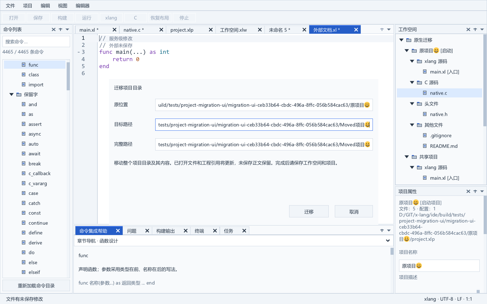
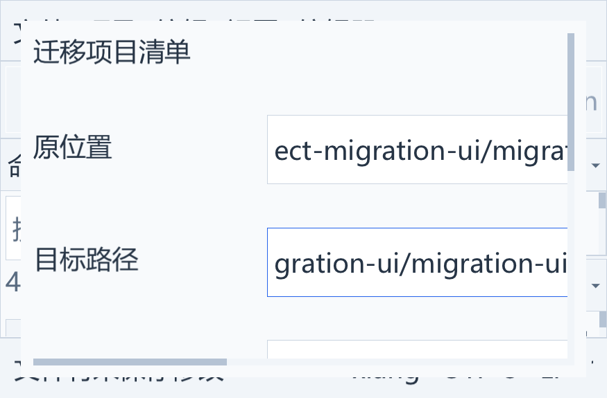

# 项目清单与目录迁移

2026-10-06 已实现项目清单与整个项目目录的原生迁移操作，包含工程模型、已打开文档、旧任务、文件监视和会话绑定。服务位于 services/project_migration.c、editor/documents.c 和 platform/file_rename.c，界面复用 ui/rename_view.c 的模态窗口。此项已通过定向原生交互及完整 Release 验收；完整 IDE 的其他阶段继续实施。

## 使用方法

在右侧工程树选中可用项目，打开“项目 → 迁移项目清单…”或“项目 → 迁移项目目录…”。文件节点所属项目也可作为目标项目；F2 保留原来的当前文件/所选文件改名作用域。

窗口显示原位置、目标输入与解析后的完整路径。目标可填写绝对路径，也可相对原位置的父目录填写；目标父目录必须存在，清单以 .xlp 结尾。取消不移动文件，失败保留输入。确认成功后编辑标签继续打开，受影响的项目及工作空间显示待保存；通过“文件 → 保存工作空间和项目”保存更新后的清单。目录移动不会自动修改源码 import/include 字符串。

## 后端行为

清单模式移动选中项目的 .xlp，更新工作空间项目引用，以及其他项目和工作空间中的该清单文件引用。源码和构建路径继续指向原绝对位置，清单移到另一目录后保存重新计算相对路径。

目录模式一次移动选中项目清单所在的整个普通目录。目录内的嵌套项目、未列入工程的文件和二进制数据随目录移动。当前工作空间中的清单、入口、文件、C 源、编译资源、构建输出、运行目录、include/library 路径按完整目录边界更新；缺失路径和不可用项目引用继续保留。若工作空间清单位于目录内，其绑定也更新。

目录外的源码和硬链接路径保持原位置，不按物理别名强行归入目录。稳定项目/文件/配置 ID、启动项目、当前配置、未知 JSON 字段及库管理元数据保持。运行参数、环境变量和未知字段没有声明为路径，不猜测或替换其中的字符串。源码 import/include 不自动改写。

成功后受影响的可用项目及工作空间标记已修改，保存时按新位置重新计算相对路径；原 JSON 继续作为磁盘保存基线。不可用项目只更新工作空间引用，不伪造可保存的项目正文。后端不隐式保存清单或清除未保存模型修改。

## 准备和提交

Prepare 不改磁盘或模型，预分配全部路径补丁，并保存独立完整模型及集合结构基线。源/目标和迁移路径表归计划拥有；结构地址仅用于临时验证，不作为持久化 ID。即使模型导出语义未变，只要项目或文件集合更换导致补丁槽过期，确认就拒绝提交。

目标父目录必须已存在，目标名称遵守 Windows 文件名规则，清单目标保持 .xlp。目录不能迁入其内部，驱动器根目录不进入该操作。准备核对受影响的已加载清单与磁盘 JSON 基线；提交前再次核对模型、集合和相关清单。

清单模式以流式 SHA-256、物理身份和元数据保护原文件，最终锁定源再执行禁止覆盖的句柄改名。目录模式保存普通非只读目录的物理身份，最终锁定根目录再验证；目录被替换、重解析点、真实共享锁或已有目标会拒绝操作。目录模式移动当前内容，不读取或重新写入每个子文件。大小写变化保留请求拼写，已有目标只接受同一对象的大小写拼写。

磁盘移动仅使用同卷句柄操作；没有合并已有目录或复制后删除的回退。成功后补丁应用无需分配，失败只释放准备数据，原工程绑定保持。根目录内并发内容变化仍需已有文档/清单冲突和保存协议协调；迁移不覆盖这些内容。

## 已执行验收

project_migration_test 不创建 XUI 上下文，使用真实模型、文件系统、任务服务与 DEMO6，验证：

- 清单重命名，跨父目录的整个项目移动，以及嵌套清单移到另一目录；保存、重载并实际构建运行原项目、共享项目和嵌套项目。
- 工作空间位于项目目录内、共享入口/C/清单引用、嵌套和缺失项目、缺失普通文件、构建路径和外部路径；稳定 ID、未知字段、启动项目和当前配置保留。
- 未列入工程的 20 MiB 二进制字节/身份，以及目录外硬链接和相似目录名前缀；参数/环境中的旧路径字面值不变。
- 准备无副作用，目标已存在、目录锁定/只读、源根真实替换、过期模型、语义相同但重新分配的集合、受影响清单的磁盘变化、大小写目录名、重复提交和同名无变化。

后端阶段的严格完整 Release 回归为 44 应用模块、36 类测试、47 公共动作、71 张新鲜原生图及 SDK 负面检查；当时没有迁移窗口图片，原生集成与新增原图见下节。详细日志和指纹见 [实施进度](progress.md)。

## 原生文档和会话事务

打开窗口时保存独立工程/集合基线、源文件或目录身份，以及全部打开文档的基线。文档记录稳定身份、路径、语言覆盖、编辑器版本、脏状态、原始字节、编码和标签；窗口打开期间即使另一个文档由服务调用修改，确认也拒绝执行。Retarget 生成目标计划时还比较初始基线和源身份，不能因重新准备目标而接受被替换的项目。

输入预览只检查路径和父目录；完整工程引用检查在确认时执行，避免每次输入都进行工程级磁盘比较。受影响清单的未保存正文、属性草稿和已作为另一文档打开的目标受到保护。普通 C/xlang 文档可保留未保存修改。

确认先预分配文档新路径、标签、独立项目会话绑定和稳定阅读快照，并保存旧作用域的恢复检查点。文档与模型再次验证后执行物理迁移，成功后一次绑定全部文档，再通知标签和任务。文档元数据的路径与标签提交不再分配；CodeEdit、代码文档、保存基线、版本、选区、折叠、语法缓存、手动语言覆盖、撤销和会话 ID 保留。不会调用普通文件另存为回调去迁移已绑定清单。

旧路径和受影响项目清单使旧构建失效。监视服务在处理下一条磁盘事件前发布新绑定与 epoch，旧路径排队事件不能重新绑定模型；大小写路径变化也丢弃旧路径的比较选择。工程树通过稳定 ID 恢复展开、选择和阅读位置，保持原活动编辑标签。

默认会话存放在清单目录内的 .xlang-ide/workspaces，随整个目录实际移动，摘要保持；保存新的作用域后更新恢复正文路径和最近清单。外置 --session-root 的工作空间按新完整清单路径进入新作用域，旧会话资料保留。独立项目更新 projectSessionPath 后切换作用域。测试使用进程内隔离的 LOCALAPPDATA 验证默认存储，不修改真实用户的全局索引。

确认前会话检查点失败时不移动项目。磁盘提交后的界面刷新或会话写入错误沿用已有错误状态报告，不把已成功移动的目录再次执行。自定义 --session-root 若位于待迁移目录内，本次操作明确拒绝；默认项目内会话已支持。跨卷、慢速/网络存储性能、源码重构和真实语言服务 URI 同步仍属于后续边界。

## 原生集成验收

project_migration_view_test 在未切换前台的独立 Windows 桌面执行真实菜单、输入和按钮，验证：

- 同时打开脏 C/xlang、干净项目/工作空间清单、外部脏文档和未命名 C 文档；目录迁移保留控件、保存基线、语言/会话身份、版本、选区、折叠和撤销，其他活动编辑标签保持。
- 过期文档/模型、原清单同字节原子替换、清单未保存正文、目标恢复文档和真实目录读取锁拒绝迁移；失败输入和原路径保留。
- 共享入口/C 与稳定工程树身份更新，清单单独迁出时源码留在原处；正在构建的旧请求失效，新路径外部修改自动加载，原/共享项目用 DEMO6 实际混编并运行。
- 125% 比例和 40 DIP 窄窗口双向滚动、实际控件字体；外置工作空间作用域和默认项目内会话目录迁移，随后重新创建应用并恢复 C/xlang、脏/未命名正文和会话 ID。

最新完整 Release 回归为 44 应用模块、37 类测试、49 公共动作、73 张新鲜原生图和 SDK 负面检查。两张迁移原图来自此次完整回归，已查看并保存。日志 build/project-migration-ui-full-regression.log 与指纹 build/project-migration-ui-full-evidence.json；后端阶段的 36 类/47 动作/71 图保留为历史记录。长期目标继续旧格式导入、资源与库专用属性、工具链查询、真实双语言服务、全局状态修复、性能和发布验收。

## 中断恢复

迁移记录在移动前保存独立工程模型和 C/xlang 会话正文，并在全局目录发现移动后的所有者。支持物理移动与会话发布之间的进程中断、连续迁移和较新正文优先恢复。受影响清单仍需显式保存。见 [项目迁移中断恢复](migration-journal.md)。
