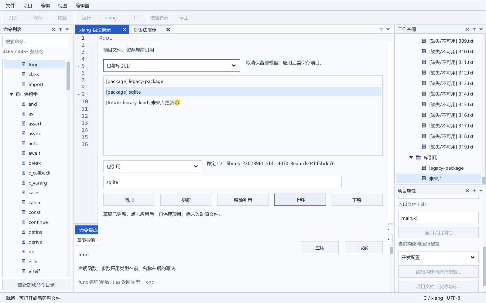
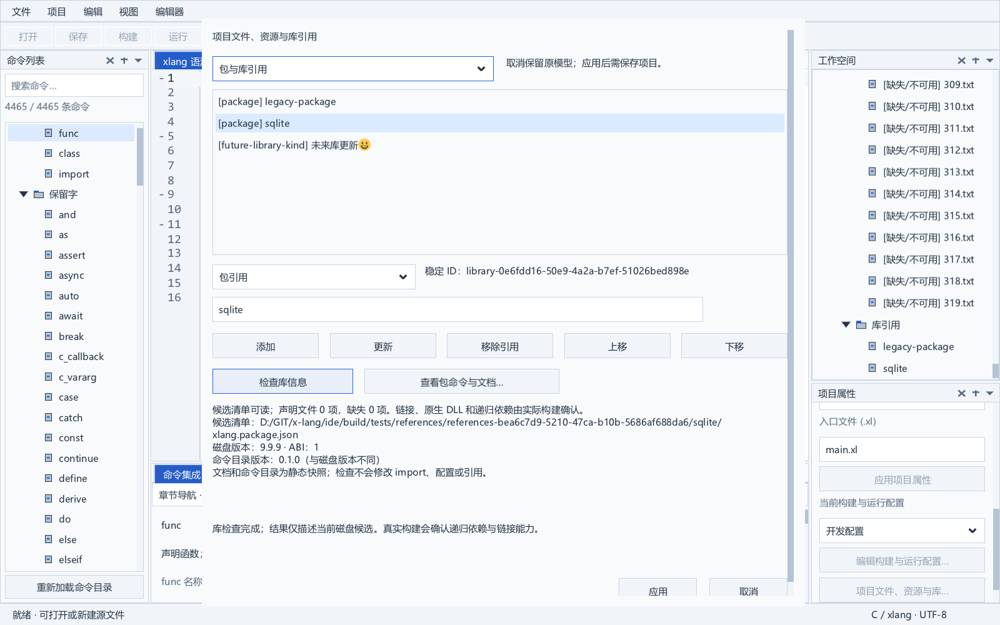
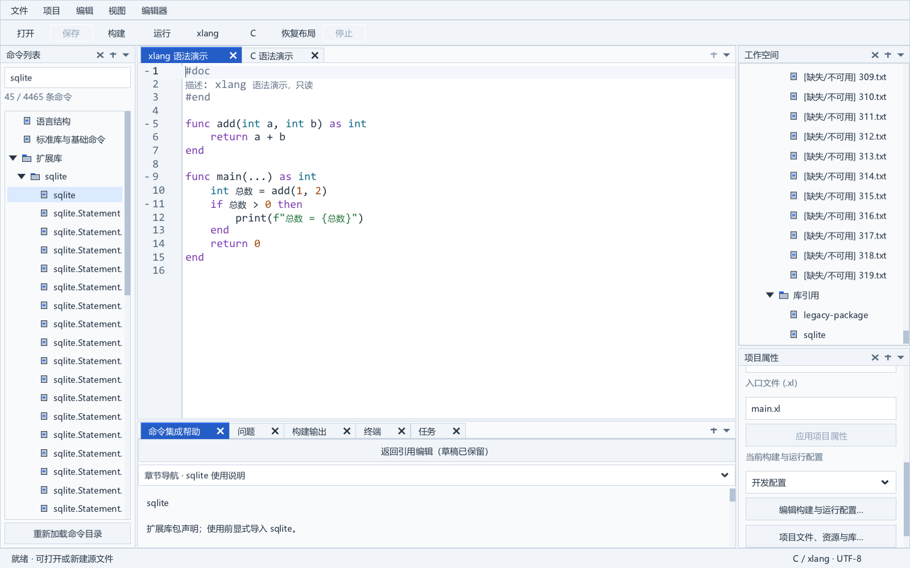
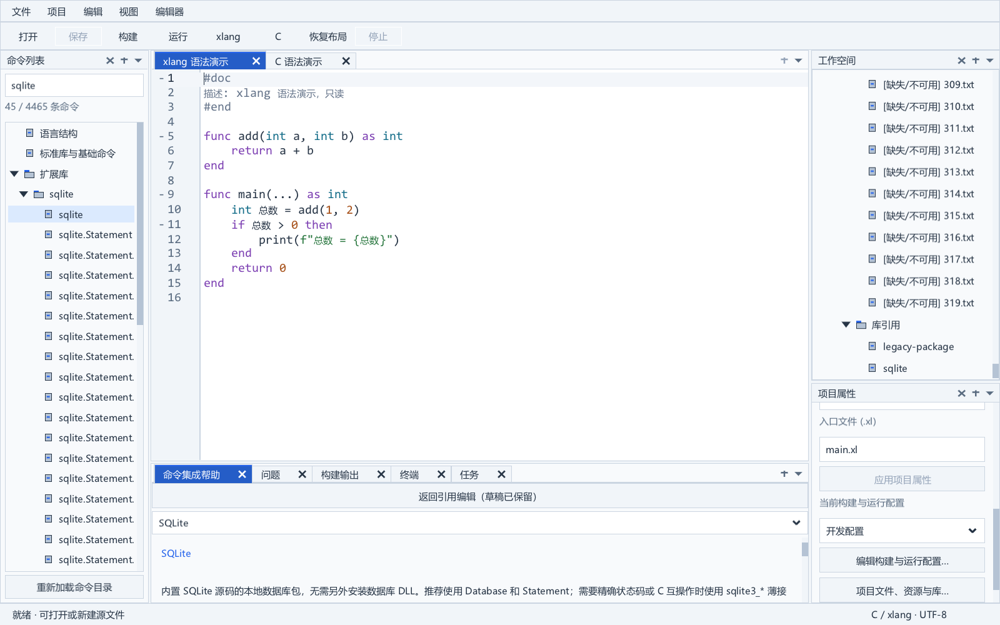

# 工程文件、资源与库引用

本增量在项目菜单和右侧项目属性加入“项目文件、资源与库引用…”入口，使用同一个原生独立草稿窗格。实现位于 model/workspace.c 和 ui/references_view.c，动作通过 ActionRegistry 注册，模型不持有控件。

## 使用与编译语义

先选择工程文件或包/库分类。选择现有行后修改种类和路径/名称，按“更新”；新引用填写后按“添加”。“上移/下移”调整草稿顺序，“移除引用”只删除工程引用。字段尚未加入列表时，“应用”保留窗口和输入并提示先添加或更新。最后按“应用”提交完整草稿，再保存项目。“取消”不修改模型。新窗格打开时回到起始位置，重复调用打开入口不重置正在编辑的草稿。

| 文件种类 | 持久化与构建行为 |
| --- | --- |
| xlang 源码 | .xl；额外文件只用于管理，模块依赖遵循源码 import |
| C 源码 | .c；同步根 cSources |
| 头文件 | .h；不作为独立编译单元 |
| 编译资源配置 | .json/.xlon；同步根 resources，由 DEMO6 编译 |
| 普通资源 | 保持 FileEntry，不自动填入编译资源；图片和普通数据可归此类 |
| 文本 | 保持 FileEntry，供编辑和工程管理 |
| 未知现有种类 | 保留原种类与未知字段，编辑时可选择明确的新种类 |

路径相对于项目清单，可通过系统 Unicode 文件选择器填写，也允许外部绝对引用和当前缺失的目标。重复路径按实际物理身份核对，包含已存在的硬链接；缺失目标不会因加载/保存被删除。入口引用必须保留为 xlang 类型，需要更换入口时先在项目属性操作。移除引用不删除磁盘文件，也不关闭独立编辑文档。

库引用保存到 ide.libraries，用于工程管理、候选包信息检查和静态文档发现；源码 import 与配置中的链接库保持独立。新建库使用 package 种类，未知现有种类可以保留。新记录提供稳定 ID，旧记录可以没有 ID；同一种类与名称以及显式 ID 的重复受到验证。没有把库视图当作自动链接、包下载或依赖安装入口。真实链接选项继续从“构建与运行配置”设置。

## 库信息与包文档

在“包与库引用”分类选择一行，先按添加或更新把字段加入草稿，再使用“检查库信息”或“查看包命令与文档…”。这两个入口不提交引用、不改写源码 import 或构建配置，也不下载和安装依赖。

检查服务读取首个存在的磁盘清单，显示包版本、ABI、声明文件数、缺失项及命令目录版本。两处版本不同会明确标记。命名包的候选顺序依据 DEMO6 的 package 层：项目入口文件目录、继承环境 XLANG_PACKAGE_PATH 的每个根，再从所选编译器目录逐级向上查找 extlibs。环境中的相对根以项目清单目录解析，与构建进程的工作目录一致；空环境段跳过。含路径的名称还检查入口目录和项目清单目录下的明确清单/包目录。

检查限于 xlang-package-1 JSON 的版本和 ABI，以及 artifact 与根字段的 xlSources/cSources。缺省版本为 0.0.0、ABI 为 1。支持 UTF-8 BOM；单个清单最多 4 MiB、相关字符串最多 4096 字节、声明文件合计最多 4096 项。未知字段只读，未知库种类保留并给出没有检查适配器的状态。首个清单损坏时保留其路径和错误，不把后续另一个包当作这个清单；编译器可能拒绝并继续搜索，这种情形以实际构建为准。

“候选清单可读”描述所检查的磁盘文件，不能证明源码中的实际 import、递归依赖、版本约束、C 链接、原生 DLL 或运行时可用。声明文件只检查是否为常规文件；权限与完整语义继续由编译器处理。未发现磁盘清单也不能断定内置模块不可用。当前检查是有界的同步读取，慢速或网络存储的响应仍待性能优化；跨多个文件的结果不是原子磁盘快照。

包命令和长文档来自随 IDE 提供的 CommandCatalog，通过语言、分类、模块种类和完整包名匹配。查看时左侧定位包命令，中央底栏保持单栏命令帮助，提供已有章节导航、范例及来源。没有收录的包或未知库种类给出说明并保留编辑窗口；有包声明但没有 README 的条目仍可查看声明与命令，不生成虚构文档。

查看帮助会暂时收起引用窗格，保留独立草稿、原项目 ID/清单/完整基线、列表选择和字段。帮助上方的“返回引用编辑（草稿已保留）”按钮恢复原草稿；也可重新调用项目引用入口。命令目录重新加载不使草稿持有失效的目录指针。阅读期间可以继续正常 IDE 操作；返回后应用仍按原基线验证，项目改变或移除、清单重新绑定、未保存 JSON/属性冲突都会拒绝提交。既有草稿即使因项目变化无法应用也可返回查看和取消。草稿只保留在当前进程，不作为已保存的工程或跨进程会话内容。

## 事务、身份与状态保护

草稿与打开时的完整项目基线独立拥有数据，编辑过程中不借用可变项目指针。应用按项目 ID 重新查找并比较清单路径和完整导出，已改变的入口、配置、未知元数据或项目重新绑定都阻止过期应用；打开的清单正文仍未保存时拒绝应用。列表所有项一次验证，失败保留模型和草稿；没有变化时不新增脏标记，变化后统一替换 FileEntry、C 源和资源数组及库元数据。

文件稳定 ID 和每条未知元数据保留，另存为重新计算路径。新库的树阅读键使用稳定库 ID，旧库沿用完整定义键；重排或更名后可以恢复原库选择、展开和顶部行。引用提交刷新三层树时保留阅读状态，选中项目和启动项目仍独立。

窗格参与既有模态保护，其他公共动作暂停，停止任务继续走统一入口。外部文件服务继续读取通知，模态期间暂缓清单协调，取消后按实际有效正文恢复协调。保存仍执行磁盘基线与原子写入，不能绕过已有 JSON/属性冲突保护。

## 字体、DPI 与验收范围

窗格使用界面字体，控件和列表行高按逻辑字号调整；字体成功更换与失败回滚的遍历都包含该弹窗。宽/高不足时使用原生两向滚动，40 DIP 下应用、取消和列表选择仍可访问。测试窄视口使用与逻辑尺寸匹配的实际 DPI 渲染表面，不改用户 Windows 显示设置；这些自动比例不能代替实体显示器和输入法验收。

references_test 在未切换到前台的独立 Windows 桌面内运行真实 XGE/XUI。验收包含 324 条文件引用、普通资源/编译资源分离、入口/种类/重复/NUL 保护、物理硬链接、未知字段、另存为往返、菜单和真实属性按钮、列表/分类/重排、草稿取消和过期应用、未保存清单、普通字段快捷键、库稳定选择、外部清单暂停/恢复及大字号滚动。指定 CompilerPath 后另通过任务服务调用真实 DEMO6 编译器，构建并运行 C/xlang 项目，再用 Windows 版本 API 读取实际生成 EXE 的 2.3.4.5 版本资源；普通资源正文故意使用非 JSON，库元数据包含未导入的包，验证二者不会被隐式编译或导入。

完整 Release 结果和实际窗格图见 [实施进度](progress.md)。库的静态文档发现、候选清单/版本/声明文件检查已接入；真实依赖解析查询、完整版本约束和依赖图仍待后续实现。Windows 资源专用表单已接入版本、ICO 和应用清单，保留未知 JSON/有类型 XLON 数据，按单次撤销编辑交给现有文档服务；详见 [Windows 资源属性](windows-resources.md)。资源创建向导与完整新 XLON 类型支持继续实施。重命名和旧格式原生导入已接入，真实语言服务仍属于长期 IDE 目标；导入协议见 [旧格式导入](legacy-import.md)，已实现的模板入口见 [项目模板与新建向导](project-templates.md)。

## 最终验收记录

2026-10-06 完整 Release 含重建、CompilerPath、SDK 负面检查退出码 0：38 个应用模块、30 类测试、61 张原生图。未更新的路径/库名受到保护；已验证真实属性按钮、稳定库选择、40 DIP 下实际列表行和应用/取消按钮，以及真实外部清单暂停/取消后恢复。真实资源构建运行及 PE 版本检查通过，三张最终图已经查看。

完整回归后检测到外部编译器更新，追加 references_test/task_test 在更新版本下通过真实混编、链接、运行、失败构建及 PE 版本资源检查；版本指纹单独记录在实施进度，不改应用源代码或固定 SDK。

## 库信息与文档验收记录

2026-10-06 库增量完整 Release 回归通过：49 应用模块、40 类测试、51 动作、82 张新鲜原生图与 SDK 负面检查。references_test 在隔离桌面检验磁盘/目录版本差异、候选路径顺序、UTF-8 BOM、缺失源、坏字段/NUL、未知种类、未应用草稿和未更新字段，实际点击文档/返回并在命令目录重新加载和项目改变后验证保护。40 DIP 检查结果可通过两轴滚动访问，真实 C/xlang 资源构建和运行继续通过。三张最终新增图已保存并核对。

