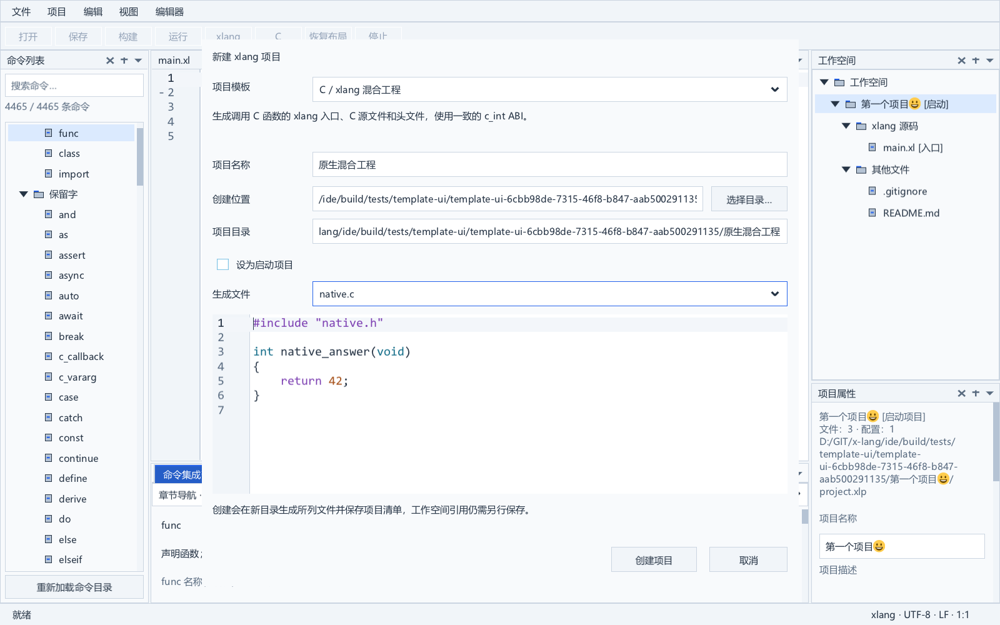

# 项目模板与新建项目向导

项目菜单的“从模板新建项目…”可从空工作台使用，也可向当前工作空间添加项目。原生向导填写项目名称和已有父目录，预览生成文件及完整 project.xlp，选择是否设为启动项目，再按“创建项目”。实现由 services/project_templates.c 与 ui/template_view.c 分担，工程模型不持有控件。

## 模板与使用

| 模板 | 生成内容 | 构建与运行 |
| --- | --- | --- |
| 空白 xlang 应用 | 最小 main.xl、.gitignore、README.md | EXE，入口返回 0 |
| xlang 控制台应用 | Hello, xlang! 入口、.gitignore、README.md | EXE，可直接构建运行 |
| C / xlang 混合工程 | main.xl、native.c、native.h、.gitignore、README.md | xlang extern 调用真实 C 函数，两端使用 C int / c_int ABI |
| xlang 动态库 | main.xl 中导出 xlang_add、.gitignore、README.md | DLL，没有应用 main；由宿主加载，F5 不独立运行 |

每种模板另生成 DEMO6 兼容的 project.xlp，带稳定项目/文件身份、FileEntry 和 development 配置，产物位于 build/development/app.exe 或 app.dll。混合模板的 C 源同步到 cSources，头文件仅作为工程文件；.gitignore 排除 build/。

创建成功后选中新项目并打开 main.xl；已打开文档继续保留。没有工作空间时建立未命名工作空间，项目清单已经保存，工作空间引用仍需通过“保存工作空间”保存。加入现有工作空间后，工作空间标记为已修改，原启动项目保持不变，勾选“设为启动项目”才替换。没有启动项目时默认勾选。

模板文件和清单预览均只读。main.xl 使用 xlang 高亮/折叠，native.c 与 native.h 使用 C；其他文件为纯文本。替换预览正文后再设置语言和生成词法/折叠缓存，使缓存对应实际文档版本，避免 SDK 在缓存过期时回退到 C 分词。

父目录可以输入 Unicode 路径或通过系统目录选择器填写；名称同时用作新目录，限制为 1–120 个 UTF-16 单位，拒绝无效 UTF-8、Windows 保留设备名、路径分隔符、首尾 ASCII 空格和末尾句点。已有目录或同名文件不能作为新项目目标。准备与浏览不写入磁盘，取消保留向导字段而不生成文件；再次打开允许继续修改输入。

## 创建事务与冲突保护

服务先准备完整项目、生成清单与文件内容。提交前确认目标仍不存在、工作空间内没有相同身份或路径引用，并预分配项目数组、返回身份及启动项目字符串。失败时不向工作空间添加半成品。

写入使用父目录内的独立 .xide-new-UUID 暂存目录，按 CREATE_NEW 创建固定模板文件并刷新写入；保存文件物理身份后关闭子文件句柄，再通过持有的目录句柄重命名到最终位置，禁止替换已有目标。Windows 对目录重命名要求子文件已关闭，见 [Microsoft 的 FILE_RENAME_INFORMATION 文档](https://learn.microsoft.com/en-us/windows-hardware/drivers/ddi/ntifs/ns-ntifs-_file_rename_information)。目标在预览后被他人创建时仍拒绝提交。

回滚仅处理本次生成的已知文件：仍打开的文件通过自身句柄删除；已关闭的文件重新打开后比较物理身份、普通文件属性及单链接数量。暂存目录无法完整清理时显示其位置，不递归删除陌生内容。整个协议不覆盖已有目标；进程或系统崩溃可能遗留暂存目录，当前没有自动崩溃清理器。

向导保有独立深拷贝的工作空间与完整项目基线。应用时重新核对；项目属性、配置、未知字段、启动项目、引用或清单绑定已改变则拒绝过期提交，输入保持可见。未应用的右侧属性草稿阻止打开向导；已打开工作空间清单的未保存正文阻止创建。模态期间其他公共动作受到统一保护，停止任务保留既有路由；外部文件监视继续接收通知，清单协调延后到关闭向导，再使用实际正文协调模型。

## 原生界面与验证

向导使用 XUI Window、ComboBox、Input、CheckBox、CodeEdit 和双向滚动。窗口提供标题栏、拖动、缩放和最大化；[窗口迁移清单](window-dialogs.md)记录公共行为。代码预览随代码字体更换，界面字体同时更新字段、按钮、选择框及复选框指标；字体保存失败恢复原字号和阅读状态。小视口及 40 DIP 字号下可以滚动访问真实创建/取消按钮。125% 自动比例测试使用与逻辑视口匹配的实际渲染目标，没有修改用户 Windows 显示设置；实体混合 DPI 与输入法仍需后续验收。

template_test 验证四种模板的完整生成、预览不写盘、清单往返、名称和路径保护、目标竞争与父目录共享锁失败；指定 CompilerPath 后用真实 DEMO6 构建并运行三个应用模板，再构建 DLL 并通过 LoadLibraryW/GetProcAddress 调用实际导出的 xlang_add，核对正负整数结果。

template_view_test 在独立后台 Windows 桌面验证空工作台菜单入口、真实模板/文件选择、当前文档版本的 token、只读预览、清单预览与实际落盘字节一致、取消、启动项目保留与实际复选框、正文/普通输入框隔离、独立过期基线、未保存清单/属性保护、目录竞争和非法名称、实际文件监视延后/恢复、字体失败回滚及大字号创建。窗口重启失败的子进程日志现在记录退出/超时和具体控件类型、世界坐标与缓存策略。

完整回归结果与实际图片在 [实施进度](progress.md) 记录。当前提供四种固定内建模板；用户模板发现、模板包管理、旧格式导入、重命名/另存为引用协调以及真实语言服务仍属于后续长期工作。

## 完整回归记录

2026-10-06 严格 Release 重建与真实 CompilerPath 完整回归退出码 0：40 个独立应用模块、32 类测试、64 张原生图和 SDK 负面检查。四模板真实构建、三个应用运行与 DLL 加载调用通过。三张向导原图来自此次完整回归，已查看；大字号图显示滚动到底部、右侧后的实际创建/取消按钮，完整字段可通过两向滚动访问。

