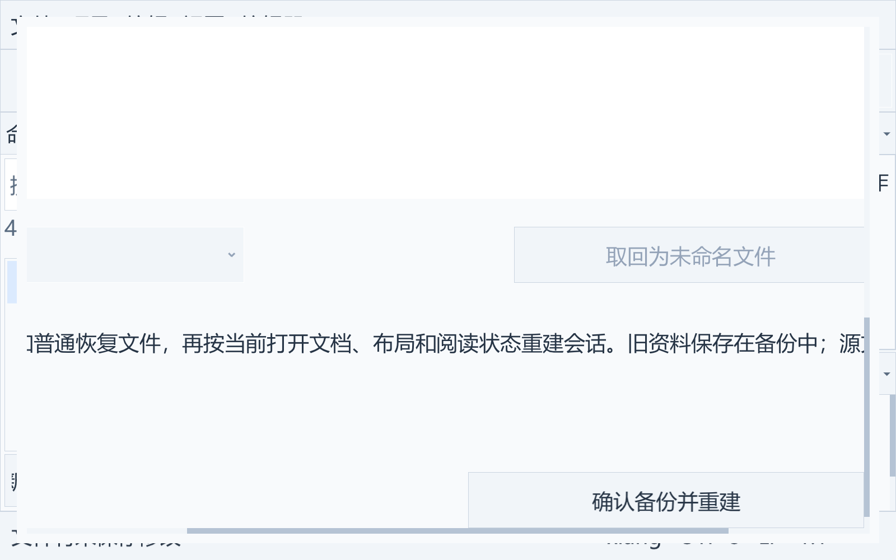

# 恢复存储维护与恢复管理

本模块属于传统 IDE 的文档保护能力。首版使用 C、Win32 和固定 XGE/XRT，正文保持不可变快照；不修改源文件、项目清单或参考项目。

## Windows 深路径

恢复作用域、检查点、备份目录与正文的原生 I/O 使用绝对 Windows 扩展路径。IDE 内部、JSON 和界面仍保存普通 UTF-8 路径及 `/` 分隔符；只有调用 Win32 或固定 SDK 文件接口时转换为反斜杠的 `\\?\` 路径。UNC 路径使用 `\\?\UNC\` 形式，转换不解析或跟随文件链接，原有普通文件检查、目录句柄固定、独占锁、拒绝重解析点及清理保护规则继续生效。无需改变系统长路径开关或 SDK。

专项使用至少 400 个 UTF-16 单元的中文/emoji 作用域，实际执行原始字节备份、元数据撤下/回退、锁定失败、后台取消/待消费结果销毁、扫描/预览、活动 GC 与损坏备份拒绝。另在相同深度的会话存储上执行真实 C/xlang/未命名文档检查点、上一检查点、关闭/重开、选区/布局、放弃更改及损坏状态保护。范围是恢复存储；项目源文件写入、外部编译器和其他工具的任意长路径支持仍各自受其实现约束。实际 UNC 网络共享和最大路径长度尚未作为本次验收。

## 检查点顺序

作用域目录包含 `checkpoint.lock`、`session.json`、可选 `previous-session.json`、`layout.json` 和 `recovery/`。正常保存先取得整个作用域的独占锁，核对加载时的当前会话/布局基线，刷新两份已发布会话正文的最近引用时间，再保留上一份已发布的会话，写不可变正文和基线，发布布局及当前会话，最后更新最近作用域索引并按需维护。每个 JSON 仍使用自身锁和原子替换。

当前和上一份会话所引用的 `.text` 与 `.base` 永远不按年龄清理。上一份会话保留完整未知字段；损坏、格式不支持、引用不安全或保存失败时保护原件，当前编辑的检查点仍可发布，但清理停止。当前会话损坏或外部基线变化则不发布本轮正文与元数据。检查点锁竞争立即返回，不阻塞界面等候另一个进程。

`layout.json` 继续保存新布局及上一已发布布局，以当前 `session.json` 的 `layoutGeneration` 作为提交入口；正文和 JSON 不是一个文件系统事务。外部程序不参与 IDE 锁，仍需基线冲突检测。

## 清理规则

成功发布后最多每小时扫描一次，显式维护服务可立即扫描当前作用域。只遍历 recovery 的一层普通文件，最多 20,000 个条目；完整枚举与两份会话验证成功后才执行删除。当前实现的引用集合使用排序查找，避免文件与引用的平方遍历。

只有 IDE 生成的 `doc-UUID-16位摘要.text/base` 或碰撞备用 `snap-UUID.text/base` 能成为候选。轮换前以原生句柄刷新被引用正文的最后写入时间，内容不改变；因此很早创建但刚失去引用的正文也获得七天宽限。无法刷新普通正文时不替换检查点；永久跳过的只读和硬链接正文不改时间。未引用候选以创建和最后写入/引用时间的较新者计算年龄，至少七天后清理；新复制的旧内容仍获得宽限期。未知文件、旧自定义命名、目录、重解析点、只读文件、硬链接、被其他句柄锁住的文件均保留。不递归删除目录，不删除 `.lock` 或临时文件，不扫描其他作用域。

作用域和 recovery 目录以句柄保持，拒绝 recovery 连接点。候选以禁止并发写入/删除的原生句柄打开，重新验证类型、链接数和年龄，再按该句柄标记删除，避免路径替换误删。会话引用不允许路径穿越，坏引用令整个维护停止。`archives/` 中受支持的版本备份通过清单和普通文件类型/链接数/长度检查后，活动 recovery 仍可维护；备份副本本身不进入清理。陌生目录、未知或损坏备份协议令整个清理停止。不存在或为空的普通 archives 目录允许维护。

统计记录扫描、引用、保留、删除、跳过数量和释放字节；维护失败不使已经成功发布的会话失效。当前未新增用户设置来缩短保留期。

## 原生恢复管理窗口

“视图 → 会话与恢复…”打开原生模态窗口，显示当前作用域路径和保护原因；列表包含当前 recovery 及受支持完整备份中的 `.text` 文件。选择正文后后台读取，使用只读 CodeEdit 预览，可选择 C、xlang 或纯文本语法。“取回为未命名文件”只把已经成功预览的实际正文插入新文档，保留未保存状态，不推断原文件名、不绑定原源文件，也不自动覆盖磁盘文件。当前孤立正文仍可查看；损坏备份不会隐藏可用的当前正文，但会报告警告。

“刷新正文列表”重新扫描当前作用域。“清理过期快照”沿用上述七天规则，不缩短保留期。恢复正文读取限制 16 MiB，必须是普通 UTF-8 文件，沿用 BOM/换行检测和内部 LF 规范化；二进制或无效 UTF-8 明确拒绝预览/取回。未选择或未验证正文时取回按钮不可用。

“备份并重建会话…”先显示窗口内确认说明；取消不修改原元数据。确认后在同一作用域锁下完成备份和原元数据撤下，再由 UI 线程保存当前已打开文档、模型关联、配置、主题、Dock 与阅读状态。当前 C/xlang 编辑器版本、未保存状态和源文件字节保持不变。未取回的旧资料留在备份中。完成、失败或取消确认后窗口滚回顶部，直接显示结果与备份路径。

扫描、预览、维护和备份由 `services/recovery.c` 后台线程处理，线程只持有独立路径与结果，不借用 UI 控件或可变模型。UI 消费结果后更新控件；同一窗口不重叠执行任务。恢复操作期间暂停当前作用域自动检查点和独立窗口位置自动保存；其他设置/工程动作由模态入口隔离。关闭正在工作的窗口请求取消并等待回收，退出先停止服务；备份完成但 UI 尚未消费的元数据撤下会回退。清理已经删除的过期孤立文件不因取消而复原。

固定 SDK 在按钮自己的点击处理内禁用该按钮时，会将 disabled 留在绘制缓存状态；重新启用输入本身不一定刷新该状态。恢复窗口在可用条件更新后，通过公开 xuiWidgetSetStateId 同步实际输入状态对应的缓存槽，保证确认/后台任务结束后按钮的可用外观正确；不改 SDK，也不强制改变焦点。

窗口随独立界面字体与主题更新；代码预览保持代码字体。8–40 DIP 大字号与窄视口通过原生横向/纵向滚动访问全部控件。诊断参数 `--recovery-manager` 只打开该窗口，不自动确认修复；`--no-session` 下禁用作用域正文操作，已指定或默认启用的程序偏好仍可独立修复。

## 备份格式与提交

备份位于当前作用域 `archives/backup-UUID/`，每次创建新目录，不复用已有备份。内容包括：

- `session.json`、`layout.json`、`previous-session.json` 的原始字节副本；存在损坏 JSON、二进制或超过通常元数据读取限制时仍按原字节保存。
- `recovery/` 下全部可读普通文件的独立副本，包括 `.text`、`.base` 及普通陌生文件；不递归复制目录或跟随重解析点。枚举至多 20,000 项，文件名、类型、读取、写入或取消失败时不撤下原元数据。副本不与原文件共享硬链接。
- `manifest.json`，格式 `xlang-ide-recovery-backup-1`，含状态及文件相对路径、原字节长度和内容摘要。

先发布 `state=copying` 的清单，再用 64 KiB 块复制、检查取消并 flush 每个副本，全部成功才原子发布 `state=complete` 清单。原元数据以禁止并发写/删的原生句柄保持。只有 complete 已发布后，才按持有句柄把原元数据移入同一备份的 `retired-session.json`、`retired-layout.json`、`retired-previous-session.json`；已复制原字节始终另外保留。

撤下失败尝试按逆序回退；取消或未消费结果退出也回退尚未提交的撤下操作。回退不替换已存在目标；若外部写入使回退失败，明确报告并保留完整原字节副本。整个作用域锁转交 UI 发布新检查点后释放。发布失败报告实际备份目录，不声称修复成功，也不删除备份或源文件；故障排除后可再次检查/重建。

普通维护永久保留备份目录与副本。complete 校验检查受支持版本、路径、重复项、普通类型、单链接与字节长度；清理前不重新计算内容摘要，因此它不是防篡改校验。copying 只有在没有任何 retired 元数据时允许活动目录维护；部分副本仍保留。未知、损坏或存在撤下状态的未完成备份令维护停止。当前最多验证 1,024 个备份，每份清单至多 20,003 个文件记录；总体性能与备份长期保留策略仍须验收。

## 已验证范围与剩余边界

`recovery_test` 使用 Unicode 路径和实际 Windows 文件系统，第二个原生测试进程验证互斥；覆盖当前/上一引用、七天精确边界、最近引用宽限、创建时间、被锁文件、只读、硬链接、外部链接内容、陌生文件、目录、损坏/未来格式/穿越引用、未知备份及真实连接点拒绝。`session_test` 验证锁失败不改变元数据、上一份引用轮换，以及损坏上一份时最新编辑仍保存而清理停止。

`recovery_backup_test` 验证超过 8 MiB 的无效元数据、包含 NUL 的二进制原件和未来格式均按原字节备份；普通正文、基线及陌生文件副本完整，原生撤下与回退成功；取消、锁定和服务退出保留原件，已完成但未消费的撤下实际回退。维护真实删除过期活动孤立快照后，完整备份正文仍可读取；损坏备份阻止清理。

`recovery_view_test` 在不切换到前台的独立 Windows 桌面运行真实高 DPI XGE/XUI。以原生列表和按钮输入验证损坏状态提示、只读预览、无效 UTF-8 拒绝、C/xlang 未命名文档取回、模态隔离、40 DIP 双向滚动、取消、锁定修复失败、完整备份/重建、结果滚动复位，以及当前编辑版本/脏状态与源文件原字节保留。另有浅/深色 900×600 发布程序窗口截图；原生截图不替代实体显示器与输入法设备验收。

当前作用域修复仍只重建 `session/layout/previous-session` 与恢复正文；独立全局文件使用下面单独的入口。其他工作空间及损坏备份本身不被重建。备份长期管理、累积规模性能、大文件编辑和实体混合 DPI/输入仍是长期目标的剩余工作。

## 独立全局文件备份与修复

同一窗口的“全局文件”下拉框提供最近工程索引、主窗口位置和程序偏好，显示所选文件实际路径。“备份并重建所选文件…”只处理当前选择，确认说明随之切换。最近工程与窗口 JSON 位于实际全局会话根目录；程序偏好使用已加载的真实路径或启动参数 `--settings` 指定的路径，通常在程序 `option/settings.json`，不假定它与会话目录同处。

最近工程索引重建后指向当前工作空间或独立项目，没有打开工程时记录 none。窗口位置记录当前真实原生几何、显示器与最大化状态，重新绑定持久化时不恢复旧位置、不移动窗口。程序偏好保留当前代码/界面字体与已加载的工具偏好；临时 `--compiler`/C 服务启动参数不写入偏好。此前有效设置中的未知成员继续保留；无法读取的格式不被猜测合并，原字节独立保存在备份。

`platform/state_repair.c` 在后台准备备份，以 64 KiB 块流式复制原文件、flush，并记录实际 SHA-256 和字节长度；JSON、UTF-8 或通常 256 KiB/8 MiB 状态读取限制不限制原字节复制。备份位于所选文件父目录的 `state-backups/backup-UUID/`，与作用域 archives 分开。`manifest.json` 使用 `xlang-ide-state-backup-1`，记录 originalPath、existed、bytes、sha256、createdFileTime 与 complete。存在原件时 `original.bin` 为完整独立副本；原本缺失时清单明确记录 existed=false，不伪造原件。

准备阶段不撤下、不修改原件，窗口关闭或未消费结果销毁只释放原生资源。完整备份后 UI 捕获当前小型 JSON，在同一文件写锁下准备并 flush 新文件；已有原件按持有的原生句柄移为 `retired-original.bin`，再原子移动新文件到原路径，不替换竞争文件。发布失败回退撤下；外部文件阻碍回退时保留竞争文件、完整副本和撤下原件并明确报告。成功后重新加载所选持久化服务，原文档不关闭、不重读，文本、版本、语法、选区、脏状态与进程内撤销记录保持。

偏好的普通工具与字体保存现也复用 `<path>.lock` 的共同进程间写锁与加载基线检查。修复固定普通父目录链，拒绝重解析祖先、重解析/硬链接/只读原件及不安全锁文件。备份或源文件锁定时不发布；原件不被跟随到外部路径。容量耗尽、取消或备份清单失败保留原件。完整备份只证明原字节已保存，不能保证两个原生重命名之间遇到进程崩溃后自动恢复；这一小段的原件仍在备份，当前没有自动重放或备份删除功能。

新增 `state_repair_test` 验证 49 项事务边界，包括超过 8 MiB 的无效原件与实际 SHA-256、共同写锁、只读/硬链接/锁定、真实目录连接点和重解析祖先拒绝、取消/待消费资源回收、注入一次 Win32 发布失败后的实际原件回退、原本缺失文件的竞争与暂存碰撞。`settings_test` 另验证共同写锁拦截正常工具和字体写入。`global_recovery_view_test` 在独立 Windows 桌面用实际原生按钮验收三种修复与取消、锁定失败、原几何保持、C/xlang 正文/版本/选区/脏状态和真实撤销重做、有效未知成员与临时工具覆盖、40 DIP 滚动以及关闭会话后的独立偏好修复。原生截图仍不替代实体设备验收。
