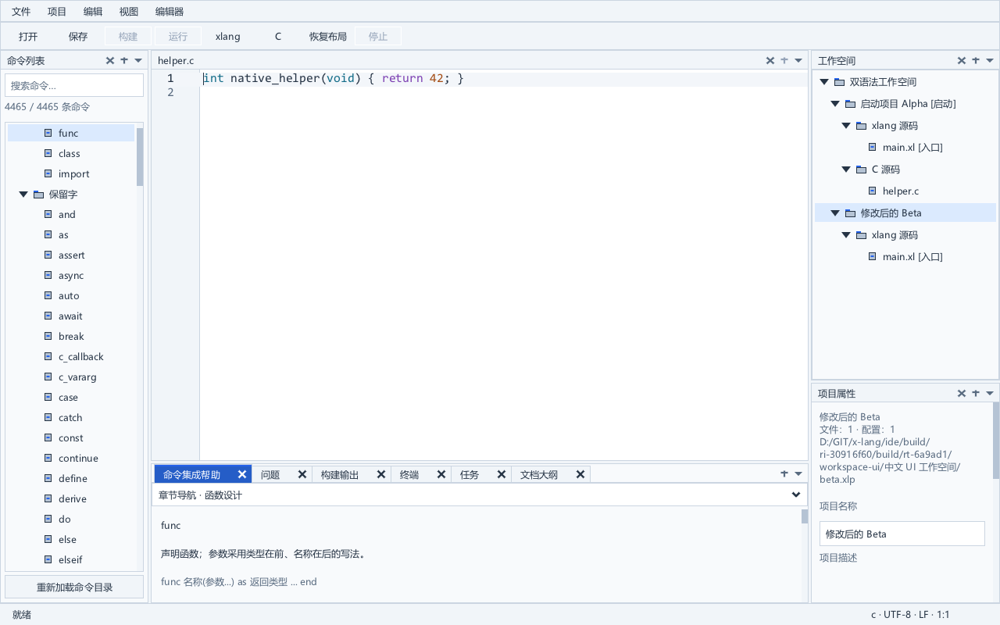
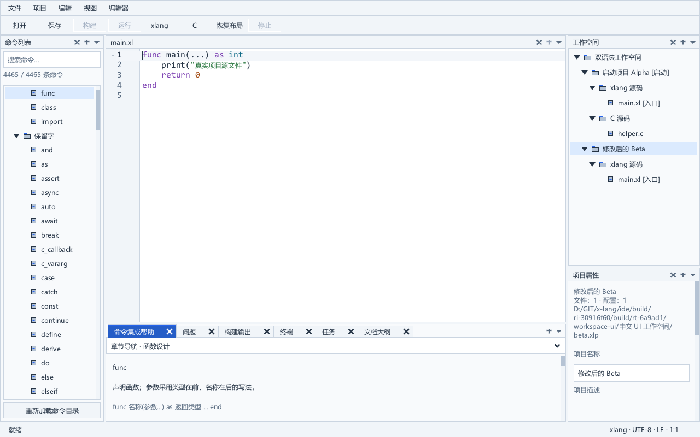

# 行级索引与完整 xlang IDE 集成候选

SDK52 的有界行级定位索引已接入完整原生 IDE，重新完成严格构建、标准运行回归和便携专项检查。编辑器继续支持 C／xlang 双语法；工作空间—项目—文件管理和定版 Dock 布局保持。新包供本地开发验收，极长行整体性能、干净 Windows、实体 IME／混合 DPI、完整 SDK 许可及整体 ABI 继续验收。

## 启动和布局

- [主程序](../dist/portable-20261011-row-index-editor-v1/xlang-ide/xlang_ide.exe)。
- [便携 ZIP](../dist/portable-20261011-row-index-editor-v1/xlang-ide-windows-x64.zip)。
- [包内快速入门](../dist/portable-20261011-row-index-editor-v1/xlang-ide/QUICKSTART.md)。

左侧 Dock 为命令列表；中央编辑器下方为单栏命令集成帮助／输出／终端，底栏夹在左右 Dock 之间；右侧上方工作空间，下方项目属性。首版保持传统 IDE 范围。包内 xlang 和 clangd 使用相对路径作为默认工具链，C／xlang 语法按文档类型选择并支持手动覆盖。

## 实际集成改动

SDK52 相对上一份已通过完整回归的 SDK48，只改动私有 `src/xui_code_edit.c`。64 KiB 以上行段的字节—可视列定位共享最多 32 KiB 的稀疏索引，以文档、内容版本、读取起点和有效 Tab 宽度为有效性键。它保留原字素边界／制表符语义，查询种子留出四字节前瞻空间；读取失败不产生有效索引，分配失败回退到原遍历。同一有效性上下文不会反复尝试已失败的索引扩容。细节、独立旧算法对照以及保留的性能观测见 [行级索引实施记录](large-source-row-index.md)。

DLL、导入库、资源对象来自 SDK52 的同次严格构建，四份公开 XGE／XUI 头、XRT 消费者声明与 SDK48 逐字节一致；5,954 个导出名称和序号一致。应用仍只由 DLL 拥有 XRT。消费者 SDK 及源码描述均重新生成，完整 IDE 在独立源树启用 `XIDE_STREAM_LAYOUT_ENABLED=1` 和 `XIDE_CURSOR_LAYOUT_ENABLED=1`，覆盖十份已验证的工厂／文本追踪文件。没有将时序诊断版 SDK50 或未选用的 Atlas 实验 SDK49 纳入新包。

完整严格构建实际退出 0，用时 223.391 秒；83 个对象与正式源文件清单一致，98 个程序／DLL 均来自本次构建，主程序按名称导入全部五个编辑器访问接口。旧生产目录的七个历史独立探针不属于标准构建，继续明确排除。

准备控制器第一次实际退出 1：它在派生尚未执行的包控制脚本时，错误要求了该脚本不含的基线字段。消费者 SDK 与应用副本已经分别实际准备成功；后续只纠正这部分未执行的脚本派生，保留失败脚本及观测，源码和功能断言未变。

## 标准回归与随包使用

完整标准 `test.ps1` 的原生进程及外层控制器均退出 0，用时 912.313 秒。使用真实冻结 xlang 编译器和两套 clangd，没有 `SkipRender`；保留工作空间／项目／文档、保存恢复、搜索替换、编辑命令、帮助、字体与 DPI、文件变化、迁移重命名、真实 C／xlang 工程构建运行、语义与定义／补全、原生错误恢复等原有断言。基础运行烟雾检查生成 38 张新图，各专项原生图及日志也完整保留。

所有 GUI 检查运行在测试所属、从未切换到前台的私有 Windows 桌面和 Job 中。输出使用复制项目内部的短目录，原有路径与 helper 归属保护保持。SDK 既有深路径原子写入边界没有在本阶段被标记为修复。

便携专项实际完成：

- portable：原生退出 0，61.375 秒。
- scalars：原生退出 0，11.281 秒。
- gui-parent：原生退出 0，98.047 秒。

便携检查使用浅层独立副本中的本地原生 helper，98 份二进制和新候选按摘要逐项核对。检查包含 15 个实际材料／解包拒绝场景、两次随包默认工具链运行和搬迁、四次主程序／控制台程序启动、12 张新 PNG，以及真实 C/xlang 标量桥接和四个 GUI 父进程缓存／中断场景。它们不修改交付评审副本。

## 来源与复现

同一编译器按实际 SDK52 构建配置重新观察 119 个编译单元，确认 211 份预处理依赖属于 241 份实际源码。13 份说明来源保留，材料收集器登记 249 份输入；缺少来源、错误 DLL／源清单和变更的新增 helper 均有明确结果。包中保留本次源构建报告、源清单和父 SDK 清单。

载荷清单包含 4356 份文件，另有清单自身。ZIP SHA-256：`ae2ab7bc0ae14d77eb86a38d327a8603f7320d15695ec281e0cf86c183ec1a71`。清单 SHA-256：`c7698a87957c06c4f635e5ec9be90488e4e3ac3366a966020a0a36c1ac874258`。二进制逐字节沿用本次通过的应用严格构建。

可复现源码补丁为 [V20](../third_party/sdk_patches/large-source-experiment-v20/README.md)，准备入口为 [SDK](../tools/prepare_row_index_sdk.py)、[工厂覆盖](../tools/prepare_row_index_app.py)、[成套消费者 SDK](../tools/prepare_experimental_sdk.py) 和 [完整应用](../tools/prepare_integrated_editor.py)，完整引擎夹具入口为 [test_row_index_sdk.py](../tools/test_row_index_sdk.py)。实际控制脚本和来源摘要保存在本阶段报告中。

严格构建报告：[strict](../build/editor-row-integrated-strict-v1-run.json)；标准回归：[full](../build/editor-row-integrated-full-v1-run.json)；SDK 依赖闭包：[materials](../build/sdk52-materials-closure-v1/result.json)；来源收集：[collection](../build/sdk52-materials-collection-v1.json)；组包：[package](../build/editor-row-integrated-package-v1-run.json)；便携门：[portable](../build/editor-row-integrated-portable-v1-run.json)。

## 预览与剩余验收

这次集成推进了当前可运行候选。上一份 SDK48 完整候选及固定 SDK／生产产物均保留。此前 1,080 项长行原生检查、12 组像素对照和交错复测仍作为索引专项证据，不把集成标准回归当作极长行整体性能通过。冷帧与绝对耗时存在波动，16 MiB 极长行绘制／定位响应还需要后续处理。长期目标继续 active，正式发行及原有复杂扩展库／完整 C 输入图验收没有提前完成。
