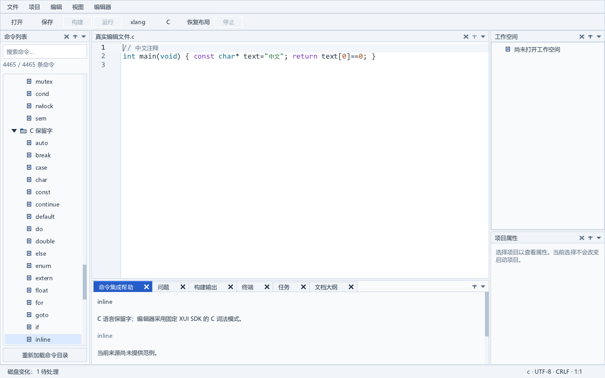
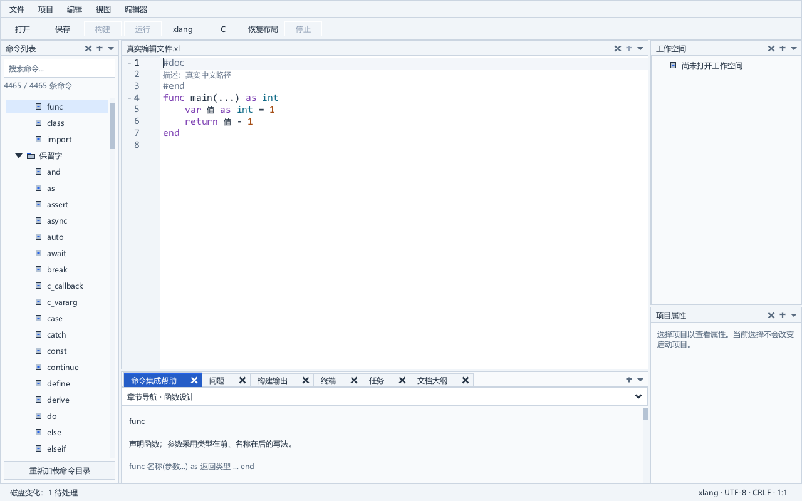

# 深程序路径启动

IDE 在图形初始化前检查自身程序目录。目录在当前 Windows ANSI 代码页下达到 256 字节时，先核对已有短名与原路径是否指向同一卷、同一文件及相同大小；短名目录小于阈值时，通过该别名启动。没有可用短名时，改为在用户临时目录创建本次专用的短目录，仅复制当前 EXE 和 `xge.dll`，逐文件核对 SHA256，再启动副本。父进程等待并返回子进程退出码。参数、工作目录、环境、标准流和实际 Windows 桌面继续传递。驱动和卷的短文件名配置均不修改。

这项处理针对本机已复现的驱动边界。独立 Win32/WGL 程序在 `ChoosePixelFormat` 内触发 `atio6axx.dll` 的 `0xc0000409`；minidump 中的实际调用栈与匹配模块反汇编显示，驱动将程序目录复制到容量为 256 个宽字符的缓冲区。原始中文目录在驱动内部由 GBK 字节逐个扩展到宽字符，观察到 348 个宽字符。独立 ASCII/中文边界实验均在目录 254、255 字节时成功，256、257 字节时失败。观察设备为 AMD Radeon RX 5700，OpenGL 驱动版本 26.8.1.260806。这里只说明该固定驱动与本机路径组合；并非对所有 `0xc0000409` 或所有驱动的解释。Windows 快速失败机制见 [Microsoft 文档](https://learn.microsoft.com/en-us/cpp/intrinsics/fastfail?view=msvc-170)。

生产代码同时将命令目录读取转为已有的 Win32 扩展路径，使别名启动后解析回原中文长路径的 `data/commands.json` 仍能加载。默认界面的命令列表与单栏帮助继续可用。

`startup_alias_test` 与 `check_startup_alias.py` 使用真实 `CreateProcessW`，在从未切换的私有桌面运行。检查空参数、空格、引号、反斜杠、中文、emoji、长参数、环境、工作目录及非零子进程退出码。三个实际 IDE 进程从原始深中文程序路径启动，打开真实 C/xlang 文件、外部深路径字体设置及具体命令帮助，保存三张原生图；原输入文件哈希保持不变。开发用 `native_desktop.py` 显式填写原生 `STARTUPINFOW.lpDesktop`，并用进程作业限制超时清理到本次启动的进程树。

早期完整流水线曾只向 Python 的 `subprocess.STARTUPINFO` 添加 `lpDesktop` 属性；CPython 未传递这一附加属性，不能据此证明那几次流水线的父进程桌面隔离。自行创建并核对私有桌面的原生夹具仍有各自证据。本轮流水线改用实际 Win32 启动接口，旧日志与失败实验保留。

无短名分支固定原 EXE 和图形库的只读句柄，每个文件最多 64 MiB。临时副本完成写入、刷新并复读摘要后保持只读句柄至子进程退出；子进程重新核对当前两文件与原两文件。只有核验成功才接受原安装位置。子进程随后清除三个内部启动关联环境变量，已验证资源位置保存在内存，构建工具和其他后代进程不继承该内部关联。命令目录、随包字体、默认设置、语言服务器、工具链发现及诊断继续使用原位置；用户工程和数据没有复制到启动目录。默认设置读取同时使用已有扩展路径 I/O，深目录下的字体和编译器设置可加载。

正常子进程退出后，只清理本次创建、文件身份仍匹配的两个副本和空目录。若副本被替换或目录出现其他文件，保留外来文件。异常强制终止父进程可能留下临时副本。新格式副本增加绑定用户、目录和文件身份/摘要的记录，父子进程独立持有租约；普通启动有限维护七天前且内容完整匹配的无存活租约副本。外来、修改、链接、旧格式及缺少有效记录的残留保留。详见[启动副本维护](startup-cache.md)。临时位置过长、复制失败、来源摘要不匹配或部分启动关联环境变量出现时，在图形初始化前报告错误。`--help` 继续直接返回。

`startup_stage_test` 覆盖 47 项原生断言：原文件/副本写入删除保护、摘要关联、残缺关联拒绝、正常清理、外来替换和文件保留，以及准备失败后状态清除。`check_startup_noalias.py` 只对新建私有 NTFS 目录用 [SetFileShortNameW](https://learn.microsoft.com/en-us/windows/win32/api/winbase/nf-winbase-setfileshortnamew) 移除短名，不改变卷策略。已有别名依然超过 256 字节后，运行真实 C/xlang GUI、默认字体/设置和具体命令帮助，并从原默认编译器设置构建、运行真实 C/xlang 混合项目。另行检查参数、实际私有桌面、标准输入输出、退出码和正常临时目录清理。早期夹具的隐藏模式跳过默认配置、Windows 超长 TEMP 回退、换行和命名偏移问题均保留记录，最终验收重新执行。

本机无可用别名的安装目录启动已覆盖。外部工具的深工作目录在已有短名可核验时使用原目录的该拼写；无短名时仍受 Windows 工作目录限制，任务明确显示路径长度、系统错误码和缩短目录的建议。2026-10-10 的独立编译器适配修复了深请求清单文件访问及 CLI 的 512 字节项目路径缓冲；真实深工程的 C/xlang 混合构建运行有另行验收。旧失败原记录保留，安装目录启动、文件访问和工程工作目录启动分别说明。详见 [编译器深路径](compiler-native-paths.md) 和 [任务和工具链](tasks-and-toolchain.md)。完整禁用短名的卷、ReFS/UNC、不同显卡驱动、干净 Windows、实体输入法和混合 DPI 设备仍属于正式发行条件。
