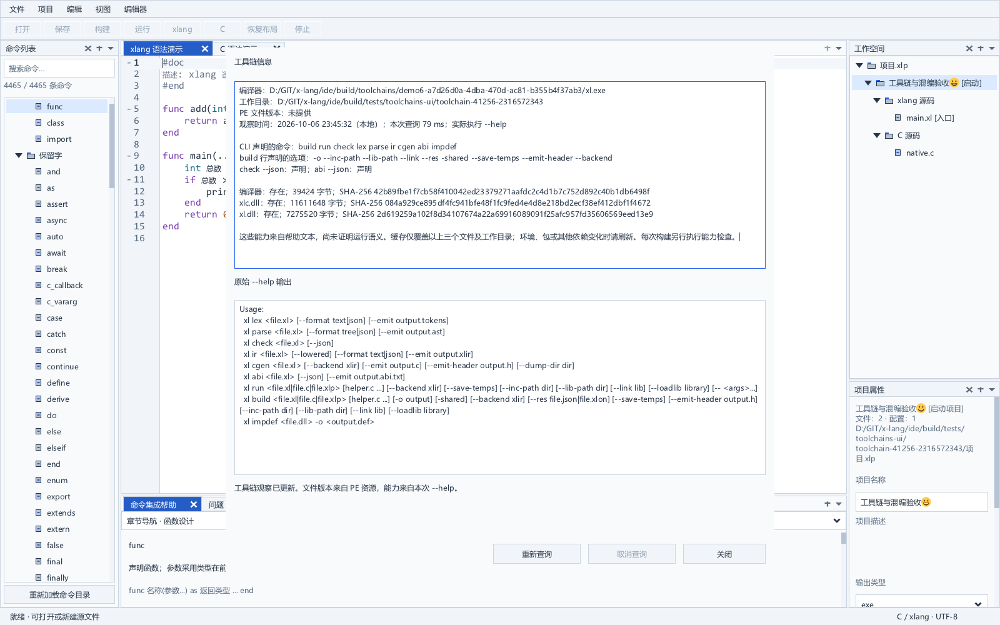
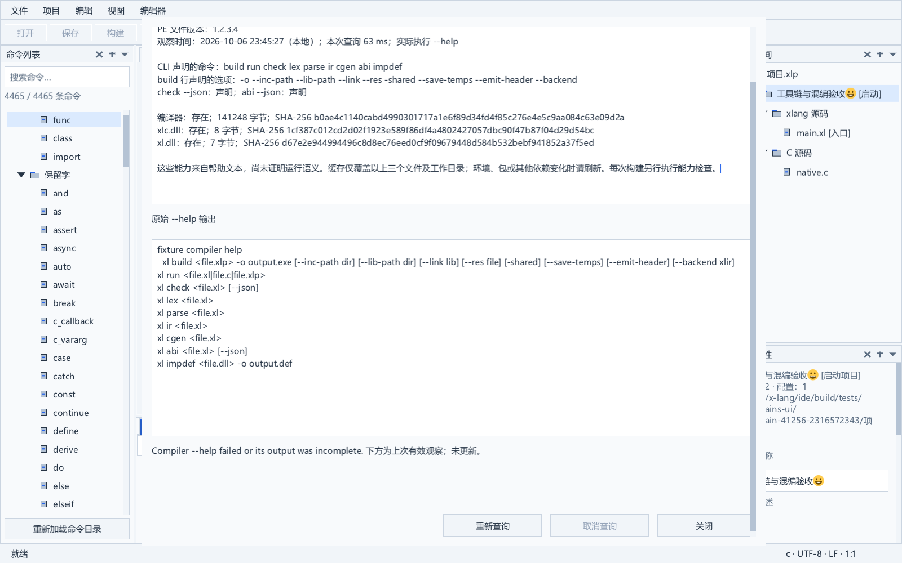

# 工具链信息与能力观察

实现日期：2026-10-06。文件菜单新增“工具链信息…”，按当前编译器与所选项目目录查询；未选择项目时使用编译器目录。定版 Dock 与中央底栏帮助保持原有空间关系。

## 使用

先通过“文件 → 选择 xlang 编译器…”指定编译器，再打开“工具链信息…”。窗口后台查询，按单栏纵向显示文件版本、命令和选项、文件指纹及原始帮助。原始帮助只读，可选择和滚动，不修改源文档。窗口遵循独立界面字体与高 DPI 映射，大字号或窄窗口通过两向滚动访问内容和按钮。

- “重新查询”：实际执行新的 `--help`，检查环境或外部依赖变化。
- “取消查询”：结束本次查询关联的进程树，保留上次有效观察。
- “关闭”：立即收起窗口并请求取消；后台结果完成后释放，不阻塞通常的窗口操作。应用退出先结束查询，再释放共享档案缓存。

刷新失败、取消或查询前后工具链文件变化时，旧观察保留，并明确标记“上次有效观察；未更新”。没有旧结果时显示尚无有效观察。读取状态与按钮外观同步，不把旧帮助当作本次查询成功。查询窗口内禁止其他配置窗口重叠；公共动作继续执行模态保护，活动构建任务仍可停止。

## 版本与能力的含义

“PE 文件版本”只读取可执行文件的 Windows `VS_FIXEDFILEINFO`。未提供资源时显示“未提供”；产品版本与文件版本不是同一个字段。当前固定 DEMO6 没有公开版本查询命令，也没有可执行文件版本资源，因此不生成假设的版本号，不执行未知的 `--version`。

能力来自实际退出码为零的帮助输出。解析 `xl build/run/check/lex/parse/ir/cgen/abi/impdef` 命令行，也接受以这些命令名开头的帮助行；选项须是完整 token。正文中提到 `build` 不算命令声明，`--linking` 不算 `--link`。`-o`、include/library/link、资源、共享库、临时文件、头文件和 backend 选项只从 build 行识别；check/abi 的 JSON 分别限定到各自行。

帮助声明不能证明运行语义、完整项目检查、递归依赖、LSP、DAP、未保存文档分析或某项功能确实成功。原始帮助始终可核对；真实 C/xlang 构建另行验证。

## 身份与缓存

后台流式读取选定可执行文件及同目录 `xlc.dll`、`xl.dll`，记录 SHA-256、文件身份、卷、长度、最后写入时间与属性。两个兄弟文件缺失时分别记录“未发现”，后续增删或替换导致失效。普通只读文件可检查；目录、连接点/重解析文件与超过 512 MiB 的单个文件拒绝。读取前后元数据复核，帮助结束后再次复核全部三个文件。

缓存只存在本进程内，最多 16 个档案，按编译器绝对路径、工作目录与三个文件完整指纹匹配，观察有效期五分钟。缓存命中也在后台重新读取文件指纹；不会把内容相同而身份不同的替换误作原文件。结果字符串由档案拥有，任务、窗口及缓存通过独立副本交接，不持有已释放项目或 UI 指针。

缓存没有覆盖环境变量、包目录、运行依赖、C 头文件及其他 DLL。外部依赖变化时应“重新查询”。档案不写入项目清单或便携设置，不表示全工具链已经被锁定；慢存储下的指纹扫描、持久化版本协调和完整依赖跟踪继续实施。

## 构建与失败保护

每个实际构建继续执行新的 `--help`，即使信息窗口刚查询成功或缓存有效。要求声明 `build` 与 `-o`；配置使用 include/library/link 时，在 build 行逐项核对其声明。该次成功探测记录为任务自己的档案，并与窗口共享观察缓存。

构建产物发布前再次复核三个文件的指纹。帮助解析失败、工具链变化或缺少请求选项时，任务失败，不发布新产物，不启动旧输出。该检查是阶段边界上的复核，不是整个构建期间的文件租约；未列出的递归依赖继续属于既有依赖覆盖边界。

帮助输出限制 65,535 字节，拒绝空输出、NUL、无效 UTF-8、不完整/丢弃输出与非零退出。帮助子进程最多十五秒；取消和关闭结束关联进程。指纹扫描在进程计时之前进行，仍受单文件大小限制，但没有假设网络存储具有固定响应时间。构建正文与运行程序的正常生命周期不受该帮助查询超时限制。

## 验收

`toolchain_test` 使用带真实文件版本 1.2.3.4、产品版本 5.6.7.8 的受控可执行文件，验证读取了文件版本字段。覆盖命令/选项作用域、深复制、工作目录隔离、缓存与强制刷新、兄弟文件增删和同字节替换、只读检查、查询期间文件变化、超量/编码/NUL/退出/超时与取消。

构建反例验证：缓存成功后仍执行新探测；仅 run 行提供链接选项不能批准 build；构建期间兄弟文件变化阻止产物发布与运行，原输出字节保留。原生菜单、按钮、只读输入、失败观察保留、模态互斥、关闭/销毁、125% DPI、40 DIP 两向滚动、C/xlang 正文版本与脏状态保持均有实际验收。固定 DEMO6 的帮助/指纹、实际 C/xlang 混编与运行，以及任务档案独立副本已经验证。

最终整套 Release 回归与固定 SDK/编译器指纹见 [实施进度](progress.md)。构建产物、日志和限制见 [构建运行与任务](tasks-and-toolchain.md)。

