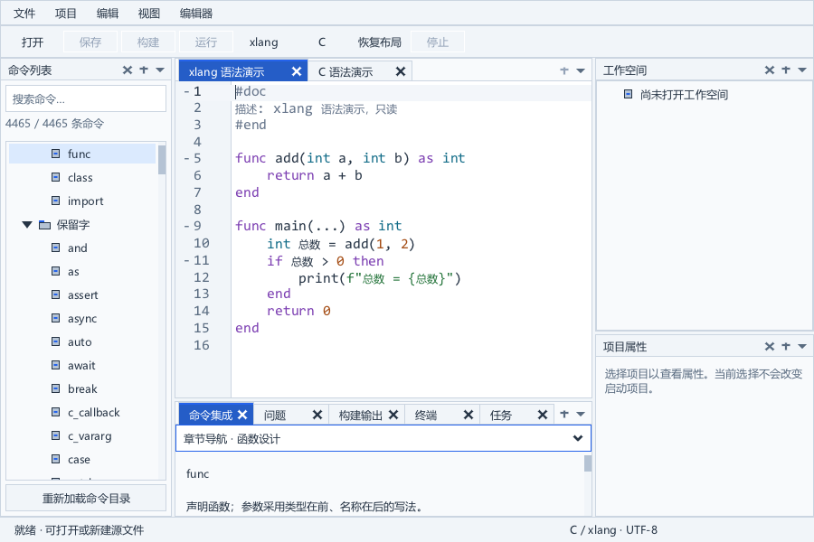

# 主窗口状态

主窗口正常位置、正常尺寸和最大化状态在可见启动时恢复。切换工作空间不会移动或重新最大化窗口。主窗口状态是本机全局偏好，与每个工作空间的 Dock 和文档会话分别保存；当前工作空间元数据损坏时仍可保存主窗口。

## 存储与参数

默认文件是 `%LOCALAPPDATA%/xlang-ide/global/window.json`，诊断 `--session-root PATH` 将它放在隔离目录根部。格式为 `xlang-ide-window-1`，placement 包含以下字段：

| 字段 | 含义 |
| --- | --- |
| coordinateSystem | 固定为 monitor-work-dip-96 |
| x / y | 相对于显示器工作区的正常窗口外框位置，96 DIP |
| width / height | 正常窗口外框尺寸，96 DIP |
| monitor | Windows 显示设备标识 |
| workX / workY | 保存时工作区原点，用于显示器缺失时选择邻近显示器 |
| dpi | 保存时窗口的有效 DPI，保留作诊断 |
| maximized | 启动时恢复最大化；最小化不作为启动状态保存 |

最大化后保存的是正常尺寸，不把最大化矩形写成正常窗口尺寸。从最大化最小化后仍保留恢复最大化的意图。`--size WIDTH HEIGHT` 完整覆盖本次启动的窗口几何恢复，之后仍可保存新状态；`--no-session` 关闭主窗口与会话读写。隐藏渲染始终跳过主窗口读写，即使显式指定隔离会话目录。

## 原生坐标与恢复

Windows 普通顶层窗口的 WINDOWPLACEMENT 正常矩形使用工作区坐标；工具窗口使用屏幕坐标，不能直接将前者传给 SetWindowPos，否则任务栏在顶部等配置会产生重复恢复漂移。[Microsoft WINDOWPLACEMENT 文档](https://learn.microsoft.com/en-us/windows/win32/api/winuser/ns-winuser-windowplacement)

应用捕获原生正常矩形，换算为显示器工作区相对的 96 DIP；恢复时先查显示设备标识，找不到则按旧工作区原点选最近显示器，再规划可见矩形并换回 WINDOWPLACEMENT 坐标。超大和越界窗口裁剪到当前工作区；开启会话的可见主窗口限制最小客户区为 640×480，工作区更小时恢复尺寸以可见范围为上限。

DPI 来自与主窗口同一线程创建的目标显示器隐藏探测窗；GetDpiForWindow 的结果取决于窗口 DPI awareness，而不是无条件的物理显示器 DPI。[Microsoft GetDpiForWindow 文档](https://learn.microsoft.com/en-us/windows/win32/api/winuser/nf-winuser-getdpiforwindow) 应用避免在 per-monitor-aware 线程使用 GetDpiForMonitor。[Microsoft GetDpiForMonitor 文档](https://learn.microsoft.com/en-us/windows/win32/api/shellscalingapi/nf-shellscalingapi-getdpiformonitor)

恢复经 SetWindowPlacement 完成；已隐藏的窗口保持隐藏。[Microsoft SetWindowPlacement 文档](https://learn.microsoft.com/en-us/windows/win32/api/winuser/nf-winuser-setwindowplacement) 此实现处理窗口几何；它不宣告整套 XUI 控件、字体、Dock、输入坐标和跨显示器候选窗的 DPI 缩放已完成。

## 保存与错误保护

原生消息适配先调用 XGE 原窗口过程，再处理最小尺寸和 WM_MOVE / WM_SIZE / WM_WINDOWPOSCHANGED / WM_DPICHANGED 的绘制请求。窗口变化经 750 ms 防抖保存；关闭和检查点也保存。工作空间切换保持同一个窗口状态对象，应用销毁时恢复原窗口过程，避免留下已释放的状态引用。

写入复用状态文件服务的 UTF-8 校验、进程间文件锁、加载基线检查与同目录原子发布。根对象和 placement 的未知字段保留。损坏或不支持的文件保留原件，IDE 继续以当前窗口启动；恢复失败也禁用本次窗口写入。外部冲突和写失败显示错误，自动保存停止重试，避免每帧重复错误；“视图 → 会话与恢复…”的全局文件入口现可独立备份并重建主窗口位置；保存当前几何并重新绑定，不移动当前窗口，见 [恢复管理](recovery-maintenance.md)。

## 已验证范围

window_test 创建单独 Windows 桌面与真实 XGE/XUI 运行循环，桌面不切换到前台。检查正常/最大化/最小化、恢复正常尺寸、应用销毁重建、三个独立发布程序进程的最大化/正常重启与实际 --size 900 600 覆盖、隐藏保留、工作空间切换、20 次恢复无漂移、损坏工作空间会话的独立窗口自动保存、缺失显示器和越界修复、最小客户区、未知字段、冲突、锁定写失败、损坏保护及原生窗口过程清理。生产工作台经过实际绘制并保存截图，SDK 错误回调判失败。

几何规划单独覆盖 96/120/144/168/192 DPI、负显示器坐标和任务栏工作区原点。真实窗口验收使用当前设备的有效 DPI；全工作台的 DPI 渲染现已接入，见 [DPI 与界面字体](dpi-and-ui-fonts.md)；多实体混合 DPI 显示器和任务栏配置改变仍待设备验收，不能用规划测试代替这些检查。

