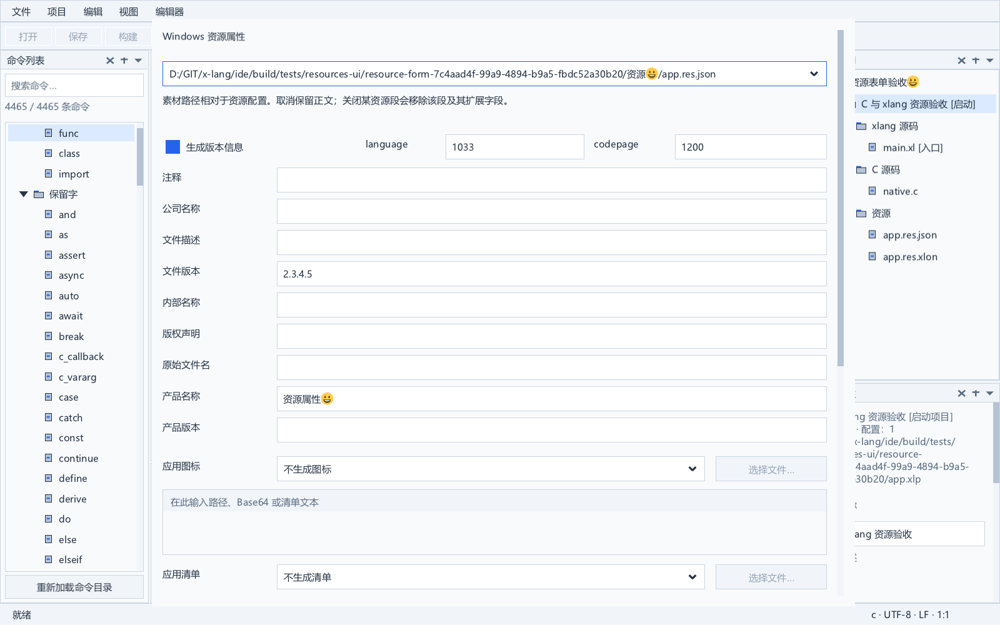
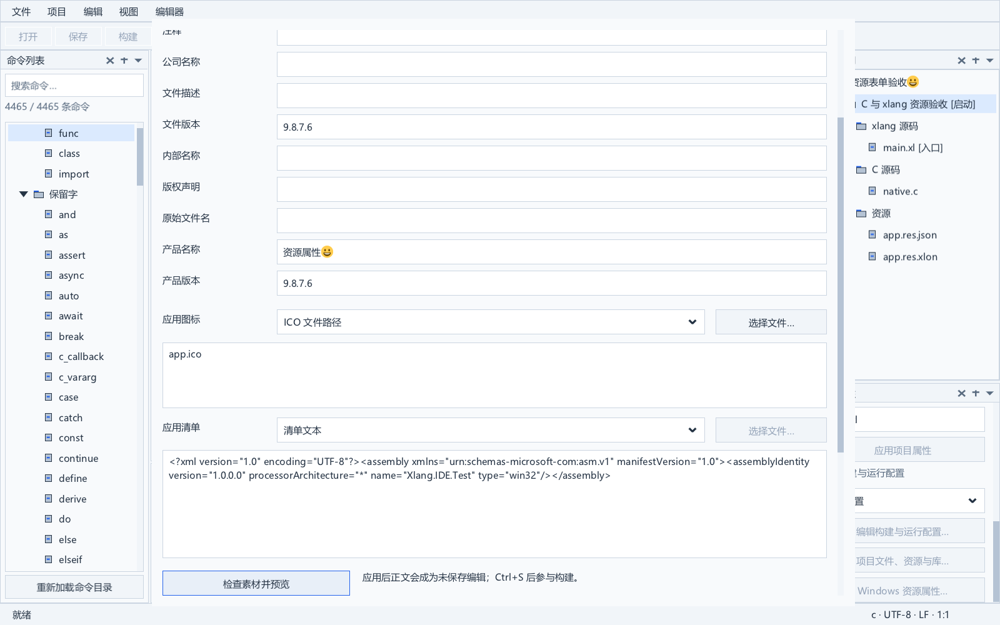

# Windows 资源属性

项目菜单和右侧项目属性提供“Windows 资源属性…”窗口，编辑已加入项目的编译资源配置。支持版本信息、ICO 图标及应用清单；应用会生成一次可撤销的文档编辑，随后通过原有文件保存与构建流程使用资源。

## 使用步骤

1. 在“项目文件、资源与库…”中，将 `.json` 或 `.xlon` 文件添加为“编译资源配置”。普通资源仅用于文件管理，不会自动成为编译输入。新配置可直接从项目菜单或右侧属性的“新建 Windows 资源配置…”创建并加入引用，见 [资源创建流程](resource-creation.md)。也可先用文本编辑器创建并保存，再添加引用。
2. 选择项目，打开“Windows 资源属性…”。选中的资源文件优先打开；没有选中资源时，可在窗口顶部切换配置。
3. 编辑版本信息、图标和清单。图标支持文件路径或 Base64，清单还支持直接输入文本。素材路径相对于资源配置文件所在目录。
4. 点击“检查素材并预览”，查看保留扩展字段的完整配置。检查涵盖字段、素材可读取性和 ICO 目录及图像范围；清单 XML 的语义由实际构建与 Windows 验证。
5. 点击“应用到文档”，再用 Ctrl+S 保存。无变化的应用不打开新文档、不改正文格式；取消也不写文件。已有未保存资源正文会作为表单的输入，应用后仍可逐步撤销回此前修改。修改只更新已知字段，其他值保留原始 XLON 文本。

字段尚未应用时，切换配置会保留当前输入并提示先应用或取消。关闭版本、图标或清单会移除整个对应资源段，包含该段的扩展字段；这是明确的删除操作。

以下配置可以作为一个最小起点：

```json
{
  "format": "xlang-windows-resource-1",
  "version": {
    "fileVersion": "1.0.0.0",
    "productVersion": "1.0.0.0",
    "fileDescription": "xlang application",
    "productName": "My application"
  }
}
```

## 字段和数据保留

| 内容 | 表单行为 |
| --- | --- |
| 版本信息 | 注释、公司、描述、文件版本、内部名称、版权、原文件名、产品名称和产品版本 |
| 版本号 | 1–4 个十进制段，每段 0–65535；空文件版本沿用产品版本，仍为空时使用 0.0.0.0 |
| language 和 codepage | 默认 1033 和 1200；接受编译器的 uint32 十进制范围，保留原整数或字符串表示 |
| ICO | 检查 ICO 标头、目录数及图像字节范围；不转码或改写图像 |
| 应用清单 | 路径、Base64 或文本；不自动更换内容来源 |
| 扩展字段 | 根对象、版本和素材对象的未知字段保留；主动移除资源段时随该段删除 |

Windows 语言 ID 通常使用 0–65535。编译器的版本字符串表和 Translation 使用 language/codepage 的低 16 位，表单保留原 uint32 值，不静默截断。

版本字段兼容 camelCase 与 Windows 官方名称，例如 `fileVersion` 和 `FileVersion`。两者同时存在时，沿用编译器的 camelCase 优先级；编辑只更新当前生效的键，保留另一键。素材对象沿用 path、base64、text 的优先级；内容未改变时完整保留原对象。主动更换素材模式会移除旧的三种内容键，保留其他扩展字段。

JSON 输入仍写为 JSON。现代 `.xlon` 配置中的 `char`、`time`、非有限 `float`、`intmap`、`set`、`bytes` 可以位于根、版本和素材对象的扩展字段中；修改表单后这些值仍保持原始字节拼写，不转换为旧 SDK 值，也不降为 JSON。扩展值可以包含嵌套容器、带转义的字符串及非 BMP 字符。表单没有提供任意扩展数据的类型编辑器，需要修改这些数据时使用中央文本编辑器。

`model/resource_text.c` 保留原正文，同时只把根 `language/codepage/version/icon/manifest`、版本名称及素材 `path/base64/text` 投影到已有 SDK 能表示的字段模型。可由 SDK 完整读取的配置仍保留其完整 DOM；不能完整读取时 `config.root` 只包含已知字段，扩展正文由不可变文本拥有。修改时仅替换变化的已知值、插入新字段或移除明确关闭的字段；保留字段的原键拼写、扩展值、注释、空白和未变化的值。写出后重新解析并核对完整已知字段投影。已有 DOM 扩展字段被其他调用方修改时拒绝表单序列化，避免把修改静默丢弃。

已知字段类型和 NUL 校验保持；重复的已知键、不能确定的容器边界、超过 512 层嵌套或 16 MiB 正文会拒绝打开/写出，原状态保持。扩展值只确定边界，不解释自定义标签或校验其中的完整 XLON 语义；有效性继续由真实编译器决定。格式、根与未知对象的数据没有因为编辑资源属性而重建或丢失。

## 文档与文件保护

窗口冻结项目完整导出、清单路径、当前打开文档的版本和状态，以及资源文件的物理身份和磁盘字节。应用前重新核对这些基线。项目、属性草稿、其他打开文档或资源磁盘发生变化时，过期应用失败并保留字段。原生文件监视在模态期间继续收集通知，关闭窗口后恢复协调。

已有资源的属性表单不直接落盘。正文使用 CodeDocumentReplace 形成一个撤销步骤，继续沿用文档保存点、UTF-8 BOM、换行风格、原子保存和外部修改冲突保护。项目已有资源引用不因此标记为修改。保存相关正文后，现有构建前保存流程和任务输入失效保护继续有效。

资源配置与素材读取各限制 16 MiB，资源正文只支持现有 UTF-8 文档服务的编码范围。没有接入另一份 XRT，也没有加载编译器 DLL 来共享值对象。已加入工程的现代 XLON 配置可以编辑已知资源字段；[资源创建表单](resource-creation.md) 已接入单独的文件与引用事务；[素材改名引用联动](file-rename.md#资源素材引用联动) 会更新图标和应用清单路径并进入撤销历史，配置仍需保存。任意扩展类型的可视化编辑及规模性能继续实施。

## 原生界面与验收

窗口使用独立界面字体，并加入字体更换、模态动作和两向滚动。125% DPI、40 DIP 窄视口下应用与取消按钮可访问。固定 SDK 的空 TextEdit 缓存有绘制限制，窗口用原生背景和提示保留空输入区，出现正文后恢复正常缓存；输入模型始终保持真实空字符串。

resource_view_test 在独立 Windows 桌面运行真实菜单、按钮、配置选择、鼠标和键盘输入及只读预览。覆盖取消、无变化应用、未应用字段切换、单次撤销重做、BOM/CRLF、未保存正文、项目与文档变化、磁盘内容变化及同字节文件替换、未知字段和有类型文本、缺失或错误 ICO、无效 Base64、字体与 DPI。指定 CompilerPath 后实际构建并运行 C/xlang 混编，读取 EXE 的版本 9.8.7.6、RT_ICON、RT_GROUP_ICON 和 RT_MANIFEST；现代 XLON 的根/版本/素材扩展包含 char/time/float/intmap/set/bytes，表单修改、原文保留、单次撤销重做及真实编译均验收。resource_text_test 另覆盖字段投影、别名、素材模式、字段增删、原样 no-op、扩展修改拒绝、BOM/注释、解析失败状态保持及输入/输出限额。

完整回归记录见 [实施进度](progress.md)，引用模型见 [工程文件、资源与库引用](project-references.md)。






