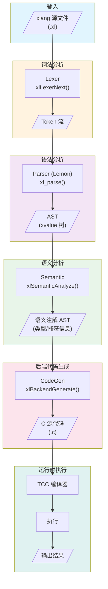
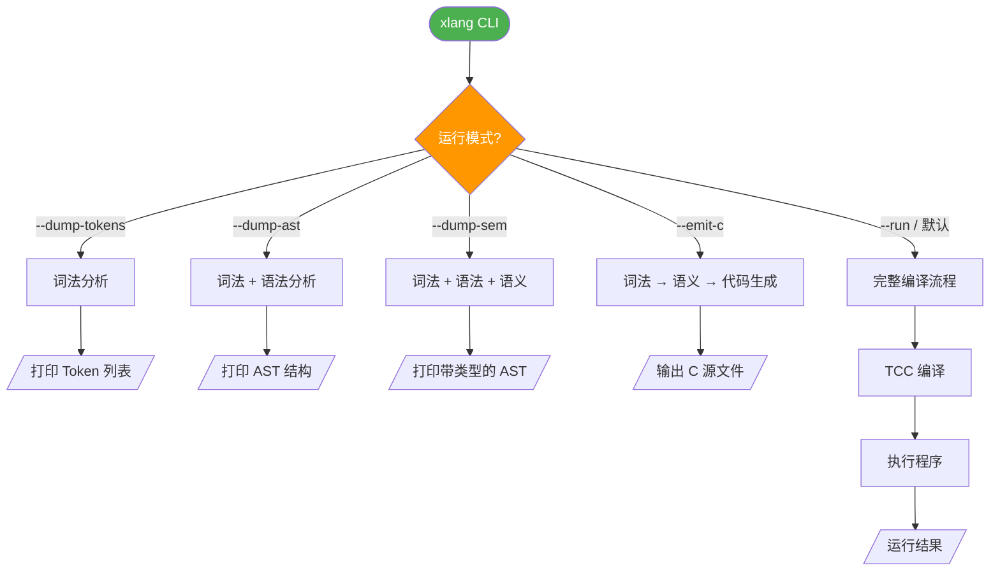
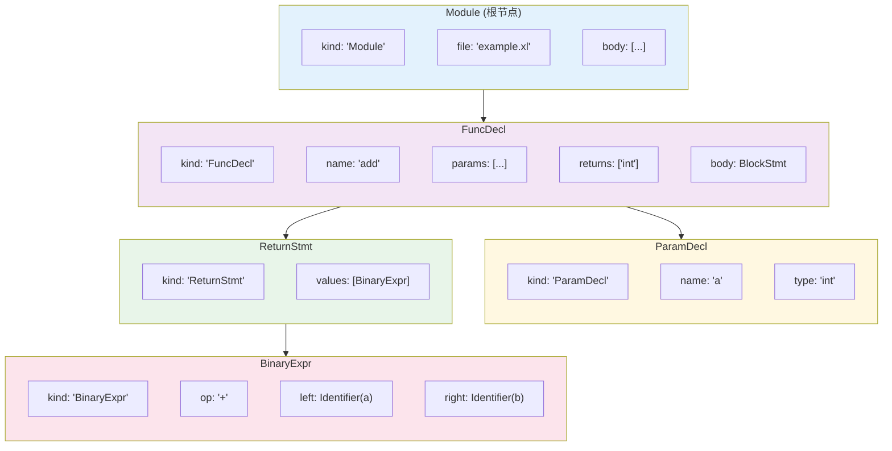
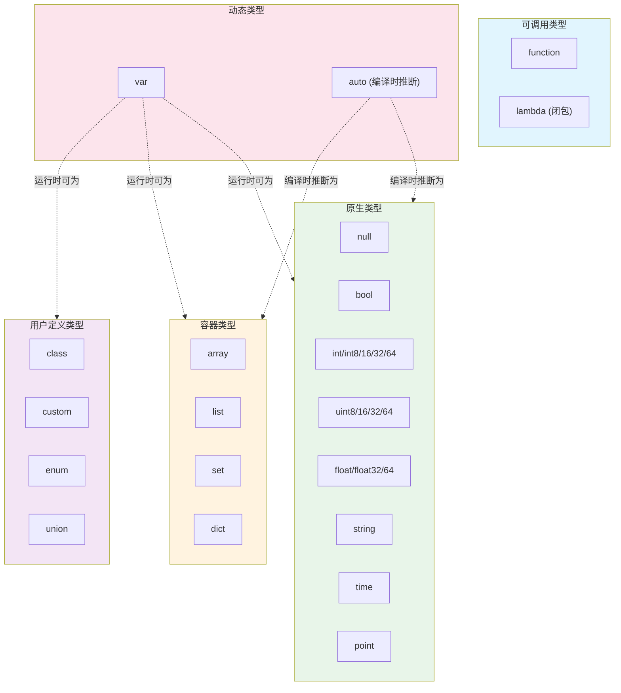
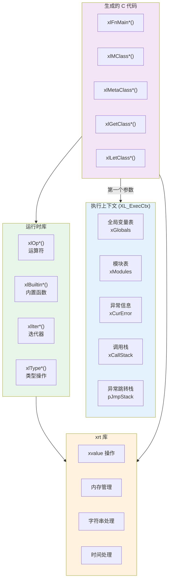
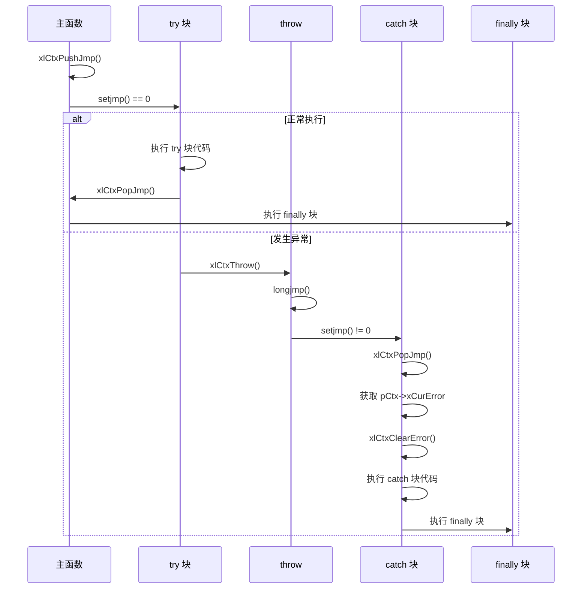
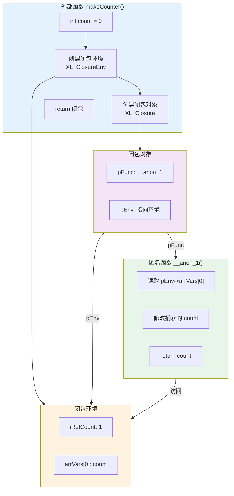
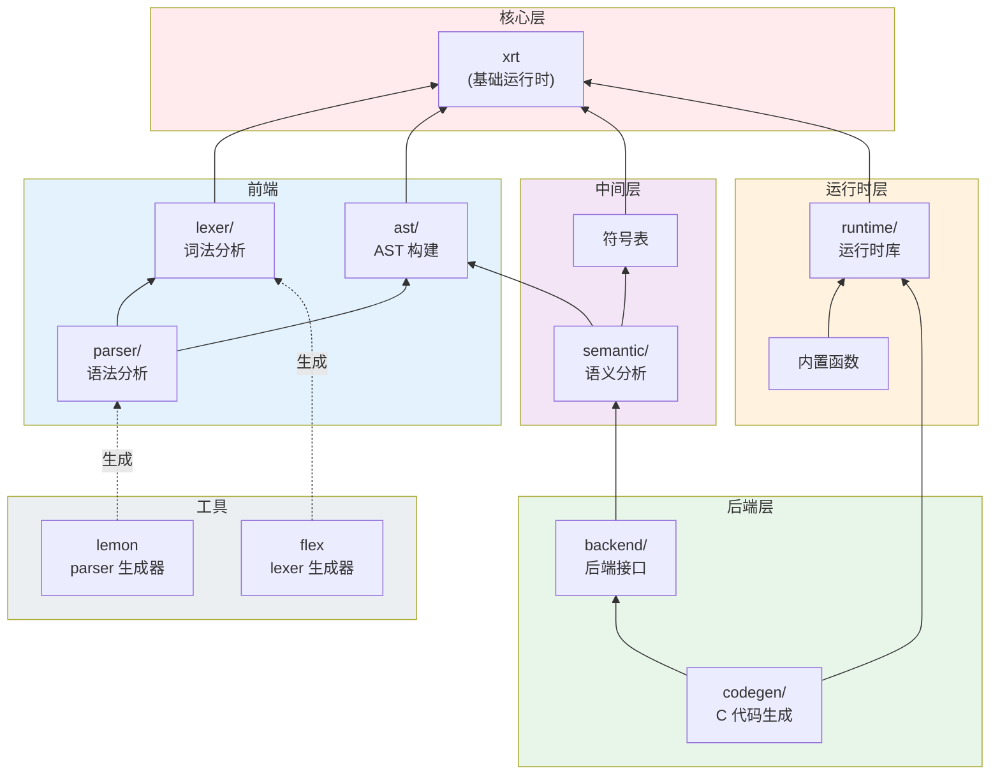
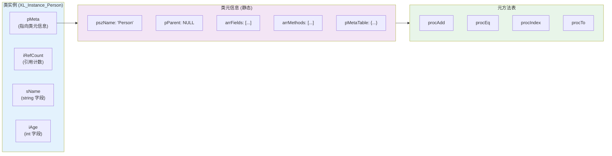
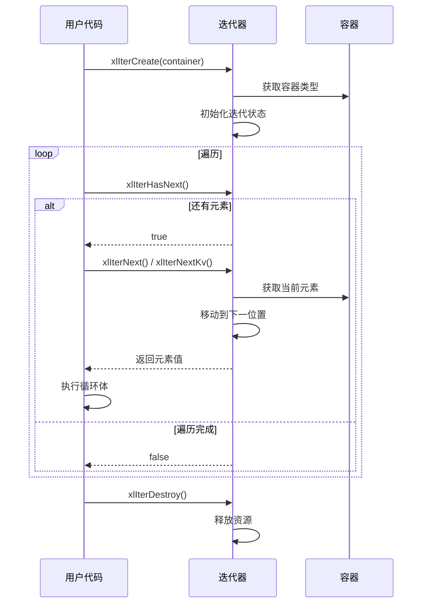

## xlang 第三版 Demo 实施方案（Spec）

本 Spec 面向 **使用 C + xrt 实现 xlang 第三版 Demo**，目标是在 `demo/` 目录下完成一个结构清晰、可扩展、可调试的编译器/运行器原型，并为未来接入多种后端（TCC/GCC/LLVM 等）预留标准化接口。

---

## 1. 项目总体目标与边界

- **语言标准**：以根目录的《语言标准第三版方案.txt》为唯一权威语义来源。
- **实现语言**：C（使用 xrt 作为运行时和工具库）。
- **AST 表达**：使用 xrt 的 `xvalue` 结构表达 AST 节点，方便在运行时打印、调试、序列化。
- **运行模式（第一个 Demo 的目标）**：
	- **脚本模式**：xlang 源码 → 词法 + 语法 + 语义 → 生成 C 源码 → TCC 编译到内存或临时文件 → 直接运行。
	- **检查模式**：可查看 tokenizer 输出、AST 结构、（后续）语义信息、中间 C 代码。
- **未来扩展（需要预留接口，但本 Demo 不完全实现）**：
	- 多后端：TCC（JIT/脚本）、GCC（AOT）、未来可接入 LLVM JIT。
	- 更完整的标准库和优化通道。

**边界**：本 Demo 不追求所有优化（如高级 SSA/闭包逃逸分析），但必须保证：

- 代码结构清晰、模块边界明确。
- 后端接口稳定、简洁，便于后续手动扩展新的后端。
- 每个中间阶段有 **可视化/可打印的调试输出**（分词结果、AST、C 代码）。

备注：xvalue 支持 xvoPrintValue 打印结构，尽可能使用 xvalue 存储各种结构化数据（字典、树、数组、列表等）。

---

## 2. 目录与工程结构

在现有 `d:\git\x-lang` 基础上，本 Demo 主要工作目录为 `demo/`：

```text
demo/
	main.c              // 本 Demo 的入口（C 语言）
	build.bat           // Windows 构建脚本
	build.sh            // Linux 构建脚本
	lib/                // 依赖的库（xrt、tcc、未来可能的辅助库）
		xrt/            // xrt 源码或静态库/头文件（可链接已有项目）
		other.h         // 非 xrt 实现的辅助函数封装（见下文说明）
		...             // 其他内置库
	tools/              // 工具（flex、lemon 源码或模板等）
	release/
		bin/            // 编译出的可执行程序
		cgen/           // 生成的 C 源码输出
		logs/           // 调试日志（可选）
		examples/       // xlang 示例与测试脚本
			token/     // 用于测试分词器的脚本
			ast/       // 用于测试 AST 的脚本
			full/      // 综合功能测试
```

> 说明：根目录 `src/`、`test/` 等保持保留，用于后续正式版本或平行实验。本 Spec 只约束 `demo/` 下这一版 Demo 的结构。

### 2.1 other.h 辅助函数规范

当某些功能无法通过 xrt 实现时，将封装函数放在 `lib/other.h` 中。这些函数的命名和风格应与 xrt 保持一致。

```c
/* lib/other.h - 非 xrt 实现的辅助函数 */

#ifndef XLANG_OTHER_H
#define XLANG_OTHER_H

#include "xrt.h"

/*
 * 命名规范：
 * - 函数名使用驼峰法，前缀 xlOther
 * - 参数命名使用匈牙利命名法
 * - 使用 xrt 类型系统（str, i64, u32, ptr 等）
 * 
 * 示例场景：
 * - 系统调用封装（xrt 未提供的系统 API）
 * - 特定平台功能（Windows/Linux 专用接口）
 * - 第三方库封装（如需要接入其他 C 库）
 */

/* 示例：环境变量操作（xrt 可能未提供） */
str xlOtherGetEnv(str pszName);
void xlOtherSetEnv(str pszName, str pszValue);

/* 示例：进程/线程相关（如 xrt 未提供） */
u32 xlOtherGetPid();
u32 xlOtherGetTid();

/* 示例：动态库加载（跨平台封装） */
ptr xlOtherLoadLib(str pszPath);
ptr xlOtherGetProc(ptr hLib, str pszName);
void xlOtherFreeLib(ptr hLib);

#endif /* XLANG_OTHER_H */
```

> 注意：应优先使用 xrt 提供的功能，只有 xrt 确实无法实现的功能才放入 other.h。每个函数必须有清晰的注释说明其用途和平台差异。

---

## 3. 模块划分与分层架构

整体按 **前端 → 中间层 → 后端 → 运行时** 分层，每一层都需要提供清晰的 C 接口，并配套一个“检查工具模式”。

### 3.1 前端：词法分析（Lexer）

- **职责**：将 xlang 源代码转换为 token 流。
- **实现方式**：优先使用 flex 生成 `demo/src/xl_lex.c`；如需手写，也按相同接口输出。
- **核心数据结构**：
	- `enum XL_TokenKind`：所有 token 类型（关键字、标识符、字面量、运算符等）。
	- `typedef struct XL_Token { ... } XL_Token;`：包含 kind、源文本切片、行列号等。

#### Token 类型完整枚举（XL_TokenKind）

```c
typedef enum XL_TokenKind {
	// ==================== 特殊 Token ====================
	XL_TK_EOF = 0,             // 文件结束
	XL_TK_ERROR,               // 词法错误
	XL_TK_NEWLINE,             // 换行（用于语句分隔）
	
	// ==================== 字面量 ====================
	XL_TK_IDENT,               // 标识符（含中文）
	XL_TK_INT,                 // 整数字面量（十进制）
	XL_TK_INT_HEX,             // 整数字面量（十六进制 0x / &H）
	XL_TK_INT_OCT,             // 整数字面量（八进制 &O）
	XL_TK_INT_BIN,             // 整数字面量（二进制 0b / &B）
	XL_TK_FLOAT,               // 浮点数字面量
	XL_TK_STRING,              // 字符串 "..." （支持转义）
	XL_TK_STRING_RAW,          // 原始字符串 '...' （不支持转义）
	XL_TK_STRING_MULTI,        // 多行字符串 """..."""
	XL_TK_STRING_MULTI_RAW,    // 多行原始字符串 '''...'''
	XL_TK_TEMPLATE,            // 模板字符串 `...`
	XL_TK_TEMPLATE_MULTI,      // 多行模板字符串 ```...```
	XL_TK_TIME,                // 时间字面量 #2000-01-01T12:00:00
	
	// ==================== 数据类型关键字 ====================
	XL_TK_NULL,                // null
	XL_TK_BOOL,                // bool
	XL_TK_TRUE,                // true
	XL_TK_FALSE,               // false
	XL_TK_INT_T,               // int
	XL_TK_INT8,                // int8
	XL_TK_INT16,               // int16
	XL_TK_INT32,               // int32
	XL_TK_INT64,               // int64
	XL_TK_UINT8,               // uint8
	XL_TK_UINT16,              // uint16
	XL_TK_UINT32,              // uint32
	XL_TK_UINT64,              // uint64
	XL_TK_FLOAT_T,             // float
	XL_TK_FLOAT32,             // float32
	XL_TK_FLOAT64,             // float64
	XL_TK_STRING_T,            // string
	XL_TK_TIME_T,              // time
	XL_TK_POINT,               // point
	XL_TK_ARRAY,               // array
	XL_TK_LIST,                // list
	XL_TK_SET,                 // set
	XL_TK_DICT,                // dict
	XL_TK_FUNCTION,            // function
	XL_TK_CLASS,               // class
	XL_TK_CUSTOM,              // custom
	XL_TK_VAR,                 // var
	XL_TK_AUTO,                // auto
	XL_TK_VOID,                // void
	XL_TK_TYPE,                // type
	XL_TK_TYPEDEF,             // typedef
	XL_TK_OBJECT,              // object
	XL_TK_ENUM,                // enum
	XL_TK_UNION,               // union
	XL_TK_RANGE,               // range
	
	// ==================== 控制流关键字 ====================
	XL_TK_IF,                  // if
	XL_TK_THEN,                // then
	XL_TK_ELSE,                // else
	XL_TK_ELSEIF,              // elseif
	XL_TK_END,                 // end
	XL_TK_FOR,                 // for
	XL_TK_IN,                  // in
	XL_TK_TO,                  // to
	XL_TK_STEP,                // step
	XL_TK_WHILE,               // while
	XL_TK_DO,                  // do
	XL_TK_BREAK,               // break
	XL_TK_CONTINUE,            // continue
	XL_TK_RETURN,              // return
	XL_TK_WITH,                // with
	XL_TK_AS,                  // as
	
	// ==================== 类与函数关键字 ====================
	XL_TK_CREATE,              // create
	XL_TK_DESTROY,             // destroy
	XL_TK_GET,                 // get
	XL_TK_LET,                 // let
	XL_TK_META,                // meta
	XL_TK_SELF,                // self
	XL_TK_SUPER,               // super
	XL_TK_PUBLIC,              // public
	XL_TK_PRIVATE,             // private
	XL_TK_PROTECTED,           // protected
	XL_TK_STATIC,              // static
	XL_TK_CONST,               // const
	XL_TK_NEW,                 // new
	XL_TK_EXTENDS,             // extends
	
	// ==================== 调用约定关键字 ====================
	XL_TK_XCALL,               // xcall
	XL_TK_CDECL,               // cdecl
	XL_TK_STDCALL,             // stdcall
	XL_TK_FASTCALL,            // fastcall
	XL_TK_EXTERN,              // extern
	XL_TK_ALIAS,               // alias
	
	// ==================== 逻辑运算符关键字 ====================
	XL_TK_AND,                 // and
	XL_TK_OR,                  // or
	XL_TK_NOT,                 // not
	XL_TK_IS,                  // is
	
	// ==================== 异常处理关键字 ====================
	XL_TK_TRY,                 // try
	XL_TK_CATCH,               // catch
	XL_TK_FINALLY,             // finally
	XL_TK_THROW,               // throw
	XL_TK_ASSERT,              // assert
	
	// ==================== 模块关键字（预留） ====================
	XL_TK_ASYNC,               // async
	XL_TK_AWAIT,               // await
	XL_TK_YIELD,               // yield
	XL_TK_IMPORT,              // import
	XL_TK_EXPORT,              // export
	XL_TK_INCLUDE,             // include
	
	// ==================== 命名空间关键字 ====================
	XL_TK_NAMESPACE,           // namespace
	XL_TK_USING,               // using
	
	// ==================== 比较运算符 ====================
	XL_TK_GT,                  // >
	XL_TK_LT,                  // <
	XL_TK_GE,                  // >=
	XL_TK_LE,                  // <=
	XL_TK_NE,                  // !=
	XL_TK_EQ,                  // ==
	XL_TK_APPROX,              // ~=  约等于
	
	// ==================== 算术运算符 ====================
	XL_TK_PLUS,                // +
	XL_TK_MINUS,               // -
	XL_TK_STAR,                // *
	XL_TK_SLASH,               // /
	XL_TK_PERCENT,             // %
	XL_TK_POWER,               // **  乘方
	
	// ==================== 位运算符 ====================
	XL_TK_AMP,                 // &   位与
	XL_TK_PIPE,                // |   位或
	XL_TK_BANG,                // !   位非
	XL_TK_CARET,               // ^   位异或
	XL_TK_SHR,                 // >>  右移
	XL_TK_SHL,                 // <<  左移
	
	// ==================== 赋值运算符 ====================
	XL_TK_ASSIGN,              // =
	XL_TK_PLUS_ASSIGN,         // +=
	XL_TK_MINUS_ASSIGN,        // -=
	XL_TK_STAR_ASSIGN,         // *=
	XL_TK_SLASH_ASSIGN,        // /=
	XL_TK_PERCENT_ASSIGN,      // %=
	XL_TK_POWER_ASSIGN,        // **=
	XL_TK_INC,                 // ++  自增
	XL_TK_DEC,                 // --  自减
	
	// ==================== 特殊运算符 ====================
	XL_TK_QUESTION,            // ?
	XL_TK_COLON,               // :
	XL_TK_NULL_COALESCE,       // ??  空值合并
	XL_TK_NULL_ASSIGN,         // ?=  空值赋值
	XL_TK_DOT,                 // .   成员访问
	XL_TK_SAFE_DOT,            // ?.  安全成员访问
	XL_TK_DOTDOT,              // ..  （预留：范围）
	XL_TK_ELLIPSIS,            // ... 可变参数（数组）
	XL_TK_ELLIPSIS_DICT,       // *** 可变参数（字典）
	
	// ==================== 分隔符 ====================
	XL_TK_LPAREN,              // (
	XL_TK_RPAREN,              // )
	XL_TK_LBRACKET,            // [
	XL_TK_RBRACKET,            // ]
	XL_TK_LBRACE,              // {
	XL_TK_RBRACE,              // }
	XL_TK_COMMA,               // ,
	XL_TK_SEMICOLON,           // ;   （可选语句分隔符）
	
	// ==================== 枚举结束标记 ====================
	XL_TK_COUNT                // Token 类型总数
} XL_TokenKind;
```

#### Token 结构定义

```c
typedef struct XL_Token {
	XL_TokenKind kind;      // Token 类型
	str pszStart;           // 源码中的起始位置
	u32 iLength;            // Token 长度
	u32 iLine;              // 行号（从 1 开始）
	u32 iColumn;            // 列号（从 1 开始）
	
	// 字面量值（解析后）
	union {
		i64 iValue;         // 整数值
		f64 fValue;         // 浮点值
		struct {
			str pszText;    // 字符串内容（已处理转义）
			u32 iLen;       // 字符串长度
		} sValue;
		xtime tValue;       // 时间值
	};
} XL_Token;
```

#### 关键字表（用于 Lexer 实现）

| 关键字 | Token 类型 | 分类 |
|--------|-----------|------|
| `null` | TK_NULL | 数据类型 |
| `bool` | TK_BOOL | 数据类型 |
| `true` | TK_TRUE | 数据类型 |
| `false` | TK_FALSE | 数据类型 |
| `int` | TK_INT_T | 数据类型 |
| `int8` | TK_INT8 | 数据类型 |
| `int16` | TK_INT16 | 数据类型 |
| `int32` | TK_INT32 | 数据类型 |
| `int64` | TK_INT64 | 数据类型 |
| `uint8` | TK_UINT8 | 数据类型 |
| `uint16` | TK_UINT16 | 数据类型 |
| `uint32` | TK_UINT32 | 数据类型 |
| `uint64` | TK_UINT64 | 数据类型 |
| `float` | TK_FLOAT_T | 数据类型 |
| `float32` | TK_FLOAT32 | 数据类型 |
| `float64` | TK_FLOAT64 | 数据类型 |
| `string` | TK_STRING_T | 数据类型 |
| `time` | TK_TIME_T | 数据类型 |
| `point` | TK_POINT | 数据类型 |
| `array` | TK_ARRAY | 数据类型 |
| `list` | TK_LIST | 数据类型 |
| `set` | TK_SET | 数据类型 |
| `dict` | TK_DICT | 数据类型 |
| `function` | TK_FUNCTION | 数据类型 |
| `class` | TK_CLASS | 数据类型 |
| `custom` | TK_CUSTOM | 数据类型 |
| `var` | TK_VAR | 数据类型 |
| `auto` | TK_AUTO | 数据类型 |
| `void` | TK_VOID | 数据类型 |
| `type` | TK_TYPE | 数据类型 |
| `typedef` | TK_TYPEDEF | 数据类型 |
| `object` | TK_OBJECT | 数据类型 |
| `enum` | TK_ENUM | 数据类型 |
| `union` | TK_UNION | 数据类型 |
| `range` | TK_RANGE | 数据类型 |
| `if` | TK_IF | 控制流 |
| `then` | TK_THEN | 控制流 |
| `else` | TK_ELSE | 控制流 |
| `elseif` | TK_ELSEIF | 控制流 |
| `end` | TK_END | 控制流 |
| `for` | TK_FOR | 控制流 |
| `in` | TK_IN | 控制流 |
| `to` | TK_TO | 控制流 |
| `step` | TK_STEP | 控制流 |
| `while` | TK_WHILE | 控制流 |
| `do` | TK_DO | 控制流 |
| `break` | TK_BREAK | 控制流 |
| `continue` | TK_CONTINUE | 控制流 |
| `return` | TK_RETURN | 控制流 |
| `with` | TK_WITH | 控制流 |
| `as` | TK_AS | 控制流 |
| `create` | TK_CREATE | 类/函数 |
| `destroy` | TK_DESTROY | 类/函数 |
| `get` | TK_GET | 类/函数 |
| `let` | TK_LET | 类/函数 |
| `meta` | TK_META | 类/函数 |
| `self` | TK_SELF | 类/函数 |
| `super` | TK_SUPER | 类/函数 |
| `public` | TK_PUBLIC | 类/函数 |
| `private` | TK_PRIVATE | 类/函数 |
| `protected` | TK_PROTECTED | 类/函数 |
| `static` | TK_STATIC | 类/函数 |
| `const` | TK_CONST | 类/函数 |
| `new` | TK_NEW | 类/函数 |
| `extends` | TK_EXTENDS | 类/函数 |
| `xcall` | TK_XCALL | 调用约定 |
| `cdecl` | TK_CDECL | 调用约定 |
| `stdcall` | TK_STDCALL | 调用约定 |
| `fastcall` | TK_FASTCALL | 调用约定 |
| `extern` | TK_EXTERN | 调用约定 |
| `alias` | TK_ALIAS | 调用约定 |
| `and` | TK_AND | 逻辑运算 |
| `or` | TK_OR | 逻辑运算 |
| `not` | TK_NOT | 逻辑运算 |
| `is` | TK_IS | 逻辑运算 |
| `try` | TK_TRY | 异常处理 |
| `catch` | TK_CATCH | 异常处理 |
| `finally` | TK_FINALLY | 异常处理 |
| `throw` | TK_THROW | 异常处理 |
| `assert` | TK_ASSERT | 异常处理 |
| `async` | TK_ASYNC | 模块(预留) |
| `await` | TK_AWAIT | 模块(预留) |
| `yield` | TK_YIELD | 模块(预留) |
| `import` | TK_IMPORT | 模块(预留) |
| `export` | TK_EXPORT | 模块(预留) |
| `include` | TK_INCLUDE | 模块(预留) |
| `namespace` | TK_NAMESPACE | 命名空间 |
| `using` | TK_USING | 命名空间 |

#### 运算符优先级表（用于 Parser 实现）

| 优先级 | 运算符 Token | 结合性 | 说明 |
|--------|-------------|--------|------|
| 1 | TK_LPAREN, TK_DOT, TK_SAFE_DOT, TK_LBRACKET | 左到右 | 调用、成员访问、索引 |
| 2 | TK_NOT, TK_INC, TK_DEC, TK_MINUS(负号), TK_BANG | 右到左 | 单目运算符 |
| 3 | TK_POWER | 右到左 | 乘方 |
| 4 | TK_STAR, TK_SLASH, TK_PERCENT | 左到右 | 乘除模 |
| 5 | TK_PLUS, TK_MINUS | 左到右 | 加减 |
| 6 | TK_SHL, TK_SHR | 左到右 | 位移 |
| 7 | TK_LT, TK_LE, TK_GT, TK_GE, TK_IN, TK_IS | 左到右 | 关系运算 |
| 8 | TK_EQ, TK_NE, TK_APPROX | 左到右 | 相等性 |
| 9 | TK_AMP | 左到右 | 位与 |
| 10 | TK_CARET | 左到右 | 位异或 |
| 11 | TK_PIPE | 左到右 | 位或 |
| 12 | TK_AND | 左到右 | 逻辑与 |
| 13 | TK_OR | 左到右 | 逻辑或 |
| 14 | TK_QUESTION (三目) | 右到左 | 三目运算符 |
| 15 | TK_NULL_COALESCE, TK_NULL_ASSIGN | 右到左 | 空值处理 |
| 16 | TK_ASSIGN, TK_PLUS_ASSIGN, ... | 右到左 | 赋值 |

- **对外接口（建议）**：

```c
typedef struct XL_Lexer XL_Lexer;

XL_Lexer* xlLexerCreate(str sSource, str sScript, size_t iSize);
XL_Lexer* xlLexerCreateWithFile(str sSource, str sFile);
void xlLexerFree(XL_Lexer *pLexer);

// 逐个取 token，返回 0 表示成功，非 0 表示错误或结束
int xlLexerNext(XL_Lexer *pLexer, XL_Token *pOutToken);
```

- **调试工具**：在 `main.c` 中提供模式：

```bash
xlang --dump-tokens file.xl
```

打印所有 token（kind + 文本 + 行列），方便你检查 lexer 正确性。

### 3.2 前端：语法分析（Parser） + AST（xvalue 表达）

- **职责**：将 token 流解析为 AST（抽象语法树）。
- **实现方式**：使用 lemon，根据《语言标准第三版方案.txt》实现语法。现有 `tools/lempar.c` 可直接复用。

#### BNF/EBNF 语法规范（xlang v3）

> 符号说明：`[ ]` 可选，`{ }` 零或多次，`( )` 分组，`|` 或，`UPPER` 终结符（Token），`lower` 非终结符

##### 模块与顶层结构

```ebnf
module          ::= { top_level_decl }

top_level_decl  ::= var_decl
                  | const_decl
                  | func_decl
                  | class_decl
                  | custom_decl
                  | enum_decl
                  | namespace_decl
                  | typedef_decl
                  | extern_decl
                  | using_decl
                  | statement
```

##### 声明

```ebnf
(* 变量声明 *)
var_decl        ::= [ visibility ] [ STATIC ] type_ref var_init { ',' var_init }
var_init        ::= IDENT [ '=' expr ]

(* 常量声明 *)
const_decl      ::= [ visibility ] CONST type_ref IDENT '=' expr

(* 类型引用 *)
type_ref        ::= base_type | IDENT | func_type_ref
base_type       ::= NULL | BOOL | INT | INT8 | INT16 | INT32 | INT64
                  | UINT8 | UINT16 | UINT32 | UINT64
                  | FLOAT | FLOAT32 | FLOAT64
                  | STRING | TIME | POINT
                  | ARRAY | LIST | SET | DICT
                  | FUNCTION | CLASS | CUSTOM
                  | VAR | AUTO | VOID | TYPE | OBJECT | RANGE

func_type_ref   ::= call_conv FUNCTION '(' [ type_list ] ')' [ AS type_list ]
type_list       ::= type_ref { ',' type_ref }

(* 可见性 *)
visibility      ::= PUBLIC | PRIVATE | PROTECTED

(* 调用约定 *)
call_conv       ::= XCALL | CDECL | STDCALL | FASTCALL
```

##### 函数声明

```ebnf
func_decl       ::= [ visibility ] [ STATIC ] [ call_conv ] FUNCTION func_name
                    '(' [ param_list ] ')' [ AS type_list ]
                    block_stmt
                  | [ visibility ] [ STATIC ] [ call_conv ] FUNCTION func_name
                    '(' [ param_list ] ')' [ AS type_list ]
                    (* extern 函数无函数体 *)

func_name       ::= IDENT [ '.' IDENT ]   (* 支持 ClassName.methodName *)

param_list      ::= param_decl { ',' param_decl } [ ',' variadic_param ]
                  | variadic_param

param_decl      ::= [ type_ref ] IDENT [ '=' expr ]

variadic_param  ::= '...'                  (* 数组可变参数 *)
                  | '***'                  (* 字典可变参数 *)
```

##### 类声明

```ebnf
class_decl      ::= CLASS IDENT [ EXTENDS IDENT ] class_body END

class_body      ::= { class_member }

class_member    ::= field_decl
                  | method_decl
                  | create_decl
                  | destroy_decl
                  | property_decl
                  | meta_decl
                  | union_decl

field_decl      ::= [ visibility ] [ STATIC ] type_ref IDENT [ '=' expr ]

method_decl     ::= func_decl

create_decl     ::= CREATE [ IDENT ] '(' [ param_list ] ')' block_stmt END
                  (* IDENT 为类名，用于类外定义 *)

destroy_decl    ::= DESTROY [ IDENT ] '(' ')' block_stmt END

property_decl   ::= property_get | property_let

property_get    ::= GET [ IDENT '.' ] IDENT [ '[' param_list ']' ] block_stmt END

property_let    ::= LET [ IDENT '.' ] IDENT [ '[' param_list ']' ] '(' param_decl ')' block_stmt END

meta_decl       ::= META IDENT '(' [ param_list ] ')' [ AS type_list ] block_stmt END
```

##### Custom 类型声明

```ebnf
custom_decl     ::= CUSTOM IDENT custom_body END

custom_body     ::= { custom_member }

custom_member   ::= EXTERN call_conv CREATE IDENT '(' [ param_list ] ')' AS POINT
                  | EXTERN call_conv DESTROY IDENT '(' POINT SELF ')'
                  | EXTERN call_conv FUNCTION IDENT IDENT '(' POINT SELF [ ',' param_list ] ')' [ AS type_ref ]
                  | EXTERN call_conv META IDENT IDENT '(' POINT SELF [ ',' param_list ] ')' [ AS type_ref ]
```

##### 枚举声明

```ebnf
enum_decl       ::= ENUM IDENT [ AS type_ref ] enum_body END

enum_body       ::= { enum_value }

enum_value      ::= IDENT [ '=' expr ]
```

##### 命名空间与导入

```ebnf
namespace_decl  ::= NAMESPACE namespace_path namespace_body END

namespace_path  ::= IDENT { '.' IDENT }

namespace_body  ::= { top_level_decl }

using_decl      ::= USING namespace_path [ AS IDENT ]

typedef_decl    ::= TYPEDEF IDENT '=' type_ref

extern_decl     ::= EXTERN STRING extern_body END
                  | EXTERN call_conv FUNCTION IDENT '(' [ param_list ] ')' [ AS type_ref ] [ ALIAS IDENT ]

extern_body     ::= { extern_func }

extern_func     ::= call_conv FUNCTION IDENT '(' [ param_list ] ')' [ AS type_ref ] [ ALIAS IDENT ]
```

##### 联合体声明

```ebnf
union_decl      ::= [ visibility ] UNION IDENT union_body END

union_body      ::= { union_field }

union_field     ::= type_ref IDENT [ '[' INT_LITERAL ']' ]
```

##### 语句

```ebnf
statement       ::= block_stmt
                  | expr_stmt
                  | if_stmt
                  | for_stmt
                  | while_stmt
                  | do_while_stmt
                  | break_stmt
                  | continue_stmt
                  | return_stmt
                  | try_stmt
                  | throw_stmt
                  | with_stmt
                  | assert_stmt
                  | var_decl
                  | const_decl

block_stmt      ::= { statement }

expr_stmt       ::= expr [ ';' ]

(* if 语句 *)
if_stmt         ::= IF expr THEN statement                (* 单行 if *)
                  | IF expr block_stmt { elseif_clause } [ else_clause ] END

elseif_clause   ::= ELSEIF expr block_stmt

else_clause     ::= ELSE block_stmt

(* for 循环 *)
for_stmt        ::= FOR [ IDENT ',' ] IDENT IN expr block_stmt END

(* while 循环 *)
while_stmt      ::= WHILE expr block_stmt END

(* do-while 循环 *)
do_while_stmt   ::= DO block_stmt WHILE expr

(* 跳转语句 *)
break_stmt      ::= BREAK [ INT_LITERAL ]

continue_stmt   ::= CONTINUE [ INT_LITERAL ]

return_stmt     ::= RETURN [ expr_list ]

(* 异常处理 *)
try_stmt        ::= TRY block_stmt CATCH IDENT block_stmt [ FINALLY block_stmt ] END

throw_stmt      ::= THROW '(' expr ',' expr [ ',' expr ] ')'

(* with 语句 *)
with_stmt       ::= WITH with_resources block_stmt END

with_resources  ::= with_resource { ',' with_resource }

with_resource   ::= expr [ AS IDENT ]

(* 断言 *)
assert_stmt     ::= ASSERT expr [ ',' expr ]
```

##### 表达式

```ebnf
expr            ::= assignment_expr

expr_list       ::= expr { ',' expr }

(* 赋值表达式 *)
assignment_expr ::= conditional_expr
                  | unary_expr assign_op assignment_expr
                  | '(' expr_list ')' '=' expr   (* 多返回值赋值 *)

assign_op       ::= '=' | '+=' | '-=' | '*=' | '/=' | '%=' | '**=' | '?='

(* 条件表达式 - 三目运算符 *)
conditional_expr ::= null_coalesce_expr [ '?' expr ':' conditional_expr ]

(* 空值合并 *)
null_coalesce_expr ::= or_expr { '??' or_expr }

(* 逻辑或 *)
or_expr         ::= and_expr { OR and_expr }

(* 逻辑与 *)
and_expr        ::= bitor_expr { AND bitor_expr }

(* 位或 *)
bitor_expr      ::= bitxor_expr { '|' bitxor_expr }

(* 位异或 *)
bitxor_expr     ::= bitand_expr { '^' bitand_expr }

(* 位与 *)
bitand_expr     ::= equality_expr { '&' equality_expr }

(* 相等性 *)
equality_expr   ::= relational_expr { ( '==' | '!=' | '~=' ) relational_expr }

(* 关系运算 *)
relational_expr ::= shift_expr { ( '<' | '<=' | '>' | '>=' | IN | IS ) shift_expr }

(* 位移 *)
shift_expr      ::= additive_expr { ( '<<' | '>>' ) additive_expr }

(* 加减 *)
additive_expr   ::= multiplicative_expr { ( '+' | '-' ) multiplicative_expr }

(* 乘除模 *)
multiplicative_expr ::= power_expr { ( '*' | '/' | '%' ) power_expr }

(* 乘方 - 右结合 *)
power_expr      ::= unary_expr [ '**' power_expr ]

(* 一元表达式 *)
unary_expr      ::= postfix_expr
                  | ( NOT | '-' | '!' ) unary_expr

(* 后缀表达式 *)
postfix_expr    ::= primary_expr { postfix_op }

postfix_op      ::= '(' [ arg_list ] ')'              (* 函数调用 *)
                  | '[' index_expr ']'                 (* 索引访问 *)
                  | '?[' index_expr ']'                (* 安全索引 *)
                  | '.' IDENT                          (* 成员访问 *)
                  | '?.' IDENT                         (* 安全成员访问 *)
                  | '++'                               (* 后缀自增 *)
                  | '--'                               (* 后缀自减 *)

index_expr      ::= expr [ TO expr ]                   (* 切片 a[1 to 5] *)
                  | expr { ',' expr }                  (* 多索引 a[1, 2, 3] *)

(* 函数调用参数 *)
arg_list        ::= arg { ',' arg }

arg             ::= [ IDENT ':' ] expr                 (* 支持命名参数 *)
```

##### 基础表达式

```ebnf
primary_expr    ::= IDENT
                  | literal
                  | '(' expr ')'
                  | '(' expr_list ')'                  (* 多值表达式 *)
                  | array_expr
                  | list_expr
                  | set_expr
                  | dict_expr
                  | lambda_expr
                  | new_expr
                  | type_cast_expr
                  | type_of_expr
                  | range_expr

(* 字面量 *)
literal         ::= INT_LITERAL
                  | FLOAT_LITERAL
                  | STRING_LITERAL
                  | TEMPLATE_LITERAL
                  | TIME_LITERAL
                  | TRUE | FALSE | NULL

(* 数组字面量 *)
array_expr      ::= '[' [ expr_list ] ']'              (* 注意：空 [] 是列表 *)
                  | NEW ARRAY '(' [ expr_list ] ')'

(* 列表字面量 *)
list_expr       ::= '[' list_entry { ',' list_entry } ']'
                  | '[' ']'                            (* 空列表 *)
                  | NEW LIST '(' ')'

list_entry      ::= expr ':' expr                      (* key : value *)

(* 集合字面量 *)
set_expr        ::= '{' expr { ',' expr } '}'          (* 非空集合 *)
                  | NEW SET '(' [ expr_list ] ')'

(* 字典字面量 *)
dict_expr       ::= '{' dict_entry { ',' dict_entry } '}'
                  | '{' '}'                            (* 空字典 *)
                  | NEW DICT '(' ')'

dict_entry      ::= dict_key ':' expr

dict_key        ::= IDENT                              (* 裸标识符作为键名 *)
                  | STRING_LITERAL                     (* 字符串键 *)
                  | '[' expr ']'                       (* 计算键 *)

(* 匿名函数 *)
lambda_expr     ::= FUNCTION '(' [ param_list ] ')' [ AS type_list ] block_stmt END

(* new 表达式 *)
new_expr        ::= NEW IDENT '(' [ arg_list ] ')'

(* 类型转换 *)
type_cast_expr  ::= type_ref '(' expr ')'

(* 类型获取 *)
type_of_expr    ::= TYPE '(' expr ')'

(* range 表达式 *)
range_expr      ::= RANGE '(' expr ',' expr [ ',' expr ] ')'
```

##### 模板字符串展开

```ebnf
(* 模板字符串在词法阶段处理，展开为以下结构 *)
template_literal ::= '`' { template_part } '`'

template_part   ::= TEMPLATE_TEXT                      (* 纯文本部分 *)
                  | '{$' expr '}'                      (* 表达式插值 *)
```

##### Lemon 实现注意事项

1. **优先级与结合性**：在 `.y` 文件头部使用 `%left`、`%right`、`%nonassoc` 声明
2. **冲突处理**：
   - `if-then` 单行与多行：使用 `THEN` 关键字区分
   - 空 `[]` 与 `{}` 歧义：`[]` 始终为空列表，`{}` 始终为空字典
   - `new array()` vs `[...]`：显式区分
3. **错误恢复**：在关键产生式添加 `error` 符号，便于报错后继续解析
4. **AST 构建**：每个产生式的语义动作调用 `xl_ast_*` 系列函数创建 xvalue 节点

- **AST 表达**：
	- 所有 AST 节点使用 xrt 的 `xvalue` 结构表达：
		- 对象类（dict-like）用于表示节点：`{"kind": "BinaryExpr", "op": "+", "left": ..., "right": ...}`
		- 数组用于表示节点列表：`[node1, node2, ...]`
	- 优点：易于打印、序列化为 JSON 风格、便于在 C 层和未来 xlang 层调试。

- **核心接口（建议）**：

```c
// AST 根节点使用 xvalue 表达
xvalue xlParse(xvalue xLexerConfig, XL_ErrorList *pErrList);
```

> 实际实现中你可以使用更直接的签名，例如 `xvalue xlParseFromSource(str pszSource, str pszFileName, XL_ErrorList *pErrList);`，内部自己创建/销毁 lexer。

- **AST 结构约定（重要）**：
	- 根节点：
		- kind: "Module"
		- fields:
			- `body`: 数组，元素为语句/声明节点。
	- 典型节点类型（部分示例）：
		- `VarDecl`：`{"kind":"VarDecl","name":"a","type":"int","init": exprOrNull}`
		- `FuncDecl`：`{"kind":"FuncDecl","name":"foo","params":[...],"ret": typeOrList,"body": block}`
		- `ClassDecl`、`EnumDecl`、`NamespaceDecl` 等。
		- 表达式：`BinaryExpr`、`UnaryExpr`、`CallExpr`、`MemberExpr`、`IndexExpr`、`LambdaExpr` 等。

> 以下是完整的 AST 节点规范表，所有节点使用 xvalue (table) 表达，必须包含 `kind` 字段。

#### AST 节点规范表

##### 通用字段

所有 AST 节点都包含以下通用字段：

| 字段 | 类型 | 说明 |
|------|------|------|
| `kind` | string | 节点类型标识（必须） |
| `line` | int | 源码行号（调试用） |
| `col` | int | 源码列号（调试用） |

##### 模块与声明

| kind | 字段 | 类型 | 说明 |
|------|------|------|------|
| **Module** | `body` | array | 顶层声明/语句列表 |
| | `file` | string | 源文件路径 |
| **VarDecl** | `name` | string | 变量名 |
| | `type` | TypeRef \| null | 类型（null 表示 var/auto） |
| | `init` | Expr \| null | 初始值表达式 |
| | `is_const` | bool | 是否为常量 |
| | `is_static` | bool | 是否为静态 |
| | `visibility` | string | "public" \| "private" \| "protected" |
| **MultiVarDecl** | `vars` | array[VarDecl] | 多变量声明 `int a, b = 1, c` |
| **FuncDecl** | `name` | string | 函数名 |
| | `params` | array[ParamDecl] | 参数列表 |
| | `returns` | array[TypeRef] | 返回类型列表（支持多返回值） |
| | `body` | BlockStmt \| null | 函数体（extern 时为 null） |
| | `callconv` | string | "xcall" \| "cdecl" \| "stdcall" \| "fastcall" |
| | `is_static` | bool | 是否为静态方法 |
| | `visibility` | string | 可见性 |
| | `variadic` | string \| null | null \| "array" \| "dict" （可变参数类型） |
| **ParamDecl** | `name` | string | 参数名 |
| | `type` | TypeRef \| null | 参数类型（null 为 var） |
| | `default` | Expr \| null | 默认值 |
| **ClassDecl** | `name` | string | 类名 |
| | `parent` | string \| null | 父类名（null 或 "object"） |
| | `members` | array | 成员列表（字段、方法、属性、元方法等） |
| **CustomDecl** | `name` | string | custom 类型名 |
| | `members` | array | 成员列表（extern 绑定的函数） |
| **EnumDecl** | `name` | string | 枚举名 |
| | `base_type` | TypeRef \| null | 底层类型（默认 int） |
| | `values` | array[EnumValue] | 枚举值列表 |
| **EnumValue** | `name` | string | 枚举项名 |
| | `value` | Expr \| null | 显式值 |
| **UnionDecl** | `name` | string | 共用体名 |
| | `members` | array[FieldDecl] | 成员字段 |
| **NamespaceDecl** | `name` | string | 命名空间名（支持 "A.B.C" 格式） |
| | `body` | array | 命名空间内容 |
| **TypedefDecl** | `name` | string | 类型别名 |
| | `target` | TypeRef | 目标类型 |
| **ExternDecl** | `lib` | string \| null | DLL 名称（批量导入时） |
| | `funcs` | array[FuncDecl] | 外部函数列表 |
| **UsingDecl** | `path` | string | 导入路径 "MyLib.Utils" |
| | `alias` | string \| null | 别名 |

##### 类成员

| kind | 字段 | 类型 | 说明 |
|------|------|------|------|
| **FieldDecl** | `name` | string | 字段名 |
| | `type` | TypeRef | 字段类型 |
| | `init` | Expr \| null | 初始值 |
| | `visibility` | string | 可见性 |
| | `is_static` | bool | 是否静态 |
| **MethodDecl** | 同 FuncDecl | | 类方法，额外可访问 self |
| **CreateDecl** | `params` | array[ParamDecl] | 构造函数参数 |
| | `body` | BlockStmt | 构造函数体 |
| **DestroyDecl** | `body` | BlockStmt | 析构函数体 |
| **PropertyGet** | `name` | string | 属性名 |
| | `params` | array[ParamDecl] | 索引参数（无参属性为空数组） |
| | `body` | BlockStmt | 属性体 |
| **PropertyLet** | `name` | string | 属性名 |
| | `params` | array[ParamDecl] | 索引参数 |
| | `value_param` | ParamDecl | 设置值参数 |
| | `body` | BlockStmt | 属性体 |
| **MetaDecl** | `meta_name` | string | 元方法名（"add", "sub", "index" 等） |
| | `params` | array[ParamDecl] | 参数列表 |
| | `returns` | array[TypeRef] | 返回类型 |
| | `body` | BlockStmt | 方法体 |

##### 语句

| kind | 字段 | 类型 | 说明 |
|------|------|------|------|
| **BlockStmt** | `stmts` | array | 语句列表 |
| **ExprStmt** | `expr` | Expr | 表达式 |
| **IfStmt** | `condition` | Expr | 条件表达式 |
| | `then_branch` | BlockStmt \| Stmt | then 分支 |
| | `elseif_branches` | array[ElseIfClause] | elseif 分支列表 |
| | `else_branch` | BlockStmt \| null | else 分支 |
| | `is_single_line` | bool | 是否为单行 if-then |
| **ElseIfClause** | `condition` | Expr | 条件 |
| | `body` | BlockStmt | 分支体 |
| **ForStmt** | `key_var` | string \| null | 键变量名（可选） |
| | `value_var` | string | 值变量名 |
| | `iterable` | Expr | 可迭代表达式 |
| | `body` | BlockStmt | 循环体 |
| **WhileStmt** | `condition` | Expr | 条件 |
| | `body` | BlockStmt | 循环体 |
| **DoWhileStmt** | `body` | BlockStmt | 循环体 |
| | `condition` | Expr | 条件 |
| **BreakStmt** | `level` | int | 跳出层数（默认 1） |
| **ContinueStmt** | `level` | int | 跳过层数（默认 1） |
| **ReturnStmt** | `values` | array[Expr] | 返回值列表（支持多返回值） |
| **TryStmt** | `try_block` | BlockStmt | try 块 |
| | `catch_var` | string | catch 变量名 |
| | `catch_block` | BlockStmt | catch 块 |
| | `finally_block` | BlockStmt \| null | finally 块 |
| **ThrowStmt** | `error_type` | Expr | 错误类型 |
| | `message` | Expr | 错误消息 |
| | `code` | Expr \| null | 错误码 |
| **WithStmt** | `resources` | array[WithResource] | 资源列表 |
| | `body` | BlockStmt | with 块 |
| **WithResource** | `expr` | Expr | 资源表达式 |
| | `alias` | string \| null | as 别名 |
| **AssertStmt** | `condition` | Expr | 断言条件 |
| | `message` | Expr \| null | 错误消息 |

##### 表达式

| kind | 字段 | 类型 | 说明 |
|------|------|------|------|
| **Identifier** | `name` | string | 标识符名 |
| **Literal** | `value` | var | 字面值 |
| | `literal_type` | string | "int" \| "float" \| "string" \| "bool" \| "null" \| "time" |
| | `raw` | string | 原始文本（调试用） |
| **TemplateLiteral** | `parts` | array | 模板字符串各部分（字符串或表达式） |
| **BinaryExpr** | `op` | string | 运算符（"+", "-", "==", "and" 等） |
| | `left` | Expr | 左操作数 |
| | `right` | Expr | 右操作数 |
| **UnaryExpr** | `op` | string | 运算符（"not", "-", "!", "++" 等） |
| | `operand` | Expr | 操作数 |
| | `is_postfix` | bool | 是否后缀（++/--） |
| **TernaryExpr** | `condition` | Expr | 条件 |
| | `then_expr` | Expr | 真值表达式 |
| | `else_expr` | Expr | 假值表达式 |
| **NullCoalesceExpr** | `left` | Expr | 左表达式 |
| | `right` | Expr | 缺省值表达式 |
| | `is_assign` | bool | 是否为 ?= 形式 |
| **CallExpr** | `callee` | Expr | 被调用表达式 |
| | `args` | array[CallArg] | 参数列表 |
| **CallArg** | `name` | string \| null | 命名参数名（位置参数为 null） |
| | `value` | Expr | 参数值 |
| **MemberExpr** | `object` | Expr | 对象表达式 |
| | `member` | string | 成员名 |
| | `is_safe` | bool | 是否为 ?. 安全访问 |
| **IndexExpr** | `object` | Expr | 对象表达式 |
| | `index` | Expr \| array[Expr] | 索引（单个或多个） |
| | `is_safe` | bool | 是否为 ?[] 安全访问 |
| **SliceExpr** | `object` | Expr | 对象表达式 |
| | `start` | Expr | 起始索引 |
| | `end` | Expr | 结束索引 |
| **AssignExpr** | `target` | Expr | 赋值目标 |
| | `op` | string | 赋值运算符（"=", "+=", "-=" 等） |
| | `value` | Expr | 赋值值 |
| **MultiAssignExpr** | `targets` | array[Expr] | 多目标 `(a, b) = ...` |
| | `value` | Expr | 值表达式（函数调用或多值） |
| **ArrayExpr** | `elements` | array[Expr] | 数组元素 |
| **ListExpr** | `entries` | array[ListEntry] | 列表项 |
| **ListEntry** | `key` | Expr | 键（int64） |
| | `value` | Expr | 值 |
| **SetExpr** | `elements` | array[Expr] | 集合元素 |
| **DictExpr** | `entries` | array[DictEntry] | 字典项 |
| **DictEntry** | `key` | Expr \| string | 键（表达式或字符串） |
| | `value` | Expr | 值 |
| | `is_computed` | bool | 键是否为计算表达式 [key] |
| **RangeExpr** | `start` | Expr | 起始值 |
| | `end` | Expr | 结束值 |
| | `step` | Expr \| null | 步长 |
| **LambdaExpr** | `params` | array[ParamDecl] | 参数列表 |
| | `returns` | array[TypeRef] | 返回类型 |
| | `body` | BlockStmt | 函数体 |
| **NewExpr** | `type_name` | string | 类型名 |
| | `args` | array[CallArg] | 构造参数 |
| **TypeCastExpr** | `target_type` | TypeRef | 目标类型 |
| | `expr` | Expr | 被转换表达式 |
| **TypeOfExpr** | `expr` | Expr | 获取类型的表达式 |
| **InExpr** | `element` | Expr | 元素表达式 |
| | `container` | Expr | 容器表达式 |
| **IsExpr** | `expr` | Expr | 被检查表达式 |
| | `type` | TypeRef | 目标类型 |

##### 类型引用

| kind | 字段 | 类型 | 说明 |
|------|------|------|------|
| **TypeRef** | `name` | string | 类型名（"int", "string", "MyClass" 等） |
| | `is_nullable` | bool | 是否可空（预留） |
| **FuncTypeRef** | `callconv` | string | 调用约定 |
| | `params` | array[TypeRef] | 参数类型列表 |
| | `returns` | array[TypeRef] | 返回类型列表 |

##### 元方法名称映射表

| xlang 运算符/操作 | meta_name | 参数 | 返回值说明 |
|------------------|-----------|------|-----------|
| `a + b` | `add` | `other` | 返回运算结果 |
| `a - b` | `sub` | `other` | 返回运算结果 |
| `a * b` | `mul` | `other` | 返回运算结果 |
| `a / b` | `div` | `other` | 返回运算结果 |
| `a % b` | `mod` | `other` | 返回运算结果 |
| `a ** b` | `pow` | `other` | 返回运算结果 |
| `-a` | `neg` | 无 | 返回取负结果 |
| `a == b` | `eq` | `other` | 返回 bool |
| `a < b` | `lt` | `other` | 返回 bool |
| `a <= b` | `le` | `other` | 返回 bool |
| `obj[key]` 读取 | `index` | `key` | 返回元素值 |
| `obj[key] = val` | `newindex` | `key, val` | 无返回值 |
| `len(obj)` | `len` | 无 | 返回 int |
| `for v in obj` | `iter` | 无 | 返回迭代器 |
| 迭代器调用 | `next` | 无 | 返回 `(value, hasMore)` |
| `type(obj)` 转换 | `to` | `type t` | 返回转换结果或 null |
| 类型转入 | `from` | `type t, var val` | 无返回值，修改 self |
| `obj(...)` 调用自身 | `callself` | `...` | 任意 |
| `obj.unknown` 读取 | `get` | `string name` | 返回值 |
| `obj.unknown = x` | `let` | `string name, var val` | 无返回值 |
| `obj.unknown(...)` | `call` | `string name, array args` | 返回值 |
| with 进入 | `enter` | 无 | 无返回值 |
| with 退出 | `exit` | 无 | 无返回值 |

- **调试工具**：

```bash
xlang --dump-ast file.xl
```

将 AST 以缩进/JSON 风格打印出来，方便对照源代码和文档。

### 3.3 中间层：语义分析（Semantic）

- **职责**：在 AST 上进行：
	- 名称解析（符号表、作用域链）。
	- 类型检查（静态类型 + var 的基本约束）。
		- 函数参数/返回值、赋值、运算符类型、属性访问合法性等。
	- 闭包捕获分析（标记需要提升到“环境”的变量）。
	- 属性访问器与元方法解析（`p.name` → `get/let`、`obj[key]` → `meta index/newindex`）。
	- 控制流检查：return、break/continue 正确性。

#### 符号表结构设计

##### 作用域类型

```c
typedef enum XL_ScopeKind {
	SCOPE_GLOBAL,       // 全局作用域
	SCOPE_NAMESPACE,    // 命名空间作用域
	SCOPE_CLASS,        // 类作用域
	SCOPE_FUNCTION,     // 函数作用域
	SCOPE_BLOCK,        // 块级作用域（if/for/while/with）
	SCOPE_CLOSURE       // 闭包环境作用域
} XL_ScopeKind;
```

##### 符号类型

```c
typedef enum XL_SymbolKind {
	SYM_VAR,            // 变量
	SYM_CONST,          // 常量
	SYM_FUNC,           // 函数
	SYM_CLASS,          // 类
	SYM_CUSTOM,         // custom 类型
	SYM_ENUM,           // 枚举
	SYM_ENUM_VALUE,     // 枚举值
	SYM_NAMESPACE,      // 命名空间
	SYM_TYPEDEF,        // 类型别名
	SYM_PARAM,          // 函数参数
	SYM_FIELD,          // 类字段
	SYM_METHOD,         // 类方法
	SYM_PROPERTY,       // 属性（get/let）
	SYM_META            // 元方法
} XL_SymbolKind;
```

##### 符号结构

```c
typedef struct XL_Symbol {
	XL_SymbolKind kind;         // 符号类型
	str pszName;                // 符号名称
	xvalue xType;               // 类型信息（TypeRef AST 节点）
	xvalue xDecl;               // 关联的声明 AST 节点
	struct XL_Scope *pScope;    // 所属作用域
	
	// 语义标记
	bool bInitialized;          // 是否已初始化
	bool bCaptured;             // 是否被闭包捕获
	bool bStatic;               // 是否静态
	int iVisibility;            // 0=public, 1=private, 2=protected
	
	// 闭包相关
	int iCaptureIndex;          // 在闭包环境中的索引（-1 表示非捕获）
	int iLocalIndex;            // 在局部变量表中的索引
	
	// 代码生成相关
	str pszCName;               // 生成的 C 变量/函数名
} XL_Symbol;
```

##### 作用域结构

```c
typedef struct XL_Scope {
	XL_ScopeKind kind;              // 作用域类型
	struct XL_Scope *pParent;       // 父作用域
	xvalue xSymbols;                // 符号表（xvalue table: name -> XL_Symbol*）
	
	// 函数作用域专用
	xvalue xLocalVars;              // 局部变量列表（用于生成代码）
	xvalue xCapturedVars;           // 捕获变量列表（闭包分析后填充）
	
	// 循环作用域专用
	int iLoopDepth;                 // 当前循环嵌套深度（用于 break/continue 检查）
	
	// 类作用域专用
	XL_Symbol *pClassSymbol;        // 关联的类符号
} XL_Scope;
```

##### 符号查找规则

1. **标识符解析**：从当前作用域向上查找，直到找到或到达全局作用域
2. **成员访问**：先检查类的直接成员，再检查父类成员
3. **命名空间**：使用 `using` 导入后可直接访问，否则需要完整路径
4. **self/super**：仅在类方法/属性/元方法中有效

```c
// 符号表 API
XL_Scope* xlScopeCreate(XL_ScopeKind kind, XL_Scope *pParent);
void xlScopeDestroy(XL_Scope *pScope);
XL_Symbol* xlScopeDefine(XL_Scope *pScope, str pszName, XL_SymbolKind kind);
XL_Symbol* xlScopeLookup(XL_Scope *pScope, str pszName);           // 当前作用域
XL_Symbol* xlScopeResolve(XL_Scope *pScope, str pszName);          // 向上查找
```

#### 闭包实现方案

##### 闭包分析阶段

1. **识别闭包**：匿名函数（LambdaExpr）即为闭包候选
2. **变量捕获分析**：
   - 遍历闭包函数体，收集所有引用的标识符
   - 排除本地定义的变量和全局变量
   - 剩余的即为需要捕获的外部变量
3. **捕获标记**：在被捕获变量的 `XL_Symbol` 上设置 `bCaptured = true`

##### 闭包环境结构（C 层）

```c
// 闭包环境 - 存储捕获的变量
typedef struct XL_ClosureEnv {
	int iRefCount;              // 引用计数
	int iVarCount;              // 捕获变量数量
	xvalue arrVars[];           // 捕获变量数组（柔性数组）
} XL_ClosureEnv;

// 闭包对象 - 函数指针 + 环境
typedef struct XL_Closure {
	xfunction pFunc;            // 函数指针
	XL_ClosureEnv *pEnv;        // 闭包环境
} XL_Closure;
```

##### 闭包变量提升示例

```c
// xlang 源码
function makeCounter()
	int count = 0
	return function() as int
		count = count + 1
		return count
	end
end

// 生成的 C 代码（概念）
xvalue xlFnMainMakeCounter(XL_ExecCtx *pCtx)
{
	// count 被捕获，分配到闭包环境
	XL_ClosureEnv *pEnv = xlClosureEnvCreate(1);
	pEnv->arrVars[0] = xvoCreateInt(0);  // count 初始值
	
	// 创建闭包对象
	XL_Closure *pClosure = xlClosureCreate(__anon_1, pEnv);
	return xvoCreateFunc((xfunction)pClosure);
}

// 匿名函数实现
xvalue __anon_1(XL_ExecCtx *pCtx, XL_ClosureEnv *pEnv)
{
	// 访问捕获的 count（索引 0）
	i64 iCount = xvoGetInt(pEnv->arrVars[0]);
	iCount = iCount + 1;
	xvoUnref(pEnv->arrVars[0]);
	pEnv->arrVars[0] = xvoCreateInt(iCount);
	return xvoCreateInt(iCount);
}
```

##### 闭包生命周期

- 闭包创建时：环境引用计数 = 1
- 闭包复制时：环境引用计数 +1
- 闭包释放时：环境引用计数 -1，为 0 时释放环境

#### 类型检查规则

##### 类型兼容性矩阵

| 目标类型 | 可赋值源类型 |
|---------|-------------|
| `int8/16/32/64` | 同类型、更小的 int 类型、字面量整数 |
| `uint8/16/32/64` | 同类型、更小的 uint 类型、非负字面量整数 |
| `float32/64` | 同类型、float32（到 float64）、所有 int 类型 |
| `string` | string |
| `bool` | bool |
| `time` | time |
| `point` | point、整数类型 |
| `array/list/set/dict` | 同类型、null |
| `class` | 同类或子类实例、null |
| `custom` | 同类型、null |
| `function` | 兼容签名的函数、闭包、null |
| `var` | 任意类型 |

##### 运算符类型规则

| 运算符 | 操作数类型 | 结果类型 |
|-------|-----------|---------|
| `+ - * /` | int, int | int（类型提升到较大） |
| `+ - * /` | float, float | float（类型提升） |
| `+ - * /` | int, float | float |
| `%` | int, int | int |
| `**` | 数值, 数值 | float64 |
| `+ *` | string, string/int | string |
| `+ - & \| ^` | set, set | set |
| `+` | array, array | array |
| `+` | dict, dict | dict |
| `== != < > <= >=` | 同类型 | bool |
| `~=` | 数值/字符串/时间 | bool |
| `and or` | bool, bool | bool |
| `not` | bool | bool |
| `& \| ^ >> <<` | int, int | int |
| `!` | int | int |
| `in` | any, 容器/string/range | bool |
| `is` | any, type | bool |

#### 错误处理规范

##### 错误信息结构

```c
typedef struct XL_Error {
	int iCode;                  // 错误码
	int iLine;                  // 行号
	int iColumn;                // 列号
	str pszFile;                // 文件名
	str pszMessage;             // 错误消息
	str pszContext;             // 上下文（源码片段）
} XL_Error;

typedef struct XL_ErrorList {
	int iCount;
	int iCapacity;
	XL_Error *arrErrors;
} XL_ErrorList;
```

##### 错误码分类

| 范围 | 分类 | 示例 |
|------|------|------|
| 1000-1999 | 词法错误 | 非法字符、未闭合字符串 |
| 2000-2999 | 语法错误 | 缺少 end、括号不匹配 |
| 3000-3999 | 语义错误 - 名称 | 未定义标识符、重复定义 |
| 4000-4999 | 语义错误 - 类型 | 类型不匹配、无效转换 |
| 5000-5999 | 语义错误 - 控制流 | break 不在循环中、return 类型不匹配 |
| 6000-6999 | 代码生成错误 | 内部错误 |

- **输出形式**：
	- 可以直接在 AST 的 xvalue 节点上 **增加字段**（如 `"type": "int"`, `"captured": true`）。
	- 也可以生成一个“语义信息表”（同样用 xvalue 表示），但建议第一版先直接注解 AST。

- **调试工具**：

```bash
xlang --dump-sem file.xl
```

打印：“带类型/捕获信息的 AST”，包括：

- 每个变量/表达式的推断类型。
- 闭包捕获列表。
- 错误列表（带行列号和简短信息）。

### 3.4 中间层：后端中立 IR & 后端接口规范

为支持未来接多个后端，需要抽象一个 **后端中立的 IR + 代码生成接口**。第一个版本可以不把 IR 单独物化为结构体，但接口规范要先定出来。

- **后端接口（概念）**：

```c
typedef struct XL_BackendConfig {
	str pszName;                   // 后端名称，例如 "c_tcc"、"c_gcc"、"llvm_jit"
	// 将来可扩展：优化级别、目标平台等
} XL_BackendConfig;

// 后端上下文
typedef struct XL_BackendCtx XL_BackendCtx;

XL_BackendCtx* xlBackendCreate(const XL_BackendConfig *pCfg);
void xlBackendDestroy(XL_BackendCtx *pCtx);

// 核心：从"语义完成的 AST"生成后端目标（当前是 C 源码）
int xlBackendGenerate(XL_BackendCtx *pCtx, xvalue xSemModule, str pszOutPath);
```

> 约定：`xSemModule` 是已经经过语义分析的 AST 根节点。

- **IR 风格**：
	- 目前先使用 AST + 语义注解作为 IR，不强制引入 SSA。未来如需优化，可增加中间层（例如简化成三地址码），但对后端接口保持兼容。

- **代码生成规范（C 后端约定）**：
	- 每个 xlang 函数 → 一个 C 函数，命名规则统一：
		- 顶层函数：`xl_fn_<module>_<name>`
		- 类方法：`xl_m_<class>_<method>`
		- 元方法：`xl_meta_<class>_<name>`
	- 所有 C 函数签名采用统一风格：
		- 第一个参数始终为上下文指针：`XL_ExecCtx *pCtx`
		- 其他参数按 xlang 函数签名映射为 `xvalue` 或具体 C 类型（int、double、char* 等），具体映射规则在下一节定义。
	- 错误返回方式统一：
		- 异常使用 `longjmp` 机制，正常返回不使用 error code。
	- 缩进风格统一：
		- 4 空格或 tab？——因为你在 C 代码中使用 tab 缩进，生成的 C 代码也用单个 tab 缩进。
		- 花括号：函数/结构体左括号独立一行，if/for/while 同行风格紧跟 brace（按你习惯保持一致）。

---

## 4. C 后端代码生成规范（v1）

本节约定从 xlang 语义层到 C 代码的 **固定映射风格**，为了后续你能手工维护生成器或添加新后端。

### 4.1 类型映射

#### xlang 类型到 C 类型完整映射表

| xlang 类型 | C 类型 | xvalue 类型 | 说明 |
|-----------|--------|------------|------|
| `null` | - | XVO_DT_NULL | 空值，使用 xvoCreateNull() |
| `bool` | `int` | XVO_DT_BOOL | 0/1，使用 xvoCreateBool() |
| `int` | `i64` | XVO_DT_INT | 默认 64 位 |
| `int8` | `i8` | XVO_DT_INT | 8 位有符号 |
| `int16` | `i16` | XVO_DT_INT | 16 位有符号 |
| `int32` | `i32` | XVO_DT_INT | 32 位有符号 |
| `int64` | `i64` | XVO_DT_INT | 64 位有符号 |
| `uint8` | `u8` | XVO_DT_INT | 8 位无符号 |
| `uint16` | `u16` | XVO_DT_INT | 16 位无符号 |
| `uint32` | `u32` | XVO_DT_INT | 32 位无符号 |
| `uint64` | `u64` | XVO_DT_INT | 64 位无符号 |
| `float` | `f64` | XVO_DT_FLOAT | 默认 64 位 |
| `float32` | `f32` | XVO_DT_FLOAT | 32 位浮点 |
| `float64` | `f64` | XVO_DT_FLOAT | 64 位浮点 |
| `string` | `str` (xrt) | XVO_DT_TEXT | UTF-8 字符串 |
| `time` | `xtime` | XVO_DT_TIME | xrt 时间戳 |
| `point` | `ptr` | XVO_DT_POINT | 通用指针 |
| `array` | `xvalue` | XVO_DT_ARRAY | 动态数组 |
| `list` | `xvalue` | XVO_DT_LIST | int64 索引列表 |
| `set` | `xvalue` | XVO_DT_COLL | 集合 |
| `dict` | `xvalue` | XVO_DT_TABLE | 字符串键字典 |
| `function` | `xfunction` | XVO_DT_FUNC | 函数指针 |
| `class` | `xvalue` | XVO_DT_CLASS | 类实例 |
| `custom` | `xvalue` | XVO_DT_CUSTOM | 自定义类型 |
| `var` | `xvalue` | 任意 | 动态类型 |
| `auto` | 推断 | 推断 | 编译时确定 |
| `void` | `void` | - | 无返回值 |
| `type` | `int` | - | 类型标识 |
| `range` | `xvalue` | XVO_DT_ARRAY | 范围对象 |

#### 函数签名映射规则

```c
// 规则 1：静态类型参数使用对应 C 类型
// xlang: function add(int a, int b) as int
i64 xlFnMainAdd(XL_ExecCtx *pCtx, i64 iA, i64 iB);

// 规则 2：var 类型参数使用 xvalue
// xlang: function process(var x) as var
xvalue xlFnMainProcess(XL_ExecCtx *pCtx, xvalue x);

// 规则 3：多返回值使用 xvalue 数组
// xlang: function divmod(int a, int b) as int, int
xvalue xlFnMainDivmod(XL_ExecCtx *pCtx, i64 iA, i64 iB);
// 返回: xvalue array [商, 余数]

// 规则 4：可变参数
// xlang: function printf(string fmt, ...)
xvalue xlFnMainPrintf(XL_ExecCtx *pCtx, str sFmt, xvalue arrArgs);

// 规则 5：字典可变参数
// xlang: function config(***)
xvalue xlFnMainConfig(XL_ExecCtx *pCtx, xvalue tblArgs);
```

#### 装箱与拆箱

```c
// 拆箱：xvalue -> C 原生类型
i64 iVal = xvoGetInt(xVal);
f64 fVal = xvoGetFloat(xVal);
str sVal = xvoGetText(xVal);
xtime tVal = xvoGetTime(xVal);
ptr pVal = xvoGetPoint(xVal);

// 装箱：C 原生类型 -> xvalue
xvalue xInt = xvoCreateInt(123);
xvalue xFloat = xvoCreateFloat(3.14);
xvalue xText = xvoCreateText("hello", 0, FALSE);
xvalue xTime = xvoCreateTime(tNow);
xvalue xPoint = xvoCreatePoint(pData);
```

- 标量：
	- `int` 系列 → `int64_t` / `int32_t` / `int16_t` / `int8_t`（具体由 xlang 类型决定）。
	- `float` 系列 → `double` / `float`。
	- `bool` → `int`（0/1），或 xrt 的布尔封装。
	- `string` → xrt 的字符串类型（在 C 层作为 `xvalue` 处理）。
- 容器与复杂类型：统一包装为 `xvalue`，交给 xrt 处理。
- 函数参数和返回：
	- 对外 C 函数签名尽量简洁：大量使用 `xvalue`，在内部再根据 xlang 静态类型做拆箱/装箱。

> 目标：保证生成器主要“拼装” xrt 调用，而不是重复造轮子。

### 4.2 函数生成

- 例：xlang 函数：

```xlang
function add(int a, int b) as int
	return a + b
end
```

- 可能生成的 C 代码（示例规范）：

```c
i64 xlFnMainAdd(XL_ExecCtx *pCtx, i64 iA, i64 iB)
{
	return iA + iB;
}
```

- 对于 `var`：

```xlang
function foo(var x)
	return x + 1
end
```

- 生成（示例）：

```c
xvalue xlFnMainFoo(XL_ExecCtx *pCtx, xvalue x)
{
	// 使用 xrt 的加法接口
	return xlOpAddInt(pCtx, x, 1);
}
```

> 具体 xrt API 名称以后可对齐现有实现，这里只规定风格：**静态类型优先使用 C 原生类型，var 一律用 xvalue**。

### 4.3 控制流生成

- `if/else`、`while`、`for` 直接翻译为 C 对应结构。
- `for v in range(a, b, step)`：
	- 展开为标准 C for 循环：

```c
for ( i64 i = iStart; iCondition; i += iStep ) {
	// 循环体
}
```

- `for k, v in container`：
	- 统一走迭代器协议：生成临时迭代器对象并使用 while 调用 `next()`。

### 4.4 异常与 Error

- `throw(Error.Value, "msg", 1001)`：
	- 生成调用：`xlRtThrow(pCtx, Error_Value, "msg", 1001);`，内部负责 longjmp。
- `try-catch-finally`：
	- 在 C 层使用 `setjmp`：

```c
if ( setjmp(pCtx->jEnv) == 0 ) {
	// try block
} else {
	// catch block，异常信息在 pCtx->curError
}
// finally block
```

> 这一块我们在真正实现前，可以先写一个纯 C + xrt 的最小 demo 验证模式。

### 4.5 生成代码风格

- 缩进：**tab**。
- 函数/结构体左括号独立一行：

```c
int procFoo()
{
	if ( condition ) {
		// ...
	}
}
```

- 变量命名：尽量保持与 xlang 源代码名一致，必要时添加前缀：
	- `i`/`f`/`s` 等匈牙利前缀可参考你的习惯。

- 编译后可用 `--emit-c` 模式查看生成 C 源码：

```bash
xlang --emit-c -o demo/release/cgen/foo.c foo.xl
```

### 4.6 类与对象代码生成

#### 类结构布局

```c
// xlang 类定义
class Person
	string sName
	int iAge
	
	create(string name, int age)
		self.sName = name
		self.iAge = age
	end
	
	function greet() as string
		return `Hello, {$self.sName}`
	end
end

// 生成的 C 代码

// 1. 类元信息结构（静态，每个类一份）
typedef struct XL_ClassMeta_Person {
	const char *pszName;            // 类名 "Person"
	XL_ClassMeta *pParent;          // 父类元信息（NULL 表示无父类）
	int iFieldCount;                // 字段数量
	XL_FieldInfo *arrFields;        // 字段信息数组
	int iMethodCount;               // 方法数量
	XL_MethodInfo *arrMethods;      // 方法信息数组
} XL_ClassMeta_Person;

// 2. 实例数据结构
typedef struct XL_Instance_Person {
	XL_ClassMeta *pMeta;            // 指向类元信息
	int iRefCount;                  // 引用计数
	// 字段数据（静态类型字段直接存储，var 字段用 xvalue）
	str sName;                      // string sName
	i64 iAge;                       // int iAge
} XL_Instance_Person;

// 3. 构造函数
xvalue xlCreatePerson(XL_ExecCtx *pCtx, str sName, i64 iAge)
{
	XL_Instance_Person *pInst = xrtMalloc(sizeof(XL_Instance_Person));
	pInst->pMeta = &g_ClassMeta_Person;
	pInst->iRefCount = 1;
	pInst->sName = xrtCopyStr(sName, 0);
	pInst->iAge = iAge;
	return xvoCreateClass(pInst);
}

// 4. 析构函数
void xlDestroyPerson(XL_ExecCtx *pCtx, xvalue xSelf)
{
	XL_Instance_Person *pInst = xvoGetClass(xSelf);
	xrtFree(pInst->sName);
	xrtFree(pInst);
}

// 5. 成员方法
str xlMPersonGreet(XL_ExecCtx *pCtx, xvalue xSelf)
{
	XL_Instance_Person *pInst = xvoGetClass(xSelf);
	return xrtFormat("Hello, %s", pInst->sName);
}
```

#### 对象类（extends object）生成

```c
// xlang 对象类定义
class DynamicObj extends object
	int iId
	
	create(int id)
		self.iId = id
	end
end

// 生成的 C 代码 - 使用 xvalue table 存储动态属性

typedef struct XL_Instance_DynamicObj {
	XL_ClassMeta *pMeta;
	int iRefCount;
	i64 iId;                        // 静态字段
	xvalue xDynamic;                // 动态属性表（xvalue table）
} XL_Instance_DynamicObj;

// 动态属性访问
xvalue xlMetaDynamicObjGet(XL_ExecCtx *pCtx, xvalue xSelf, str sName)
{
	XL_Instance_DynamicObj *pInst = xvoGetClass(xSelf);
	return xvoTableGetValue(pInst->xDynamic, sName, 0);
}

void xlMetaDynamicObjLet(XL_ExecCtx *pCtx, xvalue xSelf, str sName, xvalue xVal)
{
	XL_Instance_DynamicObj *pInst = xvoGetClass(xSelf);
	xvoTableSetValue(pInst->xDynamic, sName, 0, xVal, FALSE);
}
```

#### 继承实现

```c
// xlang 继承
class Student extends Person
	string sSchool
	
	create(string name, int age, string school)
		super.create(name, age)
		self.sSchool = school
	end
end

// 生成的 C 代码

typedef struct XL_Instance_Student {
	// 继承自 Person 的字段（内嵌或指针）
	XL_ClassMeta *pMeta;
	int iRefCount;
	str sName;                      // 继承自 Person
	i64 iAge;                       // 继承自 Person
	// Student 自有字段
	str sSchool;
} XL_Instance_Student;

xvalue xlCreateStudent(XL_ExecCtx *pCtx, str sName, i64 iAge, str sSchool)
{
	XL_Instance_Student *pInst = xrtMalloc(sizeof(XL_Instance_Student));
	pInst->pMeta = &g_ClassMeta_Student;
	pInst->iRefCount = 1;
	// 调用父类构造逻辑（内联）
	pInst->sName = xrtCopyStr(sName, 0);
	pInst->iAge = iAge;
	// 子类构造
	pInst->sSchool = xrtCopyStr(sSchool, 0);
	return xvoCreateClass(pInst);
}
```

### 4.7 属性访问器生成

```c
// xlang 属性定义
class Rectangle
	private int _iWidth, _iHeight
	
	get width
		return self._iWidth
	end
	let width(val)
		if val < 0 then throw(Error.Value, "宽度不能为负")
		self._iWidth = val
	end
	
	get area
		return self._iWidth * self._iHeight
	end
end

// 生成的 C 代码

// getter
i64 xlGetRectangleWidth(XL_ExecCtx *pCtx, xvalue xSelf)
{
	XL_Instance_Rectangle *pInst = xvoGetClass(xSelf);
	return pInst->_iWidth;
}

// setter
void xlLetRectangleWidth(XL_ExecCtx *pCtx, xvalue xSelf, i64 iVal)
{
	if ( iVal < 0 ) {
		xlCtxThrow(pCtx, XL_ERR_VALUE, "宽度不能为负", 0);
	}
	XL_Instance_Rectangle *pInst = xvoGetClass(xSelf);
	pInst->_iWidth = iVal;
}

// 只读属性（仅 getter）
i64 xlGetRectangleArea(XL_ExecCtx *pCtx, xvalue xSelf)
{
	XL_Instance_Rectangle *pInst = xvoGetClass(xSelf);
	return pInst->_iWidth * pInst->_iHeight;
}

// 属性访问调用点生成
// r.width = 100  →  xlLetRectangleWidth(pCtx, xR, 100);
// var w = r.width  →  i64 iW = xlGetRectangleWidth(pCtx, xR);
// var a = r.area  →  i64 iA = xlGetRectangleArea(pCtx, xR);
```

### 4.8 元方法生成

```c
// xlang 元方法定义
class Vector
	int iX, iY
	
	meta add(other) as Vector
		return new Vector(self.iX + other.iX, self.iY + other.iY)
	end
	
	meta eq(other) as bool
		return (self.iX == other.iX) and (self.iY == other.iY)
	end
	
	meta index(int idx) as int
		if idx == 0 then return self.iX
		if idx == 1 then return self.iY
		throw(Error.Index, "索引超出范围")
	end
	
	meta to(type t)
		if t == string
			return `({$self.iX}, {$self.iY})`
		end
		return null
	end
end

// 生成的 C 代码

// meta add
xvalue xlMetaVectorAdd(XL_ExecCtx *pCtx, xvalue xSelf, xvalue xOther)
{
	XL_Instance_Vector *pSelf = xvoGetClass(xSelf);
	XL_Instance_Vector *pOther = xvoGetClass(xOther);
	return xlCreateVector(pCtx, pSelf->iX + pOther->iX, pSelf->iY + pOther->iY);
}

// meta eq
int xlMetaVectorEq(XL_ExecCtx *pCtx, xvalue xSelf, xvalue xOther)
{
	XL_Instance_Vector *pSelf = xvoGetClass(xSelf);
	XL_Instance_Vector *pOther = xvoGetClass(xOther);
	return (pSelf->iX == pOther->iX) && (pSelf->iY == pOther->iY);
}

// meta index
i64 xlMetaVectorIndex(XL_ExecCtx *pCtx, xvalue xSelf, i64 iIdx)
{
	XL_Instance_Vector *pInst = xvoGetClass(xSelf);
	if ( iIdx == 0 ) { return pInst->iX; }
	if ( iIdx == 1 ) { return pInst->iY; }
	xlCtxThrow(pCtx, XL_ERR_INDEX, "索引超出范围", 0);
	return 0; // unreachable
}

// meta to
xvalue xlMetaVectorTo(XL_ExecCtx *pCtx, xvalue xSelf, int iTargetType)
{
	if ( iTargetType == XVO_DT_TEXT ) {
		XL_Instance_Vector *pInst = xvoGetClass(xSelf);
		str s = xrtFormat("(%lld, %lld)", pInst->iX, pInst->iY);
		return xvoCreateText(s, 0, FALSE);
	}
	return xvoCreateNull();
}

// 运算符调用点生成
// v1 + v2  →  xlMetaVectorAdd(pCtx, xV1, xV2)
// v1 == v2  →  xlMetaVectorEq(pCtx, xV1, xV2)
// v[0]  →  xlMetaVectorIndex(pCtx, xV, 0)
// string(v)  →  xlMetaVectorTo(pCtx, xV, XVO_DT_TEXT)
```

### 4.9 custom 类型生成

```c
// xlang custom 定义
custom File
	extern cdecl create file_open(string path, string mode) as point
	extern cdecl destroy file_close(point self)
	extern cdecl function read file_read(point self) as string
	extern cdecl function write file_write(point self, string content)
end

// 生成的 C 代码

// custom 类型元信息
typedef struct XL_CustomMeta_File {
	const char *pszName;
	void* (*procCreate)(str sPath, str sMode);       // file_open
	void (*procDestroy)(void* pSelf);                // file_close
} XL_CustomMeta_File;

// custom 实例包装
typedef struct XL_CustomInstance_File {
	XL_CustomMeta_File *pMeta;
	int iRefCount;
	void *pHandle;                                   // C 指针
} XL_CustomInstance_File;

// 构造函数包装
xvalue xlCreateFile(XL_ExecCtx *pCtx, str sPath, str sMode)
{
	ptr pHandle = file_open(sPath, sMode);
	if ( !pHandle ) {
		xlCtxThrow(pCtx, XL_ERR_IO, "无法打开文件", 0);
	}
	XL_CustomInstance_File *pInst = xrtMalloc(sizeof(XL_CustomInstance_File));
	pInst->pMeta = &g_CustomMeta_File;
	pInst->iRefCount = 1;
	pInst->pHandle = pHandle;
	return xvoCreateCustom(pInst);
}

// 析构函数包装
void xlDestroyFile(XL_ExecCtx *pCtx, xvalue xSelf)
{
	XL_CustomInstance_File *pInst = xvoGetCustom(xSelf);
	if ( pInst->pHandle ) {
		file_close(pInst->pHandle);
	}
	xrtFree(pInst);
}

// 方法包装
str xlMFileRead(XL_ExecCtx *pCtx, xvalue xSelf)
{
	XL_CustomInstance_File *pInst = xvoGetCustom(xSelf);
	return file_read(pInst->pHandle);
}

void xlMFileWrite(XL_ExecCtx *pCtx, xvalue xSelf, str sContent)
{
	XL_CustomInstance_File *pInst = xvoGetCustom(xSelf);
	file_write(pInst->pHandle, sContent);
}
```

### 4.10 内置函数实现规范

#### 内置函数分类

| 分类 | 函数 | 说明 |
|------|------|------|
| 类型转换 | `int()`, `float()`, `string()`, `bool()`, `time()` | 类型转换 |
| 类型检查 | `type()`, `is()` | 获取/检查类型 |
| 长度/大小 | `len()` | 获取长度 |
| 数学 | `abs()`, `min()`, `max()`, `round()`, `floor()`, `ceil()` | 数学运算 |
| 字符串 | `left()`, `right()`, `mid()`, `instr()`, `replace()`, `trim()`, `ucase()`, `lcase()`, `split()`, `join()` | 字符串操作 |
| 数组/容器 | `push()`, `pop()`, `append()`, `insert()`, `remove()`, `sort()`, `reverse()`, `slice()` | 容器操作 |
| 范围/迭代 | `range()`, `keys()`, `values()`, `entries()` | 迭代器 |
| 时间 | `now()`, `date()`, `time()`, `year()`, `month()`, `day()`, `hour()`, `minute()`, `second()` | 时间操作 |
| IO | `print()`, `println()`, `input()` | 输入输出 |
| 调试 | `assert()`, `debug()`, `trace()` | 调试辅助 |

#### 内置函数 C 实现模板

```c
// 命名规则：xlBuiltin<name>
// 所有内置函数第一个参数为 XL_ExecCtx *pCtx

// 类型转换 - int()
xvalue xlBuiltinInt(XL_ExecCtx *pCtx, xvalue xVal)
{
	i64 iResult = 0;
	switch ( xvoType(xVal) ) {
		case XVO_DT_INT:
			iResult = xvoGetInt(xVal);
			break;
		case XVO_DT_FLOAT:
			iResult = (i64)xvoGetFloat(xVal);
			break;
		case XVO_DT_TEXT:
			iResult = xrtStrToI64(xvoGetText(xVal), 0);
			break;
		case XVO_DT_BOOL:
			iResult = xvoGetBool(xVal) ? 1 : 0;
			break;
		default:
			xlCtxThrow(pCtx, XL_ERR_TYPE, "无法转换为 int", 0);
	}
	return xvoCreateInt(iResult);
}

// 长度 - len()
xvalue xlBuiltinLen(XL_ExecCtx *pCtx, xvalue xVal)
{
	i64 iLen = 0;
	switch ( xvoType(xVal) ) {
		case XVO_DT_TEXT:
			iLen = xvoGetSize(xVal);
			break;
		case XVO_DT_ARRAY:
			iLen = xvoArrayItemCount(xVal);
			break;
		case XVO_DT_LIST:
			iLen = xvoListItemCount(xVal);
			break;
		case XVO_DT_COLL:
			iLen = xvoCollItemCount(xVal);
			break;
		case XVO_DT_TABLE:
			iLen = xvoTableItemCount(xVal);
			break;
		default:
			// 检查 meta len
			if ( xlHasMeta(xVal, "len") ) {
				return xlCallMeta(pCtx, xVal, "len", NULL);
			}
			xlCtxThrow(pCtx, XL_ERR_TYPE, "对象不支持 len()", 0);
	}
	return xvoCreateInt(iLen);
}

// 类型获取 - type()
xvalue xlBuiltinType(XL_ExecCtx *pCtx, xvalue xVal)
{
	return xvoCreateInt(xvoType(xVal));
}

// 类型检查 - is()
xvalue xlBuiltinIs(XL_ExecCtx *pCtx, xvalue xVal, int iType)
{
	return xvoCreateBool(xvoType(xVal) == iType);
}

// print() - 输出不换行
void xlBuiltinPrint(XL_ExecCtx *pCtx, xvalue xVal)
{
	str s = xvoGetText(xVal);
	printf("%s", s);
}

// println() - 输出并换行
void xlBuiltinPrintln(XL_ExecCtx *pCtx, xvalue xVal)
{
	str s = xvoGetText(xVal);
	printf("%s\n", s);
}

// range() - 创建范围对象
xvalue xlBuiltinRange(XL_ExecCtx *pCtx, i64 iStart, i64 iEnd, i64 iStep)
{
	if ( iStep == 0 ) {
		xlCtxThrow(pCtx, XL_ERR_VALUE, "步长不能为 0", 0);
	}
	xvalue xRange = xvoCreateTable();
	xvoTableSetInt(xRange, "start", 0, iStart);
	xvoTableSetInt(xRange, "end", 0, iEnd);
	xvoTableSetInt(xRange, "step", 0, iStep);
	xvoTableSetInt(xRange, "__type", 0, XL_TYPE_RANGE);
	return xRange;
}

// now() - 当前时间
xvalue xlBuiltinNow(XL_ExecCtx *pCtx)
{
	return xvoCreateTime(xrtNow());
}

// abs() - 绝对值
xvalue xlBuiltinAbs(XL_ExecCtx *pCtx, xvalue xVal)
{
	if ( xvoType(xVal) == XVO_DT_INT ) {
		i64 i = xvoGetInt(xVal);
		return xvoCreateInt(i < 0 ? -i : i);
	} else if ( xvoType(xVal) == XVO_DT_FLOAT ) {
		f64 f = xvoGetFloat(xVal);
		return xvoCreateFloat(f < 0 ? -f : f);
	}
	xlCtxThrow(pCtx, XL_ERR_TYPE, "abs() 需要数值参数", 0);
	return xvoCreateNull();
}

// min/max - 多参数
xvalue xlBuiltinMin(XL_ExecCtx *pCtx, xvalue arrArgs)
{
	int iCount = xvoArrayItemCount(arrArgs);
	if ( iCount == 0 ) {
		xlCtxThrow(pCtx, XL_ERR_VALUE, "min() 至少需要一个参数", 0);
	}
	xvalue xMin = xvoArrayGetValue(arrArgs, 0);
	for ( int i = 1; i < iCount; i++ ) {
		xvalue xCur = xvoArrayGetValue(arrArgs, i);
		if ( xlCompare(pCtx, xCur, xMin) < 0 ) {
			xMin = xCur;
		}
	}
	return xvoCopy(xMin);
}
```

#### 内置函数注册表

```c
// 内置函数注册结构
typedef struct XL_BuiltinFunc {
	str pszName;                    // 函数名
	int iParamCount;                // 参数数量（-1 表示可变参数）
	ptr pFunc;                      // 函数指针
	int iReturnType;                // 返回类型
} XL_BuiltinFunc;

// 内置函数表（全局）
static XL_BuiltinFunc g_arrBuiltins[] = {
	{ "int",     1, xlBuiltinInt,     XVO_DT_INT },
	{ "float",   1, xlBuiltinFloat,   XVO_DT_FLOAT },
	{ "string",  1, xlBuiltinString,  XVO_DT_TEXT },
	{ "bool",    1, xlBuiltinBool,    XVO_DT_BOOL },
	{ "len",     1, xlBuiltinLen,     XVO_DT_INT },
	{ "type",    1, xlBuiltinType,    XVO_DT_INT },
	{ "print",   1, xlBuiltinPrint,   XVO_DT_NULL },
	{ "println", 1, xlBuiltinPrintln, XVO_DT_NULL },
	{ "range",   3, xlBuiltinRange,   XVO_DT_TABLE },
	{ "now",     0, xlBuiltinNow,     XVO_DT_TIME },
	{ "abs",     1, xlBuiltinAbs,     -1 },  // 返回类型与输入相同
	{ "min",    -1, xlBuiltinMin,     -1 },
	{ "max",    -1, xlBuiltinMax,     -1 },
	// ... 更多内置函数
	{ NULL, 0, NULL, 0 }  // 结束标记
};

// 查找内置函数
XL_BuiltinFunc* xlLookupBuiltin(str pszName)
{
	for ( int i = 0; g_arrBuiltins[i].pszName; i++ ) {
		if ( xrtStrComp(g_arrBuiltins[i].pszName, pszName, 0, FALSE) == 0 ) {
			return &g_arrBuiltins[i];
		}
	}
	return NULL;
}
```

---

## 5. 运行时集成：xrt & xvalue

### 5.1 xvalue 作为 AST/值统一结构

- AST 节点、运行时动态值（var）、容器等尽量统一使用 xrt 的 `xvalue`：
	- **好处**：
		- AST 打印/序列化方便。
		- 未来可以在 xlang 自身运行时对 AST 做变换或元编程。

- 建议封装一层 AST 工具函数：

```c
xvalue xlAstNewNode(str pszKind);
void xlAstSet(xvalue node, str pszKey, xvalue val);
xvalue xlAstGet(xvalue node, str pszKey);
void xlAstAppendChild(xvalue node, str pszKey, xvalue child);
```

### 5.2 执行上下文 `XL_ExecCtx`

- 封装：
	- 当前线程/协程的执行状态。
	- xrt 运行时句柄。
	- 当前异常信息（Error 对象）。
	- setjmp 缓存环境。

- 所有 C 生成函数都以 `XL_ExecCtx *pCtx` 作为第一个参数，便于在任意位置抛异常、访问全局运行时资源。

#### 执行上下文结构定义

```c
#include <setjmp.h>

// 异常跳转栈帧
typedef struct XL_JmpFrame {
	jmp_buf jEnv;                   // setjmp 环境
	struct XL_JmpFrame *pPrev;      // 上一个栈帧（嵌套 try）
} XL_JmpFrame;

// 执行上下文
typedef struct XL_ExecCtx {
	// 运行时状态
	xvalue xGlobals;                // 全局变量表（xvalue table）
	xvalue xModules;                // 已加载模块表
	
	// 异常处理
	XL_JmpFrame *pJmpStack;         // 异常跳转栈
	xvalue xCurError;               // 当前异常对象（Error 实例）
	bool bHasError;                 // 是否有未处理异常
	
	// 调用栈（用于错误追踪）
	xvalue xCallStack;              // 调用栈（xvalue array）
	int iStackDepth;                // 当前栈深度
	int iMaxStackDepth;             // 最大栈深度（防止栈溢出）
	
	// 内存管理
	xvalue xTempValues;             // 临时值列表（函数返回时清理）
	
	// 调试信息
	str pszCurFile;                 // 当前执行文件
	int iCurLine;                   // 当前行号
	bool bDebugMode;                // 是否调试模式
} XL_ExecCtx;

// 调用栈帧信息
typedef struct XL_StackFrame {
	str pszFuncName;                // 函数名
	str pszFile;                    // 文件名
	int iLine;                      // 调用行号
	xvalue xLocals;                 // 局部变量（调试用）
} XL_StackFrame;
```

#### 执行上下文 API

```c
// 创建/销毁上下文
XL_ExecCtx* xlCtxCreate();
void xlCtxDestroy(XL_ExecCtx *pCtx);

// 异常处理
void xlCtxPushJmp(XL_ExecCtx *pCtx, XL_JmpFrame *pFrame);
void xlCtxPopJmp(XL_ExecCtx *pCtx);
void xlCtxThrow(XL_ExecCtx *pCtx, int iType, str pszMsg, int iCode);
void xlCtxClearError(XL_ExecCtx *pCtx);

// 调用栈管理
void xlCtxPushFrame(XL_ExecCtx *pCtx, str pszFunc, str pszFile, int iLine);
void xlCtxPopFrame(XL_ExecCtx *pCtx);
xvalue xlCtxGetStacktrace(XL_ExecCtx *pCtx);
```

#### try-catch-finally 生成模式

```c
// xlang 源码
try
	riskyOperation()
catch e
	handleError(e)
finally
	cleanup()
end

// 生成的 C 代码
{
	XL_JmpFrame __jmpFrame;
	xlCtxPushJmp(pCtx, &__jmpFrame);
	
	if ( setjmp(__jmpFrame.jEnv) == 0 ) {
		// try 块
		xlFnMainRiskyOperation(pCtx);
		xlCtxPopJmp(pCtx);
	} else {
		// catch 块
		xlCtxPopJmp(pCtx);
		xvalue e = pCtx->xCurError;
		xlCtxClearError(pCtx);
		xlFnMainHandleError(pCtx, e);
		xvoUnref(e);
	}
	
	// finally 块（总是执行）
	xlFnMainCleanup(pCtx);
}
```

#### throw 生成模式

```c
// xlang 源码
throw(Error.Value, "参数无效", 1001)

// 生成的 C 代码
xlCtxThrow(pCtx, XL_ERR_VALUE, "参数无效", 1001);
// 注意：xlCtxThrow 内部调用 longjmp，不会返回
```

### 5.3 运行时库接口规范

#### 核心运行时 API 分类

| 模块 | 前缀 | 说明 |
|------|------|------|
| 执行上下文 | `xlCtx*` | 上下文管理、异常处理 |
| AST 操作 | `xlAst*` | AST 节点创建与操作 |
| 类型系统 | `xlType*` | 类型检查、转换 |
| 运算符 | `xlOp*` | 运算符实现 |
| 容器操作 | `xlArr*`, `xlList*`, `xlSet*`, `xlDict*` | 容器操作 |
| 类与对象 | `xlClass*`, `xlObj*` | 类与对象操作 |
| 字符串 | `xlStr*` | 字符串操作 |
| 迭代器 | `xlIter*` | 迭代器协议 |
| 元方法 | `xlMeta*` | 元方法调用 |

#### 运算符运行时接口

```c
// ============== 算术运算 ==============
xvalue xlOpAdd(XL_ExecCtx *pCtx, xvalue xLeft, xvalue xRight);
xvalue xlOpSub(XL_ExecCtx *pCtx, xvalue xLeft, xvalue xRight);
xvalue xlOpMul(XL_ExecCtx *pCtx, xvalue xLeft, xvalue xRight);
xvalue xlOpDiv(XL_ExecCtx *pCtx, xvalue xLeft, xvalue xRight);
xvalue xlOpMod(XL_ExecCtx *pCtx, xvalue xLeft, xvalue xRight);
xvalue xlOpPow(XL_ExecCtx *pCtx, xvalue xLeft, xvalue xRight);
xvalue xlOpNeg(XL_ExecCtx *pCtx, xvalue xVal);

// ============== 比较运算 ==============
int xlOpCmp(XL_ExecCtx *pCtx, xvalue xLeft, xvalue xRight);  // 返回 -1/0/1
bool xlOpEq(XL_ExecCtx *pCtx, xvalue xLeft, xvalue xRight);
bool xlOpNe(XL_ExecCtx *pCtx, xvalue xLeft, xvalue xRight);
bool xlOpLt(XL_ExecCtx *pCtx, xvalue xLeft, xvalue xRight);
bool xlOpLe(XL_ExecCtx *pCtx, xvalue xLeft, xvalue xRight);
bool xlOpGt(XL_ExecCtx *pCtx, xvalue xLeft, xvalue xRight);
bool xlOpGe(XL_ExecCtx *pCtx, xvalue xLeft, xvalue xRight);
bool xlOpApprox(XL_ExecCtx *pCtx, xvalue xLeft, xvalue xRight);  // ~= 约等于

// ============== 逻辑运算 ==============
bool xlOpAnd(XL_ExecCtx *pCtx, xvalue xLeft, xvalue xRight);
bool xlOpOr(XL_ExecCtx *pCtx, xvalue xLeft, xvalue xRight);
bool xlOpNot(XL_ExecCtx *pCtx, xvalue xVal);

// ============== 位运算 ==============
i64 xlOpBand(XL_ExecCtx *pCtx, xvalue xLeft, xvalue xRight);
i64 xlOpBor(XL_ExecCtx *pCtx, xvalue xLeft, xvalue xRight);
i64 xlOpBxor(XL_ExecCtx *pCtx, xvalue xLeft, xvalue xRight);
i64 xlOpBnot(XL_ExecCtx *pCtx, xvalue xVal);
i64 xlOpShl(XL_ExecCtx *pCtx, xvalue xLeft, xvalue xRight);
i64 xlOpShr(XL_ExecCtx *pCtx, xvalue xLeft, xvalue xRight);

// ============== 特殊运算 ==============
bool xlOpIn(XL_ExecCtx *pCtx, xvalue xElem, xvalue xContainer);
bool xlOpIs(XL_ExecCtx *pCtx, xvalue xVal, int iType);
xvalue xlOpCoalesce(XL_ExecCtx *pCtx, xvalue xLeft, xvalue xRight);  // ??
```

#### 运算符实现示例

```c
// 加法运算 - 支持多种类型
xvalue xlOpAdd(XL_ExecCtx *pCtx, xvalue xLeft, xvalue xRight)
{
	int iTypeL = xvoType(xLeft);
	int iTypeR = xvoType(xRight);
	
	// 数值 + 数值
	if ( (iTypeL == XVO_DT_INT) && (iTypeR == XVO_DT_INT) ) {
		return xvoCreateInt(xvoGetInt(xLeft) + xvoGetInt(xRight));
	}
	if ( ((iTypeL == XVO_DT_INT) || (iTypeL == XVO_DT_FLOAT)) &&
	     ((iTypeR == XVO_DT_INT) || (iTypeR == XVO_DT_FLOAT)) ) {
		return xvoCreateFloat(xvoGetFloat(xLeft) + xvoGetFloat(xRight));
	}
	
	// 字符串 + 字符串
	if ( (iTypeL == XVO_DT_TEXT) && (iTypeR == XVO_DT_TEXT) ) {
		str sL = xvoGetText(xLeft);
		str sR = xvoGetText(xRight);
		str sResult = xrtFormat("%s%s", sL, sR);
		return xvoCreateText(sResult, 0, FALSE);
	}
	
	// 字符串 + 其他 -> 字符串拼接
	if ( iTypeL == XVO_DT_TEXT ) {
		str sL = xvoGetText(xLeft);
		str sR = xvoGetText(xRight);  // 自动转换
		str sResult = xrtFormat("%s%s", sL, sR);
		return xvoCreateText(sResult, 0, FALSE);
	}
	
	// 数组 + 数组 -> 合并
	if ( (iTypeL == XVO_DT_ARRAY) && (iTypeR == XVO_DT_ARRAY) ) {
		xvalue xResult = xvoDeepCopy(xLeft);
		xvoArrayMerge(xResult, xRight);
		return xResult;
	}
	
	// 集合 + 集合 -> 并集
	if ( (iTypeL == XVO_DT_COLL) && (iTypeR == XVO_DT_COLL) ) {
		return xvoCollUnion(xLeft, xRight);
	}
	
	// 字典 + 字典 -> 合并
	if ( (iTypeL == XVO_DT_TABLE) && (iTypeR == XVO_DT_TABLE) ) {
		xvalue xResult = xvoDeepCopy(xLeft);
		xvoTableMerge(xResult, xRight, TRUE);
		return xResult;
	}
	
	// 检查 meta add
	if ( (iTypeL == XVO_DT_CLASS) || (iTypeL == XVO_DT_CUSTOM) ) {
		if ( xlHasMeta(xLeft, "add") ) {
			return xlCallMeta(pCtx, xLeft, "add", xRight);
		}
	}
	
	xlCtxThrow(pCtx, XL_ERR_TYPE, "不支持的加法操作", 0);
	return xvoCreateNull();
}
```

#### 迭代器接口

```c
// 迭代器结构
typedef struct XL_Iterator {
	xvalue xSource;             // 被迭代对象
	int iType;                  // 迭代器类型
	union {
		struct {
			i64 iCurrent;           // 当前索引
			i64 iEnd;               // 结束索引
			i64 iStep;              // 步长
		} range;
		struct {
			int iIndex;             // 当前数组索引
		} array;
		struct {
			ptr pNode;              // 当前节点（用于 list/dict）
		} container;
	};
} XL_Iterator;

// 迭代器 API
XL_Iterator* xlIterCreate(XL_ExecCtx *pCtx, xvalue xSource);
void xlIterDestroy(XL_Iterator *pIter);
bool xlIterHasNext(XL_Iterator *pIter);
xvalue xlIterNext(XL_ExecCtx *pCtx, XL_Iterator *pIter);
xvalue xlIterNextKv(XL_ExecCtx *pCtx, XL_Iterator *pIter, xvalue *pKey);

// for 循环生成模式
// xlang: for v in container
// 生成:
XL_Iterator *__iter = xlIterCreate(pCtx, xContainer);
while ( xlIterHasNext(__iter) ) {
	xvalue v = xlIterNext(pCtx, __iter);
	// 循环体
}
xlIterDestroy(__iter);

// xlang: for k, v in container
// 生成:
XL_Iterator *__iter = xlIterCreate(pCtx, xContainer);
while ( xlIterHasNext(__iter) ) {
	xvalue k;
	xvalue v = xlIterNextKv(pCtx, __iter, &k);
	// 循环体
}
xlIterDestroy(__iter);
```

#### 类型转换接口

```c
// 类型转换（自动调用 meta to）
xvalue xlTypeConvert(XL_ExecCtx *pCtx, xvalue xVal, int iTargetType);

// 类型判断
bool xlTypeCheck(xvalue xVal, int iType);
bool xlTypeIsNumeric(xvalue xVal);
bool xlTypeIsContainer(xvalue xVal);
bool xlTypeIsCallable(xvalue xVal);

// 获取类型名称
str xlTypeName(int iType);
```

#### 元方法调用接口

```c
// 检查对象是否有指定元方法
bool xlHasMeta(xvalue xObj, str pszMetaName);

// 调用元方法（单参数）
xvalue xlCallMeta(XL_ExecCtx *pCtx, xvalue xObj, str pszMetaName, xvalue xArg);

// 调用元方法（多参数）
xvalue xlCallMetaV(XL_ExecCtx *pCtx, xvalue xObj, str pszMetaName, xvalue arrArgs);

// 元方法查找表
typedef struct XL_MetaTable {
	xfunction procAdd;          // meta add
	xfunction procSub;          // meta sub
	xfunction procMul;          // meta mul
	xfunction procDiv;          // meta div
	xfunction procMod;          // meta mod
	xfunction procPow;          // meta pow
	xfunction procNeg;          // meta neg
	xfunction procEq;           // meta eq
	xfunction procLt;           // meta lt
	xfunction procLe;           // meta le
	xfunction procIndex;        // meta index
	xfunction procNewindex;     // meta newindex
	xfunction procLen;          // meta len
	xfunction procIter;         // meta iter
	xfunction procNext;         // meta next
	xfunction procTo;           // meta to
	xfunction procFrom;         // meta from
	xfunction procCallself;     // meta callself
	xfunction procGet;          // meta get
	xfunction procLet;          // meta let
	xfunction procCall;         // meta call
	xfunction procEnter;        // meta enter (with)
	xfunction procExit;         // meta exit (with)
} XL_MetaTable;
```

#### 错误类型常量

```c
// 错误类型枚举
typedef enum XL_ErrorType {
	XL_ERR_NONE = 0,            // 无错误
	XL_ERR_VALUE,               // 值错误
	XL_ERR_TYPE,                // 类型错误
	XL_ERR_INDEX,               // 索引越界
	XL_ERR_KEY,                 // 键不存在
	XL_ERR_NAME,                // 名称未定义
	XL_ERR_SYNTAX,              // 语法错误
	XL_ERR_IO,                  // IO 错误
	XL_ERR_MEMORY,              // 内存错误
	XL_ERR_OVERFLOW,            // 溢出错误
	XL_ERR_DIVZERO,             // 除零错误
	XL_ERR_ASSERTION,           // 断言失败
	XL_ERR_CUSTOM,              // 自定义错误
	XL_ERR_INTERNAL             // 内部错误
} XL_ErrorType;

// Error 对象结构
typedef struct XL_ErrorObject {
	XL_ErrorType iType;         // 错误类型
	int iCode;                  // 错误码（用户自定义）
	str sMessage;               // 错误消息
	str sFile;                  // 发生文件
	int iLine;                  // 发生行号
	xvalue xStackTrace;         // 调用栈追踪
} XL_ErrorObject;

// 创建 Error 对象
xvalue xlErrorCreate(XL_ErrorType iType, str pszMsg, int iCode);
```

---

## 6. 命令行工具设计（Demo 版）

在 `demo/main.c` 中实现一个多模式 CLI：

```bash
xlang [mode] [options] file.xl
```

### 6.1 模式约定

- `--dump-tokens`：只运行 lexer，打印 token 列表。
- `--dump-ast`：运行 lexer + parser，打印 AST（xvalue 结构）。
- `--dump-sem`：运行到语义分析，打印带类型/捕获信息的 AST。
- `--emit-c`：生成 C 代码到指定文件或目录，不编译。
- `--run`（默认）：生成 C 代码 → 调用 TCC 编译并运行。

### 6.2 输出位置

- 默认：
	- C 代码输出到 `demo/release/cgen/<basename>.c`。
	- 可执行程序输出到 `demo/release/bin/<basename>.exe`（Windows）或无后缀（Linux）。

---

## 7. 构建脚本与跨平台

### 7.1 Windows：`demo/build.bat`

- 主要职责：
	- 编译 `main.c` 与所有模块（lexer/parser/ast/sem/codegen/runtime）。
	- 链接 xrt、tcc（如需静态/动态链接）。
- 示例（伪代码）：

```bat
@echo off
set CC=gcc
set CFLAGS=-std=c11 -Ilib\xrt\include -Idemo\tools -D_XLANG_DEMO
set LDFLAGS=-Llib\xrt -lxrt

%CC% %CFLAGS% demo\main.c demo\*.c /Fe:demo\release\bin\xlang.exe %LDFLAGS%
```

> 具体路径可根据你在 `demo/lib` 下摆放 xrt/tcc 的方式调整。

### 7.2 Linux：`demo/build.sh`

- 与 Windows 保持同样的源文件集合与宏定义。

```sh
#!/bin/sh
CC=gcc
CFLAGS="-std=c11 -Ilib/xrt/include -Idemo/tools -D_XLANG_DEMO"
LDFLAGS="-Llib/xrt -lxrt"

$CC $CFLAGS demo/main.c demo/*.c -o demo/release/bin/xlang $LDFLAGS
```

> 注意：路径分隔符与可执行文件后缀差异。

---

## 8. 开发阶段划分与任务拆分

以下时间只是逻辑顺序，不是硬性时间估计。重点是每一步都可独立验证和调试。

### 阶段 0：准备与环境

- [ ] 将 xrt 以 **子模块/拷贝版** 放入 `demo/lib/xrt` 或使用已有编译产物。
- [ ] 搭建 `demo/` 目录结构，创建空的 `main.c`、`build.bat`、`build.sh`。
- [ ] 确认 tcc/gcc 均已加入环境变量。

### 阶段 1：词法分析器（Lexer）

- [ ] 定义 `XL_TokenKind` 枚举，覆盖所有运算符、关键字、字面量形式。
- [ ] 编写 flex 规则（或手写 lexer），生成 `xl_lex.c`：
	- 整数/浮点/字符串/模板字符串/时间字面量。
	- 关键字与标识符（支持中文）。
	- 运算符组合（`??`、`?=`、`?:`、`++`、`--` 等）。
	- 注释与空白处理。
- [ ] 在 `main.c` 支持 `--dump-tokens` 模式。
- [ ] 编写首批 example 脚本：`demo/release/examples/token/*.xl` 用于覆盖各种 token。

### 阶段 2：语法分析器（Parser）+ 基础 AST

- [ ] 基于文档定义 xlang 的 BNF/EBNF 草稿。
- [ ] 编写 lemon 语法文件 `xl.y`：
	- 表达式（含优先级、结合性）。
	- 语句（if/for/while/do-while/with/try-catch/throw/return）。
	- 顶层声明（function/class/custom/enum/namespace/typedef）。
- [ ] 实现 AST 构造函数，使用 `xvalue` 创建节点。
- [ ] 在 `main.c` 增加 `--dump-ast` 模式，打印 AST：
	- 使用缩进/JSON 风格，便于人工核对。
- [ ] 在 `demo/release/examples/ast/` 添加覆盖语法特性的脚本。

### 阶段 3：语义分析（Semantic）

- [ ] 设计符号表与作用域结构：
	- 全局 / 命名空间 / 函数 / 块级作用域。
- [ ] 实现类型检查：
	- 变量定义与赋值。
	- 函数参数与返回值（含多返回值）。
	- 运算符类型检查（含 `in`/`is`）。
- [ ] 实现闭包捕获分析：
	- 标记需要提升的变量，附加到 AST 节点。
- [ ] 实现属性访问器语义：
	- 将 `obj.prop` 映射到 `get/let` 定义（在语义符号中记录）。
- [ ] 在 `main.c` 增加 `--dump-sem` 模式：
	- 打印带类型、捕获信息的 AST。
- [ ] 在 `examples` 中添加错误用例，验证语义错误信息。

### 阶段 4：后端接口与 C 代码生成（TCC 后端）

- [ ] 固化后端接口类型：`XL_BackendConfig`、`XL_BackendCtx`、`xlBackendGenerate()`。
- [ ] 设计 C 代码的模板结构：
	- 头文件引入。
	- 全局变量与运行时初始化。
	- 所有函数声明顺序（先声明再定义或按依赖拓扑排序）。
- [ ] 实现表达式/语句到 C 的映射：
	- 标量表达式（算术、逻辑、比较）。
	- 控制流（if、while、for-in、try-catch-finally）。
	- 函数定义/调用、return、多返回值（可先简化为“多返回值只用于 xcall，内部用数组或结构体表示”）。
- [ ] 在 `main.c` 增加 `--emit-c` 模式，将 C 源码输出到 `demo/release/cgen/`。
- [ ] 手工审查生成的 C 代码风格与可读性，必要时调整生成器模式。

### 阶段 5：TCC 集成与脚本运行

- [ ] 在 Windows/Linux 上分别实现通过 TCC：
	- 直接从内存编译并执行，或
	- 生成临时 `.c` → 调用 tcc 生成可执行文件 → 运行。
- [ ] 在 `main.c` 默认模式下实现：
	- `xlang file.xl` 等价于 `--run file.xl`：解析 → 生成 C → tcc 编译 → 运行。
- [ ] 在 `examples/full/` 创建综合测试脚本：
	- 覆盖变量、函数、类、属性、闭包、异常、range、容器等。

### 阶段 6：custom & xrt 深度集成

- [ ] 依据文档实现 `custom` 类型的语义与生成：
	- 将 `custom` 映射为 C 结构体指针 + 函数表（结合 xrt）。
- [ ] 提供一个示例：封装简单文件操作（如当前 spec 中的 File 示例）。
- [ ] 在 examples 中加入基于 custom 的案例，验证 C 库集成能力。

### 阶段 7：回归测试与示例完善

- [ ] 对《语言标准第三版方案.txt》中的所有代码片段，尽量复制到 `demo/release/examples/` 下整理成可运行脚本。
- [ ] 为每次功能扩展添加新的 example，并保持可自动跑通（可写一个简单 bat/sh 循环跑所有 examples）。
- [ ] 定期根据使用体验回写标准文档与 spec（本文件）

---

## 9. 后续可扩展方向（为第二/三版 Demo 留接口）

- 替换/补充后端：
	- 实现 `XL_BackendConfig` 的多实现：`c_tcc`、`c_gcc`、`llvm_jit`。
	- CLI 增加 `--backend=c_tcc` / `--backend=llvm` 等选项。
- 更丰富的 IR：
	- 在 AST 与 C 之间插入一个更规范的 IR 层，便于优化与后端复用。
- IDE/调试器支持：
	- 利用 xvalue AST/语义信息构建调试协议，后续可与图形化界面对接。

---

以上 Spec 作为 **xlang 第三版 Demo 的实施蓝图**，重点确保：

1. 每一层（lexer/parser/semantics/backend/runtime）都有独立的检查与调试能力；
2. 后端接口提前标准化，方便你后续手写或扩展新的后端；
3. 所有逻辑集中在 `demo/` 目录，便于将来重新开辟新的 Demo（或正式版本）而不相互污染。

---

## 附录 A：架构流程图

### A.1 编译执行总流程



### A.2 命令行模式流程



### A.3 AST 节点结构示例



### A.4 类型系统层次



### A.5 运行时调用关系



### A.6 异常处理流程



### A.7 闭包捕获流程



### A.8 模块依赖关系



### A.9 类实例内存布局



### A.10 迭代器协议



---

## 附录 B: C 代码生成模板

### B.1 文件头模板

```c
/*
 * 由 xlang 编译器自动生成
 * 源文件: ${SOURCE_FILE}
 * 生成时间: ${TIMESTAMP}
 * xlang 版本: ${VERSION}
 */

#include "xrt.h"
#include "xlang_runtime.h"

/* 前向声明 */
${FORWARD_DECLARATIONS}

/* 全局变量 */
${GLOBAL_VARIABLES}

/* 字符串常量池 */
${STRING_POOL}
```

### B.2 函数模板

```c
/* xlang: func ${FUNC_NAME}(${PARAMS}) -> ${RETURN_TYPE} */
static ${C_RETURN_TYPE} xlFn${MODULE}${FUNC_NAME}( XL_ExecCtx* pCtx${PARAM_LIST} )
{
	${LOCAL_DECLARATIONS}
	
	${FUNCTION_BODY}
	
	return ${RETURN_VALUE};
}
```

### B.3 类模板

```c
/* xlang: class ${CLASS_NAME} */

/* 类实例结构 */
typedef struct XL_Instance_${CLASS_NAME} {
	XL_ClassMeta* pMeta;
	int iRefCount;
	${FIELD_DECLARATIONS}
} XL_Instance_${CLASS_NAME};

/* 类元信息 (静态) */
static XL_ClassMeta xlMeta${CLASS_NAME} = {
	.pszName = "${CLASS_NAME}",
	.pParent = ${PARENT_META},
	.iFieldCount = ${FIELD_COUNT},
	.iMethodCount = ${METHOD_COUNT},
	.procNew = xlM${CLASS_NAME}New,
	.procFree = xlM${CLASS_NAME}Free,
	.pMetaTable = &xlMetaTbl${CLASS_NAME}
};

/* 元方法表 */
static XL_MetaTable xlMetaTbl${CLASS_NAME} = {
	.procAdd = ${META_ADD},
	.procSub = ${META_SUB},
	.procMul = ${META_MUL},
	.procDiv = ${META_DIV},
	.procEq = ${META_EQ},
	.procLt = ${META_LT},
	.procIndex = ${META_INDEX},
	.procNewIndex = ${META_NEWINDEX},
	.procCall = ${META_CALL},
	.procToString = ${META_TOSTRING}
};

/* 构造函数 */
static XL_Instance_${CLASS_NAME}* xlM${CLASS_NAME}New( XL_ExecCtx* pCtx${CTOR_PARAMS} )
{
	XL_Instance_${CLASS_NAME}* pSelf = xlAlloc( sizeof(XL_Instance_${CLASS_NAME}) );
	pSelf->pMeta = &xlMeta${CLASS_NAME};
	pSelf->iRefCount = 1;
	${FIELD_INIT}
	return pSelf;
}

/* 析构函数 */
static void xlM${CLASS_NAME}Free( XL_ExecCtx* pCtx, XL_Instance_${CLASS_NAME}* pSelf )
{
	${FIELD_CLEANUP}
	xlFree( pSelf );
}

/* 方法实现 */
${METHOD_IMPLEMENTATIONS}
```

### B.4 异常处理模板

```c
/* xlang: try-catch-finally */
{
	XL_JmpBuf jmpBuf;
	xlCtxPushJmp( pCtx, &jmpBuf );
	
	if ( setjmp( jmpBuf.jmp ) == 0 ) {
		/* try 块 */
		${TRY_BODY}
		
		xlCtxPopJmp( pCtx );
	} else {
		/* catch 块 */
		xlCtxPopJmp( pCtx );
		xvalue ${CATCH_VAR} = pCtx->xCurError;
		xlCtxClearError( pCtx );
		
		${CATCH_BODY}
	}
	
	/* finally 块 */
	${FINALLY_BODY}
}
```

### B.5 闭包模板

```c
/* xlang: lambda 捕获 ${CAPTURES} */

/* 闭包环境 */
typedef struct XL_Env_${CLOSURE_ID} {
	int iRefCount;
	${CAPTURED_VARS}
} XL_Env_${CLOSURE_ID};

/* 匿名函数实现 */
static ${RETURN_TYPE} xlAnon${CLOSURE_ID}( XL_ExecCtx* pCtx, XL_Env_${CLOSURE_ID}* pEnv${PARAMS} )
{
	/* 通过 pEnv-> 访问捕获的变量 */
	${LAMBDA_BODY}
}

/* 创建闭包 */
XL_Closure* pClosure = xlClosureCreate( pCtx, 
	(XL_ClosureFunc)xlAnon${CLOSURE_ID},
	sizeof(XL_Env_${CLOSURE_ID}) );
XL_Env_${CLOSURE_ID}* pEnv = (XL_Env_${CLOSURE_ID}*)pClosure->pEnv;
pEnv->iRefCount = 1;
${CAPTURE_INIT}
```

### B.6 迭代器模板

```c
/* xlang: for item in container { ... } */
{
	XL_Iterator iter;
	xlIterCreate( pCtx, &iter, ${CONTAINER} );
	
	while ( xlIterHasNext( &iter ) ) {
		${ITEM_TYPE} ${ITEM_VAR} = xlIterNext( &iter );
		${LOOP_BODY}
	}
	
	xlIterDestroy( &iter );
}

/* xlang: for key, value in container { ... } */
{
	XL_Iterator iter;
	xlIterCreate( pCtx, &iter, ${CONTAINER} );
	
	while ( xlIterHasNext( &iter ) ) {
		${KEY_TYPE} ${KEY_VAR};
		${VALUE_TYPE} ${VALUE_VAR};
		xlIterNextKv( &iter, &${KEY_VAR}, &${VALUE_VAR} );
		${LOOP_BODY}
	}
	
	xlIterDestroy( &iter );
}
```

### B.7 类型转换模板

```c
/* 隐式类型转换 (编译器自动插入) */
int iVal = xlToInt( pCtx, xDynamic );           /* var -> int */
f32 fVal = xlToFloat( pCtx, xDynamic );         /* var -> float */
xvalue xStr = xlToString( pCtx, xDynamic );     /* var -> string */
bool bVal = xlToBool( pCtx, xDynamic );         /* var -> bool */

/* 显式类型转换 (用户代码) */
int iCasted = (int)xlCast( pCtx, xSource, XL_TYPE_INT );
xvalue xConverted = xlConvert( pCtx, xSource, XL_TYPE_STRING );
```

---

## 附录 C: xlang 示例代码集

### C.1 Hello World

```xlang
// 最简单的 xlang 程序
func main()
{
	print("Hello, xlang!")
}
```

**生成的 C 代码：**

```c
#include "xlang_runtime.h"

static void xlFnMainMain( XL_ExecCtx* pCtx )
{
	xlBuiltinPrint( pCtx, xlStrNew( "Hello, xlang!" ) );
}

int main( int argc, char** argv )
{
	XL_ExecCtx ctx;
	xlCtxInit( &ctx );
	xlFnMainMain( &ctx );
	xlCtxDestroy( &ctx );
	return 0;
}
```

### C.2 变量与类型

```xlang
// 静态类型变量
int iCount = 10
float fPrice = 19.99
string sName = "xlang"
bool bActive = true

// 动态类型
var xAny = 100
xAny = "now a string"
xAny = [1, 2, 3]

// 自动推断
auto iInferred = 42      // 推断为 int
auto arrItems = [1, 2]   // 推断为 array<int>

func main()
{
	print("Count: " + str(iCount))
	print("Price: " + str(fPrice))
	print("Name: " + sName)
	print("Active: " + str(bActive))
	print("Dynamic: " + str(xAny))
}
```

### C.3 函数与递归

```xlang
// 带类型的函数
func add( int a, int b ) -> int
{
	return a + b
}

// 递归函数
func factorial( int n ) -> int
{
	if ( n <= 1 ) {
		return 1
	}
	return n * factorial( n - 1 )
}

// 多返回值 (使用 tuple 解构)
func divmod( int a, int b ) -> (int, int)
{
	return (a / b, a % b)
}

func main()
{
	print("3 + 5 = " + str(add(3, 5)))
	print("5! = " + str(factorial(5)))
	
	auto (q, r) = divmod(17, 5)
	print("17 / 5 = " + str(q) + " remainder " + str(r))
}
```

### C.4 类与继承

```xlang
class Animal
{
	string sName
	
	func new( string name )
	{
		self.sName = name
	}
	
	func speak() -> string
	{
		return "..."
	}
}

class Dog : Animal
{
	func new( string name )
	{
		super.new( name )
	}
	
	override func speak() -> string
	{
		return self.sName + " says: Woof!"
	}
}

class Cat : Animal
{
	func new( string name )
	{
		super.new( name )
	}
	
	override func speak() -> string
	{
		return self.sName + " says: Meow!"
	}
}

func main()
{
	var arrPets = [
		Dog.new( "Buddy" ),
		Cat.new( "Whiskers" )
	]
	
	for pet in arrPets {
		print( pet.speak() )
	}
}
```

### C.5 闭包与高阶函数

```xlang
// 返回闭包的函数
func makeCounter( int iStart ) -> func() -> int
{
	int iCount = iStart
	
	return func() -> int {
		iCount = iCount + 1
		return iCount
	}
}

// 高阶函数
func map( array<int> arr, func(int) -> int transform ) -> array<int>
{
	array<int> arrResult = []
	for item in arr {
		arrResult.push( transform( item ) )
	}
	return arrResult
}

func filter( array<int> arr, func(int) -> bool predicate ) -> array<int>
{
	array<int> arrResult = []
	for item in arr {
		if ( predicate( item ) ) {
			arrResult.push( item )
		}
	}
	return arrResult
}

func main()
{
	// 使用闭包
	auto counter = makeCounter( 0 )
	print( counter() )  // 1
	print( counter() )  // 2
	print( counter() )  // 3
	
	// 使用高阶函数
	auto arrNumbers = [1, 2, 3, 4, 5]
	auto arrDoubled = map( arrNumbers, func(int n) -> int { return n * 2 } )
	auto arrEven = filter( arrNumbers, func(int n) -> bool { return n % 2 == 0 } )
	
	print( "Doubled: " + str(arrDoubled) )  // [2, 4, 6, 8, 10]
	print( "Even: " + str(arrEven) )        // [2, 4]
}
```

### C.6 异常处理

```xlang
class FileError : Error
{
	func new( string msg )
	{
		super.new( msg )
	}
}

func readFile( string sPath ) -> string
{
	if ( !file_exists( sPath ) ) {
		throw FileError.new( "File not found: " + sPath )
	}
	return file_read( sPath )
}

func main()
{
	try {
		auto sContent = readFile( "config.txt" )
		print( sContent )
	} catch FileError as e {
		print( "文件错误: " + e.getMessage() )
	} catch Error as e {
		print( "未知错误: " + e.getMessage() )
	} finally {
		print( "清理完成" )
	}
}
```

### C.7 运算符重载

```xlang
class Vector2
{
	float x
	float y
	
	func new( float x, float y )
	{
		self.x = x
		self.y = y
	}
	
	// 运算符重载
	meta func add( Vector2 other ) -> Vector2
	{
		return Vector2.new( self.x + other.x, self.y + other.y )
	}
	
	meta func sub( Vector2 other ) -> Vector2
	{
		return Vector2.new( self.x - other.x, self.y - other.y )
	}
	
	meta func mul( float scalar ) -> Vector2
	{
		return Vector2.new( self.x * scalar, self.y * scalar )
	}
	
	meta func eq( Vector2 other ) -> bool
	{
		return self.x == other.x && self.y == other.y
	}
	
	meta func to( string ) -> string
	{
		return "(" + str(self.x) + ", " + str(self.y) + ")"
	}
	
	func length() -> float
	{
		return sqrt( self.x * self.x + self.y * self.y )
	}
}

func main()
{
	auto v1 = Vector2.new( 3.0, 4.0 )
	auto v2 = Vector2.new( 1.0, 2.0 )
	
	auto v3 = v1 + v2        // 调用 meta add
	auto v4 = v1 * 2.0       // 调用 meta mul
	
	print( "v1 = " + str(v1) )           // (3.0, 4.0)
	print( "v2 = " + str(v2) )           // (1.0, 2.0)
	print( "v1 + v2 = " + str(v3) )      // (4.0, 6.0)
	print( "v1 * 2 = " + str(v4) )       // (6.0, 8.0)
	print( "v1.length() = " + str(v1.length()) )  // 5.0
}
```

### C.8 模块与导入

```xlang
// math_utils.xl
module math_utils

export func clamp( float value, float min, float max ) -> float
{
	if ( value < min ) {
		return min
	}
	if ( value > max ) {
		return max
	}
	return value
}

export func lerp( float a, float b, float t ) -> float
{
	return a + (b - a) * t
}

// main.xl
import math_utils

func main()
{
	auto fVal = math_utils.clamp( 15.0, 0.0, 10.0 )
	print( "Clamped: " + str(fVal) )  // 10.0
	
	auto fMid = math_utils.lerp( 0.0, 100.0, 0.5 )
	print( "Lerp: " + str(fMid) )     // 50.0
}
```

---

## 附录 D: 测试框架规范

### D.1 测试目录结构

```
tests/
├── lexer/                     # 词法分析测试
│   ├── test_tokens.xl         # Token 识别测试
│   ├── test_strings.xl        # 字符串字面量测试
│   ├── test_numbers.xl        # 数字字面量测试
│   └── test_comments.xl       # 注释测试
├── parser/                    # 语法分析测试
│   ├── test_expressions.xl    # 表达式解析测试
│   ├── test_statements.xl     # 语句解析测试
│   ├── test_functions.xl      # 函数声明测试
│   └── test_classes.xl        # 类定义测试
├── semantic/                  # 语义分析测试
│   ├── test_types.xl          # 类型检查测试
│   ├── test_scopes.xl         # 作用域测试
│   └── test_errors.xl         # 错误检测测试
├── codegen/                   # 代码生成测试
│   ├── test_simple.xl         # 简单代码生成
│   ├── test_classes.xl        # 类代码生成
│   └── test_closures.xl       # 闭包代码生成
├── runtime/                   # 运行时测试
│   ├── test_builtin.xl        # 内置函数测试
│   ├── test_operators.xl      # 运算符测试
│   └── test_gc.xl             # 内存管理测试
├── integration/               # 集成测试
│   ├── test_full_programs.xl  # 完整程序测试
│   └── test_edge_cases.xl     # 边界情况测试
├── fixtures/                  # 测试数据
│   ├── expected/              # 预期输出
│   └── input/                 # 测试输入
└── run_tests.bat              # Windows 测试脚本
```

### D.2 测试用例格式

```xlang
// test_expressions.xl
// @test: 表达式求值测试

// @case: 算术运算
// @expect: 15
func test_arithmetic() -> int
{
	return 10 + 5
}

// @case: 优先级测试
// @expect: 17
func test_precedence() -> int
{
	return 2 + 3 * 5
}

// @case: 括号测试
// @expect: 25
func test_parentheses() -> int
{
	return (2 + 3) * 5
}

// @case: 负数运算
// @expect: -5
func test_negative() -> int
{
	return -10 + 5
}

// @case: 类型转换
// @expect: "10"
func test_conversion() -> string
{
	return str( 10 )
}

// @error: 除零错误
// @expect_error: DivisionByZeroError
func test_div_zero() -> int
{
	return 10 / 0
}
```

### D.3 测试运行脚本

**run_tests.bat (Windows)**

```batch
@echo off
setlocal EnableDelayedExpansion

set XLANG_EXE=..\bin\xlang.exe
set TEST_DIR=%~dp0
set PASSED=0
set FAILED=0
set TOTAL=0

echo ========================================
echo xlang 测试框架 v1.0
echo ========================================
echo.

:: 遍历所有测试目录
for %%D in (lexer parser semantic codegen runtime integration) do (
	if exist "%TEST_DIR%%%D" (
		echo [测试组] %%D
		echo ----------------------------------------
		
		for %%F in ("%TEST_DIR%%%D\*.xl") do (
			set /a TOTAL+=1
			
			:: 运行测试
			%XLANG_EXE% test "%%F" > "%TEMP%\xl_test_output.txt" 2>&1
			
			if !ERRORLEVEL! EQU 0 (
				echo   [PASS] %%~nF
				set /a PASSED+=1
			) else (
				echo   [FAIL] %%~nF
				set /a FAILED+=1
				type "%TEMP%\xl_test_output.txt"
			)
		)
		echo.
	)
)

echo ========================================
echo 测试结果: !PASSED!/!TOTAL! 通过
if !FAILED! GTR 0 (
	echo !FAILED! 个测试失败
	exit /b 1
)
echo 全部通过！
exit /b 0
```

**run_tests.sh (Linux)**

```bash
#!/bin/bash

XLANG_EXE="../bin/xlang"
TEST_DIR="$(dirname "$0")"
PASSED=0
FAILED=0
TOTAL=0

echo "========================================"
echo "xlang 测试框架 v1.0"
echo "========================================"
echo

# 遍历所有测试目录
for dir in lexer parser semantic codegen runtime integration; do
	if [ -d "$TEST_DIR/$dir" ]; then
		echo "[测试组] $dir"
		echo "----------------------------------------"
		
		for file in "$TEST_DIR/$dir"/*.xl; do
			[ -f "$file" ] || continue
			((TOTAL++))
			
			# 运行测试
			if $XLANG_EXE test "$file" > /tmp/xl_test_output.txt 2>&1; then
				echo "  [PASS] $(basename "${file%.xl}")"
				((PASSED++))
			else
				echo "  [FAIL] $(basename "${file%.xl}")"
				((FAILED++))
				cat /tmp/xl_test_output.txt
			fi
		done
		echo
	fi
done

echo "========================================"
echo "测试结果: $PASSED/$TOTAL 通过"
if [ $FAILED -gt 0 ]; then
	echo "$FAILED 个测试失败"
	exit 1
fi
echo "全部通过！"
exit 0
```

### D.4 测试断言 API

```c
/* xlang_test.h - 测试框架头文件 */

#ifndef XLANG_TEST_H
#define XLANG_TEST_H

#include "xlang_runtime.h"

/* 测试上下文 */
typedef struct XL_TestCtx {
	int iTotalTests;
	int iPassedTests;
	int iFailedTests;
	str pszCurrentTest;
	str pszFailureMsg;
} XL_TestCtx;

/* 初始化/销毁 */
void xlTestInit( XL_TestCtx* pCtx );
void xlTestDestroy( XL_TestCtx* pCtx );

/* 测试注册 */
void xlTestBegin( XL_TestCtx* pCtx, str pszName );
void xlTestEnd( XL_TestCtx* pCtx );

/* 断言宏 */
#define XL_ASSERT( pCtx, cond ) \
	xlAssertImpl( pCtx, (cond), #cond, __FILE__, __LINE__ )

#define XL_ASSERT_EQ( pCtx, expected, actual ) \
	xlAssertEqImpl( pCtx, (expected), (actual), __FILE__, __LINE__ )

#define XL_ASSERT_STR_EQ( pCtx, expected, actual ) \
	xlAssertStrEqImpl( pCtx, (expected), (actual), __FILE__, __LINE__ )

#define XL_ASSERT_FLOAT_EQ( pCtx, expected, actual, epsilon ) \
	xlAssertFloatEqImpl( pCtx, (expected), (actual), (epsilon), __FILE__, __LINE__ )

#define XL_ASSERT_NULL( pCtx, ptr ) \
	xlAssertNullImpl( pCtx, (ptr), __FILE__, __LINE__ )

#define XL_ASSERT_NOT_NULL( pCtx, ptr ) \
	xlAssertNotNullImpl( pCtx, (ptr), __FILE__, __LINE__ )

#define XL_ASSERT_THROWS( pCtx, code, error_type ) \
	do { \
		bool bCaught = false; \
		XL_JmpBuf jmpBuf; \
		xlCtxPushJmp( pCtx->pExecCtx, &jmpBuf ); \
		if ( setjmp( jmpBuf.jmp ) == 0 ) { \
			code; \
			xlCtxPopJmp( pCtx->pExecCtx ); \
		} else { \
			xlCtxPopJmp( pCtx->pExecCtx ); \
			bCaught = xlErrorIsType( pCtx->pExecCtx->xCurError, error_type ); \
			xlCtxClearError( pCtx->pExecCtx ); \
		} \
		if ( !bCaught ) { \
			xlTestFail( pCtx, "Expected " #error_type " but none thrown", __FILE__, __LINE__ ); \
		} \
	} while (0)

/* 断言实现 */
void xlAssertImpl( XL_TestCtx* pCtx, bool bCond, str pszExpr, str pszFile, int iLine );
void xlAssertEqImpl( XL_TestCtx* pCtx, i64 iExpected, i64 iActual, str pszFile, int iLine );
void xlAssertStrEqImpl( XL_TestCtx* pCtx, str pszExpected, str pszActual, str pszFile, int iLine );
void xlAssertFloatEqImpl( XL_TestCtx* pCtx, f64 fExpected, f64 fActual, f64 fEpsilon, str pszFile, int iLine );
void xlAssertNullImpl( XL_TestCtx* pCtx, ptr pPtr, str pszFile, int iLine );
void xlAssertNotNullImpl( XL_TestCtx* pCtx, ptr pPtr, str pszFile, int iLine );
void xlTestFail( XL_TestCtx* pCtx, str pszMsg, str pszFile, int iLine );

/* 结果输出 */
void xlTestReport( XL_TestCtx* pCtx );

#endif /* XLANG_TEST_H */
```

### D.5 测试用例示例

```c
/* test_operators.c - 运算符测试 */

#include "xlang_test.h"

void testArithmeticOperators( XL_TestCtx* pTestCtx, XL_ExecCtx* pCtx )
{
	xlTestBegin( pTestCtx, "算术运算符测试" );
	
	/* 整数加法 */
	xvalue a = xlIntNew( 10 );
	xvalue b = xlIntNew( 5 );
	xvalue result = xlOpAdd( pCtx, a, b );
	XL_ASSERT_EQ( pTestCtx, 15, xlToInt( pCtx, result ) );
	
	/* 整数减法 */
	result = xlOpSub( pCtx, a, b );
	XL_ASSERT_EQ( pTestCtx, 5, xlToInt( pCtx, result ) );
	
	/* 整数乘法 */
	result = xlOpMul( pCtx, a, b );
	XL_ASSERT_EQ( pTestCtx, 50, xlToInt( pCtx, result ) );
	
	/* 整数除法 */
	result = xlOpDiv( pCtx, a, b );
	XL_ASSERT_EQ( pTestCtx, 2, xlToInt( pCtx, result ) );
	
	/* 取模 */
	a = xlIntNew( 17 );
	b = xlIntNew( 5 );
	result = xlOpMod( pCtx, a, b );
	XL_ASSERT_EQ( pTestCtx, 2, xlToInt( pCtx, result ) );
	
	/* 浮点数运算 */
	xvalue f1 = xlFloatNew( 3.14 );
	xvalue f2 = xlFloatNew( 2.0 );
	result = xlOpMul( pCtx, f1, f2 );
	XL_ASSERT_FLOAT_EQ( pTestCtx, 6.28, xlToFloat( pCtx, result ), 0.001 );
	
	xlTestEnd( pTestCtx );
}

void testComparisonOperators( XL_TestCtx* pTestCtx, XL_ExecCtx* pCtx )
{
	xlTestBegin( pTestCtx, "比较运算符测试" );
	
	xvalue a = xlIntNew( 10 );
	xvalue b = xlIntNew( 5 );
	xvalue c = xlIntNew( 10 );
	
	/* 相等 */
	XL_ASSERT( pTestCtx, xlOpEq( pCtx, a, c ) );
	XL_ASSERT( pTestCtx, !xlOpEq( pCtx, a, b ) );
	
	/* 不等 */
	XL_ASSERT( pTestCtx, xlOpNe( pCtx, a, b ) );
	
	/* 小于 */
	XL_ASSERT( pTestCtx, xlOpLt( pCtx, b, a ) );
	XL_ASSERT( pTestCtx, !xlOpLt( pCtx, a, b ) );
	
	/* 大于 */
	XL_ASSERT( pTestCtx, xlOpGt( pCtx, a, b ) );
	
	/* 小于等于 */
	XL_ASSERT( pTestCtx, xlOpLe( pCtx, b, a ) );
	XL_ASSERT( pTestCtx, xlOpLe( pCtx, a, c ) );
	
	/* 大于等于 */
	XL_ASSERT( pTestCtx, xlOpGe( pCtx, a, b ) );
	XL_ASSERT( pTestCtx, xlOpGe( pCtx, a, c ) );
	
	xlTestEnd( pTestCtx );
}

void testDivisionByZero( XL_TestCtx* pTestCtx, XL_ExecCtx* pCtx )
{
	xlTestBegin( pTestCtx, "除零异常测试" );
	
	xvalue a = xlIntNew( 10 );
	xvalue zero = xlIntNew( 0 );
	
	XL_ASSERT_THROWS( pTestCtx, xlOpDiv( pCtx, a, zero ), XL_ERROR_DIVISION_BY_ZERO );
	
	xlTestEnd( pTestCtx );
}

int main()
{
	XL_ExecCtx execCtx;
	XL_TestCtx testCtx;
	
	xlCtxInit( &execCtx );
	xlTestInit( &testCtx );
	testCtx.pExecCtx = &execCtx;
	
	testArithmeticOperators( &testCtx, &execCtx );
	testComparisonOperators( &testCtx, &execCtx );
	testDivisionByZero( &testCtx, &execCtx );
	
	xlTestReport( &testCtx );
	
	xlTestDestroy( &testCtx );
	xlCtxDestroy( &execCtx );
	
	return testCtx.iFailedTests > 0 ? 1 : 0;
}
```

---